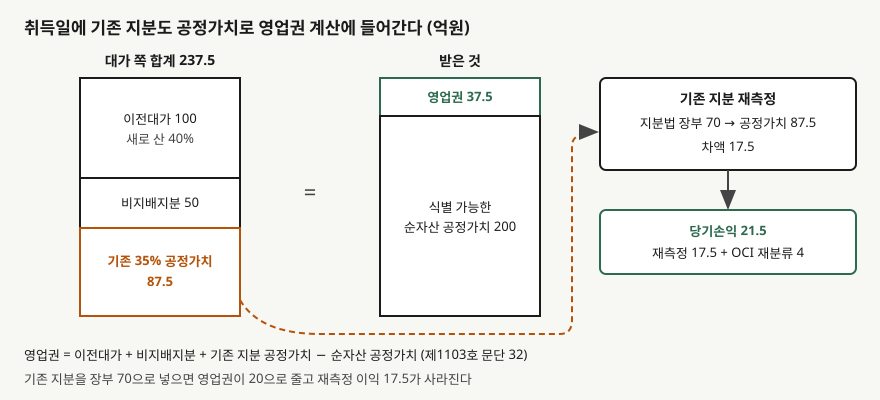

## 들어가며

관계기업으로 들고 있던 회사의 지분을 조금 더 사서 자회사로 만든 해에, 영업이익은 평범한데 당기순이익만 크게 뛰는 연결 손익계산서를 보는 경우가 있다. 영업외수익을 따라가 보면 "단계적 취득 이익" 같은 이름의 줄이 있다. 돈이 들어온 것도, 무엇을 판 것도 아닌데 이익이 잡혔다.

이 줄을 처음 보면 일회성 평가이익이라 무시하거나, 반대로 본업 이익처럼 읽는다. 둘 다 정확하지 않다. 아래 예제에서는 이 이익이 21.5억원으로, 새로 지분을 사며 낸 100억원의 5분의 1이 넘는다. 무엇을 기준으로 생긴 숫자인지 알아야 몇 년 치 순이익을 나란히 놓을 때 그해만 튀는 이유를 설명할 수 있다.

[영업권 글](../2026-11-06-goodwill-full-vs-partial/index.md)은 이미 보유한 지분이 없는 경우만 다뤘다. 이 글은 그 빈칸, 곧 **취득일 전에 지분을 갖고 있던 경우**를 가상 회사로 계산한다.

## 개념

기업회계기준서 제1103호는 취득일 직전에 이미 지분을 보유하던 피취득자에 대해 지배력을 얻는 거래를 **단계적으로 이루어지는 사업결합**, 줄여서 단계적 취득이라 부른다(문단 41). 기준서가 든 예도 비지배지분 35%를 갖고 있다가 40%를 더 사 지배력을 얻는 경우다.

처리는 한 문장이다. 취득자는 이전에 보유하던 지분을 **취득일의 공정가치로 재측정하고**, 차손익을 당기손익 또는 적절한 경우 기타포괄손익으로 인식한다(문단 42). 그리고 그 공정가치가 영업권 계산식의 세 번째 항으로 들어간다(문단 32).

왜 다시 재는가. 지배력을 얻는 순간 투자자가 들고 있는 것의 성격이 바뀐다. 그 전에는 "관계기업 주식"이라는 자산 하나였고, 그 뒤에는 피취득자의 자산·부채 전부를 연결하는 지배기업이 된다. 기준서는 이 변화를 **기존 지분을 공정가치로 처분하고 같은 값으로 다시 사 들인 것**처럼 본다. 그래서 처분한 것처럼 손익이 생기고, 다시 산 것처럼 그 값이 대가에 합쳐진다.

## 구조



> **출처**: 한국회계기준원 [기업회계기준서 제1103호 '사업결합'](https://www.samili.com/acc/Kijun/Kijunjomun.asp?code=1978-1103) 문단 32·41·42 (제3자 전재, 2021-04-23 개정) — 원문 발행처 [한국회계기준원](https://www.kasb.or.kr/front/board/ingAccountingList.do). 금액은 이 글의 `code/output.txt` `[1]`·`[2]`에서 옮겼다

왼쪽 막대의 세 칸이 영업권 식의 더하는 쪽이고, 오른쪽이 빼는 쪽인 순자산 공정가치와 그 차이인 영업권이다. 주황색으로 표시한 기존 지분 칸이 이 글의 주제다. 이 칸을 장부금액으로 두느냐 공정가치로 두느냐가 영업권과 당기손익을 함께 바꾼다.

## 동작 원리

### 기존 지분의 공정가치는 어디서 오는가

가나전자는 마바화학 지분 35%를 관계기업 투자로 들고 있었고 지분법 장부금액은 70억원이다. 취득일에 40%를 100억원에 더 사서 지분율 75%로 지배력을 얻는다. 같은 날 같은 주식이 40%에 100억원으로 거래됐으므로, 이 예제는 기존 35%의 공정가치를 같은 주당 가격으로 87.5억원이라 둔다.

실제로는 이렇게 단순하지 않다. 지배력을 얻기 위해 낸 가격에는 경영권 프리미엄이 섞일 수 있어서, 그 가격을 기존 소수 지분에 그대로 적용하는 것이 맞는지 따로 판단한다. 상장 주식이면 시장 가격과 거래 가격이 다를 수 있다. 어느 쪽을 쓰든 그 판단이 재측정 이익의 크기를 정하므로 주석에서 근거를 찾아 읽어야 한다.

### 영업권은 세 항을 더해 순자산을 뺀다

마바화학의 식별 가능한 순자산 공정가치는 200억원이고, 비지배지분 25%는 순자산 비례로 50억원이다. 영업권은 이전대가 100억원, 비지배지분 50억원, 기존 지분 공정가치 87.5억원을 더한 237.5억원에서 200억원을 뺀 37.5억원이다.

기존 지분을 장부금액 70억원으로 넣으면 영업권은 20억원이 된다. 이 경우 재측정 이익 17.5억원도 함께 사라진다. 둘이 같은 크기로 움직인다는 데 주목한다. 기존 지분을 공정가치로 올리면 그 증가분이 한쪽에서는 손익으로, 다른 쪽에서는 영업권으로 동시에 잡힌다.

### 기존 지분의 분류가 당기손익을 가른다

문단 42의 뒷부분은 기존 지분의 가치 변동을 이미 기타포괄손익으로 인식해 왔다면, 그 금액을 **직접 처분했을 때와 같은 기준으로** 처리하라고 한다. 그래서 같은 35%라도 그동안 어떤 분류로 들고 있었느냐에 따라 취득일 당기손익이 달라진다.

- **관계기업(지분법)**: 재측정 차액 17.5억원이 당기손익이다. 지분법으로 쌓아 온 관계기업 기타포괄손익 몫(여기서는 외화환산 몫 4억원)은 처분한 것처럼 당기손익으로 재분류된다. 합계 21.5억원이다.
- **FVOCI 지정 지분상품**: 제1109호는 이 선택을 한 지분상품의 기타포괄손익을 후속적으로 당기손익으로 옮기지 않는다(적용지침 B5.7.1). 재측정 차액 7.5억원도 기타포괄손익이고, 당기손익은 0이다. 누적액은 자본 안에서 이익잉여금으로 대체할 수 있을 뿐이다.
- **FVPL 금융자산**: 이미 공정가치로 들고 있었으므로 직전 장부금액과 취득일 공정가치의 차이 7.5억원만 당기손익이다.

## 실습 예제

```python
OLD_STAKE_FV = PRICE_FOR_NEW / NEW_STAKE * OLD_STAKE   # 87.5
gw = PRICE_FOR_NEW + nci + OLD_STAKE_FV - NET_ASSETS_FV

diff = OLD_STAKE_FV - carrying
recycled = acc_oci if recycle else 0.0   # FVOCI 지분상품은 재분류하지 않는다
pl = (diff if where == "당기손익" else 0.0) + recycled
```

전체 소스: [`code/`](code/)

```text
[1] 영업권 — 제1103호 문단 32
  지분율 35% + 40% = 75%, 비지배지분 25%
  (가) 이전대가 (새로 산 40%)         100.0
  (나) 비지배지분 (순자산 x 25%)          50.0
  (다) 기존 35% 지분의 취득일 공정가치     87.5
  (2) 식별 가능한 순자산 공정가치      - 200.0
  영업권                                  37.5

  (다)에 공정가치 대신 장부금액 70.0를 넣으면 영업권 20.0 (틀림)
```

```text
[2] 기존 35% 지분을 어떻게 분류해 왔느냐에 따라 취득일 당기손익이 갈린다
  분류                 장부    공정가치     차액    차액이 가는 곳   OCI 재분류     당기손익
  관계기업(지분법)        70.0    87.5   17.5        당기손익       4.0     21.5
  FVOCI 지정 지분상품    80.0    87.5    7.5      기타포괄손익       0.0      0.0
  FVPL 금융자산        80.0    87.5    7.5        당기손익       0.0      7.5
```

세 줄 모두 영업권은 37.5억원으로 같다. 영업권 식에는 분류와 상관없이 공정가치 87.5억원이 들어가기 때문이다. 달라지는 것은 그 87.5억원에 이르기까지의 차이가 어느 줄로 가느냐다. 같은 거래에서 한 회사는 당기순이익이 21.5억원 늘고 다른 회사는 하나도 늘지 않는다.

## 실무에서 주의할 점

- **단계적 취득 이익은 현금이 아니다.** 들고 있던 주식의 평가가 바뀌었을 뿐 돈이 들어오지 않았다. 간접법으로 영업활동현금흐름을 구할 때 순이익에서 차감 조정되는 비현금 이익이고, 그해 순이익을 다른 해와 비교할 때는 따로 떼어 본다.
- **기존 지분의 공정가치가 재측정 이익과 영업권을 함께 정한다.** 경영권 프리미엄을 얹은 가격을 기존 지분에 쓰면 이익과 영업권이 같이 커진다. 공정가치 산정 근거가 주석에 어떻게 적혀 있는지 확인한다.
- **분류가 다르면 같은 거래라도 순이익이 다르다.** 지분법 투자와 FVOCI 지분상품은 같은 35%라도 취득일 당기손익이 21.5억원과 0으로 갈린다. 두 회사를 비교할 때 기존 지분을 어떻게 들고 있었는지 먼저 본다.
- **취득일 이후 지분을 더 사는 것은 다르다.** 지배력을 이미 가진 뒤의 추가 취득은 사업결합이 아니라 자본거래라서 재측정도 영업권도 없다. 그 처리는 [비지배지분 글](../2026-11-06-nci-consolidated-statements/index.md)의 `[3]`에서 계산했다.
- **이 글의 숫자는 단순화한 가정이다.** 이연법인세, 취득관련원가, 조건부 대가는 넣지 않았다. 문단 번호는 인용 시점의 기준서 본문을 따랐다.

## 정리

- 단계적 취득은 이미 지분을 갖고 있던 회사에 대해 추가 취득으로 지배력을 얻는 사업결합이다(제1103호 문단 41).
- 기존 지분은 취득일 공정가치로 재측정하고, 그 공정가치가 영업권 식에 이전대가·비지배지분과 함께 더해진다(문단 32·42).
- 가상 사례에서 영업권은 37.5억원이고, 기존 지분을 장부금액으로 두면 20억원으로 줄어 재측정 이익 17.5억원만큼 차이가 난다.
- 기존 지분을 지분법으로 들고 있었으면 당기손익 21.5억원, FVOCI 지분상품이면 0, FVPL이면 7.5억원이다. 영업권은 세 경우 모두 같다.

## 참고 자료

- [한국회계기준원](https://www.kasb.or.kr/front/board/ingAccountingList.do) — K-IFRS 기준서 발행처. 아래 전재 링크는 조문을 바로 열기 위한 편의 링크다
- [기업회계기준서 제1103호 '사업결합'](https://www.samili.com/acc/Kijun/Kijunjomun.asp?code=1978-1103) (제3자 전재, 2021-04-23 개정) — 문단 32·41·42
- [기업회계기준서 제1109호 '금융상품'](https://www.samili.com/acc/Kijun/Kijunjomun.asp?code=1978-1109) (제3자 전재, 2025-10-17 개정) — 문단 5.7.5, 적용지침 B5.7.1
- [IFRS 3 Business Combinations](https://www.ifrs.org/issued-standards/list-of-standards/ifrs-3-business-combinations/) — IFRS Foundation
- 숫자는 이 글의 [`code/output.txt`](code/output.txt) `[1]`·`[2]`에서 옮겼다
