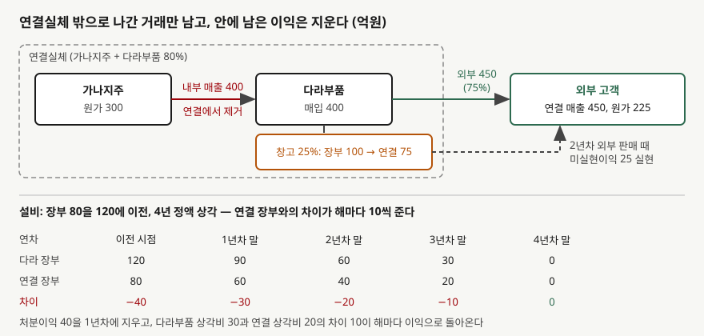

> 예제의 `가나지주`·`다라부품`과 그 숫자는 계산을 보이려고 만든 가상 자료다.

## 들어가며

지주회사와 자회사의 별도 손익계산서를 나란히 놓고 매출을 더해 보면, 연결 손익계산서의 매출보다 훨씬 큰 숫자가 나온다. 매출총이익도 더한 값과 연결 값이 맞지 않는다. 아래 예제에서 두 회사의 매출을 더하면 850억원인데 연결 매출은 450억원이고, 매출총이익은 250억원과 225억원으로 25억원이 어긋난다.

이 차이를 "연결 조정"이라는 한 단어로 넘기면, 다음 해 연결 이익이 별도 합계보다 25억원 크게 나오는 이유도 설명할 수 없게 된다. 지운 이익이 어디로 가고 언제 돌아오는지를 알아야 두 해의 숫자를 함께 읽을 수 있다.

이 글은 [연결 범위 글](../2026-11-05-consolidation-scope-control-three-elements/index.md)에서 한 줄로 넘긴 **내부거래 제거**를 계산으로 펼친다.

## 개념

기업회계기준서 제1110호 적용지침의 연결 절차 문단(B86)은 연결재무제표를 세 단계로 만든다. 같은 항목끼리 합산하고, 지배기업의 투자와 종속기업 자본 중 지배기업 몫을 상계하고, 연결실체 안의 거래에서 생긴 자산·부채·수익·비용·현금흐름을 모두 제거한다. 세 번째 단계는 재고자산이나 유형자산처럼 **자산으로 남아 있는 내부거래 손익도 모두 제거**하라고 적는다.

연결재무제표는 지배기업과 종속기업을 하나의 실체로 본다. 한 회사 안에서 창고를 옮겼다고 이익이 생기지 않듯, 지배기업이 종속기업에 물건을 넘긴 것만으로는 연결실체가 번 돈이 없다. 이익은 물건이 **연결실체 밖의 고객에게 팔릴 때** 생긴다.

같은 문단은 두 가지를 덧붙인다. 내부거래에서 생긴 손실은 그 자산이 손상됐다는 징후일 수 있고, 손익을 제거해서 생긴 일시적차이에는 제1012호 '법인세'를 적용한다. 앞의 것은 손실을 무조건 지우지 말라는 뜻이고, 뒤의 것은 이연법인세가 따라붙는다는 뜻이다.

## 구조



> **출처**: 한국회계기준원 [기업회계기준서 제1110호 '연결재무제표'](https://www.samili.com/acc/Kijun/Kijunjomun.asp?code=1978-1110) 적용지침 B86 (제3자 전재, 2024-11-22 개정) — 원문 발행처 [한국회계기준원](https://www.kasb.or.kr/front/board/ingAccountingList.do). 금액은 이 글의 `code/output.txt` `[1]`·`[2]`에서 옮겼다

위쪽 점선 상자가 연결실체다. 상자 안을 오간 400억원은 지워지고, 상자 밖으로 나간 450억원만 연결 매출로 남는다. 창고에 남은 재고는 연결실체가 들인 원가 75억원으로 돌아간다. 아래쪽은 설비를 넘긴 경우로, 장부금액 차이가 감가상각을 따라 해마다 줄어 4년차 말에 0이 된다.

## 동작 원리

### 재고는 외부에 팔릴 때 실현된다

가나지주가 원가 300억원짜리 재고를 다라부품에 400억원에 판다. 다라부품은 1년차에 75%를 외부에 450억원에 팔고 25%를 창고에 둔다. 단순 합산하면 매출 850억원, 매출원가 600억원이다. 연결에서는 내부 매출 400억원과 그만큼의 매입을 지우고, 외부에 판 75%의 원가를 연결실체 원가 225억원으로 바꾼다.

창고에 남은 25%는 다라부품 장부에 100억원으로 있지만 연결실체가 들인 원가는 75억원이다. 이 25억원이 미실현이익이다. 2년차에 다라부품이 남은 재고를 150억원에 외부에 팔면, 다라부품 장부에서는 매출총이익이 50억원이지만 연결에서는 원가가 75억원이므로 75억원이 된다. 1년차에 지운 25억원이 2년차에 돌아온 것이고, 두 해를 합하면 매출총이익은 단순 합산과 연결이 모두 300억원으로 같다.

### 이연법인세가 따라온다

세법은 회사별로 과세하므로 가나지주는 1년차에 내부 판매 이익에 세금을 낸다. 연결 장부의 재고는 75억원인데 세무상 금액은 100억원이므로 일시적차이 25억원이 생긴다. 세율 20%를 가정하면 이연법인세자산 5억원을 잡고, 연결 순이익 영향은 1년차 −20억원, 2년차 +20억원이다.

### 설비는 감가상각으로 실현된다

가나지주가 장부금액 80억원인 설비를 120억원에 다라부품에 넘기면 별도 장부에는 처분이익 40억원이 생긴다. 연결에서는 이 40억원을 1년차에 전부 지우고 설비를 80억원으로 되돌린다. 남은 내용연수 4년 정액법이면 다라부품 장부의 감가상각비는 연 30억원, 연결실체 기준으로는 연 20억원이다. 해마다 10억원씩 비용이 줄어 지운 이익이 4년에 걸쳐 돌아온다.

재고는 한 번 팔리면 한꺼번에 실현되지만, 설비는 외부에 팔리지 않아도 **사용하면서 실현된다.** 설비가 만든 제품이 외부에 팔리고 그 원가에 감가상각비가 들어가기 때문이다.

### 상향판매는 비지배지분 배분이 갈린다

같은 재고 거래를 다라부품이 가나지주에 팔았다면 미실현이익은 다라부품 이익 안에 있다. 제거 금액은 하향판매와 같이 25억원 전부다. 그런데 B86은 전부 제거하라고만 적고, 제거한 금액을 지배기업 소유주와 비지배지분에 어떻게 나눌지는 따로 적지 않는다. 그래서 배분 방식에 따라 지배기업 소유주 귀속 이익이 달라진다.

## 실습 예제

```python
unrealised = left_at_price - left_at_cost       # 100 - 75 = 25
dta = unrealised * TAX_RATE                     # 이연법인세자산

dep_adj = price / life - carrying / life        # 30 - 20 = 10, 해마다 되돌아오는 이익

nci_a = sub_net_income * (1 - STAKE)            # 제거액을 지배기업이 다 부담
nci_b = (sub_net_income - unrealised) * (1 - STAKE)  # 제거 후 이익을 지분율로
```

전체 소스: [`code/`](code/)

```text
[1] 재고 하향판매 — 가나지주가 원가 300을 400에 다라부품에 판다
  1년차: 다라부품이 75%를 외부에 450에 팔고 25%가 남는다
                                단순합산        연결        차이
  매출                           850.0     450.0    -400.0
  매출원가                         600.0     225.0    -375.0
  매출총이익                        250.0     225.0     -25.0
  기말 재고                        100.0      75.0     -25.0
  미실현이익 25.0 제거, 이연법인세자산 5.0 (세율 20%)
  연결 당기순이익 영향 1년차 -20.0

  2년차: 남은 25%를 외부에 150에 판다
  매출총이익                         50.0      75.0      25.0
  이연법인세자산 5.0 소멸, 연결 당기순이익 영향 2년차 +20.0
  2년 합계 매출총이익 단순합산 300.0 = 연결 300.0
```

```text
[2] 설비 하향이전 — 장부 80을 120에 넘기고 다라부품이 4년 정액 상각
  처분이익 40.0 은 1년차에 전부 제거, 감가상각비 차이 10.0/년이 되돌린다
    연차       처분이익 제거      상각비 조정     세전 영향     다라 장부     연결 장부      차이
     1         -40.0        10.0     -30.0      90.0      60.0   -30.0
     2           0.0        10.0      10.0      60.0      40.0   -20.0
     3           0.0        10.0      10.0      30.0      20.0   -10.0
     4           0.0        10.0      10.0       0.0       0.0     0.0
  4년 합계 세전 영향 0.0
```

```text
[3] 재고 상향판매 — 같은 거래를 다라부품이 가나지주에 판 경우 (법인세 생략)
  연결에서 제거하는 미실현이익은 하향과 같이 25.0 전부 (B86(3))
  다라부품 보고 순이익 100.0, 제거 후 75.0
  배분 방식                               지배기업 소유주       비지배지분
  (가) 제거액 전부 지배기업 부담                    55.0        20.0
  (나) 제거 후 이익을 지분율로 배분                  60.0        15.0
  두 방식 모두 연결 당기순이익은 75.0, 갈리는 것은 귀속 5.0
```

`[1]`과 `[2]`는 제거와 실현을 합하면 0이 된다. 내부거래는 이익의 총액을 바꾸지 않고 **인식하는 해를 옮길 뿐이다.** `[3]`은 연결 당기순이익 75억원은 같고, 그 안에서 누구 몫으로 적히는지만 5억원 달라진다.

## 실무에서 주의할 점

- **연결 매출이 별도 합계보다 작은 것은 정상이다.** 내부거래 규모가 크면 차이도 크다. 차이의 크기로 그룹 안에서 물건이 얼마나 도는지 짐작할 수 있지만, 이익률을 비교하려면 연결 매출과 연결 원가를 함께 써야 한다. 별도 매출에 연결 이익을 나누면 이익률이 낮게 나온다.
- **연말에 내부 재고가 쌓이면 그해 연결 이익이 줄고 다음 해 늘어난다.** 별도 이익만 늘고 연결 이익이 안 따라오는 해가 있으면, 계열사 창고에 쌓인 재고가 있는지 본다. 이듬해 연결 이익이 늘어난 이유가 외부 수요가 아니라 지난해 지운 이익의 실현일 수 있다.
- **내부거래 손실은 그대로 지우지 않을 수 있다.** B86은 내부거래에서 생긴 손실을 손상의 징후일 수 있다고 적는다. 장부금액보다 싸게 넘긴 이유가 그 자산의 가치 하락이라면 연결에서도 손실이 남는다.
- **상향판매의 비지배지분 배분은 기준서가 정하지 않았다.** 예제의 두 방식은 연결 당기순이익이 같고 지배기업 소유주 귀속 이익만 다르다. 주당이익은 지배기업 소유주 귀속 이익으로 계산하므로 이 선택이 주당이익에 닿는다. 회사가 어느 방식을 쓰는지는 주석의 회계정책을 본다.
- **이 글의 숫자는 단순화한 가정이다.** 단일 세율 20%를 두었고, 상향판매 사례는 법인세를 뺐다. 설비 사례는 잔존가치 0, 정액법을 가정했다.

## 정리

- 연결재무제표는 자산으로 남아 있는 내부거래 손익을 모두 제거하고, 제거로 생긴 일시적차이에 법인세 기준서를 적용한다(제1110호 적용지침 B86).
- 재고의 미실현이익은 외부에 팔릴 때 한꺼번에, 설비의 처분이익은 감가상각비 차이로 내용연수에 걸쳐 실현된다.
- 가상 사례에서 재고 25억원은 1년차에 지워지고 2년차에 돌아오며, 설비 40억원은 1년차에 지워진 뒤 4년 동안 10억원씩 돌아온다.
- 상향판매는 제거 금액은 같고 지배기업 소유주와 비지배지분 사이의 배분이 회사 정책에 따라 갈린다.

## 참고 자료

- [한국회계기준원](https://www.kasb.or.kr/front/board/ingAccountingList.do) — K-IFRS 기준서 발행처. 아래 전재 링크는 조문을 바로 열기 위한 편의 링크다
- [기업회계기준서 제1110호 '연결재무제표'](https://www.samili.com/acc/Kijun/Kijunjomun.asp?code=1978-1110) (제3자 전재, 2024-11-22 개정) — 적용지침 B86 연결 절차, B94 손익의 귀속
- [IFRS 10 Consolidated Financial Statements](https://www.ifrs.org/issued-standards/list-of-standards/ifrs-10-consolidated-financial-statements/) — IFRS Foundation
- 숫자는 이 글의 [`code/output.txt`](code/output.txt) `[1]`·`[2]`·`[3]`에서 옮겼다
