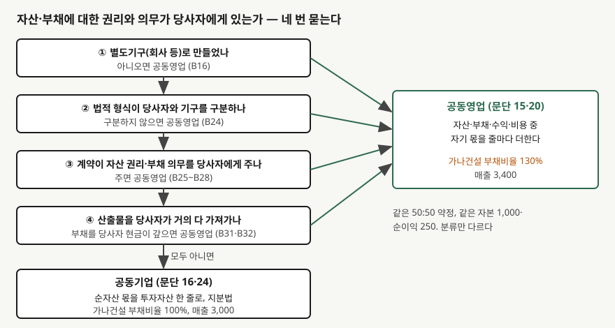

> 예제의 `가나건설`·`다라개발`과 그 숫자는 계산을 보이려고 만든 가상 자료다.

## 들어가며

건설사 두 곳이 물류센터를 반씩 투자해 짓고 운영한다는 기사를 보고, 각 회사 재무제표에서 그 사업을 찾아보는 경우가 있다. 한 회사는 투자 주식 한 줄로 적어 두었는데, 비슷한 약정을 맺은 다른 회사는 매출과 차입금에 그 사업의 절반이 섞여 있다. 지분율이 같으니 두 회사의 부채비율과 매출을 그대로 비교해도 된다고 보기 쉽다.

아래 예제에서 같은 50% 약정을 어느 쪽으로 분류하느냐에 따라 가나건설의 부채비율은 130%와 100%로 갈린다. 자본과 순이익은 똑같다. 지분율만 보고 비교하면 30%p 차이를 재무 위험의 차이로 잘못 읽게 된다.

## 개념

기업회계기준서 제1111호는 둘 이상의 당사자가 공동지배력을 보유하는 약정을 **공동약정**이라 한다(문단 4). 공동지배력은 관련 활동에 대한 결정에 지배력을 공유하는 당사자들 **전체의 동의**가 필요할 때에만 있다(문단 7). 한 당사자가 혼자 결정할 수 있으면 공동약정이 아니라 그 당사자의 종속기업이 된다.

공동약정은 두 가지 가운데 하나다(문단 6). **공동영업**은 공동지배 당사자들이 약정의 자산에 대한 권리와 부채에 대한 의무를 보유하는 약정이고(문단 15), **공동기업**은 약정의 순자산에 대한 권리를 보유하는 약정이다(문단 16).

갈리는 기준이 지분율이나 회사 설립 여부가 아니라 **권리와 의무가 어디에 있는가**라는 점이 이 기준서의 핵심이다. 공동영업자는 자산·부채·수익·비용 중 자기 몫을 각 줄에 인식하고(문단 20), 공동기업 참여자는 지분을 투자자산으로 인식해 [지분법](../2026-10-12-equity-method-associates/index.md)을 적용한다(문단 24).

## 구조



> **출처**: 한국회계기준원 [기업회계기준서 제1111호 '공동약정'](https://www.samili.com/acc/Kijun/Kijunjomun.asp?code=1978-1111) 문단 15·16·20·24, 적용지침 B15·B16·B24~B28·B31·B32 (제3자 전재, 2018-04-27 개정) — 원문 발행처 [한국회계기준원](https://www.kasb.or.kr/front/board/ingAccountingList.do). 부채비율·매출은 이 글의 `code/output.txt` `[2]`에서 옮겼다

적용지침 B15는 분류할 때 볼 것을 순서대로 적는다. 약정의 구조, 별도기구라면 그 법적 형식, 계약 조건, 그 밖의 사실과 상황이다. 네 질문 중 하나라도 당사자에게 자산 권리와 부채 의무가 있다고 답하면 공동영업이고, 모두 아니라고 답해야 공동기업이다.

## 동작 원리

### 네 번의 질문

**별도기구로 만들지 않았으면** 공동영업이다(B16). 회사를 세우지 않고 계약만으로 함께 설비를 운영하면 자산과 부채는 처음부터 당사자들의 것이다.

**별도기구라도 법적 형식이 당사자와 기구를 구분하지 않으면** 공동영업이다(B24). 기구가 보유하는 자산과 부채가 곧 당사자들의 자산과 부채인 형식이다. 반대로 주식회사처럼 기구가 자기 이름으로 자산과 부채를 갖는 형식이면 일단 공동기업 쪽을 가리킨다(B23). 다만 B23은 계약 조건과 그 밖의 사실이 법적 형식에 따른 평가보다 우선할 수 있다고 적는다.

**계약이 당사자에게 자산 권리와 부채 의무를 준다면** 회사를 세웠어도 공동영업이다(B25~B28). 예를 들어 계약에서 각 당사자가 약정의 부채를 지분만큼 직접 책임진다고 정하는 경우다.

**그 밖의 사실과 상황**도 본다(B29~B33). 약정이 산출물을 주로 당사자들에게 공급하도록 설계돼 있고 제3자에게 팔지 못하게 막혀 있으면, 당사자들이 자산의 경제적 효익 대부분을 가져가는 것이다(B31). 이때 약정의 부채는 당사자들이 산출물을 사면서 내는 현금으로 갚게 되므로, 당사자들이 부채 의무를 지는 것으로 본다(B32). 원재료를 함께 만들어 나눠 쓰려고 세운 회사가 이 경우다.

### 같은 약정, 두 장의 재무제표

가나건설과 다라개발이 50:50으로 공동지배하는 물류센터 약정은 1년차 말에 자산 1,000억원, 부채 600억원, 수익 800억원, 비용 700억원이다. 가나건설 자체 사업은 자산 1,800억원, 부채 1,000억원이다.

공동영업이면 가나건설은 약정의 자산 500억원, 부채 300억원, 수익 400억원, 비용 350억원을 자기 줄에 더한다. 공동기업이면 순자산 400억원의 절반인 200억원을 투자자산 한 줄로, 순이익 100억원의 절반인 50억원을 지분법이익 한 줄로 올린다.

두 방식 모두 자본은 1,000억원, 순이익은 250억원으로 같다. 공동영업에서 더 잡힌 자산 300억원과 부채 300억원이 정확히 같기 때문이다. 달라지는 것은 재무상태표와 손익계산서의 **크기**이고, 크기를 분모나 분자로 쓰는 비율이 모두 움직인다.

### 공동영업과 거래하면 절반만 손익이 된다

공동영업자가 공동영업에 자산을 팔면, 그것은 공동영업의 **다른 당사자와** 거래한 것으로 보아 손익을 다른 당사자들의 지분 한도까지만 인식한다(B34). 공동영업에서 자산을 사 왔다면 제3자에게 다시 팔기 전까지 자기 몫의 손익을 인식하지 않는다(B36). 자기 몫은 이미 자기 장부에 있는 자산이라, 자기 자신에게 판 부분에서는 이익이 생기지 않기 때문이다. [연결 내부거래 제거 글](../2026-11-07-intragroup-unrealised-profit-elimination/index.md)과 같은 생각을 지분 몫에만 적용한 것이다. 다만 판매로 순실현가능가치 감소나 손상의 증거가 드러나면 손실은 전부 인식한다(B35).

## 실습 예제

```python
if kind == "공동영업":
    assets = OWN_ASSETS + ARR_ASSETS * SHARE          # 줄마다 자기 몫을 더한다
    liabilities = OWN_LIABILITIES + ARR_LIABILITIES * SHARE
    revenue = OWN_REVENUE + ARR_REVENUE * SHARE
else:
    investment = (ARR_ASSETS - ARR_LIABILITIES) * SHARE  # 순자산 몫 한 줄
    equity_income = (ARR_REVENUE - ARR_EXPENSES) * SHARE # 순이익 몫 한 줄

recognised = gain * (1 - SHARE)  # 공동영업에 판 이익은 다른 당사자 몫만 (B34)
```

전체 소스: [`code/`](code/)

```text
[2] 가나건설 재무제표 — 지분 50%
  항목                         공동영업(문단 20)     공동기업(문단 24)
  자산                              2300.0          2000.0
  부채                              1300.0          1000.0
  자본                              1000.0          1000.0
  매출                              3400.0          3000.0
  비용                              3150.0          2800.0
  지분법이익                              0.0            50.0
  당기순이익                            250.0           250.0
  부채비율 %                           130.0           100.0
  매출 대비 순이익률 %                       7.4             8.3
  총자산이익률 %                          10.9            12.5

  자본과 당기순이익은 같다: 자본 1000.0 / 1000.0, 순이익 250.0 / 250.0
  공동영업에서 더 잡힌 자산 300.0 = 더 잡힌 부채 300.0
```

```text
[3] 가나건설이 장부 100인 토지를 공동영업에 160에 판다 (제1111호 B34)
  별도로 보면 처분이익 60.0
  인식 = 처분이익 60.0 x 다른 당사자 지분 50% = 30.0
  자기 몫 30.0 은 인식하지 않는다 — 토지 중 자기 몫 장부 50.0 (= 100 x 50%)
```

`[2]`에서 부채비율은 30%p, 매출은 400억원, 총자산이익률은 1.6%p 차이가 난다. 순이익과 자본이 같으므로 ROE는 두 방식이 같다. `[3]`에서 가나건설 장부에 남는 토지 몫은 160억원의 절반 80억원이 아니라 원래 장부 100억원의 절반 50억원이다.

## 실무에서 주의할 점

- **지분율로 분류를 짐작하지 않는다.** 50:50 약정도 공동영업일 수 있고 공동기업일 수 있다. 회사를 세웠다는 사실만으로 공동기업이라 단정하지 않는다. 계약 조건이나 산출물 구조 때문에 공동영업이 되는 경우를 기준서가 따로 적어 두었다(B25~B33).
- **비율을 비교할 때 분류부터 맞춘다.** 공동영업으로 반영한 회사는 매출·자산·부채가 함께 커진다. 비슷한 사업을 하는 두 회사의 부채비율이나 총자산이익률을 비교하기 전에, 주석에서 공동약정을 어느 쪽으로 분류했는지 본다.
- **공동기업의 부채는 재무상태표에 보이지 않는다.** 예제의 약정 부채 600억원 중 가나건설 몫 300억원은 공동기업 분류에서는 투자자산 200억원 안에 순액으로 숨어 있다. 지급보증이나 출자 약정이 있으면 주석의 약정·우발부채 항목에서 따로 확인한다.
- **분류는 고정이 아니다.** 사실과 상황이 바뀌면 공동지배력이 여전히 있는지, 약정의 유형이 바뀌는지 재평가한다(문단 13·19). 계약을 고쳐 부채 책임 구조가 바뀌면 같은 약정이 다음 해에 다른 모양으로 올라올 수 있다.
- **이 글의 숫자는 단순화한 가정이다.** 법인세와 약정 내부의 거래 원가 배분은 넣지 않았다. 지분법이익을 영업이익 안에 둘지 밖에 둘지는 회사마다 다르므로 예제는 순이익 기준 비율만 계산했다.

## 정리

- 공동약정은 당사자 전체의 동의가 있어야 결정되는 약정이고, 공동영업과 공동기업 둘로 나뉜다(제1111호 문단 4·6·7).
- 당사자가 자산 권리와 부채 의무를 가지면 공동영업이고, 순자산에 대한 권리만 가지면 공동기업이다(문단 15·16). 판단은 구조, 법적 형식, 계약 조건, 그 밖의 사실과 상황 네 단계로 한다(B15).
- 공동영업은 자기 몫을 줄마다 더하고, 공동기업은 지분법으로 한 줄에 담는다(문단 20·24). 가상 사례에서 자본과 순이익은 같고 부채비율은 130%와 100%로 갈린다.
- 공동영업에 자산을 팔면 처분이익은 다른 당사자 지분 한도까지만 인식한다(B34).

## 참고 자료

- [한국회계기준원](https://www.kasb.or.kr/front/board/ingAccountingList.do) — K-IFRS 기준서 발행처. 아래 전재 링크는 조문을 바로 열기 위한 편의 링크다
- [기업회계기준서 제1111호 '공동약정'](https://www.samili.com/acc/Kijun/Kijunjomun.asp?code=1978-1111) (제3자 전재, 2018-04-27 개정) — 문단 4~7 공동약정·공동지배력, 13·19 재평가, 15·16 유형, 20 공동영업자, 24 공동기업 참여자, 적용지침 B15~B33 분류, B34~B37 공동영업과의 거래
- [IFRS 11 Joint Arrangements](https://www.ifrs.org/issued-standards/list-of-standards/ifrs-11-joint-arrangements/) — IFRS Foundation
- 숫자는 이 글의 [`code/output.txt`](code/output.txt) `[2]`·`[3]`에서 옮겼다
