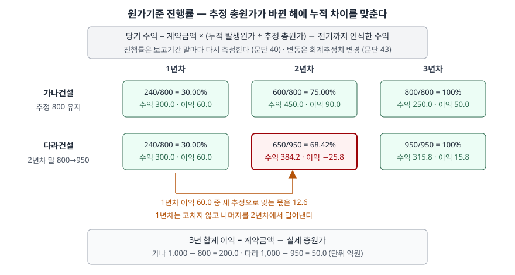

> 예제의 `가나건설`·`다라건설`과 그 숫자는 계산을 보이려고 만든 가상 자료다.

## 들어가며

건설사나 조선사의 분기 실적을 보다 보면, 매출은 꾸준한데 어느 분기에 영업이익이 갑자기 적자로 돌아서는 경우가 있다. 그 분기에 공사를 망친 것처럼 보이지만 공시를 읽어 보면 "원가율 상승분 반영"이라는 한 줄이 적혀 있다. 여기서 많은 사람이 그 분기 매출원가가 늘었다고만 이해하고 넘어간다.

그렇게 읽으면 지난 분기까지 잡아 둔 이익의 일부가 이번 분기에 한꺼번에 되돌려졌다는 사실을 놓친다. 아래 예제에서 다라건설은 2년차에 원가를 410억원 썼지만, 이익이 −25.8억원이 된 이유의 대부분은 그 해 공사가 아니라 1년차에 잡은 이익 60억원 중 47.4억원을 덜어낸 데 있다.

이 글은 [수익 인식 5단계 글](../2026-10-10-revenue-recognition-five-steps/index.md)에서 "기간에 걸쳐 인식한다"로 넘긴 부분을 계산으로 펼친다.

## 개념

기업회계기준서 제1115호는 기간에 걸쳐 이행하는 수행의무마다 **진행률**을 측정해 수익을 인식하게 한다(문단 39). 진행률을 재는 목적은 고객에게 통제를 넘기는 과정에서 기업이 얼마나 수행했는지를 나타내는 것이다. 방법은 산출법과 투입법이 있고(문단 41), 공사 계약에서 흔히 쓰는 것은 투입법 가운데 **발생원가**를 투입물로 삼는 원가기준 투입법이다(문단 B18).

```text
진행률   = 누적 발생원가 ÷ 추정 총원가
누적 수익 = 계약금액 × 진행률
당기 수익 = 누적 수익 − 전기까지 인식한 수익
```

규칙은 세 가지가 더 붙는다.

| 문단 | 내용 |
|---|---|
| 40 | 진행률은 보고기간 말마다 다시 측정한다 |
| 43 | 진행률의 변동은 제1008호에 따라 **회계추정치의 변경**으로 처리한다 |
| 44·45 | 진행률을 합리적으로 측정할 수 없으면 수익을 인식하지 않는다. 다만 원가 회수가 예상되면 결과를 측정할 수 있을 때까지 **발생원가 범위에서만** 수익을 인식한다 |

문단 43이 이 글의 중심이다. 회계추정치 변경은 과거 재무제표를 고치지 않고 변경한 기간과 그 뒤 기간의 손익에 반영한다(제1008호 문단 36). 진행률은 누적 개념이므로, 새 추정으로 누적 수익을 다시 계산하고 이미 인식한 금액을 빼면 그 차이가 전부 변경한 해의 수익이 된다.

## 구조



> **출처**: 한국회계기준원 [기업회계기준서 제1115호 '고객과의 계약에서 생기는 수익'](https://www.samili.com/acc/Kijun/Kijunjomun.asp?code=1978-1115) 문단 39·40·43·B18 (제3자 전재, 2021-04-23 개정) — 원문 발행처 [한국회계기준원](https://www.kasb.or.kr/front/board/ingAccountingList.do). 금액은 이 글의 `code/output.txt` `[1]`에서 옮겼다

두 회사는 1년차까지 똑같다. 다라건설의 2년차 칸만 빨갛게 바뀌는데, 그 해 공사가 특별히 나빴기 때문이 아니라 1년차에 너무 많이 잡은 이익을 이 칸에서 정리하기 때문이다. 3년 합계 이익은 어느 쪽이든 계약금액에서 실제 총원가를 뺀 값으로 돌아간다.

## 동작 원리

### 추정이 오르면 진행률이 뒤로 물러난다

다라건설은 2년차 말까지 650억원을 썼다. 추정 총원가가 800억원 그대로였다면 진행률은 81.25%, 누적 수익은 812.5억원이다. 그런데 남은 공사에 300억원이 더 든다는 것을 알게 되어 추정 총원가가 950억원이 되자, 같은 650억원이 68.42%로 줄어든다. 분모가 커지니 같은 원가로 "진척된 정도"가 작아진 것이다.

### 1년차 이익이 2년차에서 깎인다

1년차의 진행률 30%는 추정 800억원을 기준으로 계산했다. 새 추정 950억원을 분모로 다시 계산하면 1년차 이익은 12.6억원이어야 했다. 1년차에 60억원을 잡았으므로 47.4억원이 많았다. 제1008호에 따라 1년차를 고치지 않으니, 2년차 누적 수익을 새 진행률로 계산할 때 그 차이가 자연스럽게 빠진다. 2년차에 쓴 원가 410억원 대비 수익이 384.2억원에 그쳐 이익이 −25.8억원이 된 이유다.

3년차에는 남은 31.58%만큼인 315.8억원을 인식하고 원가 300억원을 쓰므로 이익이 15.8억원이다. 세 해 이익을 더하면 50억원으로 계약금액 1,000억원에서 실제 총원가 950억원을 뺀 값과 같다.

### 누적 수익과 청구액이 어긋나면 계약자산이나 계약부채가 된다

공사 대금은 진행률과 무관한 일정으로 청구한다. 계약 당사자 어느 한쪽이 수행하면, 기업의 수행 정도와 고객의 지급 관계에 따라 계약자산이나 계약부채로 표시한다(문단 105). 누적 수익이 누적 청구액보다 크면 이미 넘긴 공사의 대가를 받을 권리이므로 **계약자산**이다(문단 107). 반대면 받은 대가만큼 공사를 해 줄 의무이므로 **계약부채**다(문단 106). 국내 건설사 재무제표에서 미청구공사·초과청구공사라는 이름으로 보이는 것이 이 두 항목이며, 기준서도 다른 표현을 쓰는 것을 막지 않는다(문단 109).

### 낭비한 원가는 진척이 아니다

투입법은 투입물과 고객에게 넘어간 통제 사이에 직접적인 관계가 없을 수 있다는 단점이 있다(문단 B19). 그래서 계약가격에 반영되지 않았고 기업의 비효율로 생긴 원가, 예를 들어 예상 밖으로 낭비된 재료원가나 노무원가로는 수익을 인식하지 않는다. 낭비를 분자와 분모에 그대로 넣으면 낭비한 만큼 공사가 진척된 것처럼 진행률이 오른다.

## 실습 예제

```python
progress = cum_cost / estimate
cum_revenue = CONTRACT_PRICE * progress
revenue = cum_revenue - cum_revenue_prev   # 과거 연도는 고치지 않는다
position = cum_revenue - cum_billing       # +면 계약자산, −면 계약부채
```

전체 소스: [`code/`](code/)

```text
[1] 연차별 진행률과 수익 — 진행률 = 누적 발생원가 / 추정 총원가 (문단 39·B18)
  다라건설
    연차     발생원가     누적원가     추정총원가      진행률       수익       이익
     1      240.0      240.0        800.0    30.00%     300.0      60.0
     2      410.0      650.0        950.0    68.42%     384.2     -25.8
     3      300.0      950.0        950.0   100.00%     315.8      15.8
  합계 수익 1000.0, 합계 이익 50.0

  다라건설 2년차 분해 — 추정을 바꾸지 않았다면
    진행률 81.25%, 누적 수익 812.5, 2년차 수익 512.5
    실제: 진행률 68.42%, 누적 수익 684.2, 2년차 수익 384.2
    1년차에 인식한 이익 60.0 중 새 추정으로는 12.6 만 맞다 — 1년차는 고치지 않고 차이를 2년차에 반영한다 (문단 43, 제1008호 전진적용)
```

가나건설은 같은 원가 흐름에 추정이 800억원 그대로라 이익이 60.0 → 90.0 → 50.0억원으로 해마다 원가에 비례해 나온다. 두 회사의 차이는 3년 합계 150억원이고, 그 가운데 다라건설 2년차에 드러난 것이 115.8억원(90.0 − (−25.8))이다.

```text
[2] 재무상태표 표시 — 누적 수익과 누적 청구액의 차이 (문단 105~107)
  다라건설
    연차     누적수익     누적청구       차이  표시
     1      300.0      350.0     -50.0  계약부채(초과청구)
     2      684.2      650.0      34.2  계약자산(미청구)
     3     1000.0     1000.0       0.0  없음
```

가나건설은 2년차 계약자산이 100.0억원이다. 같은 청구 일정인데 다라건설은 34.2억원으로 작다. 추정 총원가가 오르면 누적 수익이 줄어 계약자산도 함께 줄어든다.

```text
[3] 1년차에 계약가격에 반영되지 않은 낭비 원가 40이 생긴 경우 — 문단 B19(1)
  발생원가 280.0 = 정상 원가 240.0 + 낭비 40.0
  방식                                진행률       수익       비용       이익
  낭비를 진행률에 포함                   33.33%     333.3     280.0      53.3
  낭비를 진행률에서 제외                 30.00%     300.0     280.0      20.0
  낭비를 포함하면 수익이 33.3 더 잡힌다 — 낭비한 만큼 공사가 진척된 것처럼 보인다
```

낭비 원가 40억원은 어느 쪽이든 그 해 비용이다. 다른 것은 수익으로, 진행률에서 빼면 낭비가 그대로 이익을 40억원 줄이고, 넣으면 수익이 33.3억원 늘어나 손실의 대부분이 가려진다.

## 실무에서 주의할 점

- **원가율 조정이 있는 분기의 이익은 그 분기만의 이익이 아니다.** 예제처럼 추정 총원가가 오르면 앞서 잡은 이익을 그 분기에서 덜어낸다. 분기 영업이익률이 꺾였을 때 그 분기 공사 실적 때문인지 누적 효과 때문인지는 주석을 봐야 가를 수 있다. 국내 기준서는 발생원가 투입법을 쓰는 계약에 대해 회계추정치 변경에 따른 공사손익 변동금액과 추정총계약원가 변동금액을 영업부문별로 공시하게 한다(한129.4). 직전 연도 매출액의 5% 이상인 계약은 계약별 진행률과 계약자산도 공시한다(한129.1). 둘 다 사업보고서 제출대상법인이 아니면 생략할 수 있다(한129.5).
- **계약자산은 매출채권과 다르다.** 계약자산은 대가를 받을 권리이지만 아직 조건이 붙어 있고, 수취채권은 시간만 지나면 받을 무조건적인 권리다(문단 108). 계약자산이 매출보다 빠르게 쌓이면 청구하지 못한 공사가 늘고 있다는 뜻이므로, 추정 총원가가 낙관적으로 잡혔는지 함께 의심한다.
- **진행률에서 뺄 원가를 정하는 것도 추정이다.** 문단 B19는 진척에 이바지하지 않는 원가를 빼라고 하지만, 어떤 원가가 비효율인지는 회사가 판단한다. 같은 사고 비용을 진행률에 넣는 회사와 빼는 회사의 매출은 그 해 다르게 나온다.
- **계약 초기에는 이익 없이 원가만큼 매출을 잡을 수 있다.** 결과를 합리적으로 측정할 수 없는 초기 단계에서는 발생원가 범위에서만 수익을 인식한다(문단 45). 수주가 몰린 해에 매출총이익률이 낮게 나오는 이유가 이것일 수 있다.
- **추정 총원가가 계약금액을 넘으면 별도 처리가 붙는다.** 진행률만으로는 남은 공사의 손실이 미래 기간으로 나뉜다. 계약 전체가 손실이 되는 경우는 [손실부담계약 충당부채 글](../2026-11-08-onerous-contract-provision/index.md)에서 다룬다.

## 정리

- 원가기준 투입법은 누적 발생원가를 추정 총원가로 나눈 진행률로 누적 수익을 계산하고, 이미 인식한 몫을 빼서 당기 수익을 낸다(제1115호 문단 39·B18).
- 진행률은 보고기간 말마다 다시 재고, 그 변동은 회계추정치 변경이라 과거를 고치지 않는다(문단 40·43). 그래서 추정 총원가가 오른 해에 앞서 잡은 이익이 한꺼번에 빠진다.
- 가상 사례에서 다라건설은 추정이 800억원에서 950억원으로 오른 2년차에 이익이 −25.8억원이 되고, 3년 합계는 실제 총원가로 계산한 50억원으로 돌아간다.
- 누적 수익과 누적 청구액의 차이가 계약자산·계약부채이고, 낭비 원가는 진행률에서 뺀다(문단 105~107·B19).

## 참고 자료

- [한국회계기준원](https://www.kasb.or.kr/front/board/ingAccountingList.do) — K-IFRS 기준서 발행처. 아래 전재 링크는 조문을 바로 열기 위한 편의 링크다
- [기업회계기준서 제1115호 '고객과의 계약에서 생기는 수익'](https://www.samili.com/acc/Kijun/Kijunjomun.asp?code=1978-1115) (제3자 전재, 2021-04-23 개정) — 문단 39~45 진행률, 105~109 표시, 한129.1~한129.5 발생원가 투입법 계약의 주석 공시, 적용지침 B18·B19 투입법
- [기업회계기준서 제1008호 '회계정책, 회계추정치 변경과 오류'](https://www.samili.com/acc/Kijun/Kijunjomun.asp?code=1978-1008) (제3자 전재, 2021-09-10 개정) — 문단 36 회계추정치 변경의 전진 적용
- [IFRS 15 Revenue from Contracts with Customers](https://www.ifrs.org/issued-standards/list-of-standards/ifrs-15-revenue-from-contracts-with-customers/) — IFRS Foundation
- 숫자는 이 글의 [`code/output.txt`](code/output.txt) `[1]`·`[2]`·`[3]`에서 옮겼다
