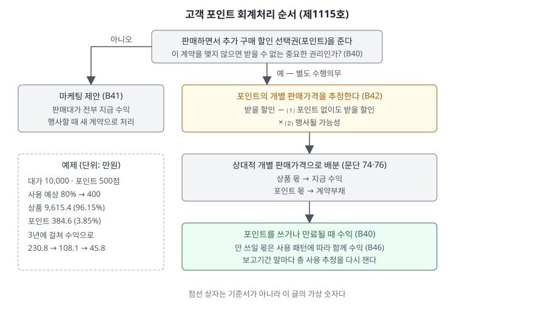

> 예제의 `다라마트`와 그 숫자는 계산을 보이려고 만든 가상 자료다.

## 들어가며

대형마트나 항공사의 재무제표 주석에는 "계약부채" 안에 포인트나 마일리지 관련 금액이 따로 적혀 있는 경우가 있다. 많은 사람이 포인트를 "나중에 깎아 줄 판촉비"로 생각해서, 포인트를 쓸 때 비용이 생기는 것으로 읽는다.

그런데 포인트가 고객에게 중요한 권리이면 기준서는 그것을 비용이 아니라 **아직 넘기지 않은 상품**으로 본다. 아래 예제에서 다라마트는 1년차에 10,000만원을 받고 포인트 500점을 적립해 주는데, 판매한 해에 수익으로 잡는 것은 9,615.4만원이다. 나머지 384.6만원은 고객이 포인트를 쓰는 3년 동안 나뉘어 수익이 된다. 기준서와 달리 포인트를 판촉비로만 보면 판매한 해 매출이 10,000만원으로 더 크게 보인다.

[반품권이 있는 판매 글](../2026-11-08-sales-with-right-of-return/index.md)은 받은 대가 중 돌려줄 몫을 떼어 냈다. 이 글은 받은 대가 중 아직 이행하지 않은 몫을 떼어 낸다.

## 개념

무료나 할인된 가격으로 추가 재화를 취득할 수 있는 고객의 선택권은 판매 인센티브, 고객보상점수(points), 계약갱신 선택권 등 형태가 다양하다(제1115호 문단 B39). 이 선택권이 수행의무가 되는 것은 한 가지 경우뿐이다. **그 계약을 체결하지 않으면 받을 수 없는 중요한 권리**를 고객에게 제공할 때다(문단 B40). 그 지역·시장의 같은 고객층에게 일반적으로 주는 할인의 범위를 넘는 할인이 예로 나온다.

| 선택권의 성격 | 처리 | 문단 |
|---|---|---|
| 중요한 권리 | 고객이 미래 재화의 대가를 미리 낸 것으로 보고, 그 몫을 미래 재화가 이전되거나 선택권이 만료될 때 수익으로 인식한다 | B40 |
| 개별 판매가격 수준의 가격으로 사는 선택권 | 중요한 권리가 아니라 마케팅 제안이다. 고객이 행사할 때만 회계처리한다 | B41 |

중요한 권리이면 계약에 수행의무가 둘(상품, 포인트) 있으므로 거래가격을 **상대적 개별 판매가격**으로 나눈다(문단 74·76). 개별 판매가격은 그 재화를 별도로 팔 때의 가격이고, 직접 관측할 수 없으면 추정한다(문단 77·78). 포인트는 따로 파는 물건이 아니라서 거의 항상 추정 대상이다.

## 구조



> **출처**: 한국회계기준원 [기업회계기준서 제1115호 '고객과의 계약에서 생기는 수익'](https://www.samili.com/acc/Kijun/Kijunjomun.asp?code=1978-1115) 문단 74·76·B40~B42·B46 (제3자 전재, 2021-04-23 개정) — 원문 발행처 [한국회계기준원](https://www.kasb.or.kr/front/board/ingAccountingList.do)

첫 갈림길에서 포인트가 중요한 권리가 아니면 판매대가 전부가 지금 수익이다. 중요한 권리이면 오른쪽 아래로 세 단계를 거친다. 포인트의 개별 판매가격을 추정하고, 그 비율로 대가를 나누고, 포인트 몫은 계약부채로 두었다가 쓰일 때 수익으로 옮긴다.

## 동작 원리

### 포인트의 개별 판매가격은 두 번 조정한다

포인트 개별 판매가격의 추정은 고객이 선택권을 행사할 때 받을 할인에서 출발하고, 두 가지를 조정한다(문단 B42). ⑴ 고객이 선택권 없이도 받을 수 있는 할인액, ⑵ 선택권이 행사될 가능성이다.

⑴을 빼는 이유는 포인트가 아니어도 누구나 받는 할인은 이 계약이 준 권리가 아니기 때문이다. ⑵를 곱하는 이유는 적립된 포인트가 전부 쓰이지 않기 때문이다. 다라마트는 포인트 없이 받는 할인이 없고 500점 중 400점이 쓰일 것으로 예상해, 포인트의 개별 판매가격을 400으로 추정했다.

### 배분은 비율로 한다

상품의 개별 판매가격 10,000과 포인트 400을 더한 10,400이 기준이다. 고객이 실제로 낸 돈은 10,000이므로, 그 10,000을 96.15% 대 3.85%로 나눈다. 상품에 9,615.4, 포인트에 384.6이 간다. 포인트 몫을 400으로 떼지 않는 이유는 고객이 상품과 포인트를 합쳐 10,400어치를 10,000에 산 것이고, 그 할인이 두 수행의무에 비례해 나뉘기 때문이다.

### 안 쓰일 몫은 쓰이는 속도에 맞춰 수익이 된다

고객이 끝내 행사하지 않는 권리를 미행사 부분(breakage)이라고 한다(문단 B45). 기업이 그 금액을 받을 권리를 갖게 될 것으로 예상되면 고객이 권리를 행사하는 방식에 따라 수익으로 인식하고, 그렇지 않으면 행사 가능성이 희박해질 때 인식한다(문단 B46). 이 판단에는 변동대가 추정치의 제약(문단 56~58)을 참고한다.

예제는 앞의 경우로, 누적 사용 포인트를 그해 말 추정한 총 사용 포인트로 나눈 비율만큼 계약부채를 수익으로 옮긴다. 2년차에 총 사용 추정이 400에서 420으로 바뀌어도 포인트에 배분한 384.6은 그대로이고, 수익으로 옮기는 속도만 바뀐다.

## 실습 예제

```python
def point_ssp(expected_rate):
    return (POINTS_ISSUED - DISCOUNT_WITHOUT_OPTION) * expected_rate   # B42

def allocate(point_value):
    total_ssp = SALES_PRICE + point_value
    goods = SALES_PRICE * SALES_PRICE / total_ssp                      # 문단 76
    return goods, SALES_PRICE - goods

cumulative_revenue = points * cumulative_used / expected_total         # B46
```

전체 소스: [`code/`](code/)

```text
[2] 상대적 개별 판매가격 배분 (문단 74·76)
               개별 판매가격      비율       배분액
  상품              10,000.0   96.15%    9,615.4
  포인트                400.0    3.85%      384.6
  합계              10,400.0  100.00%   10,000.0
  판매 시점 수익 9,615.4 · 계약부채 384.6

[3] 같은 거래, 판단만 다를 때 판매 시점 수익
  판단                                      수익    계약부채
  마케팅 제안 — 중요한 권리 아님 (B41)        10,000.0       0.0
  중요한 권리 — 사용 예상 60%               9,708.7     291.3
  중요한 권리 — 사용 예상 80%               9,615.4     384.6
  중요한 권리 — 사용 예상 100%              9,523.8     476.2
  사용 예상을 낮게 잡을수록 판매 시점 수익이 커진다
```

`[3]`은 같은 거래에서 두 가지 판단이 판매 시점 수익을 바꾸는 폭을 보여 준다. 중요한 권리인지 아닌지가 가장 크게 갈리고(384.6), 사용 예상률 60%와 100% 사이에서 다시 184.9가 갈린다. 어느 쪽이든 3년 동안의 수익 합계는 10,000으로 같고, 언제 수익이 되는지가 다르다.

```text
[4] 포인트 사용에 따라 계약부채를 수익으로 옮긴다 (B40·B46)
    누적 수익 = 포인트 배분액 × 누적 사용 ÷ 그해 말 추정 총 사용
    연차    그해 사용    누적 사용   추정 총사용    누적 수익    그해 수익  기말 계약부채
     1         240         240          400        230.8       230.8         153.8
     2         130         370          420        338.8       108.1          45.8
     3          50         420          420        384.6        45.8           0.0
  적립 500점 중 사용 420점 · 미사용 80점은 사용 패턴에 따라 이미 수익에 들어갔다
```

2년차 수익 108.1은 그해 사용분 130점만으로 계산한 값이 아니다. 총 사용 추정을 420으로 올리면서 1년차에 옮긴 비율(240/400 = 60%)이 240/420으로 낮아진 효과가 2년차에 한꺼번에 반영됐다. 추정 변경은 과거 연도를 고치지 않고 바뀐 해의 수익으로 들어간다.

## 실무에서 주의할 점

- **중요한 권리인지는 일반 할인과 비교해 판단한다.** 같은 시장의 같은 고객층이 계약 없이도 받는 할인 수준이면 마케팅 제안이다(문단 B40·B41). 회사가 상시로 주는 할인과 포인트 할인이 비슷하면 별도 수행의무가 생기지 않을 수 있으므로, 같은 업종이라도 처리가 다를 수 있다.
- **사용 예상률이 수익 시점을 바꾼다.** 예제에서 사용 예상률을 60%로 잡으면 80%일 때보다 판매 시점 수익이 93.3 크다. 계약부채 잔액 대비 그해 포인트 수익 비율이 갑자기 바뀌었다면 사용 예상률을 바꿨는지 주석에서 확인한다.
- **계약부채는 현금이 나갈 부채가 아니다.** 포인트 계약부채는 대부분 미래에 상품을 넘겨 주는 것으로 결제된다. 차입금과 같은 줄에 놓고 부채비율을 읽으면 상환 부담을 실제보다 크게 보게 된다. 반대로 그 상품을 넘길 때 드는 원가는 아직 장부에 없다.
- **미행사분을 다른 곳에 내야 하면 수익이 아니다.** 고객이 행사하지 않은 대가를 법률에 따라 정부기관 같은 다른 당사자에게 납부해야 하면, 받은 대가를 수익이 아닌 부채로 인식한다(문단 B47).
- **제휴 포인트는 본인·대리인 판단이 겹친다.** 포인트를 다른 회사가 운영하는 프로그램으로 쓰게 하면 기업이 그 재화를 직접 제공하는지 주선하는지에 따라 수익을 총액으로 볼지 순액으로 볼지가 갈린다. [본인·대리인 글](../2026-10-31-gross-vs-net-revenue-principal-agent/index.md)의 판단을 포인트 몫에 다시 적용한다.

## 정리

- 고객 선택권은 계약을 맺지 않으면 받을 수 없는 중요한 권리일 때만 수행의무가 되고, 개별 판매가격 수준이면 마케팅 제안이다(제1115호 문단 B40·B41).
- 포인트의 개별 판매가격은 받을 할인에서 선택권 없이도 받을 할인을 빼고 행사 가능성을 곱해 추정한다(문단 B42).
- 거래가격은 상대적 개별 판매가격으로 상품과 포인트에 나누고, 포인트 몫은 계약부채로 두었다가 쓰이거나 만료될 때 수익으로 옮긴다(문단 74·76·B40·B46).
- 가상 사례에서 다라마트는 10,000 중 384.6을 포인트에 배분해 3년에 걸쳐 230.8, 108.1, 45.8을 수익으로 인식했다.

## 참고 자료

- [한국회계기준원](https://www.kasb.or.kr/front/board/ingAccountingList.do) — K-IFRS 기준서 발행처. 아래 전재 링크는 조문을 바로 열기 위한 편의 링크다
- [기업회계기준서 제1115호 '고객과의 계약에서 생기는 수익'](https://www.samili.com/acc/Kijun/Kijunjomun.asp?code=1978-1115) (제3자 전재, 2021-04-23 개정) — 문단 73~80 거래가격 배분과 개별 판매가격, B39~B43 고객의 추가 선택권, B44~B47 고객이 행사하지 아니한 권리
- [IFRS 15 Revenue from Contracts with Customers](https://www.ifrs.org/issued-standards/list-of-standards/ifrs-15-revenue-from-contracts-with-customers/) — IFRS Foundation
- 숫자는 이 글의 [`code/output.txt`](code/output.txt) `[1]`~`[4]`에서 옮겼다
