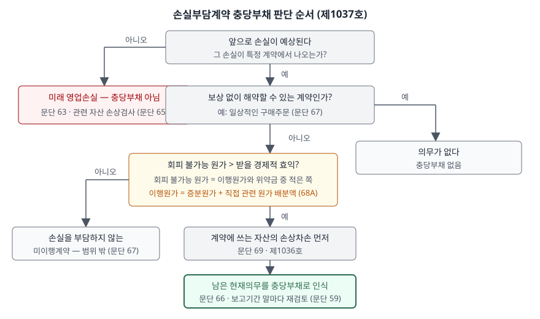

> 예제의 `가나조선`·`다라건설`과 그 숫자는 계산을 보이려고 만든 가상 자료다.

## 들어가며

수주 산업 회사의 실적 발표에서 "공사손실충당부채 전입"이라는 항목이 큰 금액으로 등장하는 분기가 있다. 그 분기에 공사를 거의 하지 않았는데도 영업손실이 크게 잡힌다. 많은 사람이 이것을 "보수적으로 미리 반영했다"는 회사의 선택으로 읽고, 다음 분기부터는 정상으로 돌아올 것이라고만 생각한다.

그런데 이 전입은 회사가 고를 수 있는 것이 아니라 기준서가 요구하는 처리이고, 미리 잡은 만큼 남은 기간의 이익이 0 근처로 눌린다. 아래 예제에서 다라건설은 2년차에 원가 410억원을 쓰고 손실 140억원을 적는데, 그 가운데 31.9억원은 3년차에 할 공사의 손실이다. 3년차에는 원가 430억원을 쓰고도 이익이 0으로 나온다.

[원가기준 진행률 글](../2026-11-08-cost-to-cost-progress-estimate-change/index.md)에서 추정 총원가가 계약금액을 넘는 경우를 이 글로 넘겼다.

## 개념

기업회계기준서 제1037호는 **손실부담계약**을 계약상 의무를 이행하는 데 필요한 회피 불가능 원가가 그 계약에서 받을 것으로 예상되는 경제적 효익을 초과하는 계약으로 정의한다(문단 68). 이런 계약을 체결하고 있으면 관련된 현재의무를 충당부채로 인식한다(문단 66).

| 구성 | 기준서의 정의 | 문단 |
|---|---|---|
| 회피 불가능 원가 | 계약을 종료하기 위한 최소 순원가. 이행원가와 이행하지 못했을 때의 보상금·위약금 중 적은 금액 | 68 |
| 이행원가 | 계약에 직접 관련되는 원가. 증분원가(직접 노무원가·재료원가)와 직접 관련되는 그 밖의 원가 배분액(설비 감가상각비 배분액 등) | 68A |
| 범위 밖 | 보상 없이 해약할 수 있는 계약(일상적인 구매주문)과 손실을 부담하지 않는 미이행계약 | 67 |

비교해 둘 문단이 있다. **미래의 예상 영업손실은 충당부채로 인식하지 않는다**(문단 63). 부채의 정의와 충당부채 인식기준을 충족하지 못하기 때문이다(문단 64). 손실이 예상되는 사업부가 있다는 것만으로는 의무가 없고, 그 손실을 강제하는 **계약**이 있어야 현재의무가 된다. 계약 없이 손실이 예상되면 대신 관련 자산의 손상검사를 한다(문단 65).

고객과의 계약에서 생기는 수익은 제1115호가 다루지만, 제1115호에 손실부담계약을 다루는 특정한 규정이 없으면 제1037호를 적용한다(제1037호 문단 5(7)). 공사 계약의 손실도 이 경로로 충당부채가 된다.

## 구조



> **출처**: 한국회계기준원 [기업회계기준서 제1037호 '충당부채, 우발부채 및 우발자산'](https://www.samili.com/acc/Kijun/Kijunjomun.asp?code=1978-1037) 문단 59·63·65~69·68A (제3자 전재, 2021-04-23 개정) — 원문 발행처 [한국회계기준원](https://www.kasb.or.kr/front/board/ingAccountingList.do)

첫 갈림길이 계약의 유무다. 왼쪽으로 빠지면 손실이 아무리 확실해도 충당부채가 아니다. 계약이 있어도 보상 없이 해약할 수 있으면 의무가 없다. 남은 계약에 대해 회피 불가능 원가와 효익을 비교하고, 손실부담이면 그 계약에 쓰는 자산의 손상차손을 먼저 인식한 뒤(문단 69) 충당부채를 잡는다.

## 동작 원리

### 이행원가의 범위가 판정을 바꾼다

문단 68A는 2020년 12월 공표된 개정으로 추가됐고, 2022년 1월 1일 이후 최초로 시작되는 회계연도부터 적용한다(문단 105). 그 전에는 이행원가에 증분원가만 넣는 회사와 배분액까지 넣는 회사가 섞여 있었다. 개정은 증분원가에 더해 **계약 이행에 직접 관련되는 그 밖의 원가 배분액**까지 넣도록 정했다.

가나조선의 계약은 대가가 500억원이고 증분원가가 460억원이다. 증분원가만 보면 40억원이 남는 계약이다. 그런데 이 계약을 위해 쓰는 설비의 감가상각비 70억원을 배분하면 이행원가가 530억원이 되어 30억원 손실이다. 개정 이후에는 이 계약이 손실부담계약이다.

### 위약금이 더 싸면 위약금이 한도다

회피 불가능 원가는 계약을 빠져나오는 가장 싼 방법의 원가다. 이행원가 530억원과 위약금을 비교하는데, 위약금을 내고 해약하면 대가 500억원도 받지 못한다. 그래서 예제는 이행 쪽을 받을 대가와 상계한 순원가 30억원과 위약금을 비교했다. 위약금이 50억원이면 이행하는 편이 싸므로 충당부채는 30억원, 20억원이면 해약하는 편이 싸므로 20억원이다.

### 진행률 공사에서는 남은 손실을 앞당긴다

진행률만 적용하면 계약 전체의 손실이 남은 공사 기간에 나뉜다. 다라건설은 2년차 말 추정 총원가가 1,080억원으로 계약금액 1,000억원을 넘는다. 새 추정으로 진행률(650 ÷ 1,080)을 다시 재서 누적 수익을 잡으면 2년차까지의 누적 손익은 −48.1억원(60.0 − 108.1)이고, 나머지 −31.9억원은 3년차 몫으로 남는다. 계약 전체가 손실인 것을 알고도 손실의 일부를 다음 해로 미루는 셈이다.

예제는 남은 공사에서 들 원가 430억원과 남은 공사에서 인식할 수익 398.1억원의 차이 31.9억원을 2년차 말 충당부채로 잡았다. 3년차에는 그 충당부채를 원래 목적인 공사 손실에 사용한다. 충당부채는 최초 인식과 관련 있는 지출에만 사용할 수 있다(문단 61). 기준서는 진행률 계약에서 이 금액을 계산하는 절차를 따로 적지 않으므로, 실제 회사의 계산 방식은 주석의 회계정책을 본다.

## 실습 예제

```python
cost = INCREMENTAL_COST + ALLOCATED_COST          # 68A 이후 이행원가
provision = min(cost - CONTRACT_PRICE, penalty)   # 회피 불가능한 순원가

remaining_cost = estimate - cum_cost
remaining_revenue = PROJECT_PRICE - cum_revenue
needed = max(remaining_cost - remaining_revenue, 0.0)
```

전체 소스: [`code/`](code/)

```text
[1] 이행원가에 무엇을 넣는가 — 문단 68A (2022-01-01 이후 시작 회계연도부터)
  계약금액(받을 효익) 500.0
  증분원가 460.0 · 직접 관련 원가 배분액 70.0
  이행원가 범위                    이행원가       효익       차이  판정
  증분원가만                     460.0     500.0     -40.0  손실부담 아님
  증분원가 + 배분액                530.0     500.0      30.0  손실부담계약
  같은 계약이 이행원가의 범위만으로 판정이 갈린다

[2] 회피 불가능 원가 — 이행할 때의 순원가와 위약금 중 적은 쪽 (문단 68)
  이행하면: 원가 530.0 − 효익 500.0 = 순원가 30.0
       위약금       충당부채  근거
        50.0        30.0  이행이 더 싸다
        20.0        20.0  해약이 더 싸다
```

```text
[3] 진행률로 수익을 인식하는 공사 — 2년차 말 추정 총원가 1,080 > 계약금액 1,000
    위약금은 커서 해약하지 않는다고 가정한다
  (가) 진행률만 적용
    연차       수익       원가  충당부채 전입(사용)       이익    기말 충당부채
     1      300.0     240.0              0.0      60.0           0.0
     2      301.9     410.0              0.0    -108.1           0.0
     3      398.1     430.0              0.0     -31.9           0.0
  합계 이익 -80.0

  (나) 남은 손실을 손실부담계약 충당부채로 인식 (제1037호 문단 5(7)·66)
    연차       수익       원가  충당부채 전입(사용)       이익    기말 충당부채
     1      300.0     240.0              0.0      60.0           0.0
     2      301.9     410.0             31.9    -140.0          31.9
     3      398.1     430.0            -31.9       0.0           0.0
  합계 이익 -80.0
```

`[3]`의 두 방식은 3년 합계가 −80.0억원으로 같다. 계약금액 1,000억원에서 실제 총원가 1,080억원을 뺀 값이다. 다른 것은 손실이 드러나는 해로, (나)는 손실을 알게 된 2년차에 계약 전체의 손실이 모두 반영되고 3년차 이익이 0이 된다. 1년차에 잡은 이익 60억원이 있으므로 2년차 손실 140억원은 계약 전체 손실 80억원보다 크다.

## 실무에서 주의할 점

- **충당부채 전입이 큰 분기 다음에는 이익이 0 근처로 눌린다.** 남은 공사의 손실을 미리 잡았으므로 공사가 진행돼도 그 계약에서는 이익이 나지 않는다. 다음 분기 이익률이 낮은 것은 실적 부진의 연장이 아니라 앞선 전입의 결과일 수 있다.
- **2022년 전후의 판정 기준이 다르다.** 문단 68A 시행 전에는 증분원가만으로 판정한 회사도 있었다. 시행 연도를 걸친 비교에서 충당부채가 갑자기 늘었다면 계약이 나빠진 것인지 이행원가 범위가 바뀐 것인지를 그해 주석의 회계정책 변경 설명에서 확인한다.
- **손상차손이 먼저 들어간다.** 그 계약을 이행하는 데 쓰는 자산이 손상됐으면 손상차손을 먼저 인식한다(문단 69). 손상으로 장부금액이 줄면 그 뒤 감가상각비 배분액도 줄어 충당부채 크기가 달라진다. 손익계산서에서 손상차손과 충당부채 전입이 같은 분기에 함께 보이는 이유다.
- **충당부채는 보고기간 말마다 다시 잰다.** 최선의 추정치로 조정하고, 자원 유출 가능성이 높지 않게 되면 환입한다(문단 59). 원가 절감이나 계약 변경으로 손실이 줄면 그 해에 환입 이익이 생긴다.
- **사업부 전체의 적자 예상은 여기에 들어가지 않는다.** 미래 영업손실은 충당부채가 아니다(문단 63). 구조조정 발표만으로 예상 손실을 미리 잡을 수 없다는 뜻이기도 하다. 그 경우 장부에서 확인할 것은 자산 손상검사 결과다(문단 65).

## 정리

- 회피 불가능 원가가 받을 경제적 효익을 넘는 계약은 손실부담계약이고, 그 현재의무를 충당부채로 인식한다(제1037호 문단 66·68).
- 회피 불가능 원가는 이행원가와 위약금 중 적은 쪽이고, 이행원가에는 2022년부터 증분원가와 직접 관련 원가 배분액이 들어간다(문단 68A·105).
- 계약 없이 예상되는 영업손실은 충당부채가 아니며, 제1115호에 특정 규정이 없는 고객 계약의 손실은 제1037호로 처리한다(문단 5(7)·63).
- 가상 사례에서 다라건설은 남은 공사 손실 31.9억원을 2년차에 충당부채로 잡아, 계약 전체 손실 80억원이 손실을 알게 된 해까지 모두 반영된다.

## 참고 자료

- [한국회계기준원](https://www.kasb.or.kr/front/board/ingAccountingList.do) — K-IFRS 기준서 발행처. 아래 전재 링크는 조문을 바로 열기 위한 편의 링크다
- [기업회계기준서 제1037호 '충당부채, 우발부채 및 우발자산'](https://www.samili.com/acc/Kijun/Kijunjomun.asp?code=1978-1037) (제3자 전재, 2021-04-23 개정) — 문단 5 적용범위, 59 충당부채의 변동, 61 사용, 63~65 미래 영업손실, 66~69·68A 손실부담계약, 105 시행일
- [기업회계기준서 제1115호 '고객과의 계약에서 생기는 수익'](https://www.samili.com/acc/Kijun/Kijunjomun.asp?code=1978-1115) (제3자 전재, 2021-04-23 개정) — 문단 39~45 진행률
- [IAS 37 Provisions, Contingent Liabilities and Contingent Assets](https://www.ifrs.org/issued-standards/list-of-standards/ias-37-provisions-contingent-liabilities-and-contingent-assets/) — IFRS Foundation
- 숫자는 이 글의 [`code/output.txt`](code/output.txt) `[1]`·`[2]`·`[3]`에서 옮겼다
