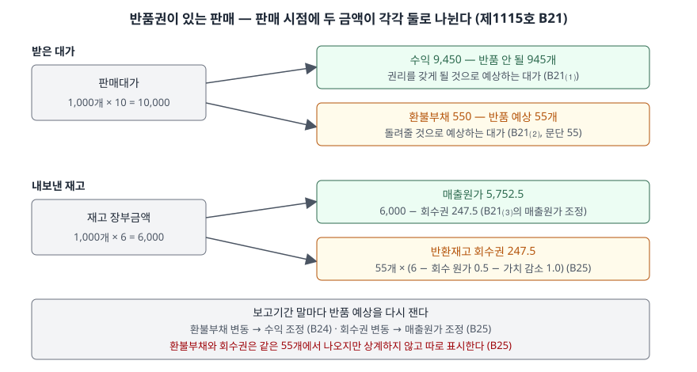

> 예제의 `가나리빙`과 그 숫자는 계산을 보이려고 만든 가상 자료다.

## 들어가며

온라인 판매 비중이 큰 회사의 재무제표를 읽다 보면 부채 쪽에 "환불부채", 자산 쪽에 "반환제품회수권"이라는 이름이 붙은 줄이 나온다. 많은 사람이 이 둘을 대수롭지 않은 잡항목으로 넘기고, 손익계산서의 매출만 보고 "판 만큼 매출이 잡혔다"고 읽는다.

그런데 반품을 받아 주는 조건으로 판 제품은 판 만큼 매출이 잡히지 않는다. 아래 예제에서 가나리빙은 12월에 쿠션 1,000개를 팔아 1억원(10,000만원)을 받지만, 그달 수익은 9,300만원이다. 나머지 700만원은 이미 돌려줬거나(200만원) 돌려줄 것으로 예상해 부채로 남긴 돈(500만원)이다. 반품을 실제로 받을 때마다 매출을 깎는 방식으로 처리했다면 12월 이익은 275만원 더 크고, 그만큼 1월 이익이 줄었을 것이다.

[수익 인식 5단계 글](../2026-10-10-revenue-recognition-five-steps/index.md)에서 3단계 거래가격 산정을 짧게 다뤘다. 이 글은 그 가운데 반품 때문에 거래가격이 흔들리는 경우를 따로 본다. 받은 대가 중 아직 이행하지 않은 몫을 떼어 내는 경우는 [고객 포인트 글](../2026-11-08-customer-loyalty-points-material-right/index.md)에서 이어 다룬다.

## 개념

기업회계기준서 제1115호는 반품권을 **변동대가**의 한 원인으로 본다. 대가는 할인·리베이트·환불·공제 등으로 변동될 수 있고, 반품권을 부여해 제품을 판매하면 대가가 변동된다고 예를 든다(문단 51). 반품권이 있으면 받을 금액이 처음부터 확정되지 않았다는 뜻이다.

그래서 판매 시점에 세 가지를 모두 인식한다(문단 B21).

| 무엇 | 금액 | 문단 |
|---|---|---|
| 수익 | 받을 권리를 갖게 될 것으로 예상하는 대가. 반품이 예상되는 제품에는 수익을 인식하지 않는다 | B21⑴ |
| 환불부채 | 받은 대가 중 권리를 갖게 될 것으로 예상하지 않는 금액 | B21⑵, 55 |
| 반환재고 회수권 | 제품의 이전 장부금액에서 회수에 예상되는 원가(가치 감소 포함)를 뺀 금액. 매출원가를 그만큼 조정한다 | B21⑶, B25 |

두 가지를 덧붙여 둔다. 반품 기간에 반품을 받기로 한 약속은 환불 의무와 별도의 수행의무가 아니다(문단 B22). 색상·크기만 다른 같은 제품으로 바꿔 주는 교환은 반품으로 보지 않고(문단 B26), 결함 제품을 정상 제품으로 바꿔 주는 것은 보증 지침으로 평가한다(문단 B27).

## 구조



> **출처**: 한국회계기준원 [기업회계기준서 제1115호 '고객과의 계약에서 생기는 수익'](https://www.samili.com/acc/Kijun/Kijunjomun.asp?code=1978-1115) 문단 55·B21·B24·B25 (제3자 전재, 2021-04-23 개정) — 원문 발행처 [한국회계기준원](https://www.kasb.or.kr/front/board/ingAccountingList.do)

위쪽은 고객에게서 받은 돈이, 아래쪽은 창고에서 내보낸 재고가 각각 둘로 나뉜다. 위의 환불부채와 아래의 회수권은 같은 55개에서 나온 금액이지만 서로 상계하지 않고 구분해 표시한다(문단 B25). 그래서 재무상태표에는 부채 550과 자산 247.5가 따로 보인다.

## 동작 원리

### 반품 수량은 확률로 추정한다

변동대가는 기댓값과 가능성이 가장 높은 금액 중 받을 대가를 더 잘 예측하는 방법으로 추정한다(문단 53). 기댓값은 가능한 금액에 각 확률을 곱해 더한 값으로, 특성이 비슷한 계약이 많을 때 적절할 수 있다. 가능성이 가장 높은 금액은 결과가 둘뿐인 경우(성과보너스를 받거나 못 받거나)에 적절할 수 있다.

쿠션 1,000개는 비슷한 거래가 많은 쪽이다. 예제는 반품률 3%·5%·8%에 확률 0.2·0.5·0.3을 주어 기댓값 5.5%(55개)를 썼다. 가능성이 가장 높은 값을 고르면 5%(50개)가 되어 수익이 50만원 더 크다. 어느 방법을 쓰든 계약 전체에 하나의 방법을 일관되게 적용한다(문단 54).

### 제약은 추정치에서 한 번 더 깎는다

추정치를 그대로 쓰지 않는 경우가 있다. 나중에 불확실성이 해소될 때 이미 인식한 누적 수익 중 **유의적인 부분을 되돌리지 않을 가능성이 매우 높은** 정도까지만 변동대가를 거래가격에 넣는다(문단 56). 되돌릴 가능성을 높이는 요인으로 기준서는 다섯 가지를 든다(문단 57). 기업 영향력 밖의 요인에 민감한 경우, 불확실성이 오래 해소되지 않는 경우, 비슷한 계약의 경험이 적은 경우, 가격할인 관행이 넓은 경우, 가능한 대가가 많고 범위가 넓은 경우다.

예제에서는 새 제품군이라 경험이 적은 경우(57⑶)를 가정해 시나리오의 가장 높은 반품률 8%로 제약했다. 수익이 9,450에서 9,200으로 줄고 매출총이익이 137.5 줄어든다. 문단 56은 "어느 값을 쓰라"는 공식을 주지 않는다. 8%를 쓴 것은 예제의 선택이고, 실제 회사가 어떤 수준으로 제약했는지는 주석의 유의적 판단 설명에서 확인한다.

### 보고기간 말마다 다시 잰다

추정은 한 번으로 끝나지 않는다. 보고기간 말마다 반품 예상량의 변동에 따라 환불부채를 수정하고, 그 조정액을 수익(또는 수익의 차감)으로 인식한다(문단 B24). 회수권 자산도 같은 날 수정한다(문단 B25). 그래서 반품 예상을 올리면 같은 기간 안에서 수익이 줄고 매출원가도 줄며, 둘의 차이만큼 매출총이익이 준다.

## 실습 예제

```python
def recognise(return_units):
    kept = UNITS_SOLD - return_units
    revenue = kept * UNIT_PRICE
    refund_liability = return_units * UNIT_PRICE
    asset_per_unit = UNIT_COST - RECOVERY_COST - VALUE_DECLINE   # B25
    return_asset = return_units * asset_per_unit
    cost_of_sales = UNITS_SOLD * UNIT_COST - return_asset
```

전체 소스: [`code/`](code/)

```text
[1] 반품률 추정 — 기댓값과 가능성이 가장 높은 금액 (문단 53)
     반품률      확률     반품 수량
      3%      0.2        30
      5%      0.5        50
      8%      0.3        80
  기댓값 반품률 5.5% → 55개
  가능성이 가장 높은 반품률 5% → 50개

[2] 판매 시점 인식 — 기댓값 대 제약 적용 (문단 56·57, B21·B23·B25)
    제약: 새 제품군이라 경험이 적으면(57(3)) 되돌릴 일이 없을 만큼만 수익에 넣는다
                          수익  환불부채    회수권   매출원가 매출총이익
  기댓값 55개             9,450.0    550.0    247.5   5,752.5  3,697.5
  제약 80개              9,200.0    800.0    360.0   5,640.0  3,560.0
  반품 없음 가정           10,000.0      0.0      0.0   6,000.0  4,000.0
  검산: 남는 945개 × 개당 이익 4.0 − 반품 55개 × 회수 손실 1.5 = 3,697.5
```

`[2]`의 검산 줄이 매출총이익의 뜻을 보여 준다. 팔린 채로 남을 945개에서 개당 4.0씩 벌고, 돌아올 55개에서 회수 원가와 가치 감소로 개당 1.5씩 잃는다. 반품 예상이 늘면 이익이 반품 수량만큼 비례해 줄어드는 것이 아니라, 판매 이익을 잃는 것에 더해 회수 손실이 붙는다.

```text
[3] 12월 말 — 20개가 반품됐고, 전체 반품 예상을 70개로 올린다 (B24·B25)
  (가) 반품 20개 정산
      환불부채 −200.0 (현금 환불)
      회수권 −90.0 + 회수 원가 지급 10.0 → 반환재고 100.0
  (나) 반품 예상 55개 → 70개 재추정
      수익 조정 -150.0 (환불부채 증가분)
      매출원가 조정 -67.5 (회수권 증가분)
      매출총이익 조정 -82.5
  12월 말 잔액 — 환불부채 500.0 · 회수권 225.0 (남은 예상 반품 50개)
  12월 손익 — 수익 9,300.0 · 매출원가 5,685.0 · 매출총이익 3,615.0

[4] 반품을 받을 때 되돌리는 방식과 비교 — 1월에 남은 50개가 예상대로 반품
    (가)는 기준서가 허용하는 방식이 아니다. 차이를 보이려고 나란히 놓는다
                              12월 이익   1월 이익      합계
  (가) 반품 때마다 되돌림             3,890.0    -275.0   3,615.0
  (나) 환불부채로 미리 뺌             3,615.0       0.0   3,615.0
  합계는 같고, 반품 손실이 드러나는 달이 다르다
```

`[3]`의 (가)는 예상했던 반품이 실제로 들어온 것이라 손익이 움직이지 않는다. 부채가 현금으로, 회수권이 재고로 바뀔 뿐이다. 손익을 움직이는 것은 (나)의 예상 변경이다. `[4]`는 두 달 합계가 3,615로 같지만, (가)는 판매한 달의 이익이 크고 반품이 몰리는 다음 달에 손실이 난다. 연말 판매가 많은 회사라면 그 차이가 연도 손익을 가른다.

## 실무에서 주의할 점

- **매출 증가율을 볼 때 환불부채 증감을 같이 본다.** 반품 예상률을 낮추면 같은 판매량에서 수익이 커진다. 예제에서 반품 예상 55개와 70개의 차이만으로 수익이 150 달라졌다. 매출이 늘었는데 판매대가 대비 환불부채 비율이 크게 줄었다면, 판매가 늘었는지 추정이 바뀌었는지를 주석에서 가린다.
- **회수권은 매출원가에서 빠진 만큼의 자산이다.** 회수권을 재고자산과 같은 것으로 읽으면 재고회전율이 왜곡된다. 회수권은 아직 돌아오지 않은 제품의 예상 회수액이고, 장부금액에서 회수 원가와 가치 감소를 뺀 금액이다(문단 B25). 반품된 제품의 가치가 많이 떨어지는 업종일수록 회수권이 작고 반품 손실이 크다.
- **환불부채와 회수권을 상계해 읽지 않는다.** 기준서가 구분해 표시하라고 한다(문단 B25). 부채 500과 자산 225를 상계해 순부채 275로 보면, 반품이 몰릴 때 나갈 현금 500이 보이지 않는다.
- **제약 수준은 회사의 판단이다.** 기준서는 되돌릴 가능성이 매우 높지 않을 만큼이라는 기준만 주고 수치를 정하지 않는다(문단 56·57). 같은 업종의 두 회사라도 제약의 정도가 다르면 판매 시점 수익이 다르다. 비교할 때는 주석의 변동대가 추정 방법 설명을 나란히 본다.
- **반품 예상을 바꾼 기간의 수익 조정은 그 기간에 들어간다.** 과거 기간을 고쳐 쓰지 않는다(문단 B24). 분기 매출이 갑자기 줄었는데 판매량은 그대로라면 반품 예상 상향이 원인일 수 있다.

## 정리

- 반품권은 변동대가의 원인이고, 판매 시점에 수익·환불부채·반환재고 회수권을 나눠 인식한다(제1115호 문단 51·B21).
- 반품 수량은 기댓값이나 가능성이 가장 높은 금액으로 추정하고, 되돌릴 가능성이 매우 높지 않을 만큼까지만 수익에 넣는다(문단 53·56).
- 보고기간 말마다 다시 재서 환불부채 변동은 수익으로, 회수권 변동은 매출원가로 조정하고 둘은 구분해 표시한다(문단 B24·B25).
- 가상 사례에서 반품을 받을 때마다 되돌리는 방식과 두 달 합계는 3,615로 같지만, 환불부채 방식은 판매한 달에 반품 손실까지 반영한다.

## 참고 자료

- [한국회계기준원](https://www.kasb.or.kr/front/board/ingAccountingList.do) — K-IFRS 기준서 발행처. 아래 전재 링크는 조문을 바로 열기 위한 편의 링크다
- [기업회계기준서 제1115호 '고객과의 계약에서 생기는 수익'](https://www.samili.com/acc/Kijun/Kijunjomun.asp?code=1978-1115) (제3자 전재, 2021-04-23 개정) — 문단 50~57 변동대가와 제약, 55 환불부채, B20~B27 반품권이 있는 판매
- [IFRS 15 Revenue from Contracts with Customers](https://www.ifrs.org/issued-standards/list-of-standards/ifrs-15-revenue-from-contracts-with-customers/) — IFRS Foundation
- 숫자는 이 글의 [`code/output.txt`](code/output.txt) `[1]`~`[4]`에서 옮겼다
