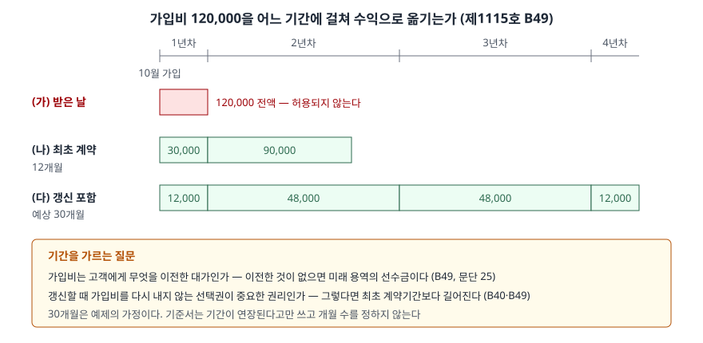

> 예제의 `가나피트니스`와 그 숫자는 계산을 보이려고 만든 가상 자료다.

## 들어가며

헬스장에 등록하면 월 회비와 별도로 가입비를 낸다. 환불도 안 되고, 받는 순간 돈은 헬스장 통장에 들어간다. 그래서 재무제표를 처음 읽는 사람은 "가입비는 받은 날 매출"이라고 생각하고, 회원이 몰리는 달의 매출이 뛰는 것을 당연하게 본다.

기준서는 그렇게 보지 않는다. 아래 예제의 가나피트니스는 10월에 회원 500명에게서 가입비 120,000(단위 천원)을 받는다. 받은 날 전부 수익으로 잡으면 그해 이익이 160,000이고, 기준서대로 회원 기간에 나누면 70,000 또는 52,000이다. 같은 현금을 받고도 첫해 이익이 세 배까지 차이 난다. 무엇을 기준으로 나누는지를 이 글에서 본다.

[보증 글](../2026-11-09-warranty-assurance-vs-service-type/index.md)은 받은 대가 안에 아직 제공하지 않은 용역이 섞여 있는 경우를 다뤘다. 가입비는 그 반대 방향의 질문이다. 대가를 받았는데, 그 대가에 대응해 **고객에게 넘긴 것이 있는가.**

## 개념

기업회계기준서 제1115호는 계약 개시시점이나 그 가까운 시기에 받는 환불되지 않는 수수료를 따로 다룬다(문단 B48). 헬스클럽 회원 가입수수료, 통신계약 가입수수료, 용역계약 준비수수료, 공급계약 개시수수료가 예로 나온다.

판단의 출발점은 **그 수수료가 약속한 재화나 용역의 이전에 관련되는가**다(문단 B49). 가입 시점에 기업이 하는 일(회원 등록, 카드 발급, 시설 안내)은 계약을 이행하려고 착수하는 활동이지만, 그 활동으로 고객에게 재화나 용역이 넘어가지는 않는다. 기준서는 이런 준비 활동이 수행의무가 아니라고 정한다(문단 25).

| 수수료가 대응하는 것 | 처리 | 근거 |
|---|---|---|
| 넘어가는 재화·용역이 없다 (준비 활동) | 미래 재화·용역의 선수금. 그 재화·용역을 제공할 때 수익 | B49, 문단 25 |
| 재화·용역이 넘어간다 | 그 재화·용역을 별도 수행의무로 볼지 판단 | B50, 문단 22~30 |
| 갱신 선택권이 중요한 권리다 | 인식 기간이 최초 계약기간보다 길어진다 | B49, B40 |

## 구조



> **출처**: 한국회계기준원 [기업회계기준서 제1115호 '고객과의 계약에서 생기는 수익'](https://www.samili.com/acc/Kijun/Kijunjomun.asp?code=1978-1115) 문단 25, 적용지침 문단 B40·B48~B51 (제3자 전재, 2021-04-23 개정) — 원문 발행처 [한국회계기준원](https://www.kasb.or.kr/front/board/ingAccountingList.do)

(가)는 받은 날 전부 수익으로 잡는 처리로, 문단 B49가 막는 것이다. (나)와 (다)는 둘 다 선수금으로 보되 기간이 다르다. 어느 쪽인지는 갱신 선택권의 성격이 정한다.

## 동작 원리

### 가입비는 미래 용역의 선수금이다

문단 B49는 선수수수료가 준비 활동에 관련되더라도 그 활동으로 용역이 이전되지 않으므로, 수수료를 **미래 재화나 용역에 대한 선수금**으로 보고 그 재화나 용역을 제공할 때 수익으로 인식하라고 한다. 고객이 가입비를 내고 얻는 것은 앞으로 시설을 쓸 권리이고, 그 권리는 회원 기간 동안 매일 조금씩 이행된다.

그래서 받은 날의 회계처리는 현금과 **계약부채**다. 수익은 회원 기간이 지나면서 계약부채에서 옮겨 온다. 환불되지 않는다는 사실은 수익을 인식하는 시점을 정하지 않는다. 시점을 정하는 것은 용역을 이행했는가다.

### 갱신 선택권이 기간을 늘린다

가나피트니스는 1년 계약이 끝난 회원이 갱신할 때 가입비를 다시 받지 않는다. 새로 가입하는 사람은 240을 내야 하므로, 기존 회원의 갱신 선택권은 계약을 맺지 않았다면 받지 못했을 혜택이다. 문단 B40은 이런 선택권을 **중요한 권리**로 보고, 문단 B49는 이때 수익 인식 기간이 최초 계약기간보다 연장된다고 쓴다.

기준서는 기간이 "연장될 것"이라고만 쓰고 몇 개월로 할지는 정하지 않는다. 예제의 30개월은 과거 회원의 평균 유지 기간을 가정한 값이다.

### 준비 원가는 진행률에 넣지 않는다

가입비는 준비 원가를 보상하는 명목으로 받는 경우가 많다(문단 B51). 그러나 준비 활동이 수행의무를 이행하는 것이 아니므로, 원가 기준으로 진행률을 잴 때 그 활동과 원가를 **무시한다**(문단 B19·B51). 넣으면 아무것도 이전하지 않은 첫날에 진행률이 올라간다.

준비 원가 자체를 비용으로 둘지 자산으로 둘지는 따로 판단한다. 계약에 직접 관련되고, 미래 수행의무에 쓸 자원을 만들고, 회수될 것으로 예상되는 세 요건을 모두 충족하면 계약이행원가 자산이다(문단 95). 일반관리원가는 고객에게 명백히 청구할 수 있는 원가가 아니면 발생 시점에 비용이다(문단 98⑴). 자산으로 두면 관련 용역을 이전하는 방식에 맞춰 상각한다(문단 99).

## 실습 예제

```python
def spread(amount, total_months):
    # 기간에 걸쳐 고르게 이전되는 용역이라 경과 개월 수로 나눈다
    return {y: amount * m / total_months for y, m in months_by_year(total_months).items()}
```

전체 소스: [`code/`](code/)

```text
[2] 가입비 수익 인식 — 세 가지 처리
  (가) 받은 날 전액 수익 — 기준서가 허용하는 처리가 아니다 (B49)
    1년차  120,000.0   연말 계약부채        0.0
    2년차        0.0   연말 계약부채        0.0
    3년차        0.0   연말 계약부채        0.0
    4년차        0.0   연말 계약부채        0.0
  (나) 최초 계약기간 12개월에 나눔 — 갱신 선택권이 중요한 권리가 아닐 때 (B49)
    1년차   30,000.0   연말 계약부채   90,000.0
    2년차   90,000.0   연말 계약부채        0.0
    3년차        0.0   연말 계약부채        0.0
    4년차        0.0   연말 계약부채        0.0
  (다) 갱신 포함 예상 회원 기간 30개월에 나눔 — 갱신 선택권이 중요한 권리일 때 (B40·B49)
    1년차   12,000.0   연말 계약부채  108,000.0
    2년차   48,000.0   연말 계약부채   60,000.0
    3년차   48,000.0   연말 계약부채   12,000.0
    4년차   12,000.0   연말 계약부채        0.0

[3] 1년차 손익 — 가입비 처리별 (월 회비 3개월분은 같다)
    처리         회비 수익    가입비 수익     용역 원가     준비 원가        이익
    (가)    150,000.0 120,000.0  90,000.0  20,000.0 160,000.0
    (나)    150,000.0  30,000.0  90,000.0  20,000.0  70,000.0
    (다)    150,000.0  12,000.0  90,000.0  20,000.0  52,000.0
    준비 원가는 문단 98⑴ 일반관리원가로 보아 발생 시점에 비용으로 둔 경우다
```

10월 가입이라 1년차에는 3개월분만 수익이 된다. (다)는 1년차 말 계약부채가 108,000으로, 받은 가입비의 90%가 아직 부채다.

`[3]`에서 세 처리의 1년차 이익 차이는 가입비 수익 차이와 같다. 회비·용역 원가·준비 원가는 셋 다 같기 때문이다. (가)는 준비 원가 20,000을 쓴 날 가입비 120,000을 수익으로 잡아 첫해 이익이 160,000이 된다. 그 대신 2년차 이후에는 가입비 수익이 없다.

```text
[4] 준비 원가가 문단 95 요건을 충족한다고 볼 때 — 자산으로 두고 상각 (문단 99)
    1년차 상각    2,000.0   연말 자산   18,000.0
    2년차 상각    8,000.0   연말 자산   10,000.0
    3년차 상각    8,000.0   연말 자산    2,000.0
    4년차 상각    2,000.0   연말 자산        0.0

[5] 원가 기준 진행률에 준비 원가를 넣으면 — 최초 12개월 계약, 3개월 경과 시점 (B19·B51)
    준비 원가 포함  (40 + 180) / (40 + 720) = 28.9%
    준비 원가 제외  180 / 720 = 25.0%
    계약 대가 1인당 1440 기준, 500명의 수익 차이 28,421.1
```

`[4]`는 같은 준비 원가를 자산으로 볼 때다. 가입비와 같은 30개월에 맞춰 상각하면 1년차 비용이 20,000에서 2,000으로 준다. 가입비를 이연하는 기간과 원가를 상각하는 기간이 같으므로 수익과 비용이 같은 기간에 대응한다.

`[5]`는 헬스클럽처럼 기간 기준으로 재는 경우가 아니라, 원가 기준 진행률을 쓰는 용역 계약이라고 가정해 본 계산이다. 첫날 쓴 준비 원가 40을 진행률에 넣으면 3개월 경과 시점의 진행률이 25.0%에서 28.9%로 올라간다. 아무 용역도 더 이전하지 않았는데 수익이 28,421 앞당겨진다. 문단 B51이 준비 활동을 진행률에서 빼라고 하는 이유가 이 숫자다.

## 실무에서 주의할 점

- **신규 가입이 몰린 분기의 매출을 가입비 수익으로 읽지 않는다.** 기준서대로라면 가입비는 계약부채로 들어가 회원 기간에 나뉜다. 가입자 수가 크게 늘었는데 매출보다 계약부채가 더 크게 늘었다면 그것이 정상적인 모양이다.
- **계약부채 잔액은 이미 받은 현금이다.** 예제 (다)의 1년차 말 계약부채 108,000은 돌려줄 돈이 아니라 앞으로 용역으로 갚을 의무다. 부채비율을 볼 때 차입금과 같은 무게로 읽으면 재무 위험을 크게 잡게 된다. [유동·비유동 글](../2026-09-29-current-vs-noncurrent/index.md)처럼 1년 안에 수익으로 넘어갈 부분과 그 뒤 부분도 나눠 본다.
- **인식 기간은 회사의 추정이다.** 갱신 선택권이 중요한 권리라면 기간이 길어지지만 개월 수는 기준서가 정하지 않는다. 예제에서 12개월과 30개월의 차이만으로 1년차 이익이 18,000 달라졌다. 같은 업종 두 회사의 이익률을 비교할 때는 주석의 수익 인식 기간 설명을 확인한다.
- **가입비를 별도 용역의 대가로 볼 수 있는지 먼저 따진다.** 가입할 때 개인 운동 지도처럼 실제로 넘어가는 용역이 있다면, 그 용역이 별도 수행의무인지 판단한다(문단 B50). 이때는 이전되는 용역에 거래가격을 배분하므로 위 계산과 결과가 다르다.
- **준비 원가를 자산으로 둔 회사는 상각 기간을 같이 본다.** 계약이행원가 자산은 관련 용역을 이전하는 방식에 맞춰 상각하고, 예상 이전 시기가 유의적으로 바뀌면 상각 방식을 고친다(문단 99·100). 가입비 이연 기간과 원가 상각 기간이 크게 다르면 수익과 비용의 대응이 어긋난다.

## 정리

- 환불되지 않는 선수수수료는 그 대가로 넘어가는 재화·용역이 없으면 미래 용역의 선수금이다. 받은 날이 아니라 용역을 제공할 때 수익으로 인식한다(제1115호 문단 B48·B49, 문단 25).
- 갱신 선택권이 중요한 권리라면 인식 기간이 최초 계약기간보다 길어진다(문단 B40·B49). 개월 수는 회사가 추정한다.
- 준비 활동은 수행의무가 아니므로 원가 기준 진행률에서 뺀다. 준비 원가가 자산 요건을 충족하면 계약이행원가 자산으로 두고 상각한다(문단 B51·95·99).
- 가상 사례에서 같은 가입비 120,000을 받고도 처리에 따라 1년차 이익이 160,000, 70,000, 52,000으로 갈린다.

## 참고 자료

- [한국회계기준원](https://www.kasb.or.kr/front/board/ingAccountingList.do) — K-IFRS 기준서 발행처. 아래 전재 링크는 조문을 바로 열기 위한 편의 링크다
- [기업회계기준서 제1115호 '고객과의 계약에서 생기는 수익'](https://www.samili.com/acc/Kijun/Kijunjomun.asp?code=1978-1115) (제3자 전재, 2021-04-23 개정) — 문단 22~30 수행의무 식별, 95~98 계약이행원가, 99~100 상각, B19 진행률, B40 고객의 선택권, B48~B51 환불되지 않는 선수수수료
- [IFRS 15 Revenue from Contracts with Customers](https://www.ifrs.org/issued-standards/list-of-standards/ifrs-15-revenue-from-contracts-with-customers/) — IFRS Foundation
- 숫자는 이 글의 [`code/output.txt`](code/output.txt) `[1]`~`[5]`에서 옮겼다
