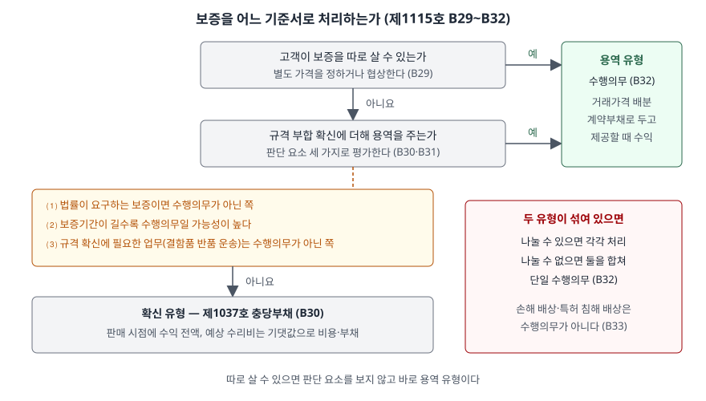

> 예제의 `가나가전`과 그 숫자는 계산을 보이려고 만든 가상 자료다.

## 들어가며

가전을 사면 상자 안에 "구입 후 1년 무상 수리" 보증서가 들어 있고, 계산대에서는 "3년 연장보증을 함께 드시겠냐"는 권유를 받는다. 재무제표를 읽는 사람 대부분은 둘 다 "보증"이라는 이름으로 묶어, 판매보증충당부채 한 줄만 보고 넘어간다.

그런데 두 보증은 회계상 다른 물건이다. 아래 예제에서 가나가전은 공기청정기 1,000대를 연장보증과 묶어 10만 8,000(단위 만원)에 판다. 연장보증을 수행의무로 떼어 내면 1년차 매출총이익은 29,200이고, 전부 충당부채로 처리하면 41,200이다. 3년 합계는 같지만 판매한 해의 이익이 12,000 다르다. 어느 쪽인지는 보증서의 문구와 판매 방식이 정한다.

[충당부채 글](../2026-10-10-provisions-and-contingent-liabilities/index.md)은 판매보증을 기댓값으로 재는 방법을 다뤘다. 이 글은 그 앞 단계, 어떤 보증이 충당부채로 가고 어떤 보증이 수익 쪽으로 가는지를 가르는 기준을 본다. [반품권 판매 글](../2026-11-08-sales-with-right-of-return/index.md)이 결함 제품 교환을 보증 지침으로 넘긴 자리이기도 하다. 받은 대가에 대응해 넘긴 것이 없는 경우는 [선수수수료 글](../2026-11-09-nonrefundable-upfront-fee-deferral/index.md)에서 이어 다룬다.

## 개념

기업회계기준서 제1115호 적용지침은 보증을 두 종류로 나눈다(문단 B28). 하나는 제품이 **합의된 규격에 부합해 의도한 대로 작동할 것이라는 확신**을 주는 보증이고, 다른 하나는 그 확신에 더해 **고객에게 용역을 제공하는** 보증이다. 문단 B32는 앞의 것을 확신 유형의 보증, 뒤의 것을 용역 유형의 보증이라고 부른다.

| 구분 | 무엇을 약속하는가 | 처리 기준서 | 회계처리 |
|---|---|---|---|
| 확신 유형 | 판매 시점에 이미 있던 결함을 고친다 | 제1037호 (문단 B30) | 판매 시점에 수익 전액. 예상 수리비를 비용과 충당부채로 |
| 용역 유형 | 규격 확신을 넘는 수리·관리 용역을 준다 | 제1115호 (문단 B29·B32) | 수행의무로 보아 거래가격 일부를 배분. 계약부채로 두었다가 용역을 줄 때 수익 |

이 구분이 왜 필요한가. 확신 유형 보증은 "결함 없는 제품"이라는 약속의 일부다. 제품을 넘긴 순간 기업이 할 일은 끝났고, 남은 것은 혹시 있을지 모를 결함의 비용뿐이다. 용역 유형 보증은 아직 제공하지 않은 용역이다. 고객이 그 몫의 돈을 이미 냈다면 기업은 그만큼을 아직 벌지 않은 것이다.

## 구조



> **출처**: 한국회계기준원 [기업회계기준서 제1115호 '고객과의 계약에서 생기는 수익'](https://www.samili.com/acc/Kijun/Kijunjomun.asp?code=1978-1115) 적용지침 문단 B28~B33 (제3자 전재, 2021-04-23 개정) — 원문 발행처 [한국회계기준원](https://www.kasb.or.kr/front/board/ingAccountingList.do)

첫 질문은 고객이 보증을 **따로 살 수 있는가**다. 보증에 별도 가격을 매기거나 협상한다면 그 보증은 구별되는 용역이고, 수행의무로 회계처리해 거래가격을 배분한다(문단 B29). 이 경우에는 판단 요소를 볼 것도 없이 결론이 난다.

따로 살 수 없으면 두 번째 질문으로 간다. 그 보증이 규격 부합 확신에 더해 용역을 주는지를 문단 B31의 세 요소로 평가한다. 용역을 주지 않는다면 제1037호를 적용한다(문단 B30).

## 동작 원리

### 판단 요소 세 가지

| 요소 | 수행의무가 **아닌** 쪽으로 기우는 경우 | 근거 |
|---|---|---|
| 법률의 요구 | 법률이 보증을 요구한다. 결함 제품을 살 위험에서 고객을 보호하려는 규정이기 때문이다 | B31⑴ |
| 보증기간 | 짧다. 기간이 길수록 확신을 넘는 용역을 제공할 가능성이 높다 | B31⑵ |
| 업무의 특성 | 규격 확신에 필요한 정해진 업무다 (예: 결함 제품의 반품 운송) | B31⑶ |

세 요소는 점수표가 아니다. 기준서는 "고려한다"고만 쓰고 몇 개를 충족해야 하는지 정하지 않는다. 예를 들어 보증기간이 업계 관행보다 훨씬 길면, 법정 보증기간 안의 부분은 확신 유형이고 그 뒤 부분은 용역 유형으로 나뉠 수 있다. 문단 B32가 "보증(또는 그 일부)"이라고 쓰는 이유다.

### 섞여 있으면 나누고, 못 나누면 합친다

한 보증서에 두 유형이 함께 들어 있는 경우가 흔하다. 기준서는 둘을 합리적으로 구별할 수 있으면 각각 처리하고, 구별할 수 없으면 **두 보증을 함께 단일 수행의무**로 회계처리하라고 한다(문단 B32). 못 나눌 때 충당부채 쪽이 아니라 수행의무 쪽으로 합친다는 점이 눈여겨볼 대목이다. 수익을 늦게 인식하는 쪽으로 처리가 정해진다.

### 보증이라는 이름이어도 수행의무가 아닌 것

제품이 손해를 끼치면 보상하라는 법률(제조물 책임)이나, 제품이 특허권·상표권을 침해해 생긴 청구를 배상하겠다는 약속은 수행의무를 만들지 않는다(문단 B33). 고객에게 이전하는 재화나 용역이 아니라 사고에 대한 책임이기 때문이다. 이것들은 제1037호로 처리한다.

## 실습 예제

가나가전은 공기청정기 1,000대(대당 원가 60)를 1년차 초에 판다. 1년 결함 보증만 붙이면 대당 100이고, 2·3년차 무상 수리 용역(연장보증)을 묶으면 대당 108이다. 연장보증은 따로 사면 20이라 고객이 따로 살 수 있는 용역이다(문단 B29).

```python
def allocate_bundle():
    # 상대적 개별 판매가격 비율로 거래가격을 배분한다 (제1115호 문단 74·76)
    total_ssp = SSP_PRODUCT + SSP_EXTENDED
    product = PRICE_BUNDLE * SSP_PRODUCT / total_ssp
    extended = PRICE_BUNDLE * SSP_EXTENDED / total_ssp
    return product, extended
```

전체 소스: [`code/`](code/)

```text
[1] 확신 유형 보증의 충당부채 — 기댓값 (제1037호 문단 39)
        확률     대당 수리비
      0.80        0.0
      0.15        2.0
      0.05       10.0
  대당 기댓값 0.80 → 충당부채 800.0

[2] 묶음 가격 배분 — 상대적 개별 판매가격 (제1115호 문단 74·76, B29)
  개별 판매가격 합계 120.0 (제품 100.0 + 연장보증 20.0)
  묶음 가격 108.0 → 제품 90.0 · 연장보증 18.0 (대당)
  판매 시점 계약부채 18,000.0
```

`[1]`은 확신 유형 보증의 측정이다. 많은 제품에 걸친 의무라 확률 가중평균으로 잰다(제1037호 문단 39). `[2]`에서 묶음 할인 12는 제품과 연장보증에 개별 판매가격 비율대로 나뉜다. 그래서 묶음으로 판 제품의 수익은 90으로, 단품 가격 100보다 작다.

```text
[3] 연도별 손익 — 1,000대, 1년차 초에 판매
  안 A: 1년 결함 보증만 (확신 유형 → 충당부채)
      연도         수익       매출원가       보증원가      매출총이익
       1 100,000.0  60,000.0     800.0  39,200.0
       2       0.0       0.0       0.0       0.0
       3       0.0       0.0       0.0       0.0
    합계 매출총이익 39,200.0

  안 B: 연장보증 묶음, 용역 유형으로 분리 (B29·B32)
      연도         수익       매출원가       보증원가      매출총이익
       1  90,000.0  60,000.0     800.0  29,200.0
       2   9,000.0       0.0   3,000.0   6,000.0
       3   9,000.0       0.0   3,000.0   6,000.0
    합계 매출총이익 41,200.0

  안 C: 같은 묶음을 전부 확신 유형으로 본 경우 (허용되지 않음)
      연도         수익       매출원가       보증원가      매출총이익
       1 108,000.0  60,000.0   6,800.0  41,200.0
       2       0.0       0.0       0.0       0.0
       3       0.0       0.0       0.0       0.0
    합계 매출총이익 41,200.0

  안 B와 안 C의 3년 합계 차이 0.0
  1년차 매출총이익 차이 (C − B) 12,000.0

[4] 안 B의 계약부채 잔액 (연말)
    1년차 말 18,000.0
    2년차 말 9,000.0
    3년차 말 0.0
```

안 B는 1년차에 계약부채 18,000을 남기고, 연장보증 기간인 2·3년차에 9,000씩 수익으로 옮긴다. 그 기간의 수리 원가 3,000은 용역을 제공하면서 드는 원가라 그해 비용이다.

안 C는 같은 묶음을 확신 유형으로 잘못 본 경우다. 108,000을 전부 1년차 수익으로 잡고, 2·3년차 수리 원가 6,000까지 1년차에 충당부채로 당겨 잡는다. 3년 합계는 41,200으로 안 B와 같다. 그러나 1년차 이익은 12,000 크고, 그 12,000은 연장보증 수익 18,000에서 2·3년차 원가 6,000을 뺀 금액, 즉 **아직 제공하지 않은 용역의 이익**이다. 문단 B29가 막는 것이 이것이다.

## 실무에서 주의할 점

- **판매보증충당부채만 보고 보증 규모를 판단하지 않는다.** 용역 유형 보증은 충당부채가 아니라 계약부채(선수수익)에 들어 있다. 예제의 안 B는 충당부채가 800뿐이지만 계약부채가 18,000이다. 연장보증을 많이 파는 회사라면 주석의 수행의무 설명과 계약부채 잔액을 같이 본다.
- **같은 보증서라도 회사마다 판단이 갈릴 수 있다.** 문단 B31의 세 요소는 고려 요소일 뿐 몇 개를 충족해야 한다는 기준이 없다. 보증기간이 법정 기간보다 조금 긴 정도라면 회사에 따라 확신 유형으로도, 일부 용역 유형으로도 판단할 수 있다. 두 회사의 매출총이익률을 비교할 때는 주석의 유의적 판단 설명을 확인한다.
- **연장보증 판매가 늘면 판매한 해의 이익률이 낮아 보인다.** 예제에서 대당 8을 더 받았는데도 안 B의 1년차 매출총이익은 단품 판매(안 A)보다 10,000 작다. 판매 구성이 바뀐 해의 이익률 하락이 실적 악화인지, 수익 이연인지는 계약부채 증가분으로 가린다.
- **용역 유형 보증의 원가는 충당부채로 미리 잡지 않는다.** 용역을 제공할 때 원가가 발생한다. 다만 제공해야 할 용역의 원가가 남은 대가보다 커지면 손실부담계약 여부를 따진다. [손실부담계약 글](../2026-11-08-onerous-contract-provision/index.md)의 판단이 여기에 붙는다.
- **제조물 책임이나 특허 침해 배상은 보증이 아니다.** 이름이 "보증"으로 붙어 있어도 수행의무를 만들지 않으므로(문단 B33) 수익 배분 대상이 아니다. 제1037호의 인식 요건(현재의무·유출 가능성·신뢰성 있는 추정)을 따른다.

## 정리

- 보증은 규격 부합만 확신하는 확신 유형과, 그 이상의 용역을 주는 용역 유형으로 나뉜다(제1115호 문단 B28).
- 고객이 따로 살 수 있는 보증은 바로 용역 유형이다. 따로 살 수 없으면 법률의 요구·보증기간·업무의 특성 세 요소로 판단한다(문단 B29·B31).
- 확신 유형은 제1037호에 따라 기댓값으로 충당부채를 잡고, 용역 유형은 거래가격을 배분해 용역을 제공할 때 수익으로 인식한다. 둘을 나눌 수 없으면 합쳐서 수행의무로 본다(문단 B30·B32).
- 가상 사례에서 처리 방법에 따라 3년 합계 이익은 같지만 판매한 해의 매출총이익이 12,000 다르다.

## 참고 자료

- [한국회계기준원](https://www.kasb.or.kr/front/board/ingAccountingList.do) — K-IFRS 기준서 발행처. 아래 전재 링크는 조문을 바로 열기 위한 편의 링크다
- [기업회계기준서 제1115호 '고객과의 계약에서 생기는 수익'](https://www.samili.com/acc/Kijun/Kijunjomun.asp?code=1978-1115) (제3자 전재, 2021-04-23 개정) — 문단 22~30 수행의무 식별, 73~86 거래가격 배분, B28~B33 보증
- [기업회계기준서 제1037호 '충당부채, 우발부채, 우발자산'](https://www.samili.com/acc/Kijun/Kijunjomun.asp?code=1978-1037) (제3자 전재, 2021-04-23 개정) — 문단 36~40 최선의 추정치와 기댓값, 문단 39 보증 사례
- [IFRS 15 Revenue from Contracts with Customers](https://www.ifrs.org/issued-standards/list-of-standards/ifrs-15-revenue-from-contracts-with-customers/) — IFRS Foundation
- 숫자는 이 글의 [`code/output.txt`](code/output.txt) `[1]`~`[4]`에서 옮겼다
