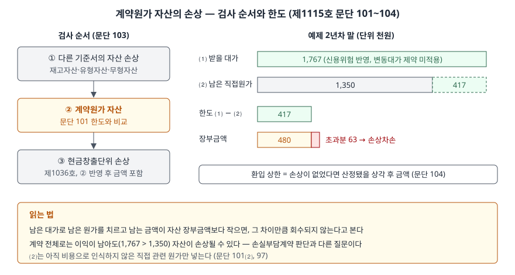

> 예제의 `가나클라우드`, 고객 `A사`와 그 숫자는 계산을 보이려고 만든 가상 자료다.

## 들어가며

구독형 회사의 재무상태표에서 "계약원가" 같은 이름의 자산을 처음 보면, 이미 지급한 영업 수수료가 왜 자산으로 남아 있는지부터 의아하다. [앞 글](../2026-11-10-incremental-cost-of-obtaining-contract/index.md)에서 본 것처럼 그 수수료는 앞으로 받을 구독료와 대응시키려고 남겨 둔 것이다. 그러면 큰 고객이 계약 중간에 단가를 깎아 달라고 하면, 남겨 둔 수수료는 그대로 둬도 되는가.

많은 사람이 "계약이 여전히 이익이 나면 문제없다"고 판단한다. 아래 예제에서 가나클라우드는 A사가 구독료를 낮춘 뒤에도 남은 3년 동안 받을 대가 1,767(단위 천원)이 남은 원가 1,350보다 크다. 계약은 여전히 이익이다. 그런데 수수료 자산 480 가운데 63은 손상차손으로 비용이 된다. 계약 전체의 이익과 자산 하나의 회수 가능성은 다른 질문이기 때문이다.

## 개념

기업회계기준서 제1115호는 계약체결원가(문단 91)와 계약이행원가(문단 95)로 인식한 자산에 따로 손상 검사를 둔다. 장부금액이 다음 ⑴에서 ⑵를 뺀 금액을 초과하는 정도까지 손상차손을 당기손익에 인식한다(문단 101).

| 항목 | 무엇 | 조정 | 근거 |
|---|---|---|---|
| ⑴ | 관련 재화·용역의 대가로 받을 것으로 예상하는 나머지 금액 | 거래가격 산정 원칙을 쓰되 변동대가 제약은 빼고, 고객의 신용위험을 반영 | 문단 101⑴·102 |
| ⑵ | 그 재화·용역 제공에 직접 관련되는 원가로서 아직 비용으로 인식하지 않은 것 | 계약이행원가 범위(문단 97)를 따른다 | 문단 101⑵ |
| 환입 | 손상 상황이 사라지거나 개선되면 당기손익으로 환입 | 손상이 없었을 때의 상각 후 금액을 넘지 않는다 | 문단 104 |

⑴ − ⑵는 **이 계약에서 앞으로 남을 몫**이다. 그 몫이 아직 비용으로 넘기지 않은 수수료보다 작으면, 남은 수수료 가운데 일부는 어떤 수익으로도 회수되지 않는다는 뜻이다.

## 구조



> **출처**: 한국회계기준원 [기업회계기준서 제1115호 '고객과의 계약에서 생기는 수익'](https://www.samili.com/acc/Kijun/Kijunjomun.asp?code=1978-1115) 문단 97, 101~104 상각과 손상 (제3자 전재, 2021-04-23 개정) — 원문 발행처 [한국회계기준원](https://www.kasb.or.kr/front/board/ingAccountingList.do)

왼쪽은 검사 순서다. 계약과 관련해 다른 기준서(제1002호 재고자산, 제1016호 유형자산, 제1038호 무형자산)로 인식한 자산의 손상을 먼저 인식하고, 그다음 계약원가 자산에 문단 101을 적용한다. 그 결과를 반영한 장부금액을 현금창출단위에 넣고 제1036호 자산손상을 적용한다(문단 103). 오른쪽은 예제의 2년차 말 숫자다.

## 동작 원리

### 한도는 앞으로 남을 몫이다

가나클라우드는 A사와 5년 계약을 맺으며 수수료 800을 자산으로 두고 해마다 160씩 상각한다. 2년차 말 장부금액은 480이다. 이때 A사가 남은 3년의 연 구독료를 1,000에서 600으로 낮춘다. 남은 3년 동안 용역에 직접 드는 원가는 해마다 450이다.

받을 대가는 구독료 1,800에 초과 사용료 추정치 60을 더하고, A사의 신용위험을 반영해 회수율 95%를 곱한 1,767이다. 여기서 남은 직접원가 1,350을 빼면 한도는 417이다. 장부금액 480이 한도를 63 넘으므로 손상차손은 63이다.

### 변동대가는 제약 없이 넣는다

수익을 인식할 때는 변동대가 추정치에 **제약**을 건다. 불확실성이 해소될 때 이미 인식한 누적 수익 가운데 유의적인 부분을 되돌리지 않을 가능성이 매우 높은 정도까지만 거래가격에 넣는 것이다(문단 56~58). 그런데 문단 102는 손상 검사에서 받을 대가를 산정할 때 이 제약에 관한 요구사항을 **제외**한다고 정한다. 수익으로 아직 잡지 못한 초과 사용료 60도 한도 계산에는 들어간다.

제약을 잘못 걸어 60을 빼면 한도가 360으로 줄고 손상차손이 120으로 커진다. 수익을 보수적으로 잡으려고 둔 장치를 자산 평가에까지 끌고 오면 손상을 과대하게 잡게 된다.

### 환입에는 상한이 있다

손상 뒤 장부금액 417을 남은 3년에 139씩 상각하면 3년차 말 장부금액은 278이다. 그 사이 A사가 구독료를 900으로 되돌리고 회수율이 98%로 오르면 한도는 864로 넓어진다. 그러나 환입은 손상이 없었다면 산정됐을 상각 후 금액 320까지만 할 수 있다(문단 104). 그래서 환입액은 864 − 278이 아니라 320 − 278 = 42다.

## 실습 예제

```python
def headroom(fee_per_year, years_left, variable_estimate, collect_rate):
    """문단 101 ⑴ − ⑵. ⑴은 신용위험을 반영해 조정하고, 변동대가 제약은 적용하지 않는다(문단 102)."""
    consideration = (fee_per_year * years_left + variable_estimate) * collect_rate
    costs = SERVICE_COST_PER_YEAR * years_left
    return consideration, costs, consideration - costs
```

전체 소스: [`code/`](code/)

```text
[2] 2년차 말 손상 검사 — A사가 남은 3년 연 구독료를 1,000에서 600으로 낮춤 (문단 101·102)
  변동대가 제외 (수익 인식의 제약을 잘못 적용)
    ⑴ 받을 대가 (1,800 + 초과 사용료 0) × 회수율 95% = 1,710.0
    ⑵ 남은 직접원가 450 × 3 = 1,350.0
    한도 ⑴ − ⑵ = 360.0   장부금액 480.0   손상차손 120.0
  변동대가 포함 (문단 102 — 제약을 적용하지 않는다)
    ⑴ 받을 대가 (1,800 + 초과 사용료 60) × 회수율 95% = 1,767.0
    ⑵ 남은 직접원가 450 × 3 = 1,350.0
    한도 ⑴ − ⑵ = 417.0   장부금액 480.0   손상차손 63.0

[3] 같은 시점에 계약 전체는 손실부담계약인가 (제1037호 문단 66·68)
    남은 대가 1,767.0 > 남은 직접원가 1,350.0 → 손실부담계약 아님, 충당부채 없음
    그래도 수수료 자산 480.0은 한도 417.0를 넘으므로 손상차손 63.0
```

`[3]`은 [손실부담계약 글](../2026-11-08-onerous-contract-provision/index.md)의 판정과 나란히 놓은 것이다. 예제는 위약금이 없어 남은 직접원가를 회피 불가능 원가로 두었다. 손실부담계약은 남은 원가가 받을 효익을 넘는지를 묻고(제1037호 문단 68), 계약원가 자산 손상은 남은 몫이 **이미 쌓아 둔 자산**을 회수할 만큼인지를 묻는다. 남은 몫이 0보다 크지만 480보다 작은 구간에서는 앞의 판정은 통과하고 뒤의 판정에서 걸린다.

```text
[5] 연도별 비용 — 수수료 자산 관련
    연도         상각비     손상차손       환입    연말 장부
    1년차    160.0      0.0      0.0    640.0
    2년차    160.0     63.0      0.0    417.0
    3년차    139.0      0.0     42.0    320.0
    4년차    160.0      0.0      0.0    160.0
    5년차    160.0      0.0      0.0      0.0
```

3년차 말 환입 뒤 장부금액 320은 처음부터 손상이 없었을 때의 3년차 말 금액과 같다. 그래서 4·5년차 상각비는 원래대로 160이다. 5년 합계 비용은 상각비 779와 손상차손 63에서 환입 42를 뺀 800으로, 처음 자산으로 둔 수수료와 같다. 손상과 환입은 비용이 **어느 해에** 들어가는지를 바꿀 뿐 총액을 바꾸지 않는다.

## 실무에서 주의할 점

- **계약이 이익이라는 사실로 손상 검사를 건너뛰지 않는다.** 예제처럼 계약 전체는 이익이어도 남은 몫이 자산 장부금액보다 작으면 손상이다. 고객이 단가를 낮추거나 계약 기간을 줄였다는 공시가 있으면, 그 분기의 손상차손과 계약원가 자산 잔액을 함께 본다.
- **변동대가 제약은 수익 쪽 장치다.** 손상 한도에서는 제약을 빼고 추정치를 넣되, 고객의 신용위험은 반영한다(문단 102). 둘을 거꾸로 적용하면 손상을 과대하게 또는 과소하게 잡는다. 예제에서 제약을 잘못 걸자 손상차손이 63에서 120으로 커졌다.
- **⑵에는 아직 비용으로 넘기지 않은 직접원가만 넣는다.** 이미 비용으로 인식한 원가나 일반관리원가처럼 직접 관련되지 않는 원가를 넣으면 한도가 줄어 손상이 커진다(문단 101⑵, 97).
- **검사 순서가 금액을 바꾼다.** 계약에 쓰는 장비가 먼저 손상되면 그 자산의 장부금액이 줄어든다. 그 뒤 계약원가 자산을 검사하고, 마지막으로 현금창출단위 손상을 본다(문단 103). 순서를 바꾸면 같은 손실이 다른 줄에 나타난다.
- **환입 상한을 확인한다.** 상황이 크게 좋아져도 환입은 손상이 없었다면 산정됐을 상각 후 금액까지다(문단 104). 손상차손을 인식한 다음 해의 이익이 환입 덕에 늘었다면, 그 금액이 상한 안에 있는지와 일회성인지를 구분해 읽는다.

## 정리

- 계약원가 자산은 장부금액이 ⑴ 받을 나머지 대가에서 ⑵ 아직 비용으로 넘기지 않은 직접원가를 뺀 금액을 넘는 만큼 손상차손을 인식한다(제1115호 문단 101).
- ⑴은 변동대가 제약을 적용하지 않고, 고객의 신용위험을 반영해 조정한다(문단 102).
- 다른 기준서 자산의 손상 → 계약원가 자산 → 현금창출단위 순으로 검사한다(문단 103).
- 환입은 손상이 없었을 때의 상각 후 금액까지다(문단 104). 가상 사례에서 한도가 864로 넓어져도 환입은 42에 그쳤다.
- 계약 전체가 손실부담계약이 아니어도 자산은 손상될 수 있다. 두 판정은 서로 다른 질문이다.

## 참고 자료

- [한국회계기준원](https://www.kasb.or.kr/front/board/ingAccountingList.do) — K-IFRS 기준서 발행처. 아래 전재 링크는 조문을 바로 열기 위한 편의 링크다
- [기업회계기준서 제1115호 '고객과의 계약에서 생기는 수익'](https://www.samili.com/acc/Kijun/Kijunjomun.asp?code=1978-1115) (제3자 전재, 2021-04-23 개정) — 문단 56~58 변동대가 추정치의 제약, 91·95·97 계약원가, 99~104 상각과 손상
- [기업회계기준서 제1037호 '충당부채, 우발부채 및 우발자산'](https://www.samili.com/acc/Kijun/Kijunjomun.asp?code=1978-1037) (제3자 전재, 2021-04-23 개정) — 문단 66~69 손실부담계약
- [IFRS 15 Revenue from Contracts with Customers](https://www.ifrs.org/issued-standards/list-of-standards/ifrs-15-revenue-from-contracts-with-customers/) — IFRS Foundation
- 숫자는 이 글의 [`code/output.txt`](code/output.txt) `[1]`~`[5]`에서 옮겼다
