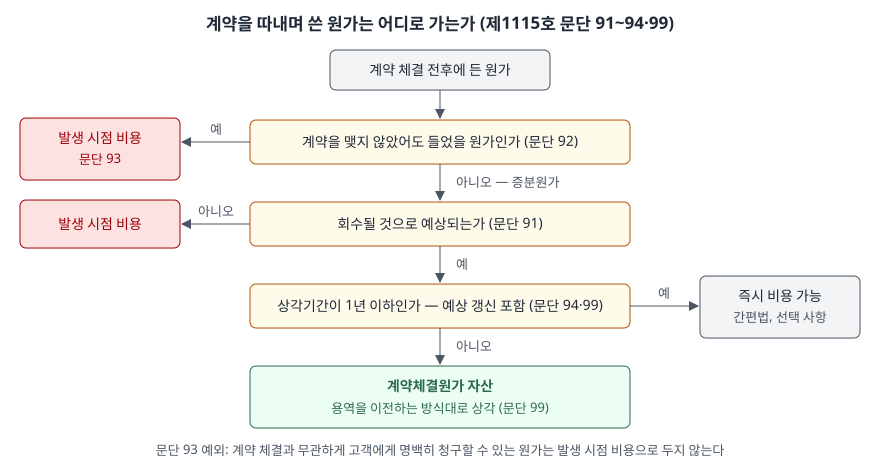

> 예제의 `가나클라우드`와 그 숫자는 계산을 보이려고 만든 가상 자료다.

## 들어가며

구독형 소프트웨어 회사의 손익계산서를 보면 판매비와관리비 안에 영업 수수료가 큰 줄로 잡혀 있는 경우가 많다. 영업사원이 계약 한 건을 따면 그 자리에서 수수료를 주니, 돈이 나간 해의 비용이라고 생각하기 쉽다. 그러면 신규 고객을 많이 확보한 해일수록 비용이 커져서 이익이 줄어든다.

기준서는 이 수수료를 바로 비용으로 두지 않는 경우를 정해 두었다. 아래 예제의 가나클라우드는 4년 동안 수수료로 420,000(단위 천원)을 지급하지만, 같은 4년의 손익에 비용으로 들어가는 금액은 228,750이다. 나머지 191,250은 4년차 말 재무상태표에 자산으로 남는다. 어떤 원가가 자산이 되고 언제 비용으로 넘어가는지를 이 글에서 본다.

[선수수수료 글](../2026-11-09-nonrefundable-upfront-fee-deferral/index.md)은 계약 초에 **받은** 돈을 기간에 나누는 문제였다. 이 글은 계약 초에 **쓴** 돈을 기간에 나누는 문제다.

## 개념

기업회계기준서 제1115호는 고객과의 계약에서 생기는 원가 가운데 두 가지를 자산으로 둘 수 있게 한다. 계약을 따내는 데 든 **계약체결원가**(문단 91~94)와, 계약을 이행하는 데 든 **계약이행원가**(문단 95~98)다. 이 글은 앞의 것을 다룬다.

자산으로 두는 원가는 **계약체결 증분원가**로 한정된다. 고객과 계약을 체결하려고 들인 원가로서 계약을 체결하지 않았다면 들지 않았을 원가이고, 기준서가 드는 예가 판매수수료다(문단 92). 이 원가가 회수될 것으로 예상되면 자산으로 인식한다(문단 91).

| 원가 | 계약을 못 맺었다면 | 처리 | 근거 |
|---|---|---|---|
| 계약 체결 시에만 주는 영업 수수료 | 들지 않았다 | 회수 예상 시 자산 | 문단 91·92 |
| 제안서 자문료, 출장비, 영업팀 기본급 | 그래도 들었다 | 발생 시점 비용 | 문단 93 |
| 위 원가 중 고객에게 명백히 청구할 수 있는 것 | — | 발생 시점 비용으로 두지 않는다 | 문단 93 단서 |

판별 기준은 원가의 이름이 아니라 **계약을 못 맺었을 때도 그 돈이 나가는가**다. 입찰을 위해 만든 설계 자료처럼 계약 체결 여부와 무관하게 든 원가는 계약을 따낸 뒤에도 자산이 되지 않는다.

## 구조



> **출처**: 한국회계기준원 [기업회계기준서 제1115호 '고객과의 계약에서 생기는 수익'](https://www.samili.com/acc/Kijun/Kijunjomun.asp?code=1978-1115) 문단 91~94 계약체결 증분원가, 99 상각 (제3자 전재, 2021-04-23 개정) — 원문 발행처 [한국회계기준원](https://www.kasb.or.kr/front/board/ingAccountingList.do)

질문은 세 단계다. 증분원가인가, 회수될 것인가, 상각기간이 1년을 넘는가. 셋째 질문에서 "예"일 때 즉시 비용은 **쓸 수 있는** 간편법이지 의무가 아니다. 자산으로 두고 1년 안에 상각해도 된다.

## 동작 원리

### 자산으로 두면 용역을 이전하는 방식대로 상각한다

계약체결원가 자산은 그 자산과 관련된 재화나 용역을 고객에게 이전하는 방식과 일치하는 체계적 기준으로 상각한다(문단 99). 구독 용역은 기간에 걸쳐 고르게 이전되므로 예제에서는 정액으로 상각한다. 수수료라는 원가가 그 계약에서 생기는 수익과 같은 기간에 비용으로 대응하도록 하는 것이다.

### 상각기간에는 예상 갱신이 들어간다

문단 99는 그 자산이 **구체적으로 식별된 예상 계약**에 따라 이전할 재화나 용역에 관련될 수 있다고 쓴다. 가나클라우드는 계약이 1년 단위지만 신규 계약 때만 수수료를 주고, 갱신 때는 주지 않는다. 고객이 평균 4년 머문다면 처음 준 수수료는 갱신 계약까지 포함한 4년 동안의 용역과 관련된다. 그래서 상각기간이 계약서상 1년이 아니라 4년이 된다.

이것이 간편법과 바로 이어진다. 문단 94의 간편법은 **상각기간**이 1년 이하일 때만 쓸 수 있다. 계약 기간이 1년이라는 사실로는 부족하다. 예상 갱신을 넣어 상각기간이 4년이 되면 간편법은 닫히고 자산으로 두어야 한다.

### 예상이 바뀌면 상각을 고친다

고객이 예상보다 일찍 떠나는 경향이 확인되는 것처럼 이전 시기에 유의적 변동이 생기면 상각 방식을 수정하고, 이를 회계추정치의 변경으로 처리한다(문단 100). 과거 숫자를 고치지 않고 그 시점부터 앞으로 반영한다.

## 실습 예제

```python
def amortise(amount, years, start_year):
    # 구독 용역이 기간에 걸쳐 고르게 이전되므로 상각도 정액이다 (문단 99)
    return {start_year + i: amount / years for i in range(years)}
```

전체 소스: [`code/`](code/)

```text
[1] 계약 1건에 든 원가 — 증분원가인가 (문단 92·93)
    항목                          금액  처리
    영업 수수료 (체결 시 지급)         300.0  자산 후보 (증분원가)
    제안서 작성 외부 자문료             40.0  발생 시점 비용 (계약 체결과 무관)
    고객 방문 출장비                 25.0  발생 시점 비용 (계약 체결과 무관)
    영업팀 기본급 배분액              120.0  발생 시점 비용 (계약 체결과 무관)

[2] 상각기간이 정하는 처리 — 고객 1곳
    갱신 예상 없음       상각기간 1년  → 간편법 가능 (문단 94)
    갱신 포함 예상 기간    상각기간 4년  → 간편법 불가 — 자산으로 두고 상각
```

계약 한 건에 든 원가 485 가운데 자산 후보는 수수료 300뿐이다. 자문료와 출장비는 계약을 놓쳤어도 이미 나간 돈이고, 기본급은 계약 건수와 상관없이 나간다.

```text
[4] 성장기 4년 — 수수료를 즉시 비용으로 둘 때와 자산으로 상각할 때
    연도      신규   고객 수     구독 수익     즉시 비용       상각비     연말 자산
    1년차   200     200    240,000.0     60,000.0     15,000.0     45,000.0
    2년차   300     500    600,000.0     90,000.0     37,500.0     97,500.0
    3년차   450     950  1,140,000.0    135,000.0     71,250.0    161,250.0
    4년차   450    1400  1,680,000.0    135,000.0    105,000.0    191,250.0

[5] 같은 4년의 수수료 비용 합계
    즉시 비용 420,000.0   상각비 228,750.0   차이(4년차 말 자산) 191,250.0
```

1년차에는 수수료 60,000을 썼지만 상각비는 그 4분의 1인 15,000이다. 남은 45,000은 앞으로 3년의 구독 수익과 대응할 원가로 자산에 남는다. 신규 고객이 늘수록 즉시 비용과 상각비의 차이는 커지고, 자산 잔액도 쌓인다.

4년차에는 신규 고객 수가 3년차와 같아서 즉시 비용이 135,000으로 멈췄지만, 상각비는 105,000으로 계속 올라간다. 앞선 해의 수수료가 아직 상각되고 있기 때문이다. 신규 유입이 일정하게 유지되면 결국 두 처리의 연간 비용은 같아진다. 차이가 크게 나는 것은 **성장 속도가 바뀌는 구간**이다.

## 실무에서 주의할 점

- **계약 기간이 1년이라고 간편법을 바로 쓰지 않는다.** 상각기간은 예상 갱신까지 포함해 정한다(문단 99). 갱신 때 수수료를 다시 주지 않는 구조라면 처음 준 수수료가 갱신 계약에도 관련되므로 상각기간이 길어진다.
- **수수료 지급 조건을 보고 증분원가인지 판단한다.** 개별 계약 체결에 따라 생기는 수수료는 증분원가지만, 고정 급여나 계약과 무관하게 주는 성과급은 계약을 못 맺었어도 나가는 돈이다(문단 92·93). 이름이 수수료라는 이유만으로 자산에 넣지 않는다.
- **같은 업종 두 회사의 영업이익률을 그대로 비교하지 않는다.** 한 회사는 상각기간이 1년 이하라 간편법을 쓰고, 다른 회사는 자산으로 둔다면 성장기의 판매비 규모가 크게 다르게 보인다. 예제 2년차에 즉시 비용은 90,000, 상각비는 37,500이다. 주석에서 계약원가 자산 잔액과 상각 정책을 확인한다.
- **자산 잔액이 빠르게 쌓이면 회수 가능성을 같이 본다.** 이 자산은 회수될 것으로 예상될 때만 인식하고(문단 91), 그 뒤에도 남은 대가로 회수할 수 있는지 손상 검사를 받는다. 고객 이탈이 예상보다 빠르면 상각기간을 줄이고(문단 100) 손상을 검토한다. 손상 계산은 [계약원가 자산 손상 글](../2026-11-10-contract-cost-asset-impairment/index.md)에서 본다.
- **현금은 이미 나갔다.** 자산으로 두어도 수수료 420,000은 4년 동안 실제로 지급됐다. 이익과 현금이 어긋나는 모양은 [이익과 현금의 차이 글](../2026-09-30-cash-flow-profit-without-cash/index.md)과 같은 구조다.

## 정리

- 계약을 체결하지 않았다면 들지 않았을 원가(계약체결 증분원가)만 회수 예상 시 자산으로 둔다. 계약 체결 여부와 무관한 원가는 발생 시점 비용이다(제1115호 문단 91~93).
- 자산은 관련 용역을 이전하는 방식대로 상각하고, 상각기간에는 구체적으로 식별된 예상 계약이 들어간다(문단 99).
- 상각기간이 1년 이하일 때만 즉시 비용 간편법을 쓸 수 있다(문단 94). 계약 기간이 아니라 상각기간이 기준이다.
- 가상 사례에서 4년간 지급한 수수료 420,000 가운데 228,750만 비용이 되고 191,250이 자산으로 남았다. 차이는 성장 속도가 바뀌는 구간에서 커진다.

## 참고 자료

- [한국회계기준원](https://www.kasb.or.kr/front/board/ingAccountingList.do) — K-IFRS 기준서 발행처. 아래 전재 링크는 조문을 바로 열기 위한 편의 링크다
- [기업회계기준서 제1115호 '고객과의 계약에서 생기는 수익'](https://www.samili.com/acc/Kijun/Kijunjomun.asp?code=1978-1115) (제3자 전재, 2021-04-23 개정) — 문단 91~94 계약체결 증분원가, 95~98 계약이행원가, 99~100 상각
- [IFRS 15 Revenue from Contracts with Customers](https://www.ifrs.org/issued-standards/list-of-standards/ifrs-15-revenue-from-contracts-with-customers/) — IFRS Foundation
- 숫자는 이 글의 [`code/output.txt`](code/output.txt) `[1]`~`[5]`에서 옮겼다
