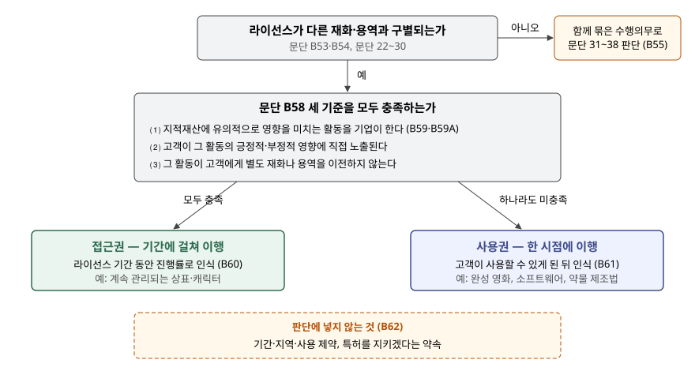

> 예제의 `가나라이선싱`과 그 숫자는 계산을 보이려고 만든 가상 자료다.

## 들어가며

캐릭터나 콘텐츠를 가진 회사의 사업보고서를 읽다 보면 라이선스 수익이 해마다 고르게 잡히는 회사가 있고, 계약을 맺은 해에 한꺼번에 튀어 오르는 회사가 있다. 계약금을 미리 다 받았다는 사실은 같은데 매출 모양이 이렇게 다르면, 한쪽이 공격적으로 회계처리를 했다고 의심하기 쉽다.

아래 예제의 가나라이선싱은 두 고객에게 각각 계약금 1,200(단위 백만원), 기간 4년의 라이선스를 판다. 하나는 캐릭터 상표이고 하나는 완성된 영화다. 1년차에 상표 쪽은 300을 수익으로 잡고, 영화 쪽은 0을 잡는다. 2년차에는 영화 쪽이 1,200을 한 번에 잡는다. 두 처리는 모두 기준서대로다. 무엇이 둘을 가르는지를 이 글에서 본다.

[수익 인식 5단계 글](../2026-10-10-revenue-recognition-five-steps/index.md)에서 수행의무가 한 시점에 이행되는지 기간에 걸쳐 이행되는지를 봤다. 라이선스는 이 판단을 위한 별도 규정이 적용지침에 있다. 이 글은 고정 계약금만 다루고, 고객 매출에 따라 달라지는 로열티는 [판매기준 로열티 글](../2026-11-11-sales-based-royalty-exception/index.md)에서 본다.

## 개념

기업회계기준서 제1115호 적용지침은 라이선스를 **기업의 지적재산에 대한 고객의 권리를 정하는 것**으로 보고, 소프트웨어·영화와 음악·프랜차이즈·특허권과 상표권을 예로 든다(문단 B52).

라이선스가 다른 재화나 용역과 구별되지 않으면 함께 하나의 수행의무로 묶어 일반 규정으로 판단한다(문단 B54·B55). 구별되면 라이선스 약속의 성격이 다음 둘 중 무엇인지 판단한다(문단 B56).

| 성격 | 고객이 받는 것 | 이행 시기 | 근거 |
|---|---|---|---|
| **접근권** | 라이선스 기간 전체에 걸쳐 **존재하는** 지적재산에 접근할 권리 | 기간에 걸쳐 | 문단 B56⑴·B60 |
| **사용권** | 라이선스를 부여하는 **시점에 존재하는** 지적재산을 사용할 권리 | 한 시점 | 문단 B56⑵·B61 |

차이는 지적재산이 계약 뒤에도 **기업의 활동으로 바뀌는가**다. 상표는 그 회사가 광고를 멈추고 평판을 관리하지 않으면 가치가 떨어진다. 고객이 받는 것은 계약일의 상표가 아니라 4년 동안 관리되는 상표다. 완성된 영화는 계약일의 모습 그대로 쓰인다.

## 구조



> **출처**: 한국회계기준원 [기업회계기준서 제1115호 '고객과의 계약에서 생기는 수익'](https://www.samili.com/acc/Kijun/Kijunjomun.asp?code=1978-1115) 적용지침 문단 B52~B62 지적재산의 라이선스 (제3자 전재, 2021-04-23 개정) — 원문 발행처 [한국회계기준원](https://www.kasb.or.kr/front/board/ingAccountingList.do)

접근권이 되려면 세 기준을 **모두** 충족해야 한다(문단 B58). 하나라도 빠지면 사용권이다. 기준서가 사용권을 남는 쪽으로 정해 둔 것이므로, 판단은 접근권의 세 기준을 하나씩 확인하는 순서로 한다.

## 동작 원리

### 첫째 기준이 대부분을 가른다

세 기준 중 실무에서 판단이 갈리는 곳은 ⑴ **지적재산에 유의적으로 영향을 미치는 활동**이다. 기업의 사업 관행이나 공개된 경영방침이 고객의 기대를 만들 수 있고, 판매기준 로열티처럼 지적재산의 성과를 기업과 고객이 나눠 갖는 구조도 그 기대를 나타낼 수 있다. 다만 로열티는 결정적인 증거가 아니다(문단 B59).

"유의적으로 영향"은 문단 B59A가 두 경우로 정한다. 활동이 지적재산의 형식이나 기능성을 유의적으로 바꿀 것으로 예상되거나, 고객이 효익을 얻는 능력이 실질적으로 그 활동에서 생기는 경우다. 기준서는 상표를 뒤의 예로 든다. 반대로 **개별 기능성이 유의적인** 지적재산, 곧 소프트웨어·약물 제조법·완성된 영화나 음반은 효익의 대부분이 그 기능성에서 나오므로 형식이나 기능성을 바꾸지 않는 활동만으로는 첫째 기준을 충족하지 않는다.

둘째 기준은 그 활동의 결과가 고객에게 **직접** 미쳐야 한다는 것이고, 셋째 기준은 그 활동 자체가 업데이트 제공처럼 고객에게 무언가를 넘기는 별도 용역이 아니어야 한다는 것이다. 별도 용역이면 그 용역이 따로 수행의무가 된다.

### 사용권은 쓸 수 있게 된 뒤에야 수익이다

사용권은 한 시점에 이행하지만, 고객이 라이선스를 사용해 효익을 얻을 수 있는 **기간이 시작되기 전에는** 수익을 인식하지 않는다(문단 B61). 기준서의 예는 라이선스 기간이 시작됐는데 소프트웨어 접속번호를 아직 주지 않은 경우다. 예제의 영화 계약은 라이선스 기간이 1년차 12월 1일에 시작하지만 방영용 원본 파일을 2년차 1월 10일에 넘기므로, 수익은 2년차에 들어간다.

### 계약서에 적힌 제약은 성격을 바꾸지 않는다

라이선스 기간 4년, 국내 한정, 특정 매체 한정 같은 제약은 라이선스의 **속성**을 정할 뿐 이행 시기를 정하지 않는다. 특허 침해에 대응하겠다는 약속도 수행의무가 아니다(문단 B62). 기간이 정해져 있다는 이유로 기간에 걸쳐 인식하면 이 규정을 어기는 것이다.

## 실습 예제

```python
def nature(contract):
    if contract["activity"] and contract["exposed"] and contract["no_transfer"]:
        return "access"
    return "use"
```

전체 소스: [`code/`](code/)

```text
[1] 문단 B58 세 기준 — 모두 충족해야 접근권
    계약                  ⑴ 유의적 활동   ⑵ 직접 노출  ⑶ 별도 이전 없음  판단
    A. 캐릭터 상표 라이선스            충족        충족          충족  접근권 → 기간에 걸쳐
      근거: 기업이 캐릭터 애니메이션·광고를 계속 내보내 상표 가치를 유지한다
    B. 완성 영화 방영 라이선스         미충족       미충족          충족  사용권 → 한 시점
      근거: 영화는 완성돼 있고 기업이 내용을 바꿀 계획이 없다 (개별 기능성이 유의적, B59A)
```

두 계약은 금액, 기간, 지역 제약, 침해 대응 약속이 모두 같다. 갈린 것은 첫째 기준이다. 둘째 기준은 첫째 기준의 활동에 고객이 노출되는지를 묻는 것이라, 활동이 없으면 함께 미충족이 된다.

```text
[3] 같은 계약금 1,200 의 연도별 수익
    계약                       1년차       2년차       3년차       4년차       5년차        합계
    A. 캐릭터 상표 라이선스         300.0     300.0     300.0     300.0       0.0   1,200.0
    B. 완성 영화 방영 라이선스         0.0   1,200.0       0.0       0.0       0.0   1,200.0

[4] 연말 계약부채 잔액 — 현금은 계약일에 이미 다 받았다 (문단 106)
    계약                       1년차       2년차       3년차       4년차       5년차
    A. 캐릭터 상표 라이선스         900.0     600.0     300.0       0.0       0.0
    B. 완성 영화 방영 라이선스     1,200.0       0.0       0.0       0.0       0.0
```

합계는 둘 다 1,200이다. 차이는 **시기**뿐이다. 상표 계약은 진행률을 경과 기간으로 보아 해마다 300씩 인식하고, 받은 돈 중 아직 이행하지 않은 몫이 계약부채로 줄어든다. 영화 계약은 1년차 말에 받은 돈 전부가 계약부채로 남아 있다가, 원본 파일을 넘긴 2년차에 한 번에 수익이 된다.

1년차만 보면 A가 300, B가 0이고, 2년차만 보면 B가 A보다 900 많다. 라이선스 매출 비중이 큰 회사에서 한 해의 매출 증감을 볼 때는 이 시기 차이를 먼저 걸러야 한다.

## 실무에서 주의할 점

- **사용권 라이선스가 많은 회사는 매출이 계약 시기를 따라 출렁인다.** 큰 계약이 몰린 해에 매출이 뛰고 다음 해에 꺼지는 것은 사업이 흔들린다는 뜻이 아닐 수 있다. 주석에서 라이선스 수익을 한 시점 인식과 기간 인식으로 나눠 공시했는지 본다.
- **기간이 정해진 라이선스라고 기간에 걸쳐 인식하지 않는다.** 4년 기간은 시간 제약이고 판단에서 뺀다(문단 B62). 기간에 걸친 인식을 정당화하는 것은 기업의 계속적인 활동이다.
- **계약부채 잔액으로 앞으로의 수익을 읽을 수 있다.** 접근권 계약은 받은 계약금이 계약부채로 남아 해마다 수익으로 넘어간다. 예제 A의 1년차 말 잔액 900은 앞으로 3년 동안 인식할 수익이다. 다만 현금은 이미 들어왔으므로 이 수익에는 새로 들어올 현금이 없다.
- **같은 콘텐츠라도 계약 내용이 성격을 바꾼다.** 영화라도 기업이 고객이 쓰는 동안 내용을 계속 바꾸기로 약속했다면 첫째 기준을 다시 따져야 한다. 업데이트를 넘기는 약속이 별도 용역이면 그 부분은 따로 수행의무가 되고(셋째 기준), 라이선스 자체의 성격은 그대로 남는다.
- **고객이 쓸 수 없는 상태면 사용권이라도 수익이 아니다.** 접속번호나 원본을 아직 넘기지 않았다면 라이선스 기간이 시작됐어도 인식하지 않는다(문단 B61). 연말 직전에 맺은 계약은 이 조건 때문에 회계연도가 갈릴 수 있다.

## 정리

- 구별되는 라이선스는 성격에 따라 접근권(기간에 걸쳐)과 사용권(한 시점)으로 나뉜다(제1115호 문단 B56·B60·B61).
- 접근권이 되려면 문단 B58의 세 기준을 모두 충족해야 하고, 판단을 가르는 것은 대개 지적재산에 유의적으로 영향을 미치는 기업 활동이 있는가다(문단 B59A).
- 기간·지역·사용 제약과 특허를 지키겠다는 약속은 판단에 넣지 않는다(문단 B62).
- 가상 사례에서 같은 1,200이 상표 계약은 4년간 300씩, 영화 계약은 원본을 넘긴 2년차에 한 번에 수익이 됐다.

## 참고 자료

- [한국회계기준원](https://www.kasb.or.kr/front/board/ingAccountingList.do) — K-IFRS 기준서 발행처. 아래 전재 링크는 조문을 바로 열기 위한 편의 링크다
- [기업회계기준서 제1115호 '고객과의 계약에서 생기는 수익'](https://www.samili.com/acc/Kijun/Kijunjomun.asp?code=1978-1115) (제3자 전재, 2021-04-23 개정) — 적용지침 문단 B52~B62 지적재산의 라이선스, 문단 106 계약부채
- [IFRS 15 Revenue from Contracts with Customers](https://www.ifrs.org/issued-standards/list-of-standards/ifrs-15-revenue-from-contracts-with-customers/) — IFRS Foundation
- 숫자는 이 글의 [`code/output.txt`](code/output.txt) `[1]`~`[5]`에서 옮겼다
