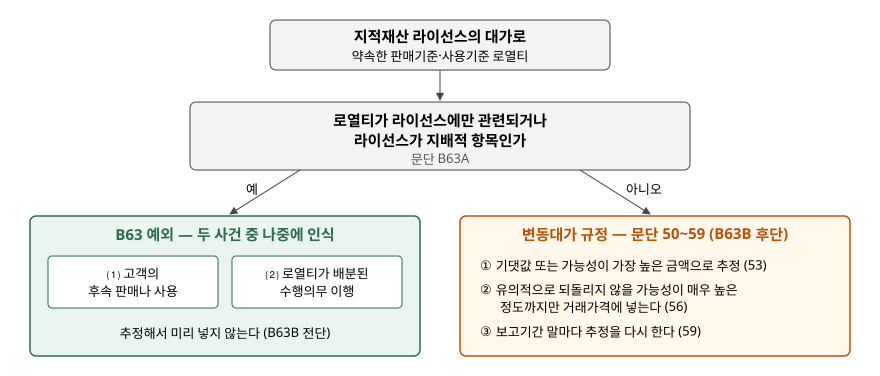

> 예제의 `가나라이선싱`과 그 숫자, 시나리오 확률은 계산을 보이려고 만든 가상 자료다.

## 들어가며

라이선스 계약서에는 고정 계약금 말고도 "고객 매출액의 몇 퍼센트" 같은 로열티 조항이 흔히 붙는다. 이 로열티는 고객이 얼마나 팔지에 따라 금액이 달라지므로 변동대가다. 반품권이나 판매장려금 같은 다른 변동대가는 계약 시점에 금액을 추정해 거래가격에 넣으니, 로열티도 그렇게 하리라고 생각하기 쉽다.

아래 예제의 가나라이선싱은 3년 동안 로열티를 1,000(단위 백만원) 받는다. 계약 시점 추정치의 기대값은 980으로 실제와 거의 같았다. 그런데도 기준서는 사용권을 넘긴 1년차에 이 추정치를 수익으로 넣지 못하게 하고, 그해 실제로 생긴 200만 인식하게 한다. 이 예외가 어떤 계약에 적용되고, 적용되지 않으면 무엇이 달라지는지를 본다.

[라이선스 접근권과 사용권 글](../2026-11-11-license-right-to-access-vs-use/index.md)은 고정 계약금이 언제 수익이 되는지를 다뤘다. 이 글은 같은 라이선스에 붙은 변동 대가를 다룬다.

## 개념

변동대가의 일반 규정은 두 단계다. 기댓값이나 가능성이 가장 높은 금액 중 더 잘 예측하는 방법으로 금액을 추정하고(문단 53), 불확실성이 해소될 때 이미 인식한 누적 수익 중 유의적인 부분을 되돌리지 않을 **가능성이 매우 높은 정도까지만** 거래가격에 넣는다(문단 56). 이것을 변동대가 추정치의 제약이라고 한다.

적용지침 문단 B63은 이 일반 규정에 **"불구하고"** 로 시작하는 예외를 둔다. 지적재산 라이선스의 대가인 판매기준·사용기준 로열티의 수익은 다음 중 **나중의** 사건이 일어날 때 인식한다.

| 사건 | 뜻 |
|---|---|
| ⑴ 후속 판매나 사용 | 고객(라이선시)이 그 지적재산을 써서 실제로 팔거나 쓴다 |
| ⑵ 수행의무 이행 | 로열티의 일부나 전부가 배분된 수행의무를 기업이 이행한다 |

예외가 적용되는 범위도 정해져 있다. 로열티가 라이선스에**만** 관련되거나, 라이선스가 로열티가 관련된 **지배적 항목**일 때다(문단 B63A). 이 요건을 충족하면 로열티 수익은 전적으로 B63에 따르고, 충족하지 못하면 일반 변동대가 규정으로 돌아간다(문단 B63B).

## 구조



> **출처**: 한국회계기준원 [기업회계기준서 제1115호 '고객과의 계약에서 생기는 수익'](https://www.samili.com/acc/Kijun/Kijunjomun.asp?code=1978-1115) 문단 50~59 변동대가와 그 추정치의 제약, 적용지침 문단 B63~B63B 판매기준 로열티나 사용기준 로열티 (제3자 전재, 2021-04-23 개정) — 원문 발행처 [한국회계기준원](https://www.kasb.or.kr/front/board/ingAccountingList.do)

갈림길은 하나다. 로열티가 무엇의 대가인가. 라이선스가 지배적인 예로 기준서는 기업이 고객이 그 라이선스에 다른 재화나 용역보다 더 유의적인 가치를 부여할 것이라고 합리적으로 예상하는 경우를 든다(문단 B63A⑵).

## 동작 원리

### 예외가 막는 것 — 계약 시점에 미래 매출을 수익으로 당겨 오는 일

사용권 라이선스는 한 시점에 이행된다. 일반 규정대로라면 라이선스를 넘긴 날 로열티 추정치 중 제약을 통과한 금액이 그날의 수익이 된다. 고객 매출은 기업이 통제할 수 없는 시장 상황에 달려 있고, 로열티는 계약 기간 내내 불확실성이 남는다. 문단 57은 대가가 기업의 영향력이 미치지 못하는 요인에 민감하거나 불확실성이 장기간 해소되지 않을 때 수익이 되돌려질 가능성이 커진다고 든다. B63은 이 판단을 계약마다 하게 두지 않고, 고객의 판매가 실제로 일어날 때까지 기다리도록 시기를 정해 버린 것이다.

### 나중 사건이 무엇이 되는가

사용권이면 라이선스를 넘긴 날 수행의무 ⑵가 이미 끝났으므로 나중 사건은 언제나 고객의 판매 ⑴이다. 접근권이면 수행의무가 라이선스 기간 동안 이어서 이행된다. 예제처럼 해마다 이행이 진행되는 동안 고객 매출도 그해에 일어나면, 두 사건은 같은 해에 함께 생긴다.

반대로 ⑴이 먼저 생기는 경우도 있다. 기업이 아직 라이선스를 넘기지 않았는데 고객이 판매를 시작할 수는 없으므로, 이 경우는 로열티가 라이선스 외에 아직 이행하지 않은 다른 수행의무에도 배분된 계약에서 생긴다. 그때는 그 수행의무가 이행될 때까지 기다린다.

### 예외가 적용되지 않으면 추정과 재검토로 돌아간다

라이선스가 지배적 항목이 아니면 로열티 전체를 변동대가로 추정하고 제약을 걸어 거래가격에 넣은 뒤, 보고기간 말마다 추정을 다시 한다(문단 59). 수익 금액은 실제 로열티가 아니라 **제약된 거래가격 × 진행률**의 누적치에서 나온다.

## 실습 예제

```python
def case_use_right(fixed_fee):
    """사용권: 고정 계약금은 이전 시점(1년차)에, 로열티는 고객 매출이 일어날 때 (B61, B63)."""
    royalty = actual_royalty()
    return {y: (fixed_fee if y == 1 else 0.0) + royalty[y] for y in YEARS}
```

전체 소스: [`code/`](code/)

```text
[1] 고객 매출과 실제 로열티 (매출액의 5%)
    1년차  고객 매출   4,000.0   로열티     200.0
    2년차  고객 매출  10,000.0   로열티     500.0
    3년차  고객 매출   6,000.0   로열티     300.0
    합계              20,000.0            1,000.0

[2] 고정 계약금 300 + 로열티 — B63 적용 (라이선스만 관련)
    처리                               1년차       2년차       3년차        합계
    사용권: 계약금은 1년차, 로열티는 매출 때       500.0     500.0     300.0   1,300.0
    접근권: 계약금은 3년 정액, 로열티는 매출 때     300.0     600.0     400.0   1,300.0
```

두 처리에서 로열티 몫은 똑같이 200·500·300이다. 차이는 고정 계약금 300을 1년차에 한 번에 넣느냐 3년에 100씩 나누느냐뿐이다. 로열티 쪽은 라이선스 성격과 상관없이 고객 매출의 모양을 그대로 따라간다.

```text
[3] 비교 — 예외가 없다면 사용권 이전 시점(1년차)에 넣었을 로열티 추정치
    기대값 (문단 53)                           980.0
    가장 낮은 시나리오까지만 (제약 판단 가정)       600.0
    실제 3년 로열티                            1,000.0
    B63 적용 시 1년차 로열티 수익                 200.0
```

예외가 없다면 1년차에 600~980이 로열티 수익으로 들어갈 수 있었다. 제약을 어디까지 걸지는 판단이고, 예제의 600은 가장 낮은 시나리오를 쓴다는 가정이다. B63은 이 판단 자체를 없애고 1년차를 실제 200으로 고정한다.

```text
[4] 라이선스가 지배적 항목이 아닐 때 — 변동대가 규정으로 (B63B, 문단 56·59)
    연도         누적 실제      제약된 가격     진행률     누적 수익     당기 수익
    1년차        200.0       600.0     33%     200.0     200.0
    2년차        700.0       900.0     67%     600.0     400.0
    3년차      1,000.0     1,000.0    100%   1,000.0     400.0
    비교: 같은 해 실제 로열티  1년차 200.0  2년차 500.0  3년차 300.0
```

이 경우는 로열티가 라이선스와 3년 기술지원 용역으로 된 하나의 수행의무에 관련되고 기간에 걸쳐 이행된다고 가정했다. 보고기간 말마다 지금까지의 실제 로열티에 남은 기간의 가장 낮은 시나리오를 더해 거래가격을 다시 잡는다. 2년차에 실제 로열티는 500인데 수익은 400이고, 3년차에는 실제 300에 수익 400이다. 고객 매출이 튄 해의 몫이 다음 해로 나뉘어 들어간다. 3년 합계는 B63을 적용했을 때와 같은 1,000이다.

## 실무에서 주의할 점

- **로열티 매출은 고객의 매출을 그대로 따라간다.** B63이 적용되는 회사의 로열티 수익이 해마다 출렁이면 그것은 라이선시들의 판매가 출렁인 것이다. 계약금 수익과 로열티 수익을 주석에서 나눠 보지 않으면 원인을 구분할 수 없다.
- **"로열티"라는 이름만으로 예외를 쓰지 않는다.** 예외는 지적재산 라이선스의 대가에만, 그리고 라이선스만 관련되거나 지배적일 때만 적용된다(문단 B63A). 라이선스와 제조·연구 용역이 함께 묶인 계약은 지배적 항목 판단이 먼저다.
- **판매와 무관한 조건부 대가는 이 예외 대상이 아니다.** 일정 기간이 지나야 권리가 확정되는 인센티브나 마일스톤 지급처럼 고객의 판매·사용에 연동되지 않는 대가는 문단 50~59의 변동대가 규정을 따른다.
- **예외가 적용되면 추정치를 미리 넣지 않는다.** 계약 시점에 미래 로열티를 아무리 잘 예측할 수 있어도 B63 대상이면 거래가격에 넣지 않는다. "예측이 정확하니 미리 넣어도 된다"는 판단은 이 예외 아래에서 쓸 수 없다.
## 정리

- 판매·사용기준 로열티는 변동대가이지만, 지적재산 라이선스의 대가이면 고객의 판매·사용과 수행의무 이행 중 나중 사건이 일어날 때 인식한다(제1115호 문단 B63).
- 예외는 로열티가 라이선스에만 관련되거나 라이선스가 지배적 항목일 때 적용되고, 아니면 변동대가 추정·제약·재검토 규정으로 돌아간다(문단 B63A·B63B, 56·59).
- 가상 사례에서 예외가 없다면 1년차에 600~980이 들어갈 수 있었던 로열티가 실제 200만 인식됐다. 변동대가 규정으로 가면 수익이 실제 로열티와 다른 해에 나뉘어 들어간다.

## 참고 자료

- [한국회계기준원](https://www.kasb.or.kr/front/board/ingAccountingList.do) — K-IFRS 기준서 발행처. 아래 전재 링크는 조문을 바로 열기 위한 편의 링크다
- [기업회계기준서 제1115호 '고객과의 계약에서 생기는 수익'](https://www.samili.com/acc/Kijun/Kijunjomun.asp?code=1978-1115) (제3자 전재, 2021-04-23 개정) — 문단 50~59 변동대가, 적용지침 문단 B56~B63B 지적재산의 라이선스
- [IFRS 15 Revenue from Contracts with Customers](https://www.ifrs.org/issued-standards/list-of-standards/ifrs-15-revenue-from-contracts-with-customers/) — IFRS Foundation
- 숫자는 이 글의 [`code/output.txt`](code/output.txt) `[1]`~`[4]`에서 옮겼다
