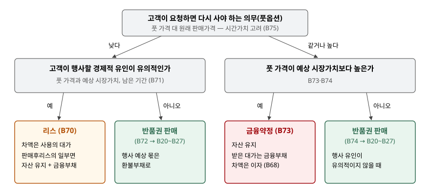

> 예제의 `다라중공업`과 그 숫자, 예상 시장가치와 행사 대수, 감가상각 가정은 계산을 보이려고 만든 가상 자료다.

## 들어가며

건설장비 제조사가 렌탈 업체에 굴착기를 팔면서 "3년 뒤 원하면 정해진 값에 되사 주겠다"는 조건을 붙이는 일이 있다. 렌탈 업체는 중고 처분 걱정을 덜고, 제조사는 판매를 늘린다. 계약서 이름은 매매계약이니 판 날 매출을 잡으면 될 것 같다.

그런데 되사 주는 값이 3년 뒤 중고 시세보다 높으면 렌탈 업체는 거의 틀림없이 되판다. 그러면 제조사가 한 일은 굴착기를 3년 빌려주고 사용료를 받은 것과 같다. 되사 주는 값이 원래 판매가격보다도 높으면 아예 돈을 빌린 모양이 된다. 같은 "되사 주겠다"는 조항이 값에 따라 리스, 반품권 판매, 금융약정 세 가지로 갈리는 이유다.

[앞 글](../2026-11-12-repurchase-forward-call-option/index.md)은 기업이 되살 의무나 권리를 쥔 선도·콜옵션을 다뤘다. 이 글은 그 결정이 **고객** 쪽에 있는 풋옵션을 다룬다.

## 개념

풋옵션은 고객이 요청하면 기업이 자산을 다시 사야 하는 의무다(문단 B65⑶). 선도·콜옵션과 달리 되사는 결정이 고객에게 있으므로 풋옵션이 있다는 사실만으로는 고객의 통제가 제한되지 않는다. 고객은 옵션을 행사하지 않고 자산을 계속 쓰거나 시장에 팔 수 있다.

그래서 기준서는 고객이 실제로 행사할 것인지를 묻는다. 계약 개시시점에 고객이 그 권리를 행사할 **경제적 유인이 유의적인지**를 고려한다(문단 B70). 판단에는 재매입일의 예상 시장가치와 재매입 가격의 관계, 권리가 소멸될 때까지 남은 기간 같은 여러 요소를 본다(문단 B71). 같은 문단은 재매입 가격이 시장가치보다 유의적으로 높을 것으로 예상되면 유인이 유의적이라는 예를 든다.

## 구조



> **출처**: 한국회계기준원 [기업회계기준서 제1115호 '고객과의 계약에서 생기는 수익'](https://www.samili.com/acc/Kijun/Kijunjomun.asp?code=1978-1115) 적용지침 문단 B70~B76 재매입약정 — 풋옵션, 문단 B20~B27 반품권이 있는 판매 (제3자 전재, 2021-04-23 개정) — 원문 발행처 [한국회계기준원](https://www.kasb.or.kr/front/board/ingAccountingList.do)

기준은 두 가격이다. 풋 가격을 먼저 **원래 판매가격**과 견주고, 그다음 **예상 시장가치**(또는 행사 유인)와 견준다. 네 갈래 중 두 갈래가 반품권 판매로 모인다.

## 동작 원리

### 판매가격보다 낮은 풋 — 유인이 크면 리스

풋 가격이 원래 판매가격보다 낮은데 고객이 행사할 유인이 유의적이라면, 고객은 판매가격과 풋 가격의 차이만큼을 내고 일정 기간 자산을 쓴 뒤 돌려주는 것이다. 문단 B70은 이 결과를 고객이 사용권의 대가를 지급하는 것으로 보고 제1116호에 따른 리스로 처리하게 한다. 그 계약이 판매후리스 거래의 일부라면 자산을 계속 인식하고 받은 대가를 금융부채로 처리한다.

### 판매가격보다 낮은 풋 — 유인이 작으면 반품권 판매

유인이 유의적이지 않으면 고객은 대체로 자산을 계속 갖는다. 이때는 반품권이 있는 제품의 판매처럼 처리한다(문단 B72). 행사될 것으로 예상하는 몫만큼은 매출 대신 환불부채로 두고, 돌려받을 자산은 반환재고회수권으로 인식한다. 회수권은 종전 장부금액에서 회수 원가와 가치 감소 예상분을 뺀 금액으로 잰다(문단 B25).

### 판매가격 이상의 풋 — 시장가치가 가른다

풋 가격이 원래 판매가격 이상이고 예상 시장가치보다도 높으면 고객은 행사할 것이고, 기업은 받은 돈보다 많이 돌려주게 된다. 이 계약은 사실상 금융약정이다(문단 B73). 앞 글의 콜옵션과 똑같이 자산을 계속 인식하고 받은 대가를 금융부채로 둔 뒤 차액을 이자로 인식한다(문단 B68).

풋 가격이 판매가격 이상이어도 예상 시장가치 이하이고 행사 유인이 유의적이지 않으면, 고객은 시장에 파는 편이 낫다. 이때는 다시 반품권 판매로 처리한다(문단 B74). 두 경우 모두 가격 비교에는 시간가치를 고려하고(문단 B75), 옵션이 행사되지 않고 소멸되면 부채를 제거하고 수익을 인식한다(문단 B76).

## 실습 예제

다라중공업이 장부금액 700인 굴착기 10대를 대당 1,000에 팔고, 3년 뒤 고객이 요청하면 되사 주는 풋옵션을 붙인다. 3년 뒤 예상 시장가치는 대당 600으로 가정했다. 예제는 B71의 여러 요소 중 시장가치 하나만 보고, **풋 가격이 시장가치보다 높으면 유인이 유의적**이라고 단순화했다.

```text
[1] 풋 가격에 따른 분류 (원래 판매가격 1,000, 판매후리스 아님)
    풋 가격    예상 시장가치   분류
        400          600      반품권이 있는 판매 (B72)
        500          600      반품권이 있는 판매 (B72)
        600          600      반품권이 있는 판매 (B72)
        700          600      리스 (B70)
        900          600      리스 (B70)
      1,000          600      금융약정 (B73)
      1,050          600      금융약정 (B73)
      1,050        1,200      반품권이 있는 판매 (B74)
```

풋 가격 700과 900은 판매가격보다 낮아도 시장가치보다 높아 리스로 간다. 같은 1,050이라도 예상 시장가치가 1,200이면 고객이 시장에 파는 편이 나으므로 반품권 판매로 바뀐다. 분류에 들어가는 것은 풋 가격 하나가 아니라 **두 가격과의 관계**다.

전체 소스: [`code/`](code/)

```text
[2] 굴착기 10대, 3년 뒤 예상 시장가치 대당 600
  가. 풋옵션 없음 — 판매
    판 날    매출  10,000.0  매출원가  -7,000.0
    3년 손익 합계    3,000.0
  나. 풋 500 — 반품권이 있는 판매 (1대 행사 예상)
    판 날    매출   9,500.0  매출원가  -6,400.0
    3년 손익 합계    3,100.0
    환불부채 500.0  반환재고회수권 600.0
  다. 풋 700 — 리스
    1년차    리스료수익   1,000.0  감가상각비    -700.0
    3년 손익 합계      900.0
  라. 풋 1,050 — 금융약정 (유효이자율 1.6396%)
    1년차    이자비용    -164.0
    3년 손익 합계     -500.0
```

`다`와 `라`는 2·3년차가 같은 모양으로 이어지므로 줄을 줄였다(전체는 `output.txt` `[2]`).

반품권 판매(`나`)는 1대가 행사될 것으로 보고 그 대금 500을 환불부채로 뺐다. 돌려받을 굴착기는 장부금액 700에서 예상 가치 감소 100을 빼 600으로 잡았다. 되사 주는 값 500보다 돌려받는 굴착기 값 600이 크므로 이익이 풋옵션이 없을 때보다 100 많다. 풋 가격이 시장가치보다 낮다는 것은 기업 쪽에서 보면 싸게 되사 온다는 뜻이다.

리스(`다`)는 매출이 없다. 고객이 낸 1,000과 돌려받을 700의 차이 300이 대당 3년 사용료이고, 10대면 해마다 1,000이 리스료수익이 된다. 금융약정(`라`)은 10,000을 빌려 3년 뒤 10,500을 갚는 셈이라 손익에는 이자 500만 남는다.

```text
[3] 3년 뒤 풋옵션이 행사되지 않고 소멸 (B76)
    다. 리스      부채 7,000.0 제거 -> 매출 7,000.0, 매출원가 4,900.0
        3년 손익 합계    3,000.0
    라. 금융약정  부채 10,500.0 제거 -> 매출 10,500.0, 매출원가 7,000.0
        3년 손익 합계    3,000.0
```

행사되지 않고 소멸되면 리스와 금융약정의 3년 합계는 풋옵션 없는 판매와 같은 3,000이 된다. 앞 글의 콜옵션과 같은 결과다. 다만 시장가치보다 높은 풋을 고객이 버리는 일은 드물다. 예상이 맞았다면 굴착기는 장부로 돌아오고 합계는 900과 -500에 머문다.

## 실무에서 주의할 점

- **분류는 계약 개시시점에 한다.** 문단 B70은 계약 개시시점에 행사 유인을 고려하라고 정한다. 3년 뒤 중고 시세가 예상과 달라져도 처음 분류를 따라간 처리가 이어진다. 예상 시장가치를 무엇으로 잡았는지가 분류 전체를 정하므로 근거를 남겨야 한다.
- **"유의적"에는 숫자 기준이 없다.** 문단 B71은 고려할 요소와 예를 들 뿐 몇 퍼센트 높으면 유의적인지 정하지 않는다. 예제의 "시장가치보다 높으면 유의적"은 설명을 위한 단순화다. 실무에서는 남은 기간, 시세 변동성, 고객의 사업상 사정까지 함께 본다.
- **반품권 판매의 회수권은 새 제품 값이 아니다.** 3년 쓴 자산이 돌아오므로 종전 장부금액에서 가치 감소 예상분을 빼야 한다(문단 B25). 판 날의 원가 700을 그대로 회수권으로 두면 돌려받을 자산이 부풀고 판 날 이익도 그만큼 커진다.
- **같은 풋이 콜옵션과 다르게 읽힌다.** 콜옵션은 행사 유인과 상관없이 판매가 아니지만(문단 B66), 풋옵션은 유인이 작으면 판매로 처리된다. 계약서의 재매입 조항을 볼 때 누가 행사 결정을 쥐는지부터 확인한다.

## 정리

- 고객 풋옵션은 계약 개시시점에 고객이 행사할 경제적 유인이 유의적인지로 판단한다(제1115호 문단 B70·B71).
- 풋 가격이 판매가격보다 낮으면 유인이 클 때 리스, 작을 때 반품권 판매다(문단 B70·B72).
- 판매가격 이상이면 예상 시장가치보다 높을 때 금융약정, 이하이고 유인이 작을 때 반품권 판매다(문단 B73·B74).
- 가상 사례에서 풋 가격만 500·700·1,050으로 바꾸자 3년 손익이 3,100, 900, -500으로 갈렸다.

## 참고 자료

- [한국회계기준원](https://www.kasb.or.kr/front/board/ingAccountingList.do) — K-IFRS 기준서 발행처. 아래 전재 링크는 조문을 바로 열기 위한 편의 링크다
- [기업회계기준서 제1115호 '고객과의 계약에서 생기는 수익'](https://www.samili.com/acc/Kijun/Kijunjomun.asp?code=1978-1115) (제3자 전재, 2021-04-23 개정) — 적용지침 문단 B20~B27 반품권이 있는 판매, 문단 B64~B76 재매입약정
- [기업회계기준서 제1116호 '리스'](https://www.samili.com/acc/Kijun/Kijunjomun.asp?code=1978-1116) (제3자 전재, 2023-05-12 개정) — 문단 81·84 운용리스 리스제공자
- [IFRS 15 Revenue from Contracts with Customers](https://www.ifrs.org/issued-standards/list-of-standards/ifrs-15-revenue-from-contracts-with-customers/) — IFRS Foundation
- 숫자는 이 글의 [`code/output.txt`](code/output.txt) `[1]`~`[3]`에서 옮겼다
