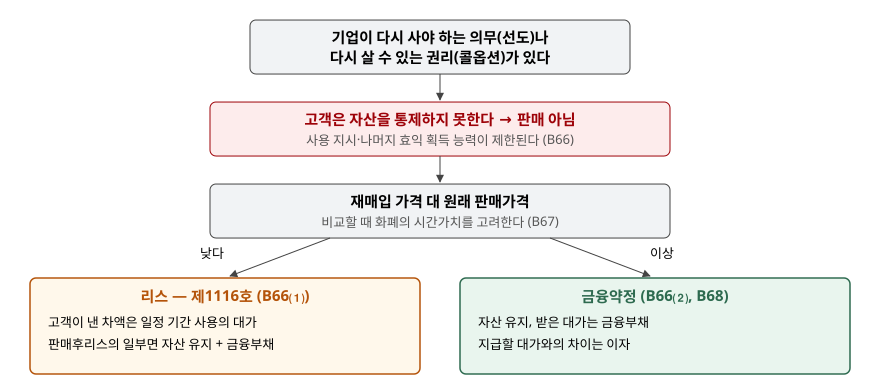

> 예제의 `가나기계`와 그 숫자, 감가상각 가정은 계산을 보이려고 만든 가상 자료다.

## 들어가며

기계 제조사가 거래처에 기계를 넘기고 대금 1,000을 받는다. 계약서 뒷장에는 "2년 뒤 회사가 이 기계를 1,100에 다시 사 온다"는 조항이 붙어 있다. 송장도 나갔고 기계도 거래처 공장에 들어가 있으니 넘긴 날 매출 1,000을 잡고 싶어진다.

그런데 2년 뒤 1,100에 되사 오면 이 회사가 한 일은 1,000을 받고 2년 뒤 1,100을 갚은 것이다. 기계는 잠시 거래처에 가 있었을 뿐 결국 회사 손에 돌아온다. 이 거래를 매출로 잡으면 넘긴 해의 매출이 1,000 부풀고, 2년 뒤에는 되사는 데 쓴 1,100이 갑자기 재고로 들어온다. 기준서는 이런 약정을 판매로 보지 않고, 재매입 가격에 따라 리스 아니면 금융약정으로 처리하게 한다.

[반품권이 있는 판매 글](../2026-11-08-sales-with-right-of-return/index.md)은 고객이 돌려줄 수 있는 판매를 다뤘다. 이 글은 반대로 **기업이** 되사 오는 쪽을 다룬다. 고객이 되팔 수 있는 풋옵션은 [다음 글](../2026-11-12-customer-put-option-sale/index.md)에서 다룬다.

## 개념

재매입약정은 자산을 판매하고, 같은 계약이나 다른 계약에서 그 자산을 다시 사기로 약속하거나 다시 살 수 있는 선택권을 갖는 계약이다(문단 B64). 되사는 대상은 판매한 자산 그 자체일 수도, 실질적으로 같은 자산이나 그 자산이 구성요소로 들어간 다른 자산일 수도 있다. 기준서는 형태를 세 가지로 나눈다(문단 B65).

| 형태 | 누가 결정하는가 |
|---|---|
| ⑴ 선도 | 기업이 다시 사야 하는 **의무** |
| ⑵ 콜옵션 | 기업이 다시 살 수 있는 **권리** |
| ⑶ 풋옵션 | 고객이 요청하면 기업이 다시 사야 하는 의무 |

선도와 콜옵션은 되사는 결정이 기업 쪽에 있다는 점이 같다. 그래서 둘은 한데 묶여 같은 규정(문단 B66~B69)을 따른다.

## 구조



> **출처**: 한국회계기준원 [기업회계기준서 제1115호 '고객과의 계약에서 생기는 수익'](https://www.samili.com/acc/Kijun/Kijunjomun.asp?code=1978-1115) 적용지침 문단 B64~B69 재매입약정 — 선도나 콜옵션 (제3자 전재, 2021-04-23 개정) — 원문 발행처 [한국회계기준원](https://www.kasb.or.kr/front/board/ingAccountingList.do)

판단은 두 단계다. 먼저 선도나 콜옵션이 있으면 그 자체로 판매가 아니다. 그다음 재매입 가격을 원래 판매가격과 견줘 리스와 금융약정을 가른다.

## 동작 원리

### 고객이 통제하지 못하는 이유

수익은 고객이 자산을 통제할 때 인식한다. 통제는 자산의 사용을 지시하고 나머지 효익의 대부분을 얻는 능력이다. 기업이 되사 올 의무나 권리를 쥐고 있으면 고객은 기계를 공장에 두고 쓰더라도 그 기계를 남에게 팔거나 기간이 끝난 뒤의 효익을 가져갈 수 없다. 문단 B66은 고객이 자산을 물리적으로 점유하더라도 이 능력이 제한되므로 고객이 자산을 통제하지 못한다고 정한다.

### 재매입 가격이 낮으면 리스

재매입 가격이 원래 판매가격보다 낮으면 고객은 판매가격과 재매입 가격의 차이만큼을 내고 일정 기간 기계를 쓴 셈이다. 그래서 이 약정을 제1116호에 따른 리스로 처리한다(문단 B66⑴). 기업은 리스제공자다. 기계는 기업 장부에 남고, 받은 차액은 리스기간에 걸쳐 리스료수익이 된다. 운용리스면 리스료를 정액이나 다른 체계적인 기준으로 수익으로 인식하고(제1116호 문단 81), 기초자산은 기업의 비슷한 자산과 같은 정책으로 감가상각한다(같은 기준서 문단 84).

단, 그 계약이 판매후리스 거래의 일부라면 리스가 아니라 자산을 계속 인식하고 받은 대가를 금융부채로 인식한다(문단 B66⑴ 후단).

### 재매입 가격이 같거나 높으면 금융약정

재매입 가격이 판매가격 이상이면 고객은 기계를 쓰는 대가를 내는 것이 아니라 오히려 돈을 더 받는다. 이 약정은 자산을 담보로 돈을 빌린 것과 같은 모양이다. 기업은 자산을 계속 인식하고 받은 대가를 금융부채로 인식하며, 받은 대가와 지급할 대가의 차이를 이자로 인식한다(문단 B68). 보험 같은 처리원가나 보유원가가 있으면 그 몫으로 인식한다.

### 옵션이 소멸되면

콜옵션을 행사하지 않은 채 기간이 지나면 고객은 그때부터 자산을 통제한다. 기업은 부채를 제거하고 수익을 인식한다(문단 B69).

## 실습 예제

가나기계가 장부금액 700인 기계를 1,000에 넘기고 2년 뒤 되사 오는 약정을 맺는다. 재매입 가격만 바꿔 세 처리를 비교한다. 리스 처리에서는 기계의 남은 내용연수를 10년, 잔존가치를 0으로 두고 정액으로 감가상각한다고 가정했다.

```python
def case_financing(repurchase_price):
    """B68: 기계를 계속 인식하고 받은 대가를 금융부채로, 차액을 이자로 나눠 인식한다."""
    rate = effective_rate(SALE_PRICE, repurchase_price, TERM_YEARS)
    liability = SALE_PRICE
    for y in YEARS:
        interest = liability * rate
        liability += interest
        rows[y] = {"이자비용": -interest}
```

전체 소스: [`code/`](code/)

```text
[2] 세 처리의 손익 — 재매입이 실제로 일어나는 경우
  가. 재매입약정 없음 — 판매
    넘긴 날    매출  1,000.0  매출원가   -700.0
    2년 손익 합계     300.0
  나. 재매입 800 — 리스
    1년차     리스료수익    100.0  감가상각비    -70.0
    2년차     리스료수익    100.0  감가상각비    -70.0
    2년 손익 합계      60.0
  다. 재매입 1,100 — 금융약정
    1년차     이자비용    -48.8
    2년차     이자비용    -51.2
    2년 손익 합계    -100.0
```

같은 기계를 같은 1,000에 넘겼는데 2년 손익이 300, 60, -100으로 갈린다. 판매는 넘긴 날 이익 300을 한 번에 잡는다. 리스는 고객이 실제로 낸 사용 대가 200을 2년에 나눠 받고 그동안 기계가 닳은 몫 140을 비용으로 뺀다. 금융약정은 매출이 하나도 없고 빌린 돈의 이자 100만 남는다. 금융약정의 이자는 유효이자율 4.8809%로 부채 1,000이 2년 뒤 1,100이 되도록 나눴다(`output.txt` `[3]`).

```text
[4] 2년 뒤 옵션이 행사되지 않고 소멸 (콜옵션일 때, B69)
    나. 리스      부채 800.0 제거 -> 매출 800.0, 매출원가 560.0  (2년 감가상각 140.0 뒤 장부금액)
        2년 손익 합계     300.0
    다. 금융약정  부채 1,100.0 제거 -> 매출 1,100.0, 매출원가 700.0
        2년 손익 합계     300.0
    비교: 가. 판매  2년 손익 합계     300.0
```

콜옵션이 행사되지 않고 소멸되면 세 처리의 2년 손익 합계가 모두 300으로 같아진다. 결국 기계는 고객에게 넘어갔고, 기업이 받은 현금도 1,000으로 같기 때문이다. 다른 것은 **어느 해에, 어느 줄에** 들어가느냐다. 금융약정은 매출 1,100과 이자비용 100으로 나뉘어 매출액이 판매 처리보다 100 크다.

## 실무에서 주의할 점

- **시간가치를 넣으면 분류가 바뀔 수 있다.** 재매입 가격을 판매가격과 비교할 때 화폐의 시간가치를 고려한다(문단 B67). 아래는 2년 뒤 1,000에 되사는 경우다. 명목으로는 판매가격과 같아 금융약정 쪽이지만, 할인하면 판매가격보다 작아진다. 기준서는 시간가치를 고려하라고만 하고 할인율을 정하지 않으므로, 어떤 율을 왜 썼는지를 남겨야 한다.

  ```text
  [5] 시간가치를 넣은 비교 (B67) — 재매입 가격 1,000 을 2년 뒤에 치를 때
      할인율   0%  현재가치  1,000.0  ->  판매가격 이상
      할인율   3%  현재가치    942.6  ->  판매가격 미만
      할인율   5%  현재가치    907.0  ->  판매가격 미만
  ```

- **재매입 조항이 다른 계약서에 있어도 같은 약정이다.** 문단 B64는 같은 계약이나 다른 계약에서 되사기로 한 경우를 모두 재매입약정으로 본다. 판매 계약서만 보고 매출을 잡으면 별도로 맺은 재매입 합의를 놓친다.
- **콜옵션은 행사 가능성을 따지지 않는다.** 풋옵션과 달리 선도·콜옵션 규정에는 "행사할 경제적 유인" 판단이 없다. 기업이 되살 권리를 쥐고 있다는 사실만으로 고객의 통제가 제한된다. 행사할 생각이 없는 콜옵션이라도 판매로 처리하지 않는다.
- **금융약정의 현금은 매출 현금이 아니다.** 금융약정으로 받은 1,000은 손익계산서에 매출로 나타나지 않고 재무상태표의 부채로 들어간다. 매출채권 회전율이나 매출 대비 현금 비율을 볼 때 이 부채를 매출 쪽으로 읽으면 안 된다.

## 정리

- 기업이 되사 올 의무(선도)나 권리(콜옵션)가 있으면 고객은 자산을 통제하지 못하므로 판매로 처리하지 않는다(제1115호 문단 B66).
- 재매입 가격이 원래 판매가격보다 낮으면 리스, 이상이면 금융약정이다. 비교에는 시간가치를 고려한다(문단 B66·B67).
- 금융약정은 자산을 계속 인식하고 받은 대가를 부채로, 차액을 이자로 처리한다. 옵션이 소멸되면 부채를 제거하고 수익을 인식한다(문단 B68·B69).
- 가상 사례에서 2년 손익은 판매 300, 리스 60, 금융약정 -100으로 갈렸고, 옵션이 소멸되면 셋 다 300이 됐다.

## 참고 자료

- [한국회계기준원](https://www.kasb.or.kr/front/board/ingAccountingList.do) — K-IFRS 기준서 발행처. 아래 전재 링크는 조문을 바로 열기 위한 편의 링크다
- [기업회계기준서 제1115호 '고객과의 계약에서 생기는 수익'](https://www.samili.com/acc/Kijun/Kijunjomun.asp?code=1978-1115) (제3자 전재, 2021-04-23 개정) — 적용지침 문단 B64~B69 재매입약정
- [기업회계기준서 제1116호 '리스'](https://www.samili.com/acc/Kijun/Kijunjomun.asp?code=1978-1116) (제3자 전재, 2023-05-12 개정) — 문단 81·84 운용리스 리스제공자
- [IFRS 15 Revenue from Contracts with Customers](https://www.ifrs.org/issued-standards/list-of-standards/ifrs-15-revenue-from-contracts-with-customers/) — IFRS Foundation
- 숫자는 이 글의 [`code/output.txt`](code/output.txt) `[2]`~`[5]`에서 옮겼다
