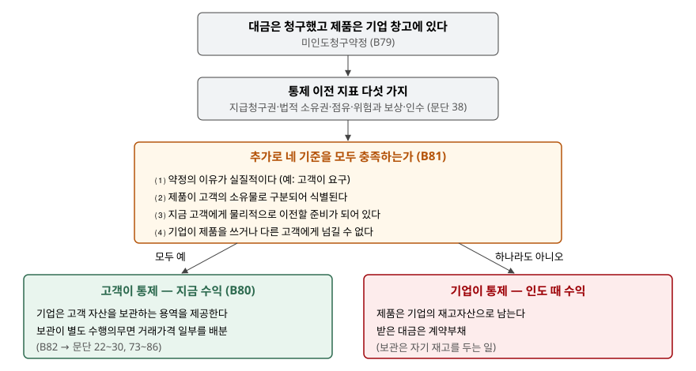

> 예제의 `타파기계`와 그 숫자, 개별 판매가격과 보관 기간은 계산을 보이려고 만든 가상 자료다.

## 들어가며

설비 제조사가 고객 공장에 들어갈 포장 설비 5대를 12월 말에 다 만들었다. 그런데 고객의 공장 증설이 늦어져 설비를 놓을 자리가 없다. 고객은 대금은 지금 치를 테니 반년만 맡아 달라고 한다. 제조사는 연말 결산을 앞두고 있고, 대금까지 받았으니 올해 매출로 잡고 싶다.

설비가 아직 제조사 창고에 있다는 사실만 보면 매출을 잡을 수 없을 것 같다. 반대로 대금을 받았다는 사실만 보면 당연히 잡아야 할 것 같다. 둘 다 반만 맞다. 기준서는 이 경우에 네 가지 조건을 따로 두었고, 그중 하나라도 빠지면 매출은 반년 뒤 인도 때로 밀린다. 예제에서는 그 차이로 2026년 이익이 1,060(백만원)에서 0이 됐다.

[앞 글](../2026-11-13-consignment-arrangement-revenue-timing/index.md)의 위탁약정은 제품이 상대에게 가 있어도 통제는 기업에 남는 경우였다. 미인도청구약정은 그 반대 방향이다.

## 개념

미인도청구약정은 기업이 고객에게 제품 대가를 청구하지만 미래 어느 시점에 이전할 때까지 제품을 물리적으로 점유하는 계약이다(문단 B79). 고객의 보관 공간이 부족하거나 생산 일정이 밀린 경우를 기준서가 예로 든다.

수익 시점은 여기서도 고객이 언제 통제하게 되느냐로 정한다(문단 B80). 대부분의 계약에서는 인도되거나 선적될 때 통제가 넘어간다. 그러나 기업이 점유하고 있어도 고객이 제품의 사용을 지시하고 나머지 효익의 대부분을 얻을 능력을 가질 수 있다. 그러면 기업은 제품을 통제하지 않고, 대신 **고객의 자산을 보관하는 용역**을 제공하는 것이다.

물리적 점유가 통제와 어긋날 수 있다는 점은 통제 이전 지표 조항(문단 38⑶)이 위탁약정과 함께 직접 든다. 다만 미인도청구약정은 점유 없이 매출을 잡는 쪽이라 잘못 쓰이기 쉽다. 그래서 기준서는 문단 38 외에 충족해야 할 기준을 따로 덧붙였다.

## 구조



> **출처**: 한국회계기준원 [기업회계기준서 제1115호 '고객과의 계약에서 생기는 수익'](https://www.samili.com/acc/Kijun/Kijunjomun.asp?code=1978-1115) 문단 38 통제 이전 지표, 적용지침 문단 B79~B82 미인도청구약정 (제3자 전재, 2021-04-23 개정) — 원문 발행처 [한국회계기준원](https://www.kasb.or.kr/front/board/ingAccountingList.do)

판단은 두 겹이다. 먼저 문단 38의 일반 지표를 보고, 그 위에 B81의 네 기준을 **모두** 충족해야 한다. 네 기준 중 셋을 채워도 통제는 넘어가지 않는다.

## 동작 원리

### 네 기준이 각각 막는 것

문단 B81의 네 기준은 다음과 같다. 약정의 이유가 실질적이어야 한다(예: 고객이 요구했다). 제품이 고객의 소유물로 구분되어 식별되어야 한다. 지금 고객에게 물리적으로 이전할 준비가 되어 있어야 한다. 기업이 그 제품을 쓰거나 다른 고객에게 넘길 능력이 없어야 한다.

네 기준은 각각 다른 빈틈을 막는다. 첫째는 기업이 실적을 앞당기려고 먼저 청구하는 경우를 걸러 낸다. 이유가 기업 쪽에 있으면 고객이 통제를 원한 것이 아니다. 둘째와 넷째는 같은 모델 재고와 섞여 있거나 다른 주문에 돌려쓸 수 있는 경우를 걸러 낸다. 기업이 어느 제품을 누구에게 줄지 아직 고를 수 있다면 사용을 지시하는 능력은 기업에 있다. 셋째는 아직 완성되지 않았거나 시운전이 남은 경우를 걸러 낸다. 이전할 준비가 안 된 제품은 고객이 지금 효익을 얻을 수 없다.

### 기준을 충족하면 보관 용역이 생긴다

네 기준을 모두 충족해 수익을 인식하면, 기업은 그 뒤로 고객의 자산을 맡아 두는 일을 한다. 문단 B82는 이때 보관 용역 같은 나머지 수행의무가 있는지 문단 22~30에 따라 보고, 있으면 문단 73~86에 따라 거래가격 일부를 배분하라고 정한다. 계약서에 보관료가 따로 적혀 있지 않아도 보관이 별도 수행의무이면 거래가격 일부는 보관하는 기간에 걸쳐 수익이 된다.

기준을 충족하지 못하면 제품은 기업의 재고자산으로 남는다. 받은 대금은 아직 이행하지 않은 수행의무에 대한 계약부채다. 이때 창고에 두는 일은 자기 재고를 보관하는 것이라 고객에게 제공하는 용역이 아니다.

## 실습 예제

타파기계가 포장 설비 5대를 4,800에 만들어 2026년 12월 말에 완성하고 대금을 받는다. 제조원가는 3,500이다. 설비는 고객 요청으로 2027년 6월 말까지 타파기계 창고에 둔다. 먼저 네 기준 중 하나씩 빠뜨린 다섯 경우의 판단이다.

```text
[1] B81 네 기준과 통제 이전 판단
    가. 네 기준 모두 충족              O O O O   통제 이전 -> 지금 수익
    나. 기업이 출고 일정을 맞추려고 먼저 청구   X O O O   통제 미이전 -> 인도 때 수익
    다. 같은 모델 재고와 섞어 보관         O X O O   통제 미이전 -> 인도 때 수익
    라. 마지막 시운전이 남음             O O X O   통제 미이전 -> 인도 때 수익
    마. 급한 다른 주문에 돌려쓸 수 있음      O O O X   통제 미이전 -> 인도 때 수익
```

O/X는 기준 ⑴~⑷ 순서다. 네 기준은 "모두"라는 조건이므로 하나라도 X면 결론이 바뀐다. 예제는 문단 38의 지표가 충족됐다고 두고 B81만 비교했다.

```text
[2] 거래가격 배분 (B82, 개별 판매가격 비율)
    개별 판매가격  설비 4,750.0  보관 250.0  합계 5,000.0
    거래가격 4,800.0 -> 설비 4,560.0  보관 240.0  (월 40.0)
```

보관 용역은 별도 수행의무라고 보고, 개별 판매가격 비율로 거래가격을 나눴다. 계약서에는 4,800 하나만 적혀 있어도 그중 240은 보관의 대가다.

전체 소스: [`code/`](code/)

```text
  가. 네 기준 충족 — 미인도청구 판매
    2026Q4  설비  4,560.0  보관    0.0  매출원가 -3,500.0  이익  1,060.0
    2027Q1  설비      0.0  보관  120.0  매출원가      0.0  이익    120.0
    2027Q2  설비      0.0  보관  120.0  매출원가      0.0  이익    120.0
    2026년 이익  1,060.0  2027년 이익    240.0
  마. 기준 ⑷ 미충족 — 인도 때 판매
    2026Q4  설비      0.0  보관    0.0  매출원가      0.0  이익      0.0
    2027Q1  설비      0.0  보관    0.0  매출원가      0.0  이익      0.0
    2027Q2  설비  4,800.0  보관    0.0  매출원가 -3,500.0  이익  1,300.0
    2026년 이익      0.0  2027년 이익  1,300.0
```

두 경우 모두 이익 합계는 1,300으로 같다. 달라지는 것은 어느 해에 잡히느냐다. 네 기준을 충족하면 2026년에 1,060, 2027년에 보관 용역 240이 잡힌다. 기준 ⑷ 하나가 빠지면 2026년 이익은 0이고 1,300이 전부 2027년 2분기로 간다. 설비 매출이 4,560이 아니라 4,800인 것은 보관이 고객에게 주는 용역이 아니어서 나눌 대상이 없기 때문이다.

```text
[4] 2026년 말 재무상태표에서 갈리는 줄 (대금 4,800 은 둘 다 받았다)
    가. 재고      0.0  계약부채    240.0  (남은 보관 용역)
    마. 재고  3,500.0  계약부채  4,800.0  (설비 전체)
```

연말 재무상태표에서 같은 창고의 같은 설비 5대가 한쪽에서는 사라지고 다른 쪽에서는 재고 3,500으로 남는다. 받은 현금은 같지만 계약부채가 240과 4,800으로 크게 갈린다.

## 실무에서 주의할 점

- **요청한 쪽을 문서로 남긴다.** 기준 ⑴은 이유가 실질적이어야 한다는 것이고, 기준서는 그 예로 고객이 요구한 경우를 든다. 고객의 서면 요청이 없고 기업이 결산 직전에 청구서만 낸 형태라면 이 기준을 설명하기 어렵다.
- **구분 보관은 표시만이 아니라 돌려쓸 수 없어야 한다.** 고객 이름표를 붙였어도 급한 주문이 오면 그 제품을 먼저 내보내는 관행이 있다면 기준 ⑷가 성립하지 않는다. 기준 ⑵와 ⑷는 함께 확인한다.
- **보관 용역을 빠뜨리면 매출이 앞당겨진다.** 보관이 별도 수행의무인데 거래가격 전부를 설비 매출로 잡으면, 예제에서는 240이 반년 먼저 수익이 된다. B82는 이 검토를 요구한다.
- **위험과 보상도 같이 본다.** 보관 중 파손 위험을 누가 지는지는 문단 38⑷ 지표와 이어진다. 네 기준을 다 채웠다는 것으로 문단 38의 검토를 건너뛰지 않는다. B81은 문단 38을 적용하는 것 "외에도" 충족해야 하는 기준이다.

## 정리

- 미인도청구약정은 대금을 청구하고도 제품을 기업이 점유하는 계약이다(제1115호 문단 B79).
- 고객이 통제하려면 문단 38에 더해 B81의 네 기준, 곧 실질적 이유·구분 식별·이전 준비·기업의 사용·전용 불가를 모두 충족해야 한다.
- 수익을 인식하면 보관 용역이 별도 수행의무인지 보고 거래가격을 나눈다(문단 B82).
- 가상 사례에서 네 기준을 충족하면 2026년 이익 1,060, 기준 하나가 빠지면 0이었고, 두 경우 합계는 1,300으로 같았다.

## 참고 자료

- [한국회계기준원](https://www.kasb.or.kr/front/board/ingAccountingList.do) — K-IFRS 기준서 발행처. 아래 전재 링크는 조문을 바로 열기 위한 편의 링크다
- [기업회계기준서 제1115호 '고객과의 계약에서 생기는 수익'](https://www.samili.com/acc/Kijun/Kijunjomun.asp?code=1978-1115) (제3자 전재, 2021-04-23 개정) — 문단 22~30 수행의무 식별, 문단 38 통제 이전 지표, 문단 73~86 거래가격 배분, 적용지침 문단 B79~B82 미인도청구약정
- [IFRS 15 Revenue from Contracts with Customers](https://www.ifrs.org/issued-standards/list-of-standards/ifrs-15-revenue-from-contracts-with-customers/) — IFRS Foundation
- 숫자는 이 글의 [`code/output.txt`](code/output.txt) `[1]`~`[4]`에서 옮겼다
