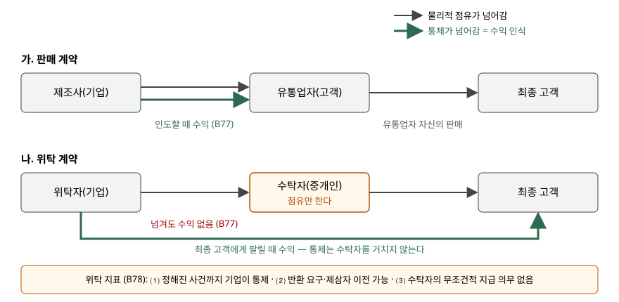

> 예제의 `바사전자`·`아자유통`과 그 숫자, 분기별 판매 대수는 계산을 보이려고 만든 가상 자료다.

## 들어가며

가전 제조사가 새 공기청정기를 내놓으면서 지역 유통업자 창고로 100대를 한꺼번에 보내는 일이 있다. 트럭이 떠났고 송장도 나갔으니 그 분기에 100대분 매출을 잡고 싶어진다. 분기 마감을 며칠 앞두고 출고가 몰리는 것도 그래서다.

그런데 계약서를 보면 유통업자는 팔린 만큼만 대금을 보내고, 석 달 뒤 남은 물건은 돌려보내기로 되어 있다. 유통업자 쪽에서는 자기 돈을 한 푼도 걸지 않은 채 남의 물건을 맡아 둔 셈이다. 이런 계약에서 출고일에 100대분 매출을 잡으면 실제로 팔린 대수와 무관한 숫자가 손익계산서에 들어간다. 예제에서는 1분기 매출이 38,000(천원)이나 부풀었다.

[반품권이 있는 판매](../2026-11-08-sales-with-right-of-return/index.md)는 고객이 제품을 통제하게 된 뒤에 일부가 돌아올 수 있는 경우다. 이 글은 그보다 앞 단계, **받은 쪽이 애초에 통제를 얻지 못한** 경우를 다룬다.

## 개념

기업회계기준서 제1115호는 수익을 고객이 자산을 **통제**하게 될 때 인식한다. 통제는 자산의 사용을 지시하고 나머지 효익의 대부분을 얻을 수 있는 능력이다(문단 33). 통제가 넘어갔는지는 지급청구권, 법적 소유권, 물리적 점유, 위험과 보상, 고객의 인수라는 다섯 지표를 참고해 판단한다(문단 38).

이 다섯 중 물리적 점유는 통제와 어긋날 수 있다고 기준서가 직접 적는다. 같은 문단 38⑶은 위탁약정에서 수탁자가 기업이 통제하는 자산을 점유할 수 있고, 반대로 미인도청구약정에서는 기업이 고객이 통제하는 자산을 점유할 수 있다고 든다. 위탁약정은 그 첫 번째 경우이고, 두 번째 경우는 [미인도청구약정](../2026-11-13-bill-and-hold-four-criteria/index.md)에서 다룬다.

문단 B77은 최종 고객에게 팔려고 제품을 중개인이나 유통업자에게 넘길 때 그 당사자가 **그 시점에 통제를 얻는지**를 평가하라고 정한다. 얻지 못하면 그 제품은 위탁약정에 따라 보유되는 것이고, 넘길 때 수익을 인식하지 않는다.

## 구조



> **출처**: 한국회계기준원 [기업회계기준서 제1115호 '고객과의 계약에서 생기는 수익'](https://www.samili.com/acc/Kijun/Kijunjomun.asp?code=1978-1115) 문단 33·38 통제와 통제 이전 지표, 적용지침 문단 B77~B78 위탁약정 (제3자 전재, 2021-04-23 개정) — 원문 발행처 [한국회계기준원](https://www.kasb.or.kr/front/board/ingAccountingList.do)

두 계약에서 제품이 움직이는 길은 똑같다. 다른 것은 통제가 언제, 누구에게 넘어가느냐다. 위탁에서는 통제가 수탁자를 거치지 않고 기업에서 최종 고객으로 바로 간다.

## 동작 원리

### 위탁인지 가리는 세 지표

문단 B78은 위탁약정이라는 지표로 세 가지를 든다. 정해진 사건(중개인의 판매, 기간 만료)이 일어날 때까지 기업이 자산을 통제한다. 기업이 제품의 반환을 요구하거나 다른 중개인에게 옮길 수 있다. 중개인은 보증금을 낼 수는 있어도 제품 대금을 지급할 **무조건적인 의무**는 없다.

세 지표는 같은 사실을 다른 면에서 본 것이다. 기업이 물건을 불러들이거나 다른 곳으로 돌릴 수 있다면 사용을 지시하는 능력이 여전히 기업에 있다. 팔리지 않은 물건을 돌려보내면 끝나는 중개인은 재고가 안 팔릴 위험을 지지 않는다. 문단 B78이 "이에 한정되지는 않는다"고 적었으므로 셋을 기계적으로 세는 것으로 끝나지는 않고, 최종 판단은 문단 33·38의 통제 기준으로 돌아간다.

### 위탁이면 장부에 무엇이 남는가

위탁으로 판단되면 넘긴 제품은 기업의 재고자산으로 남는다. 창고 위치만 바뀌었을 뿐이다. 최종 고객에게 팔리는 시점이 기업이 수행의무를 이행하는 시점이 되고, 그때 매출과 매출원가를 인식한다.

매출을 얼마로 잡을지는 [총액·순액 판단](../2026-10-31-gross-vs-net-revenue-principal-agent/index.md)과 이어진다. 기업이 팔리기 전까지 제품을 통제하므로 최종 고객과의 거래에서 본인이다(문단 B35). 예제는 그래서 최종 판매가격을 매출로, 수탁자 몫은 판매수수료로 둔다. 수탁자가 낸 보증금은 돌려줄 수 있는 돈이므로 수익이 아니라 부채다.

## 실습 예제

바사전자가 원가 300(천원)인 공기청정기 100대를 1분기 초에 아자유통에 넘긴다. 판매 계약이면 아자유통이 대당 500에 사들이고 반품하지 못한다. 위탁 계약이면 바사전자가 정한 600에 팔고 대당 100을 수수료로 뗀 뒤 정산하며, 3분기 말에 남은 제품을 돌려준다. 아자유통은 분기마다 20대, 45대, 25대를 판다.

```text
[1] B78 위탁약정 지표
  가. 판매 계약                          나. 위탁 계약
    ⑴ 정해진 사건까지 기업이 통제  아니오     예
    ⑵ 반환 요구·제삼자 이전 가능   아니오     예
    ⑶ 무조건적인 지급 의무 없음    아니오     예
    위탁 지표 0/3                       3/3
```

위 표는 `output.txt` `[1]`의 두 블록을 나란히 붙인 것이다. 값은 그대로다.

전체 소스: [`code/`](code/)

```text
  가. 판매 — 대당 500, 반품 불가
    1분기  매출   50,000  수수료       0  매출원가  -30,000  이익  20,000  누적  20,000  기말 재고       0
    2분기  매출        0  수수료       0  매출원가        0  이익       0  누적  20,000  기말 재고       0
    3분기  매출        0  수수료       0  매출원가        0  이익       0  누적  20,000  기말 재고       0
  나. 위탁 — 최종가 600, 수수료 100
    1분기  매출   12,000  수수료  -2,000  매출원가   -6,000  이익   4,000  누적   4,000  기말 재고  24,000
    2분기  매출   27,000  수수료  -4,500  매출원가  -13,500  이익   9,000  누적  13,000  기말 재고  10,500
    3분기  매출   15,000  수수료  -2,500  매출원가   -7,500  이익   5,000  누적  18,000  기말 재고   3,000
    3분기 말 돌려받은 제품 10대 -> 재고 3,000 (매출 없음)
```

판매 계약은 1분기에 50,000을 한 번에 잡고 끝난다. 그 뒤 아자유통이 못 팔아도 바사전자의 손익과는 관계가 없다. 판 물건은 아자유통의 재고다.

위탁 계약은 매출이 실제 판매를 따라 세 분기에 나뉜다. 1분기 말에도 80대분 24,000이 바사전자의 재고로 남아 있다. 남은 10대는 3분기 말에 돌아오고 매출 없이 재고로 계속 남는다. 세 분기 합계가 18,000으로 판매 계약의 20,000보다 작은 것은 팔린 대수가 90대이기 때문이다. 대당 마진은 위탁이 200(600 − 100 − 300)으로 판매와 같다.

```text
[3] 1분기 말 재무상태표에서 갈리는 줄
    가. 판매  매출채권   50,000  재고        0  예수보증금        0
    나. 위탁  매출채권   10,000  재고   24,000  예수보증금   10,000
```

1분기 말만 보면 두 회사의 재무상태표는 전혀 다르게 생겼다. 판매 계약은 매출채권 50,000이 서고 재고가 비었다. 위탁 계약은 팔린 20대분 정산액 10,000만 받을 돈이고 재고 24,000과 보증금 부채 10,000이 남는다. 계약 조건을 모르고 출고 기록만 보면 이 차이가 보이지 않는다.

## 실무에서 주의할 점

- **계약서 제목이 아니라 조건을 본다.** "판매대리점 계약"이라는 제목이어도 미판매분 반환 조항과 판매분 정산 조항이 있으면 B78 지표가 그대로 성립한다. 반대로 "위탁"이라는 말이 들어가도 유통업자가 대금을 무조건 갚아야 하면 위탁이 아닐 수 있다.
- **반품권 판매와 헷갈리지 않는다.** 반품권 판매는 고객이 통제를 얻은 뒤 일부가 돌아올 수 있어 예상 반품분만 환불부채로 뺀다(문단 B20~B27). 위탁은 통제가 넘어가지 않았으므로 전량이 재고로 남는다. 둘을 가르는 질문은 "몇 대가 돌아올까"가 아니라 "받은 쪽이 통제를 얻었는가"다.
- **수탁자 창고의 재고도 실사 범위다.** 위탁 재고는 기업의 재고자산이므로 기말 수량 확인과 평가 대상이다. 자기 창고만 세면 재고가 빠지고, 수탁자가 이미 판 물건을 남은 것으로 세면 매출이 늦게 잡힌다. 수탁자의 판매 보고 주기가 결산일과 맞는지 확인한다.
- **보증금을 매출로 잡지 않는다.** 문단 B78⑶은 보증금이 있어도 무조건적 지급 의무가 없을 수 있다고 적는다. 보증금은 계약이 끝나면 돌려줄 수 있는 돈이므로 받은 날 수익이 되지 않는다.

## 정리

- 유통업자에게 넘긴 제품을 그 시점에 유통업자가 통제하지 못하면 위탁약정이고, 넘길 때 수익을 인식하지 않는다(제1115호 문단 B77).
- 위탁 지표는 기업의 통제 유지, 반환·이전 요구 가능, 중개인의 무조건적 지급 의무 없음의 세 가지다(문단 B78).
- 물리적 점유는 통제 지표 다섯 중 하나일 뿐이고, 위탁에서는 점유와 통제가 어긋난다(문단 38⑶).
- 가상 사례에서 같은 100대가 판매면 1분기 매출 50,000, 위탁이면 12,000으로 잡혔고, 위탁에서는 1분기 말 재고 24,000이 기업 장부에 남았다.

## 참고 자료

- [한국회계기준원](https://www.kasb.or.kr/front/board/ingAccountingList.do) — K-IFRS 기준서 발행처. 아래 전재 링크는 조문을 바로 열기 위한 편의 링크다
- [기업회계기준서 제1115호 '고객과의 계약에서 생기는 수익'](https://www.samili.com/acc/Kijun/Kijunjomun.asp?code=1978-1115) (제3자 전재, 2021-04-23 개정) — 문단 33·38 통제와 통제 이전 지표, 적용지침 문단 B20~B27 반품권이 있는 판매, B34~B38 본인 대 대리인, B77~B78 위탁약정
- [IFRS 15 Revenue from Contracts with Customers](https://www.ifrs.org/issued-standards/list-of-standards/ifrs-15-revenue-from-contracts-with-customers/) — IFRS Foundation
- 숫자는 이 글의 [`code/output.txt`](code/output.txt) `[1]`~`[4]`에서 옮겼다
