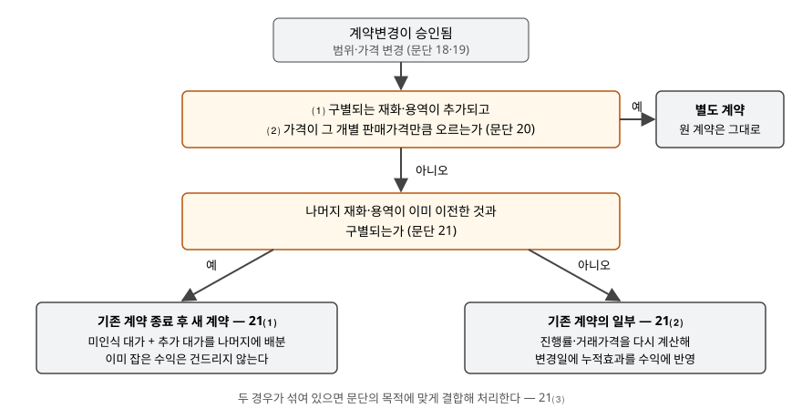

> 예제의 `타파소재`와 그 숫자, 계약 조건은 계산을 보이려고 만든 가상 자료다.

## 들어가며

소재 회사가 120개를 개당 100(천원)에 납품하기로 하고 절반쯤 넘겼을 때, 고객이 30개를 더 달라고 한다. 영업팀은 단골이니 80에 주겠다고 하고 추가 발주서를 받는다. 회계 담당자는 발주서가 따로 왔으니 추가분 30개를 80짜리 새 거래로 잡는다.

이 처리는 남은 원 계약 물량을 여전히 100으로 잡는다. 그런데 고객은 사실상 남은 90개를 8,400에 사기로 한 것이고, 기준서는 이 경우 남은 물량 전체의 단가를 다시 정하라고 한다. 예제에서 다음 분기 40개를 넘길 때 수익이 267(천원) 앞당겨 잡혔다. 같은 일이 공사 계약에서 생기면 이번에는 이미 잡은 수익을 변경일에 깎아야 할 수도 있다.

## 개념

기업회계기준서 제1115호에서 **계약변경**은 계약 당사자들이 승인한 계약의 범위나 가격(또는 둘 다)의 변경이다(문단 18). 주문변경, 공사 변경, 수정 같은 이름으로 불리기도 한다. 서면이 아니라 구두 합의나 사업 관행으로도 승인될 수 있고, 승인되기 전까지는 기존 계약을 그대로 회계처리한다.

범위 변경에는 합의했지만 가격이 아직 정해지지 않았어도 계약변경은 존재한다(문단 19). 이때 거래가격의 변경분은 변동대가 추정(문단 50~54)과 그 제약(문단 56~58)에 따라 추정한다. 가격이 확정될 때까지 회계처리를 미루지 않는다는 뜻이다.

변경이 승인되면 기준서는 그것을 세 갈래 중 하나로 보낸다. 첫째는 새 계약이 하나 더 생긴 것으로 보는 **별도 계약**, 둘째는 기존 계약을 끝내고 새로 맺은 것으로 보는 **종료 후 새 계약**, 셋째는 기존 계약을 고친 것으로 보는 **누적효과 일괄조정**이다.

## 구조



> **출처**: 한국회계기준원 [기업회계기준서 제1115호 '고객과의 계약에서 생기는 수익'](https://www.samili.com/acc/Kijun/Kijunjomun.asp?code=1978-1115) 문단 18~21 계약변경 (제3자 전재, 2021-04-23 개정) — 원문 발행처 [한국회계기준원](https://www.kasb.or.kr/front/board/ingAccountingList.do)

판단은 두 질문으로 끝난다. 첫 질문은 추가된 부분이 따로 떼어 팔아도 되는 거래인지를, 둘째 질문은 남은 부분이 이미 넘긴 부분과 떨어져 있는지를 묻는다.

## 동작 원리

### 별도 계약 — 두 조건을 모두 충족할 때

문단 20은 두 조건을 모두 충족하면 계약변경을 별도 계약으로 처리한다. ⑴ 구별되는 재화나 용역이 추가되어 범위가 넓어지고, ⑵ 가격이 추가분의 **개별 판매가격**만큼 오른다. 개별 판매가격은 계약 상황에 맞게 조정할 수 있다. 기준서는 기존 고객에게는 새 고객을 찾는 판매관련원가가 들지 않으므로 그만큼 할인해 주는 것을 예로 든다.

두 조건이 다 맞으면 고객이 시장 가격으로 새 주문을 낸 것과 다르지 않다. 그래서 원 계약은 그대로 두고 추가분만 새 계약으로 회계처리한다.

### 종료 후 새 계약 — 남은 것이 구별될 때

별도 계약이 아니면 문단 21이 **아직 넘기지 않은 나머지**를 본다. 나머지가 변경일 전에 넘긴 것과 구별되면 기존 계약을 종료하고 새 계약을 맺은 것처럼 처리한다(문단 21⑴). 나머지에 배분할 대가는 ㈎ 원 계약 대가 중 아직 수익으로 잡지 않은 금액과 ㈏ 변경으로 약속한 대가의 합이다.

이미 잡은 수익은 건드리지 않고 앞으로의 단가만 바꾸므로 **전진적** 처리다. 추가분의 할인이 남은 원 계약 물량에도 고르게 퍼진다.

### 누적효과 일괄조정 — 남은 것이 구별되지 않을 때

나머지가 구별되지 않아 변경일에 부분적으로 이행된 **단일 수행의무**의 일부라면, 계약변경은 기존 계약의 일부인 것처럼 처리한다(문단 21⑵). 공사처럼 진행률로 수익을 잡는 계약이 대표적이다. 변경이 거래가격과 진행률에 주는 영향은 **변경일에 수익을 늘리거나 줄여서** 한 번에 반영한다.

[원가기준 진행률 추정 변경](../2026-11-08-cost-to-cost-progress-estimate-change/index.md)과 계산 방식은 같다. 다른 점은 그쪽은 원가 추정만 바뀐 것이고, 이쪽은 계약가격과 원가가 함께 바뀐다는 것이다. 두 갈래가 섞여 있으면 문단 21⑶에 따라 미이행 수행의무에 주는 영향을 이 문단의 목적에 맞게 처리한다.

## 실습 예제

타파소재는 120개를 개당 100에 넘기는 계약에서 60개를 넘긴 뒤 30개 추가 주문을 받는다. 변경일 현재 추가 제품의 개별 판매가격은 100이고, 판매관련원가를 반영해 조정한 가격은 95다. 가는 추가분을 95에, 나는 80에 판다. 다는 별개 공사 계약이다.

전체 소스: [`code/`](code/)

```text
[2] 가. 추가분 단가 95 — 개별 판매가격을 반영 → 문단 20 별도 계약
    원 계약 나머지    60개 × 100.00 =      6,000
    추가 계약       30개 ×  95.00 =      2,850
    변경일 이후 수익 합계      8,850
```

95는 개별 판매가격 100을 기존 고객 사정에 맞게 조정한 값이므로 문단 20⑵를 충족한다. 원 계약 60개는 100, 추가 30개는 95로 각각 잡는다.

```text
[3] 나. 추가분 단가 80 — 개별 판매가격을 반영하지 않음 → 문단 21⑴ 종료 후 새 계약
    ㈎ 원 계약 대가 중 아직 수익이 아닌 금액      6,000
    ㈏ 계약변경으로 약속한 대가                2,400
    나머지 90개에 배분 → 단가 93.3333
    변경일 이후 수익 합계      8,400
```

80은 개별 판매가격을 반영하지 않은 값이다. 제품 하나하나는 구별되므로 문단 21⑴로 간다. 남은 원 계약 60개의 대가 6,000과 추가 대가 2,400을 합친 8,400을 남은 90개에 나누면 단가가 93.3333이 된다.

```text
[4] 나. 다음 분기에 40개 인도(원 계약 물량부터) 시 그 분기 수익
    문단 21⑴ 적용   40 × 93.3333 =      3,733
    별도 계약 오분류 40 × 100.0000 =      4,000
    차이        267 — 앞 분기 수익이 크게, 뒤 분기가 작게 잡힌다
```

합계 8,400은 어떻게 처리해도 같다. 하지만 추가분을 따로 80짜리 계약으로 잡으면 원 계약 물량을 넘기는 앞 분기에 100씩 잡히고, 할인은 추가분을 넘기는 뒤 분기에 몰린다. 할인을 준 결정이 이미 내려졌는데 그 효과가 늦게 보이는 것이다.

```text
[5] 다. 단일 수행의무 공사 — 원가기준 진행률, 문단 21⑵ 누적효과 일괄조정
    원 계약  가격  1,000,000  예상 원가    700,000
    1년차 말 발생원가    420,000 → 진행률 60.00% → 누적 수익    600,000
    2년차 초 계약변경 — 사양 추가, 가격 +150,000, 예상 원가 +120,000
    변경 후 가격  1,150,000  예상 원가    820,000
    변경일 진행률 420,000 / 820,000 = 51.22%
    변경일 누적 수익    589,024  이미 인식    600,000
    변경일 수익 조정    -10,976  (음수면 수익 감액)
    2년차 말 완공(누적 원가 820,000) → 2년차 나머지 수익    560,976
    전체 수익  1,150,000 = 변경 후 가격
```

공사 계약은 사양이 추가되어도 하나의 설비를 짓는 단일 수행의무다. 가격이 150,000 올랐는데도 변경일에 수익을 10,976 **줄인다.** 예상 원가가 늘면서 진행률이 60.00%에서 51.22%로 내려갔고, 늘어난 가격을 곱해도 누적 수익이 이미 잡은 600,000에 못 미치기 때문이다. 추가분의 이익률이 20%로 원 계약의 30%보다 낮아 계약 전체 이익률이 28.70%로 떨어진 것이 숫자로 나온다. 전기 수익은 소급해 고치지 않고 변경일에 한 번에 반영한다.

## 실무에서 주의할 점

- **발주서가 따로 왔다고 별도 계약이 아니다.** 별도 계약 여부는 문단 20의 두 조건으로 정한다. 추가분 가격이 개별 판매가격을 반영하지 않으면 서류가 몇 장이든 문단 21로 간다.
- **가격 미확정을 이유로 기다리지 않는다.** 범위 변경이 승인되고 가격만 다투고 있으면 문단 19에 따라 변동대가로 추정해 반영한다. 공사 계약의 클레임이나 추가 공사비 협상이 여기에 해당한다.
- **가격이 올라도 수익이 줄 수 있다.** 누적효과 일괄조정에서는 늘어난 가격보다 늘어난 원가의 비중이 크면 변경일 수익 조정이 음수가 된다. 수주 산업 회사의 분기 매출이 계약 증액 공시가 나온 분기에 오히려 줄었다면 이 계산을 의심해 본다.
- **세 갈래가 섞인 계약을 하나로 몰지 않는다.** 남은 의무 중 일부는 구별되고 일부는 구별되지 않으면 문단 21⑶이 각각에 맞는 처리를 요구한다. 편한 한 가지 방법으로 전체를 처리하면 수익 시기가 틀어진다.

## 정리

- 계약변경은 승인된 범위·가격의 변경이며, 가격이 미확정이어도 존재할 수 있다(제1115호 문단 18·19).
- 구별되는 재화가 추가되고 가격이 그 개별 판매가격만큼 오르면 별도 계약이다(문단 20).
- 아니면 나머지가 구별될 때 종료 후 새 계약으로 앞으로의 단가를 다시 정하고, 구별되지 않을 때 변경일에 누적효과를 수익에 반영한다(문단 21⑴·⑵).
- 가상 사례에서 추가분을 80에 판 경우 남은 90개의 단가가 93.3333이 됐고, 공사 계약은 가격이 150,000 올랐는데도 변경일 수익이 10,976 줄었다.

## 참고 자료

- [한국회계기준원](https://www.kasb.or.kr/front/board/ingAccountingList.do) — K-IFRS 기준서 발행처. 아래 전재 링크는 조문을 바로 열기 위한 편의 링크다
- [기업회계기준서 제1115호 '고객과의 계약에서 생기는 수익'](https://www.samili.com/acc/Kijun/Kijunjomun.asp?code=1978-1115) (제3자 전재, 2021-04-23 개정) — 문단 18~21 계약변경, 문단 50~58 변동대가
- [IFRS 15 Revenue from Contracts with Customers](https://www.ifrs.org/issued-standards/list-of-standards/ifrs-15-revenue-from-contracts-with-customers/) — IFRS Foundation
- 숫자는 이 글의 [`code/output.txt`](code/output.txt) `[1]`~`[5]`에서 옮겼다
