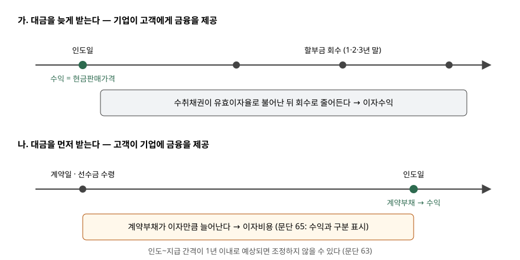

> 예제의 `차카기계`와 그 숫자, 지급 조건은 계산을 보이려고 만든 가상 자료다.

## 들어가며

설비 회사 영업팀이 큰 거래를 따내려고 "3년 무이자 할부"를 제시하는 일은 흔하다. 현금으로 사면 1,000,000(천원)인 설비를 매년 380,000씩 세 번, 모두 1,140,000에 파는 조건이다. 계약서에 이자라는 말은 없으니 인도한 날 매출을 1,140,000으로 잡고 싶어진다.

하지만 고객 쪽에서 보면 140,000을 더 내는 대가로 3년 동안 돈을 빌린 것과 같다. 이 140,000을 인도일 매출에 넣으면 설비를 판 이익과 돈을 빌려준 이익이 한 줄에 섞인다. 예제에서 매출총이익이 400,000에서 540,000으로 35% 부풀었다. 반대로 고객이 대금을 2년 먼저 내는 계약에서는 매출이 그만큼 작게 잡힌다.

## 개념

기업회계기준서 제1115호는 거래가격을 산정할 때, 합의한 지급시기 때문에 고객이나 기업에 **유의적인 금융 효익**이 제공되면 화폐의 시간가치를 반영해 약속된 대가를 조정하라고 정한다(문단 60). 그런 계약을 "유의적인 금융요소를 포함한다"고 부른다. 금융 약속이 계약서에 적혀 있든, 지급조건에서 암시되든 상관없다.

조정의 목적은 고객이 인도받을 때 **현금으로 결제했다면 지급했을 가격**, 곧 현금판매가격으로 수익을 인식하는 것이다(문단 61). 그러면 매출은 재화를 넘긴 대가만 담고, 시간의 대가는 이자수익이나 이자비용으로 따로 나온다. 문단 65는 이 금융효과를 고객과의 계약에서 생기는 수익과 **구분하여 표시**하라고 정한다.

금융을 누가 제공하느냐에 따라 방향이 둘이다. 대금을 늦게 받으면 기업이 고객에게 돈을 빌려준 것이고, 먼저 받으면 고객이 기업에 돈을 빌려준 것이다.

## 구조



> **출처**: 한국회계기준원 [기업회계기준서 제1115호 '고객과의 계약에서 생기는 수익'](https://www.samili.com/acc/Kijun/Kijunjomun.asp?code=1978-1115) 문단 60~65 유의적인 금융요소 (제3자 전재, 2021-04-23 개정) — 원문 발행처 [한국회계기준원](https://www.kasb.or.kr/front/board/ingAccountingList.do)

두 경우 모두 수익은 인도일에 현금판매가격으로 한 번 잡힌다. 다른 것은 그 앞뒤로 붙는 이자의 부호다. 할부는 인도 뒤에 이자수익이, 선수금은 인도 앞에 이자비용이 붙는다.

## 동작 원리

### 유의적인지 판단하는 두 가지

문단 61은 금융요소가 있는지, 그것이 유의적인지를 볼 때 두 가지를 포함해 모든 사실을 고려하라고 한다. 하나는 약속한 대가와 현금판매가격의 **차이**다. 다른 하나는 인도와 지급 사이의 **예상 기간**과 관련 시장의 **일반적인 이자율**을 함께 본 효과다. 기간이 길어도 금리가 낮으면 영향이 작고, 기간이 짧아도 차이가 크면 영향이 크다.

### 금융요소가 없다고 보는 세 경우

문단 62는 앞의 평가와 관계없이 다음 중 하나라도 있으면 유의적인 금융요소가 없다고 본다.

| 경우 | 왜 금융이 아닌가 |
|---|---|
| ⑴ 고객이 선급했고 이전 시점을 고객이 정한다 | 상품권처럼 언제 쓸지 고객 재량이라 지급과 이전 간격을 계약이 정하지 않는다 |
| ⑵ 대가의 상당 부분이 판매기준 로열티처럼 통제할 수 없는 미래 사건으로 변동한다 | 대가의 시기와 금액이 당사자의 합의가 아니라 사건에 달려 있다 |
| ⑶ 차이가 금융 외의 이유로 생긴다 | 예: 상대방이 의무를 다하지 못할 때를 대비한 유보금 |

⑶이 실무에서 가장 자주 쓰인다. 공사 잔금의 일부를 완공 검수 뒤에 주기로 한 조건은 지급을 늦추지만, 목적이 돈을 빌려주는 데 있지 않고 시공 품질을 담보하는 데 있다.

### 1년 이내 간편법

계약 개시 때 인도와 지급 사이가 **1년 이내**로 예상되면 조정하지 않아도 된다(문단 63). 대부분의 외상 매출이 여기에 들어간다. 간편법은 "쓸 수 있다"로 적혀 있으므로 선택이고, 기간 판단은 계약 개시시점의 예상으로 한다.

### 할인율은 계약 개시 때 정하고 고치지 않는다

조정에 쓰는 할인율은 기업과 고객이 계약 개시시점에 **별도 금융거래를 한다면 쓸 이자율**이다(문단 64). 금융을 받는 쪽의 신용 특성과 담보를 반영한다. 할부라면 고객의 신용이, 선수금이라면 기업의 신용이 들어간다. 명목 대가를 현금판매가격으로 할인하는 이자율을 찾아 그 값으로 써도 된다. 계약 뒤에 금리나 고객 신용이 바뀌어도 할인율은 **새로 고치지 않는다.** 고객 신용이 나빠진 영향은 거래가격이 아니라 [수취채권의 기대신용손실](../2026-10-30-receivables-expected-credit-loss/index.md)로 들어간다.

할인율이 정해지면 그 뒤는 [사채의 유효이자율법](../2026-10-12-bonds-effective-interest/index.md)과 같은 계산이다. 기초 잔액에 이자율을 곱해 이자를 잡고, 받은 돈만큼 잔액을 줄인다.

## 실습 예제

차카기계가 현금판매가격 1,000,000(천원), 원가 600,000인 설비 한 대를 세 조건으로 판다. 할부는 인도 후 1·2·3년 말에 380,000씩 받는다. 선수금은 인도 2년 전 계약일에 890,000을 받는다. 단기 외상은 인도 10개월 뒤 1,040,000을 받는다.

전체 소스: [`code/`](code/)

```text
[1] 할부판매 — 인도 후 3년간 매년 말 380,000 회수
    명목 대가   1,140,000  현금판매가격   1,000,000  차이     140,000 (14.0%)
    내재 이자율 6.8489%  (문단 64: 계약 개시시점에 정하고 바꾸지 않는다)

    연도   기초 채권    이자수익       회수    기말 채권
    1년차   1,000,000      68,489     380,000     688,489
    2년차     688,489      47,154     380,000     355,643
    3년차     355,643      24,357     380,000           0
    이자수익 합계     140,000
```

380,000씩 세 번을 1,000,000으로 되돌리는 이자율은 6.8489%다. 인도일에 매출 1,000,000과 수취채권 1,000,000을 잡고, 그 뒤 3년 동안 이자수익 140,000이 잔액에 비례해 줄어드는 모양으로 나온다. 첫해 68,489가 셋째 해 24,357의 세 배 가까운 것은 원금이 갚아질수록 이자가 붙을 잔액이 줄기 때문이다.

```text
[2] 선수금 — 인도 2년 전 계약일에 890,000 수령
    명목 대가     890,000  현금판매가격   1,000,000  차이     110,000
    내재 이자율 5.9998%

    연도   기초 계약부채    이자비용    기말 계약부채
    1년차     890,000          53,398      943,398
    2년차     943,398          56,602    1,000,000
    인도일에 계약부채   1,000,000 를 수익으로 대체
```

선수금은 방향이 반대다. 계약일에 받은 890,000이 계약부채로 서고, 2년 동안 이자비용 110,000만큼 불어나 인도일에 1,000,000이 된다. 이 금액이 수익으로 대체된다. 받은 현금은 890,000인데 매출이 1,000,000인 이유는, 그 사이 기업이 고객의 돈을 쓴 대가로 110,000을 이자비용으로 이미 치렀기 때문이다.

```text
[3] 손익계산서에 남는 모양 — 조정 여부별 (원가 600,000)
    구분                         매출      매출총이익     이자손익    전 기간 합계
    할부  금융요소 반영      1,000,000     400,000     140,000     540,000
    할부  반영하지 않음      1,140,000     540,000           0     540,000
    선수금 금융요소 반영      1,000,000     400,000    -110,000     290,000
    선수금 반영하지 않음        890,000     290,000           0     290,000
    → 같은 지급 조건이면 전 기간 합계는 같고, 매출과 이자로 나뉘는 몫만 달라진다
```

조정은 전 기간 이익의 합계를 바꾸지 않는다. 바꾸는 것은 그 이익이 **어느 줄, 어느 해에** 놓이느냐다. 조정하면 지급 조건과 관계없이 매출총이익이 400,000으로 같아진다. 설비를 판 성과가 지급 조건에 따라 흔들리지 않게 되는 것이 이 규정의 효과다. 조정하지 않으면 할부는 매출총이익이 140,000 커지고, 선수금은 110,000 작아진다.

```text
[4] 단기 외상 — 인도 후 10개월 뒤 1,040,000 회수
    인도~회수 기간 10개월 ≤ 12개월 → 문단 63 실무적 간편법 적용 가능
    간편법 적용 시 인도일 수익   1,040,000  (현금판매가격과 차이      40,000도 매출)
```

10개월 외상은 간편법을 쓰면 1,040,000 전액이 매출이다. 차이 40,000은 금리로 보면 꽤 큰 값이지만, 기준서는 기간 1년 이내라는 조건만 보고 조정을 면제한다.

## 실무에서 주의할 점

- **"무이자 할부"라는 문구가 금융요소를 없애지 않는다.** 문단 60은 금융 약속이 계약에 적혀 있는지가 아니라 지급시기가 금융 효익을 주는지를 본다. 같은 설비를 현금으로 사면 더 싸게 살 수 있다면, 그 차이가 이자다.
- **선수금 업종은 매출이 이자비용만큼 커진다.** 분양처럼 대금을 먼저 받는 업종에서는 계약부채에 이자비용을 얹고 그만큼 매출이 늘어난다. 이 이자비용은 현금이 나가지 않는 비용이므로 [현금흐름표](../2026-10-23-cash-flow-direct-vs-indirect/index.md)에서 따로 조정된다. 이자보상배율 같은 비율을 계산할 때 이 이자비용이 섞여 있는지 주석을 확인한다.
- **할인율을 신용 변화에 맞춰 고치지 않는다.** 고객 신용이 나빠졌다고 이자율을 올리면 이미 인식한 수익을 사후에 바꾸는 것이 된다. 문단 64가 막는 처리이고, 신용 악화는 손실충당금으로 반영한다.
- **간편법 기준은 결산일이 아니라 계약 개시 때의 예상이다.** 14개월 뒤 받기로 한 계약은 결산일에 잔여 기간이 3개월이 되어도 간편법 대상이 되지 않는다. 반대로 10개월로 예상했다가 늦어진 계약을 소급해 조정하지도 않는다.

## 정리

- 지급시기 때문에 유의적인 금융 효익이 생기면 거래가격을 현금판매가격으로 조정하고, 금융효과는 이자수익·이자비용으로 수익과 구분해 표시한다(제1115호 문단 60·61·65).
- 고객 재량의 선급, 통제할 수 없는 사건에 달린 변동대가, 금융 외 목적의 지급 조건이면 금융요소가 없다(문단 62).
- 인도와 지급 사이가 1년 이내로 예상되면 조정하지 않는 간편법을 쓸 수 있다(문단 63).
- 할인율은 계약 개시 때 정하고 바꾸지 않는다(문단 64).
- 가상 사례에서 조정 여부는 전 기간 이익(할부 540,000·선수금 290,000)을 바꾸지 않고, 매출총이익을 지급 조건과 관계없이 400,000으로 맞췄다.

## 참고 자료

- [한국회계기준원](https://www.kasb.or.kr/front/board/ingAccountingList.do) — K-IFRS 기준서 발행처. 아래 전재 링크는 조문을 바로 열기 위한 편의 링크다
- [기업회계기준서 제1115호 '고객과의 계약에서 생기는 수익'](https://www.samili.com/acc/Kijun/Kijunjomun.asp?code=1978-1115) (제3자 전재, 2021-04-23 개정) — 문단 60~65 유의적인 금융요소
- [IFRS 15 Revenue from Contracts with Customers](https://www.ifrs.org/issued-standards/list-of-standards/ifrs-15-revenue-from-contracts-with-customers/) — IFRS Foundation
- 숫자는 이 글의 [`code/output.txt`](code/output.txt) `[1]`~`[4]`에서 옮겼다
