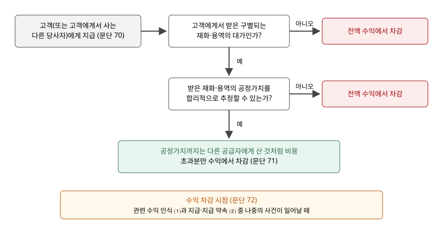

> 예제의 `사아식품`·`자차마트`와 그 숫자는 계산을 보이려고 만든 가상 자료다.

## 들어가며

식품 회사가 대형 유통사에 새 제품을 넣으려면 입점 장려금을 내고, 전단 광고비를 나눠 내고, 소비자 할인 쿠폰을 찍는 일이 흔하다. 영업 부서 예산으로 나가는 돈이라 손익계산서에서도 판매비와관리비에 넣고 싶어진다. 매출은 유통사에 판 금액 그대로 두고, 나간 돈은 비용으로 잡는 방식이다.

그런데 이 돈을 받는 쪽은 바로 제품을 사 간 고객이다. 고객에게 물건을 팔고 그 고객에게 돈을 돌려주면, 실질적으로는 물건값을 깎아 준 것과 다르지 않다. 예제의 식품회사가 상반기에 지급한 127,000(천원)을 모두 판관비로 넣으면 매출총이익률이 30.0%로 나오지만, 기준서대로 나누면 22.0%다. 영업이익은 같은데 총이익률이 8%포인트 벌어진다.

## 개념

기업회계기준서 제1115호의 **고객에게 지급할 대가**는 기업이 고객에게 지급하거나 지급할 것으로 예상하는 현금이다(문단 70). 고객에게서 기업의 제품을 사는 **다른 당사자**에게 주는 돈도 들어간다. 유통사를 거쳐 제품을 산 소비자에게 주는 쿠폰이 여기에 해당한다. 현금이 아니라 고객이 갚을 금액을 줄여 주는 공제, 쿠폰, 상품권도 포함된다.

원칙은 **수익에서 차감**이다. 예외는 그 지급이 고객에게서 받은 **구별되는 재화나 용역의 대가**인 경우 하나다. 이때는 다른 공급자에게 산 것과 같은 방법으로 처리한다. 즉 광고 용역을 샀으면 광고비, 원재료를 샀으면 원재료 매입이다(문단 71).

지급액에 변동금액이 있으면(판매량에 따라 달라지는 장려금, 회수율을 알 수 없는 쿠폰) [변동대가 추정과 제약](../2026-11-15-variable-consideration-estimate-constraint/index.md)을 그대로 적용한다(문단 70 마지막 문장). 차감 금액도 추정치이고, 제약도 받는다.

## 구조



> **출처**: 한국회계기준원 [기업회계기준서 제1115호 '고객과의 계약에서 생기는 수익'](https://www.samili.com/acc/Kijun/Kijunjomun.asp?code=1978-1115) 문단 70~72 고객에게 지급할 대가 (제3자 전재, 2021-04-23 개정) — 원문 발행처 [한국회계기준원](https://www.kasb.or.kr/front/board/ingAccountingList.do)

질문은 둘이고, 그 뒤에 시점을 정한다. 두 질문 중 어느 하나에서라도 "아니오"가 나오면 전액이 수익 차감이다. 비용으로 남는 길은 두 질문을 모두 통과한 경우뿐이고, 그것도 공정가치까지만이다.

## 동작 원리

### 질문 1 — 무엇을 받았는가

구별되는지는 수행의무를 식별할 때 쓰는 기준(문단 26~30)으로 판단한다. 문단 70이 그 문단을 직접 가리킨다. 이번에는 기업이 사는 쪽이므로, 기업이 그 재화나 용역에서 판매 거래와 별개로 효익을 얻을 수 있는지를 본다. 이 예제에서는 전단 광고를 다른 광고 대행사에서도 살 수 있는 용역으로 보아 구별된다고 판단했다. 입점 장려금은 유통사가 제품을 매대에 올리는 데 대한 지급인데, 매대에 오르는 것은 유통사가 그 제품을 팔기 위한 일이라 기업이 따로 받은 용역이 없다고 판단했다. 같은 명목이라도 계약 내용에 따라 판단이 달라질 수 있다.

### 질문 2 — 공정가치를 알 수 있는가

구별되는 용역을 받았어도 문단 71은 두 가지 제한을 둔다. 지급액이 받은 용역의 **공정가치를 넘으면 초과분**을 수익에서 뺀다. 시장에서 40,000이면 살 광고에 50,000을 냈다면 10,000은 광고값이 아니라 물건값 할인이다. 그리고 공정가치를 **합리적으로 추정할 수 없으면 전액**을 뺀다. 비교할 시장 가격이 없는 용역에 큰돈을 내면서 그것을 비용으로 두면 매출을 부풀리는 통로가 되기 때문이다.

### 시점 — 나중의 사건

문단 72는 수익에서 차감하는 시점을 다음 둘 중 **나중의 사건**이 일어날 때로 정한다.

| 사건 | 뜻 |
|---|---|
| ⑴ 관련 재화나 용역을 이전해 수익을 인식한다 | 차감할 매출이 아직 없으면 먼저 뺄 수 없다 |
| ⑵ 대가를 지급하거나 지급하기로 약속한다 | 약속이 사업 관행에서 암시되어도 된다. 지급이 미래 사건을 조건으로 해도 된다 |

미리 발표한 쿠폰은 그 쿠폰이 붙는 제품이 팔릴 때 뺀다. 거꾸로 이미 판 제품에 나중에 쿠폰을 붙이기로 하면, 판매 분기가 아니라 약속한 분기에 뺀다. 과거 매출을 고치지 않는다는 점은 [변동대가 재추정](../2026-11-15-variable-consideration-estimate-constraint/index.md)과 같다.

## 실습 예제

사아식품은 상반기에 자차마트에 1분기 400,000, 2분기 450,000(천원)어치를 판다. 원가율은 70%다. 그 사이 입점 장려금, 공동광고비, 진열 대행료, 두 종류의 소비자 쿠폰을 지급한다.

전체 소스: [`code/`](code/)

```text
[1] 지급 명목별 처리 — 문단 70·71
    명목             지급액      비용     수익 차감
    입점 장려금         30,000         0      30,000
    전단 공동광고비       50,000    40,000      10,000
    매대 진열 대행료      20,000         0      20,000
    합계            100,000    40,000      60,000
```

지급한 100,000 중 비용으로 남는 것은 광고의 공정가치 40,000뿐이다. 입점 장려금은 질문 1에서 걸려 전액이 매출 차감이다. 진열 대행은 구별되는 용역으로 보았지만 비교할 가격이 없어 질문 2에서 걸려 전액이 매출 차감이다. 공동광고비는 공정가치 40,000을 넘는 10,000만 매출에서 빠진다.

```text
[2] 쿠폰의 수익 차감 시점 — 문단 72: 판매와 약속 중 나중 분기
    프로그램  약속    판매    차감 분기   금액
    쿠폰 A    1분기    1분기    1분기         6,000
    쿠폰 A    1분기    2분기    2분기         9,000
    쿠폰 B    2분기    1분기    2분기        12,000
    분기별 차감 1분기 6,000  2분기 21,000
```

쿠폰 A는 1분기에 발표되었지만 2분기에 판 제품에 붙는 9,000은 2분기에 뺀다. 1분기에는 그 매출이 아직 없다. 쿠폰 B는 1분기에 이미 유통사로 넘어간 재고에 2분기에 붙인 것이라, 판매는 1분기여도 약속이 나중이므로 2분기에 뺀다. 결과적으로 2분기 차감액이 21,000으로 1분기의 3.5배가 된다.

```text
[3] 상반기 손익계산서 — 처리 방식별
    구분            매출       매출원가   매출총이익  총이익률   판관비(지급분)   영업이익
    기준서대로          763,000    595,000    168,000     22.0%        40,000     128,000
    전부 판관비로        850,000    595,000    255,000     30.0%       127,000     128,000
    → 영업이익은 같고, 매출과 매출총이익률이 달라진다
```

두 방식은 영업이익 128,000이 같다. 다른 것은 같은 87,000이 매출 줄에서 빠지느냐 판관비 줄에 들어가느냐다. 기준서대로 하면 매출이 87,000 줄고 매출총이익률이 22.0%가 된다. 전부 판관비로 두면 매출이 850,000으로 크게 보이고 매출총이익률이 30.0%로 높아진다. [세 가지 이익률](../../ratios/2026-10-14-three-margins-step-by-step/index.md)을 볼 때 매출총이익률만 따로 비교하면 이 차이에 그대로 속는다.

## 실무에서 주의할 점

- **명목이 아니라 받은 것을 본다.** "광고비"라는 이름의 지급도 실제로 받은 광고가 없거나 공정가치를 알 수 없으면 수익 차감이다. 계약서의 명칭이 판단을 정하지 않는다.
- **매출 규모를 비교할 때 지급 구조를 확인한다.** 유통사에 의존하는 소비재 회사는 판매장려금 규모가 크다. 회사마다 장려금 중 어느 부분을 구별되는 용역으로 보았는지가 다르면 같은 실질의 거래라도 매출과 총이익률이 달라진다. 주석의 수익 인식 정책에서 고객에게 지급할 대가를 어떻게 처리하는지 먼저 본다.
- **고객의 고객에게 주는 돈도 들어간다.** 소비자 쿠폰, 캐시백처럼 유통 단계 끝에 있는 사람에게 주는 돈도 문단 70의 범위다. 직접 거래 상대방이 아니라고 판관비로 두지 않는다. 반대로 고객이 아닌 공급자에게 주는 수수료는 이 규정의 대상이 아니다.
- **발표 시점이 분기 실적을 옮긴다.** 문단 72 때문에 이미 판 재고에 판촉을 붙이면 발표한 분기의 매출이 줄어든다. 분기 매출이 판매량보다 덜 늘었다면 그 분기에 시작한 판촉을 확인한다.

## 정리

- 고객과 고객에게서 제품을 사는 다른 당사자에게 지급하는 현금·쿠폰·공제는 원칙적으로 수익에서 차감한다(제1115호 문단 70).
- 구별되는 재화나 용역의 대가이면 일반 구매처럼 처리하되, 공정가치를 넘는 금액은 차감하고, 공정가치를 추정할 수 없으면 전액 차감한다(문단 71).
- 차감 시점은 관련 수익 인식과 지급 약속 중 나중의 사건이다(문단 72).
- 가상 사례에서 상반기 지급 127,000 중 40,000만 비용으로 남았고, 영업이익 128,000은 그대로인 채 매출총이익률이 30.0%에서 22.0%로 바뀌었다.

## 참고 자료

- [한국회계기준원](https://www.kasb.or.kr/front/board/ingAccountingList.do) — K-IFRS 기준서 발행처. 아래 전재 링크는 조문을 바로 열기 위한 편의 링크다
- [기업회계기준서 제1115호 '고객과의 계약에서 생기는 수익'](https://www.samili.com/acc/Kijun/Kijunjomun.asp?code=1978-1115) (제3자 전재, 2021-04-23 개정) — 문단 70~72 고객에게 지급할 대가, 26~30 구별되는 재화나 용역
- [IFRS 15 Revenue from Contracts with Customers](https://www.ifrs.org/issued-standards/list-of-standards/ifrs-15-revenue-from-contracts-with-customers/) — IFRS Foundation
- 숫자는 이 글의 [`code/output.txt`](code/output.txt) `[1]`~`[3]`에서 옮겼다
