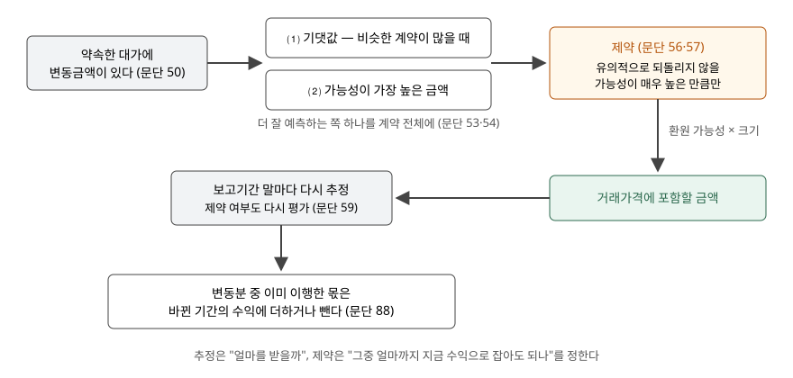

> 예제의 `타파건설`·`하나부품`과 그 숫자, 확률은 계산을 보이려고 만든 가상 자료다.

## 들어가며

공사 계약서에 "약정일보다 일찍 끝내면 보너스 100,000(천원)"이 붙어 있는 일은 흔하다. 현장 소장은 일정상 70%쯤 받을 수 있다고 본다. 결산을 맡은 사람은 이 보너스를 매출에 얼마나 넣을지 정해야 하는데, 0을 넣으면 받을 것이 확실해 보이는 돈을 빼는 것 같고, 100,000을 다 넣으면 장마 한 번에 그만큼 매출을 되돌려야 한다.

거래처에 "연 1,000개를 넘기면 그해 산 전량을 단가 90으로 정산한다"는 리베이트를 주는 부품 회사도 같은 문제를 겪는다. 1분기에는 1,000개를 못 넘길 것 같아 100으로 매출을 잡았는데 2분기에 주문이 몰리면, 이미 인식한 1분기 매출 일부를 2분기에 깎아야 한다. 예제에서 2분기 청구액은 35,000이지만 그 분기 매출은 29,500이 된다.

## 개념

기업회계기준서 제1115호는 약속한 대가에 변동금액이 있으면, 재화나 용역을 이전하고 받을 권리를 갖게 될 금액을 **추정**하라고 정한다(문단 50). 대가가 바뀌는 이유로 할인, 리베이트, 환불, 가격할인, 장려금, 성과보너스, 위약금을 든다(문단 51). 계약서에 적혀 있지 않아도 기업이 관행적으로 값을 깎아 주어 고객이 그것을 정당하게 기대한다면 대가는 변동한다(문단 52).

추정한 금액을 그대로 거래가격에 넣지는 않는다. 불확실성이 나중에 풀릴 때 이미 인식한 누적 수익 중 **유의적인 부분을 되돌리지 않을 가능성이 매우 높은**(highly probable) 만큼만 넣는다(문단 56). 이것을 변동대가 추정치의 **제약**이라고 부른다. 추정은 "얼마를 받을까"를, 제약은 "그중 얼마까지를 지금 수익으로 잡아도 되나"를 정한다.

[반품권이 있는 판매](../2026-11-08-sales-with-right-of-return/index.md)의 환불부채와 [판매기준 로열티 예외](../2026-11-11-sales-based-royalty-exception/index.md)가 모두 이 틀의 특수한 경우다. 이 글은 그 둘이 기대고 있는 일반 규정을 다룬다.

## 구조



> **출처**: 한국회계기준원 [기업회계기준서 제1115호 '고객과의 계약에서 생기는 수익'](https://www.samili.com/acc/Kijun/Kijunjomun.asp?code=1978-1115) 문단 50~57 변동대가, 59 변동대가의 재검토, 88 거래가격의 변동 (제3자 전재, 2021-04-23 개정) — 원문 발행처 [한국회계기준원](https://www.kasb.or.kr/front/board/ingAccountingList.do)

흐름은 세 단계다. 추정 방법을 하나 고르고, 제약으로 넣을 금액을 줄이고, 보고기간 말마다 처음부터 다시 한다. 마지막 단계에서 바뀐 금액은 과거 기간을 고치지 않고 바뀐 기간에 반영된다.

## 동작 원리

### 추정 방법 두 가지

문단 53은 받을 대가를 **더 잘 예측할 것으로 예상하는** 방법을 쓰라고 하며 두 가지를 둔다.

| 방법 | 계산 | 기준서가 든 적합한 경우 |
|---|---|---|
| ⑴ 기댓값 | 가능한 금액마다 확률을 곱해 더한다 | 특성이 비슷한 계약이 많을 때 |
| ⑵ 가능성이 가장 높은 금액 | 가능한 결과 중 확률이 가장 높은 하나 | 결과가 두 가지뿐일 때(보너스를 받거나 못 받거나) |

기댓값은 계약이 많을 때 평균이 실제 합계에 가까워지므로 잘 맞는다. 계약이 하나이고 결과가 둘뿐이면 기댓값은 **실제로는 일어날 수 없는 금액**이 된다. 받으면 100,000이고 못 받으면 0인데 70,000을 넣는 셈이다. 그래서 문단 53⑵가 이 경우를 따로 들었다.

문단 54는 한 계약 안에서 불확실성 하나에는 방법 하나를 **일관되게** 쓰고, 과거·현재·예측 정보를 모두 참고하라고 정한다. 쓰는 정보는 경영진이 입찰가를 정할 때 쓴 정보와 비슷할 것이라고 적었다. 견적 단계에서 보너스를 받을 것으로 보고 값을 낮춰 불렀다면, 결산에서 보너스를 받지 못할 것으로 보는 판단과는 서로 맞지 않는다.

### 제약 — 확률과 크기를 함께 본다

문단 57은 되돌릴 가능성이 매우 높지 않은지 판단할 때 **환원 가능성과 크기를 모두** 고려하라고 하며, 환원 가능성을 키우거나 크기를 키우는 요인 다섯 가지를 든다.

| 요인 | 예 |
|---|---|
| ⑴ 기업이 영향을 줄 수 없는 요인에 매우 민감하다 | 시장 변동, 제삼자의 판단, 날씨, 높은 진부화 위험 |
| ⑵ 불확실성이 오랫동안 풀리지 않는다 | 수년 뒤에야 확정되는 인센티브 |
| ⑶ 비슷한 계약 경험이 적거나 예측력이 낮다 | 처음 맺는 형태의 계약 |
| ⑷ 가격할인이나 지급조건 변경을 폭넓게 해 온 관행이 있다 | 분기 말마다 깎아 주던 거래처 |
| ⑸ 가능한 대가가 많고 범위가 넓다 | 단계가 여러 개인 보너스 |

기준서는 "매우 높은"을 숫자로 정하지 않는다. 그래서 이 글의 예제도 문턱을 정해 판정하지 않고, 후보 금액마다 되돌릴 확률과 크기를 나란히 계산해 판단에 쓸 재료를 보이는 데서 멈춘다.

### 보고기간 말마다 다시 추정한다

문단 59는 보고기간 말마다 추정 거래가격을 새로 고치고, 제약 여부도 다시 평가하라고 정한다. 바뀐 금액은 계약 개시 때와 같은 기준으로 수행의무에 배분하고, **이미 이행한 수행의무에 배분된 몫은 거래가격이 바뀐 기간에** 수익에 더하거나 뺀다(문단 88). 과거 분기의 매출을 고쳐 쓰지 않고 바뀐 분기에 한꺼번에 반영하는 누적 따라잡기다. 계약변경으로 생긴 가격 변동은 이 규정이 아니라 [계약변경 규정](../2026-11-14-contract-modification-three-paths/index.md)을 따른다(문단 90).

## 실습 예제

타파건설은 고정대가 900,000(천원)짜리 공사에 조기 완공 보너스를 받는다. 하나부품은 단가 100에 연 1,000개를 넘기면 전량을 90으로 소급 정산하는 계약으로 부품을 판다.

전체 소스: [`code/`](code/)

```text
[1] 결과가 두 가지인 보너스 — 두 방법의 추정치
    기댓값                    970,000   (실제로는 나올 수 없는 금액)
    가능성이 가장 높은 금액   1,000,000
```

보너스가 0 또는 100,000(확률 70%)이면 기댓값은 970,000이다. 공사가 끝났을 때 실제 대가는 900,000 아니면 1,000,000이므로, 970,000은 어느 결과가 나와도 틀린다. 가능성이 가장 높은 금액 1,000,000은 맞을 확률이 70%다. 결과가 둘뿐이면 이쪽이 받을 금액을 더 잘 예측한다.

```text
[2] 단계 보너스 — 거래가격에 넣을 보너스 후보별 수익 환원 위험
    기댓값 55,000  가능성이 가장 높은 금액 50,000
    포함 금액     되돌릴 확률   되돌릴 최대 크기   누적 수익 대비
    0 (전부 제약)           0        0%               0          0.0%
    가능성 최고         50,000       20%          50,000          5.3%
    기댓값            55,000       70%          55,000          5.8%
    최대치           100,000       70%         100,000         10.0%
```

보너스가 0·50,000·100,000의 세 단계(확률 20%·50%·30%)이면 결과가 셋이라 판단이 달라진다. 기댓값 55,000을 넣으면 실제가 55,000보다 작을 확률, 곧 0이나 50,000이 나올 확률이 70%다. 가능성이 가장 높은 50,000을 넣으면 되돌릴 확률이 20%로 떨어지고, 되돌릴 크기는 최대 50,000이다. 5,000 차이로 환원 확률이 50%포인트 바뀌는 것은 두 후보 사이에 실제 결과가 하나도 없기 때문이다.

이 표가 문단 57이 말하는 "가능성과 크기"다. 0을 넣으면 위험은 없지만 받을 가능성이 80%인 50,000까지 모두 빼게 된다. 공사가 날씨에 크게 좌우된다면(요인 ⑴) 50,000 넣기도 어렵다고 볼 수 있고, 비슷한 공사를 많이 해 본 회사라면(요인 ⑶의 반대) 50,000은 넣을 수 있다고 볼 수 있다. 숫자는 판단을 대신하지 않고, 판단에 쓸 재료만 준다.

```text
[3] 소급 수량 리베이트 — 분기 말 재추정과 누적 따라잡기 (문단 59, 88)
    분기    판매   누적   예상 연간  적용 단가   누적 수익   분기 수익   명목 청구액
    1분기    200    200       800       100      20,000      20,000      20,000
    2분기    350    550     1,100        90      49,500      29,500      35,000
    3분기    300    850     1,100        90      76,500      27,000      30,000
    4분기    250  1,100     1,100        90      99,000      22,500      25,000
    연간 수익 99,000 = 1,100개 × 90
```

하나부품은 1분기 말에 연간 800개를 예상해 단가 100으로 20,000을 잡았다. 2분기 말 예상이 1,100개로 바뀌자 누적 550개 전체에 90을 적용해 누적 수익이 49,500이 되어야 한다. 이미 잡은 20,000을 빼면 2분기 수익은 29,500이다. 2분기에 판 350개의 몫 31,500(350×90)에서 1분기 200개에 소급된 2,000(200×10)을 뺀 금액과 같다. 1분기 재무제표는 고치지 않는다.

3·4분기 매출은 청구액보다 각각 3,000·2,500 작다. 이 차이만큼 고객에게 돌려줄 금액이 쌓이므로, 연말 정산 전까지는 받은 돈과 매출의 차이가 환불부채로 남는다(문단 55).

## 실무에서 주의할 점

- **기댓값을 "가장 정확한 값"으로 여기지 않는다.** 단일 계약에 결과가 둘이면 기댓값은 어느 결과와도 맞지 않는다. 문단 53은 둘 중 아무거나가 아니라 더 잘 예측하는 쪽을 쓰라고 한다.
- **제약은 0 아니면 전부가 아니다.** 문단 56은 추정치의 "일부나 전부"를 넣는다고 적는다. 단계 보너스에서 가장 낮은 단계까지만 넣는 것처럼, 되돌릴 위험이 낮은 부분만 떼어 넣을 수 있다.
- **분기 매출의 출렁임은 재추정의 결과일 수 있다.** 소급 리베이트가 있는 회사는 문턱 예상이 바뀌는 분기에 매출이 판매량보다 덜 오르거나 더 오른다. 판매량과 매출 증가율이 어긋나면 주석의 변동대가 설명과 환불부채 변동을 먼저 확인한다.
- **관행도 변동대가를 만든다.** 계약서상 가격이 고정이어도 분기 말 할인을 반복해 왔다면 문단 52에 따라 대가가 변동하는 것으로 보고, 문단 57⑷는 그런 관행 자체를 환원 위험을 키우는 요인으로 든다.

## 정리

- 대가에 변동금액이 있으면 받을 권리를 갖게 될 금액을 추정한다(제1115호 문단 50~52).
- 추정은 기댓값과 가능성이 가장 높은 금액 중 더 잘 예측하는 쪽으로 하고, 계약 전체에 일관되게 쓴다(문단 53·54).
- 추정치는 유의적인 수익 환원이 없을 가능성이 매우 높은 만큼만 거래가격에 넣으며, 판단에는 환원 가능성과 크기를 함께 본다(문단 56·57).
- 보고기간 말마다 다시 추정하고, 이행한 몫의 변동은 바뀐 기간의 수익에 반영한다(문단 59·88).
- 가상 사례에서 단계 보너스는 50,000을 넣으면 환원 확률이 20%, 기댓값 55,000을 넣으면 70%였고, 소급 리베이트는 2분기 청구액 35,000에 대해 매출 29,500을 남겼다.

## 참고 자료

- [한국회계기준원](https://www.kasb.or.kr/front/board/ingAccountingList.do) — K-IFRS 기준서 발행처. 아래 전재 링크는 조문을 바로 열기 위한 편의 링크다
- [기업회계기준서 제1115호 '고객과의 계약에서 생기는 수익'](https://www.samili.com/acc/Kijun/Kijunjomun.asp?code=1978-1115) (제3자 전재, 2021-04-23 개정) — 문단 50~59 변동대가, 87~90 거래가격의 변동
- [IFRS 15 Revenue from Contracts with Customers](https://www.ifrs.org/issued-standards/list-of-standards/ifrs-15-revenue-from-contracts-with-customers/) — IFRS Foundation
- 숫자는 이 글의 [`code/output.txt`](code/output.txt) `[1]`~`[3]`에서 옮겼다
