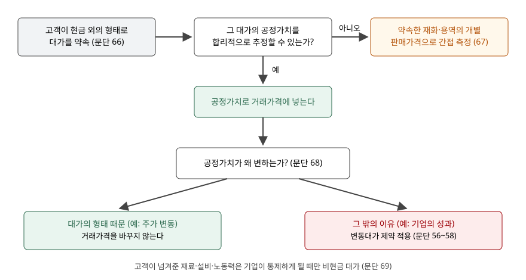

> 예제의 `하거소프트`·`마바랩`과 그 숫자는 계산을 보이려고 만든 가상 자료다.

## 들어가며

소프트웨어 회사가 창업 초기 회사의 시스템을 만들어 주고, 현금이 모자란 고객이 대금 일부를 자기 회사 주식으로 주겠다고 하는 일이 있다. 계약서에는 "현금 1억 원과 주식 2,000주"라고만 적혀 있다. 회계 담당자는 보통 주식을 실제로 받은 날 그 값을 매출로 잡거나, 비상장 주식이라 값을 모른다며 현금 부분만 매출로 잡는다.

두 방법은 같은 계약의 매출을 크게 다르게 만든다. 예제에서 기준서대로 잰 매출은 175,000(천원)인데, 주식을 받은 날의 가격으로 재면 212,500으로 37,500이 늘고, 현금만 잡으면 100,000으로 줄어든다. 주가가 오른 몫은 고객에게 용역을 판 대가가 아니라 주식을 들고 있어서 생긴 차익인데, 첫 방법은 그것을 매출에 섞는다.

## 개념

기업회계기준서 제1115호에서 **비현금 대가**는 고객이 현금 외의 형태로 약속한 대가다. 주식, 재화, 설비, 용역이 모두 해당한다. 기준서는 거래가격을 산정할 때 고려할 다섯 가지 중 하나로 비현금 대가를 든다(문단 48⑷). 나머지는 [변동대가와 그 제약](../2026-11-15-variable-consideration-estimate-constraint/index.md), [유의적인 금융요소](../2026-11-14-significant-financing-component/index.md), [고객에게 지급할 대가](../2026-11-15-consideration-payable-to-customer/index.md)다.

규정은 네 문단이다.

| 문단 | 내용 |
|---|---|
| 66 | 비현금 대가는 **공정가치**로 측정한다 |
| 67 | 공정가치를 합리적으로 추정할 수 없으면 약속한 재화나 용역의 **개별 판매가격**을 참조해 간접 측정한다 |
| 68 | 공정가치가 **대가의 형태** 때문에 변하는 것과 **그 밖의 이유**로 변하는 것을 나누고, 뒤의 것에만 변동대가 제약(56~58)을 적용한다 |
| 69 | 고객이 계약 이행을 돕도록 넘겨준 재료·설비·노동력은 기업이 **통제**하게 되는 경우에만 비현금 대가다 |

기준서 본문은 공정가치를 **어느 날짜 기준**으로 재는지 정하지 않는다. 이 글의 예제는 계약 개시시점 값으로 잰다고 가정했고, 실제로 회사가 택한 기준은 주석의 수익 인식 정책에서 확인해야 한다.

## 구조



> **출처**: 한국회계기준원 [기업회계기준서 제1115호 '고객과의 계약에서 생기는 수익'](https://www.samili.com/acc/Kijun/Kijunjomun.asp?code=1978-1115) 문단 66~69 비현금 대가 (제3자 전재, 2021-04-23 개정) — 원문 발행처 [한국회계기준원](https://www.kasb.or.kr/front/board/ingAccountingList.do)

판단은 두 번이다. 먼저 무엇으로 재는지(공정가치냐 개별 판매가격이냐)를 정하고, 그 다음 값이 변할 때 그 변동을 거래가격에 넣을지를 정한다.

## 동작 원리

### 공정가치를 모르면 반대편 가격을 쓴다

비상장 주식이나 특수 장비처럼 시장 가격이 없는 대가도 있다. 문단 67은 이때 대가 쪽이 아니라 **기업이 준 쪽**의 가격을 본다. 기업이 같은 용역을 따로 팔 때 받는 가격이 170,000이고 현금으로 100,000을 받았다면, 주식은 70,000어치로 본다. 교환 거래에서 양쪽 가치가 같다고 보는 셈이다. 공정가치를 모른다고 0으로 두면 매출이 줄고, 그렇다고 임의의 값을 넣을 수도 없으니 기준서가 두 번째 근거를 정해 둔 것이다.

### 변동의 이유를 나눈다

문단 68은 공정가치 변동을 두 갈래로 나눈다.

- **대가의 형태 때문인 변동** — 받기로 한 주식 수는 그대로인데 주가가 오르내리는 경우다. 이 변동은 기업이 용역을 얼마나 잘했는지와 무관하다. 거래가격을 다시 정하지 않는다. 받은 주식은 금융자산이므로 이후의 가치 변동은 [금융자산 분류](../2026-10-12-financial-assets-three-classes/index.md)에 따라 처리한다.
- **그 밖의 이유로 인한 변동** — 기한 안에 끝내면 주식을 더 받는 식으로 **받을 수량**이 기업의 성과에 달린 경우다. 이것은 현금 성과보너스와 같은 변동대가이므로 문단 56~58의 제약을 적용한다. 되돌릴 가능성이 매우 낮다고 판단될 때까지 거래가격에 넣지 않는다.

### 고객이 넘겨준 장비

고객이 자기 서버를 주며 "이걸로 구축해 달라"고 할 때가 있다. 문단 69는 기업이 그 서버를 **통제**하게 되는지를 묻는다. 기업이 서버를 자기 자산처럼 쓰고 처분할 수 있게 되면 비현금 대가로 거래가격에 넣고 자산도 인식한다. 서버가 여전히 고객의 것이고 기업은 그 위에서 작업만 하면 대가가 아니다.

## 실습 예제

하거소프트는 마바랩에 1년짜리 시스템 구축 용역을 제공한다. 대가는 현금 100,000과 마바랩 주식 2,000주다. 기한 안에 끝내면 주식 500주를 더 받는다. 계약 개시시점 주당 공정가치는 30, 4분기에 주식을 받을 때는 45다. 용역은 기간에 걸쳐 이행되고 진행률은 분기마다 25%씩 오른다.

전체 소스: [`code/`](code/)

```text
[1] 계약 개시시점 거래가격 — 문단 66·68
    현금                          100,000
    주식 2,000주 x 30           60,000
    보너스 주식 500주 (제약)                0
    거래가격                      160,000
```

보너스 주식은 받을 수량이 기업의 성과에 달려 있으므로 변동대가 제약 대상이다. 계약 초기에는 기한 안에 끝낼 수 있을지 알 수 없다고 보아 0으로 두었다.

```text
[2] 분기별 수익 — 보너스 주식은 제약이 풀린 분기에 누적 따라잡기
    분기  진행률   거래가격    누적 수익    분기 수익
    1분기    25%    160,000     40,000     40,000
    2분기    50%    160,000     80,000     40,000
    3분기    75%    175,000    131,250     51,250
    4분기   100%    175,000    175,000     43,750
    합계                             175,000
```

3분기에 기한 내 완료 가능성이 매우 높아졌다고 판단하면 보너스 주식 500주(계약 개시시점 값 15,000)가 거래가격에 들어온다. 이미 지난 진행률 75%에 해당하는 몫까지 3분기에 한꺼번에 잡으므로 3분기 수익이 51,250으로 다른 분기보다 크다. 보너스 주식을 몇 시점의 값으로 넣을지도 기준서 본문이 정하지 않으므로, 예제는 계약 개시시점 값을 썼다.

```text
[3] 주가 변동 — 대가의 형태 때문인 변동은 거래가격에 넣지 않는다 (문단 68)
    수령 주식 2,500주 x 45            112,500
    수익에 넣은 주식 몫                75,000
    차이 (수익 밖)                     37,500
    수령 시점 값으로 잘못 잰 수익     212,500
```

주가가 30에서 45로 오른 것은 주식의 형태 때문인 변동이다. 받은 주식은 112,500어치지만 매출에 들어간 몫은 75,000이고, 차이 37,500은 매출이 아니다. 받은 날 가격으로 매출을 재면 212,500이 되어 용역의 대가가 주가에 따라 달라진다. 반대로 주가가 떨어졌다면 매출이 줄었을 것이다.

```text
[4] 주식 공정가치를 추정할 수 없을 때 — 문단 67
    구축 용역 개별 판매가격           170,000
    현금                              100,000
    주식 대가로 보는 금액              70,000
```

마바랩 주식의 공정가치를 추정할 수 없으면 하거소프트가 같은 구축 용역을 따로 팔 때의 가격 170,000에서 현금을 뺀 70,000을 주식 대가로 본다.

```text
[5] 고객이 넘겨주는 서버 장비 — 문단 69
    통제 여부    거래가격     서버 처리
    통제한다     195,000     자산 인식, 비현금 대가
    통제 못함    175,000     인식하지 않는다
```

마바랩이 20,000어치 서버를 넘겨줄 때, 하거소프트가 그 서버를 통제하면 거래가격이 195,000으로 늘고 같은 금액의 자산이 생긴다. 통제하지 못하면 거래가격은 175,000 그대로다. 같은 장비가 계약 조건에 따라 매출에 들어가기도 하고 빠지기도 한다.

## 실무에서 주의할 점

- **주가 상승을 매출로 섞지 않는다.** 받은 주식의 값이 오른 몫은 용역을 판 대가가 아니라 금융자산을 들고 있어 생긴 손익이다. 매출과 금융손익이 섞이면 매출총이익률이 주가에 따라 흔들린다.
- **수량이 바뀌는지, 가격이 바뀌는지를 구분한다.** 성과에 따라 주식 수가 늘어나는 조건은 변동대가이고 제약을 받는다. 같은 주식이라도 가격 변동은 제약 대상이 아니다. 계약서에 두 조건이 섞여 있으면 갈래를 나누어 따로 처리한다.
- **측정 기준일을 주석에서 확인한다.** 기준서 본문이 측정 시점을 정하지 않으므로 회사마다 계약 개시시점이나 수령 시점 등 기준이 다를 수 있다. 비현금 대가가 큰 회사끼리 매출을 비교할 때는 이 정책부터 본다.
- **고객 자산을 쓴다고 모두 대가는 아니다.** 고객이 장비나 인력을 넘겨줄 때 기업이 통제하지 않으면 거래가격에 넣지 않는다. 넣으면 매출과 원가가 같은 금액만큼 부풀어 이익은 같아도 매출 규모가 커 보인다.

## 정리

- 고객이 현금 외의 형태로 약속한 대가는 공정가치로 측정하고, 추정할 수 없으면 기업이 약속한 재화·용역의 개별 판매가격을 참조한다(제1115호 문단 66·67).
- 공정가치 변동 중 대가의 형태 때문인 것은 거래가격을 바꾸지 않고, 성과처럼 그 밖의 이유로 인한 것만 변동대가 제약을 적용한다(문단 68).
- 고객이 넘겨준 재료·설비·노동력은 기업이 통제할 때만 비현금 대가다(문단 69).
- 가상 사례에서 매출은 175,000이었고, 주식을 받은 날의 가격으로 쟀다면 37,500 많은 212,500이 되었다.

## 참고 자료

- [한국회계기준원](https://www.kasb.or.kr/front/board/ingAccountingList.do) — K-IFRS 기준서 발행처. 아래 전재 링크는 조문을 바로 열기 위한 편의 링크다
- [기업회계기준서 제1115호 '고객과의 계약에서 생기는 수익'](https://www.samili.com/acc/Kijun/Kijunjomun.asp?code=1978-1115) (제3자 전재, 2021-04-23 개정) — 문단 48 거래가격 고려사항, 56~58 변동대가 제약, 66~69 비현금 대가
- [IFRS 15 Revenue from Contracts with Customers](https://www.ifrs.org/issued-standards/list-of-standards/ifrs-15-revenue-from-contracts-with-customers/) — IFRS Foundation
- 숫자는 이 글의 [`code/output.txt`](code/output.txt) `[1]`~`[5]`에서 옮겼다
