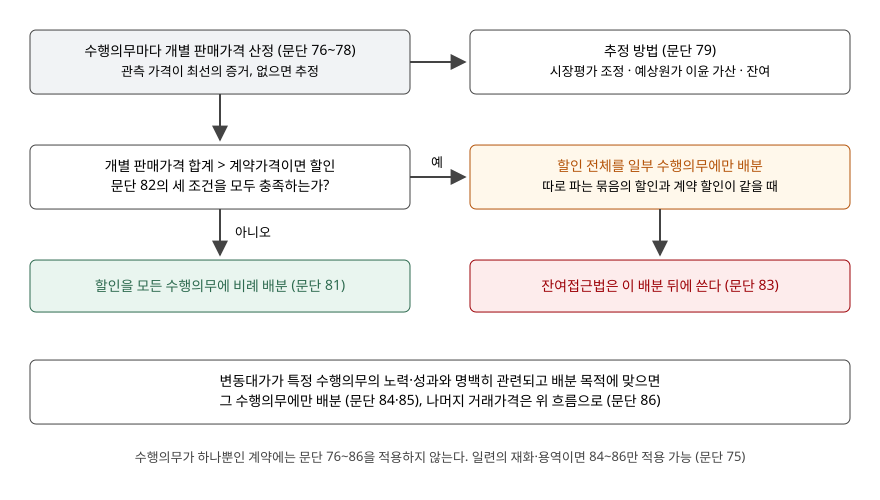

> 예제의 `파하가전`과 그 숫자는 계산을 보이려고 만든 가상 자료다.

## 들어가며

가전 매장에서 냉장고와 정수기를 함께 사면 2년 관리 서비스까지 묶어 할인해 주는 상품을 흔히 본다. 회사 입장에서 냉장고와 정수기는 배송한 날 수익이 되고, 관리 서비스는 2년에 걸쳐 수익이 된다. 그러면 깎아 준 150(천원)을 어느 품목에서 뺄지에 따라 첫해 매출이 달라진다. 보통은 계산이 쉽다는 이유로 정가 비율대로 나누거나, 반대로 영업 부서가 "관리 서비스를 공짜로 준 셈"이라며 서비스에 할인을 몰아 넣는다.

두 방식 모두 근거가 따로 있어야 한다. 기준서는 원칙을 비례 배분으로 두고, 일부 품목에 몰아주려면 세 조건을 모두 충족해야 한다고 정한다. 예제에서 배분 방식만 바꿔도 첫해 수익이 1,215.0과 1,237.5로 갈리고, 잔여접근법의 순서를 바꾸면 한 수행의무에 배분되는 금액이 300에서 150으로 절반이 된다.

## 개념

기업회계기준서 제1115호의 수익 인식 5단계 중 네 번째가 **거래가격 배분**이다([수익 인식 5단계](../2026-10-10-revenue-recognition-five-steps/index.md)). 배분의 목적은 각 수행의무에 기업이 그 재화나 용역을 이전하고 받을 권리를 갖게 될 금액을 배분하는 것이다(문단 73).

방법은 **상대적 개별 판매가격** 기준이다(문단 74·76). 계약 개시시점에 각 수행의무의 **개별 판매가격**, 즉 그 재화나 용역을 따로 팔 때의 가격을 정하고 그 비율로 거래가격을 나눈다. 개별 판매가격의 최선의 증거는 비슷한 상황에서 비슷한 고객에게 따로 팔 때의 관측 가격이다. 계약서의 표시가격이나 정가가 개별 판매가격일 수는 있지만, 그것을 곧바로 개별 판매가격으로 보아서는 안 된다(문단 77).

이 원칙에서 벗어나는 경우가 둘이다. **할인액의 배분**(문단 81~83)과 **변동대가의 배분**(문단 84~86)이다. 수행의무가 하나뿐인 계약은 나눌 대상이 없으므로 이 규정들을 적용하지 않는다(문단 75).

## 구조



> **출처**: 한국회계기준원 [기업회계기준서 제1115호 '고객과의 계약에서 생기는 수익'](https://www.samili.com/acc/Kijun/Kijunjomun.asp?code=1978-1115) 문단 73~86 거래가격 배분 (제3자 전재, 2021-04-23 개정) — 원문 발행처 [한국회계기준원](https://www.kasb.or.kr/front/board/ingAccountingList.do)

## 동작 원리

### 개별 판매가격을 추정하는 세 가지 방법

관측 가격이 없으면 추정한다. 문단 79는 적절한 방법 세 가지를 들고, 이것에 한정되지 않는다고 덧붙인다.

| 방법 | 어떻게 | 쓸 수 있는 조건 |
|---|---|---|
| ⑴ 시장평가 조정 접근법 | 시장에서 고객이 지급하려는 가격을 추정한다. 경쟁사 가격에 자기 원가와 이윤을 반영해 조정할 수 있다 | 제한 없음 |
| ⑵ 예상원가 이윤 가산 접근법 | 수행의무를 이행할 예상원가에 적절한 이윤을 더한다 | 제한 없음 |
| ⑶ 잔여접근법 | 총 거래가격에서 다른 재화나 용역의 관측 가능한 개별 판매가격 합계를 뺀다 | 판매가격이 매우 다양하거나(㈎) 아직 가격을 정하지 않고 따로 판 적이 없을 때(㈏)만 |

잔여접근법에 조건이 붙은 이유는, 남는 금액을 전부 한 품목에 몰아 주는 방법이라 그 품목의 가격을 정할 근거가 따로 있으면 쓸 이유가 없기 때문이다. 둘 이상의 품목이 모두 가격이 불확실하면 잔여접근법으로 묶음 값을 구한 뒤 그 안을 다른 방법으로 다시 나누는 식의 결합도 허용된다(문단 80).

### 할인은 원칙적으로 모두에게 나눈다

개별 판매가격 합계가 계약가격보다 크면 고객은 묶음 할인을 받은 것이다. 원칙은 할인을 모든 수행의무에 비례 배분하는 것이다(문단 81). 할인 전체를 일부 수행의무에만 배분하려면 문단 82의 세 조건을 **모두** 충족해야 한다.

| 조건 | 내용 |
|---|---|
| ⑴ | 계약의 구별되는 재화나 용역(또는 그 묶음)을 각각 보통 따로 판매한다 |
| ⑵ | 그중 일부를 묶어 개별 판매가격보다 할인한 묶음으로도 보통 따로 판매한다 |
| ⑶ | 그 묶음의 할인액이 계약의 할인액과 실질적으로 같고, 그래서 계약 할인이 어느 수행의무에서 나오는지 관측 가능한 증거가 된다 |

세 조건이 요구하는 것은 결국 **관측 가능한 증거**다. "관리 서비스를 공짜로 준 셈"이라는 영업 쪽 설명은 증거가 아니다. 회사가 실제로 같은 할인 묶음을 시장에서 따로 팔고 있어야 한다.

### 잔여접근법보다 할인 배분이 먼저다

할인을 일부 수행의무에 몰아주는 경우, 잔여접근법을 쓰기 **전에** 그 할인을 배분한다(문단 83). 순서를 바꾸면 다른 품목에 귀속되어야 할 할인이 잔여 품목의 몫에서 빠져 그 품목의 금액이 줄어든다. 아래 예제의 [3]이 그 차이를 보인다.

### 변동대가는 관련된 곳에만

성과 보너스처럼 특정 수행의무의 이행과 명백히 관련된 변동대가는, 그 수행의무에 전부 배분하는 것이 배분 목적에 맞으면 그곳에만 배분한다(문단 84·85). 남은 거래가격은 위 원칙대로 나눈다(문단 86). 변동대가를 추정하는 방법은 [변동대가 추정과 제약](../2026-11-15-variable-consideration-estimate-constraint/index.md)에서 다뤘다.

## 실습 예제

파하가전은 냉장고(개별 판매가격 900), 정수기(300), 2년 관리 용역(300)을 묶어 1,350에 판다. 냉장고와 정수기는 1분기 초에 인도하고, 관리 용역은 8분기에 걸쳐 고르게 이행한다. 파하가전은 냉장고를 900에 따로 팔고, 정수기와 관리 용역을 묶어 450에 따로 판다.

전체 소스: [`code/`](code/)

```text
[1] 묶음 판매 거래가격 배분 — 개별 판매가격 합계 1,500, 계약가격 1,350, 할인 150
    수행의무     개별판매가격   비례 배분(81)   일부 집중(82)
    냉장고             900          810.0          900.0
    정수기             300          270.0          225.0
    관리 용역           300          270.0          225.0
    합계            1,500        1,350.0        1,350.0
```

비례 배분은 할인 150을 개별 판매가격 비율(6:2:2)대로 나눠 모두 10%씩 깎는다. 일부 집중은 정수기+관리 묶음이 600에서 450으로 150 할인되어 계약 할인과 같다는 관측 증거가 있으므로, 냉장고는 900 그대로 두고 할인 전체를 정수기와 관리 용역에 배분한다. 묶음 450은 그 안에서 다시 개별 판매가격 비율로 나눈다.

```text
[2] 첫해 수익과 연말 계약부채 — 관리 용역은 8분기 중 4분기 이행
    배분 방식      재화 수익   용역 수익   첫해 합계   계약부채
    비례 배분         1,080.0      135.0    1,215.0      135.0
    일부 집중         1,125.0      112.5    1,237.5      112.5
```

일부 집중에서는 냉장고가 할인 없이 900을 배분받고 할인은 정수기와 관리 용역 몫에서만 빠지므로, 인도 시점에 인식하는 재화 수익이 커진다. 첫해 수익은 22.5 많고, 아직 이행하지 않은 관리 용역 몫인 계약부채는 22.5 적다. 2년 동안의 총수익은 1,350으로 같고 시점만 달라진다.

```text
[3] 앱 연동 서비스를 잔여접근법으로 — 계약가격 1,650 (문단 79⑶·83)
    순서                          다른 수행의무 몫   앱 연동 몫
    할인 먼저 배분 후 잔여 (83)            1,350        300
    잔여 먼저, 할인 무시                   1,500        150
```

이번에는 같은 묶음에 앱 연동 서비스를 더해 1,650에 판다. 앱 연동 서비스는 고객마다 가격이 매우 다양해 잔여접근법을 쓸 수 있다고 본다. 문단 83대로 할인을 먼저 배분하면 다른 수행의무의 몫은 냉장고 900과 할인 묶음 450을 더한 1,350이고, 앱 연동은 300이다. 할인을 무시하고 정가 합계 1,500을 먼저 빼면 앱 연동이 150으로 줄어든다. 정수기·관리 묶음에 귀속되어야 할 할인 150이 앱 연동 몫에서 빠진 것이다.

## 실무에서 주의할 점

- **정가는 개별 판매가격이 아닐 수 있다.** 문단 77은 정가를 곧바로 개별 판매가격으로 보지 말라고 한다. 정가에서 늘 깎아 팔고 있다면 실제로 따로 팔 때의 가격이 증거다. 정가 비율로 나누면 할인이 큰 품목의 몫이 부풀려진다.
- **할인을 서비스에 몰아주려면 관측 증거가 있어야 한다.** 일부 집중은 첫해 수익을 앞당기는 방향으로 작용하는 경우가 많다. 세 조건 중 하나라도 근거가 약하면 비례 배분이 원칙이다.
- **잔여접근법은 마지막에 쓴다.** 잔여 품목의 금액은 다른 품목의 할인과 추정 오차가 모두 반영된 값이 된다. 잔여 품목이 기간에 걸쳐 인식되는 용역이면 그 차이가 수익 인식 시점까지 바꾼다.
- **계약 개시시점에 정하고 다시 나누지 않는다.** 개별 판매가격은 계약 개시시점에 산정한다(문단 76). 계약 개시 후 개별 판매가격이 바뀌어도 그것을 반영하려고 거래가격을 다시 배분하지 않는다(문단 88).

## 정리

- 거래가격은 계약 개시시점의 상대적 개별 판매가격 비율로 각 수행의무에 배분한다(제1115호 문단 73~76).
- 개별 판매가격은 관측 가격이 최선이고, 없으면 시장평가 조정·예상원가 이윤 가산·잔여 접근법으로 추정하되 잔여접근법은 가격이 매우 다양하거나 불확실할 때만 쓴다(문단 77~80).
- 할인은 모든 수행의무에 비례 배분하고, 문단 82의 세 조건을 모두 충족할 때만 일부에 몰아주며, 그 배분은 잔여접근법보다 먼저 한다(문단 81~83).
- 가상 사례에서 배분 방식에 따라 첫해 수익이 1,215.0과 1,237.5로 갈렸고, 순서를 어기면 잔여 품목의 몫이 300에서 150이 되었다.

## 참고 자료

- [한국회계기준원](https://www.kasb.or.kr/front/board/ingAccountingList.do) — K-IFRS 기준서 발행처. 아래 전재 링크는 조문을 바로 열기 위한 편의 링크다
- [기업회계기준서 제1115호 '고객과의 계약에서 생기는 수익'](https://www.samili.com/acc/Kijun/Kijunjomun.asp?code=1978-1115) (제3자 전재, 2021-04-23 개정) — 문단 73~86 거래가격 배분, 87~90 거래가격의 변동
- [IFRS 15 Revenue from Contracts with Customers](https://www.ifrs.org/issued-standards/list-of-standards/ifrs-15-revenue-from-contracts-with-customers/) — IFRS Foundation
- 숫자는 이 글의 [`code/output.txt`](code/output.txt) `[1]`~`[3]`에서 옮겼다
