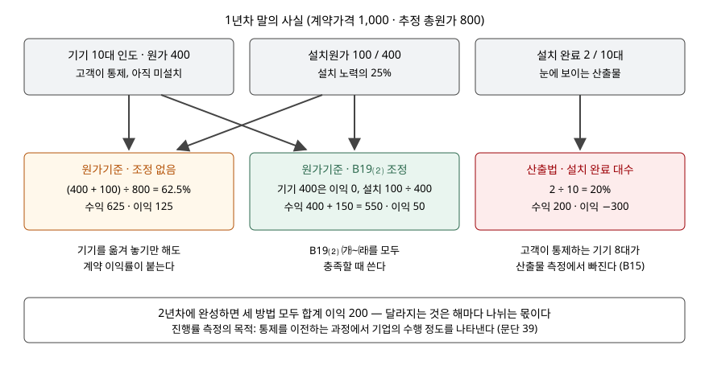

> 예제의 `아자승강기`와 그 숫자는 계산을 보이려고 만든 가상 자료다.

## 들어가며

설비를 공급하고 설치까지 맡는 회사의 분기 실적을 보면, 대형 수주를 시작한 분기에 매출과 이익이 한꺼번에 뛰었다가 다음 분기에 이익률이 내려앉는 경우가 있다. 공사가 잘되다가 갑자기 나빠진 것처럼 읽히고, 대개는 그렇게 이해하고 넘어간다.

그런데 공사 실적은 그대로인데 진행률을 재는 방식 때문에 이런 모양이 나올 수 있다. 아래 예제의 아자승강기는 1년차에 기기 10대를 현장에 들여놓고 그중 2대만 설치했다. 이 같은 사실을 원가 비율로 재면 1년차 이익이 125, 기기를 따로 떼어 재면 50, 설치 대수로 재면 −300이다. 계약이 끝나면 세 방법 모두 이익 200으로 같다.

이 글은 [원가기준 진행률 글](../2026-11-08-cost-to-cost-progress-estimate-change/index.md)에서 다루지 않은 산출법과, 원가기준 투입법을 조정해야 하는 두 번째 경우인 미설치 자재를 다룬다.

## 개념

기업회계기준서 제1115호는 기간에 걸쳐 이행하는 수행의무마다 진행률을 재서 수익을 인식하게 한다. 진행률을 재는 목적은 고객에게 통제를 넘기는 과정에서 **기업의 수행 정도**를 나타내는 것이다(문단 39). 방법은 두 갈래다(문단 41·B14).

| 구분 | 무엇을 재는가 | 예 | 단점 |
|---|---|---|---|
| 산출법(B15) | 지금까지 이전한 재화·용역이 고객에게 주는 가치 | 수행 완료 정도 조사, 달성 결과 평가, 도달한 단계, 경과 시간, 생산·인도 단위 | 산출물을 직접 관측하지 못하거나 정보를 얻는 데 원가가 과도할 수 있다(B17) |
| 투입법(B18) | 예상 총투입물 대비 기업의 노력·투입물 | 소비 자원, 노동시간, 발생원가, 경과 시간, 기계시간 | 투입물과 통제 이전 사이에 직접 관계가 없을 수 있다(B19) |

방법을 고를 때는 이전하기로 약속한 재화나 용역의 특성을 고려하고(문단 41), 수행의무 하나에는 방법 하나를 쓰며, 비슷한 수행의무에는 같은 방법을 일관되게 쓴다(문단 40). 고객에게 통제를 넘기지 않은 재화나 용역은 진행률 측정에서 빼고, 넘긴 것은 모두 넣는다(문단 42).

## 구조



> **출처**: 한국회계기준원 [기업회계기준서 제1115호 '고객과의 계약에서 생기는 수익'](https://www.samili.com/acc/Kijun/Kijunjomun.asp?code=1978-1115) 문단 39~42·B14~B19 (제3자 전재, 2021-04-23 개정) — 원문 발행처 [한국회계기준원](https://www.kasb.or.kr/front/board/ingAccountingList.do). 금액은 이 글의 `code/output.txt` `[1]`에서 옮겼다

위쪽 세 칸이 1년차 말에 있는 사실이고, 아래 세 칸이 그 사실을 재는 방법이다. 원가기준 두 방법은 기기와 설치원가를 함께 보지만 기기를 어떻게 다루느냐가 다르다. 산출법은 설치를 마친 대수만 본다.

## 동작 원리

### 원가기준을 그대로 쓰면 기기를 옮긴 것만으로 이익이 붙는다

원가기준 투입법은 원가 1마다 같은 수익을 붙인다. 이 계약은 계약가격 1,000에 추정 총원가 800이므로 원가 1마다 수익 1.25다. 1년차에 기기 400과 설치 100을 썼으니 진행률 62.5%, 수익 625다. 문제는 기기 원가 400이 수익 500을 끌어온다는 점이다. 기기는 제삼자에게서 사 와서 현장에 내려놓았을 뿐이고, 회사가 하는 일의 본체인 설치는 25%밖에 하지 않았다.

### B19⑵ — 원가만큼만 수익을 인식하는 조정

기준서는 발생원가가 진척도에 비례하지 않는 경우, 발생원가의 범위까지만 수익을 인식하도록 투입법을 조정하는 것이 수행 정도를 가장 잘 나타낼 수 있다고 본다(문단 B19⑵). 계약 개시시점에 다음 네 조건을 모두 충족할 것으로 예상하면, 그 재화의 원가와 같은 금액을 수익으로 인식하는 방법이 수행 정도를 충실하게 나타낼 수 있다.

| 조건 | 내용 | 예제에서 |
|---|---|---|
| ㈎ | 재화가 구별되지 않는다 | 기기와 설치가 수행의무 하나 |
| ㈏ | 고객이 관련 용역을 받는 때보다 유의적으로 이른 시점에 재화를 통제한다 | 1년차에 인도, 설치는 2년차까지 |
| ㈐ | 이전되는 재화의 원가가 예상 총원가에 비해 유의적이다 | 400 / 800 |
| ㈑ | 제삼자에게서 조달하고 설계·생산에 유의적으로 관여하지 않는다(본인으로 활동) | 기기 외부 조달 |

조정하면 기기 400은 수익 400·이익 0이 되고, 나머지 계약가격 600을 설치원가 진행률로 나눠 인식한다. 1년차 설치 진행률 25%이므로 설치 부분 수익은 150이다. 기기 몫 이익이 사라지는 대신 설치 1원마다 수익 1.5가 붙는다.

### 산출법이 고객이 통제하는 기기를 놓친다

설치 완료 대수는 고객 입장에서 눈에 보이는 산출물이라 산출법으로 적절해 보인다. 하지만 기준서는 선택한 산출물이 고객에게 통제가 넘어간 재화의 일부를 측정하지 못하면 수행 정도를 충실하게 나타낼 수 없다고 적는다. 고객이 통제하는 재공품이나 완성품을 산출물 측정에 넣지 않은 경우를 예로 든다(문단 B15). 예제에서 고객은 이미 기기 10대를 통제하는데, 설치 대수는 그중 2대만 잡는다. 원가 500을 쓰고 수익 200만 인식해 이익을 잡을 수 있는 계약에서 1년차 손실 300이 생긴다.

### B16 — 청구권 금액으로 바로 인식하는 간편법

산출법의 특수한 경우로, 지금까지 수행한 정도가 고객에게 주는 가치에 직접 상응하는 금액을 받을 권리가 있다면, 청구할 권리가 있는 금액으로 수익을 인식할 수 있다. 기준서는 용역 시간당 고정금액을 청구하는 계약을 예로 든다(문단 B16). 이때는 진행률을 따로 계산하지 않는다.

## 실습 예제

```python
def cost_adjusted(year):
    """B19⑵ — 미설치 자재는 원가만큼만 수익, 나머지 원가로 진행률을 잰다."""
    equipment, install, _ = CUMULATIVE[year]
    margin_progress = install / INSTALL_COST_TOTAL
    margin_revenue = (CONTRACT_PRICE - EQUIPMENT_COST) * margin_progress
    return margin_progress, equipment + margin_revenue
```

전체 소스: [`code/`](code/)

가정은 다음과 같다(금액 단위 백만원). 기기와 설치는 구별되지 않는 수행의무 하나이고, 기간에 걸쳐 이행한다. 추정 총원가 800 = 기기 400 + 설치 400이다. 1년차에 기기 10대를 모두 인도해 고객이 통제하고, 설치원가 100을 써서 2대를 설치했다. 2년차에 나머지를 끝내고 추정은 바뀌지 않는다.

```text
[1] 1년차 말 — 같은 사실, 세 가지 진행률 (문단 41·B15·B18·B19)
  누적원가 500 = 기기 400 + 설치 100, 설치 완료 2/10대, 추정 총원가 800
  방법                             진행률     수익     비용     이익
  원가기준 투입법(조정 없음)             62.50%    625.0    500.0    125.0
  원가기준 투입법(B19⑵ 조정)           25.00%    550.0    500.0     50.0
  산출법(설치 완료 대수)               20.00%    200.0    500.0   -300.0
```

```text
[2] 연차별 수익과 이익 — 2년차에 완성하면 합계는 같다
  원가기준 투입법(조정 없음)
    1년차  수익   625.0  비용   500.0  이익   125.0  이익률   20.0%
    2년차  수익   375.0  비용   300.0  이익    75.0  이익률   20.0%
  원가기준 투입법(B19⑵ 조정)
    1년차  수익   550.0  비용   500.0  이익    50.0  이익률    9.1%
    2년차  수익   450.0  비용   300.0  이익   150.0  이익률   33.3%
  산출법(설치 완료 대수)
    1년차  수익   200.0  비용   500.0  이익  -300.0  이익률 -150.0%
    2년차  수익   800.0  비용   300.0  이익   500.0  이익률   62.5%
```

조정 없는 원가기준은 두 해 모두 이익률 20%다. 매끄러워 보이지만 기기를 들여놓은 해에 이익을 앞당긴 결과다. B19⑵ 조정은 기기만 들여놓은 1년차 이익률이 9.1%로 낮고, 설치가 몰린 2년차에 33.3%로 오른다. 설치라는 회사의 실제 일이 2년차에 더 많았다는 사실이 이익에 나타난다.

```text
[3] B19⑵ 조정의 분해 — 1년차
  조정 없음은 원가 1 마다 수익 1.25 를 붙인다: 기기 400 x 1.25 = 500.0, 설치 100 x 1.25 = 125.0
  B19⑵ 조정은 기기 400.0, 설치 100 x 1.50 = 150.0
  수익 차이 75.0 = 기기에 붙은 이익 100.0 - 설치에 덜 붙은 이익 25.0
```

```text
[4] B16 실무적 간편법 — 시간당 고정금액을 청구하는 유지보수 계약
  1년차  제공 120시간 x 0.5 = 수익 60.0 (청구권이 있는 금액으로 인식)
```

## 실무에서 주의할 점

- **진행률 측정방법은 회계정책 주석에서 먼저 확인한다.** 같은 업종이라도 원가기준을 쓰는 회사와 산출법을 쓰는 회사의 분기 이익 모양이 다르다. 이익률 추이를 비교하기 전에 각 회사가 무엇으로 진행률을 재는지 본다.
- **기기 반입이 몰린 분기의 이익률은 따로 본다.** 원가기준을 조정 없이 쓰면 외부 조달 기기가 들어온 분기에 이익이 앞당겨진다. 반대로 B19⑵ 조정을 쓰는 회사는 같은 분기에 이익률이 낮아진다. 어느 쪽이든 그 분기만 떼어 영업 성과로 읽으면 틀린다.
- **B19⑵ 조정은 네 조건을 계약 개시시점에 판단한다.** 조건 ㈑처럼 회사가 기기 설계나 생산에 깊이 관여하면 조정 대상이 아니다. 같은 기기라도 직접 만드는 회사와 사 오는 회사의 진행률이 다를 수 있다.
- **산출법이 직관적이라고 충실한 것은 아니다.** 설치 대수·인도 대수처럼 셀 수 있는 지표는 고객이 이미 통제하는 재공품을 놓칠 수 있다(B15). 산출법 회사의 계약 초기 손실은 계약이 나빠서가 아니라 측정 방식 때문일 수 있다.
- **진행률을 합리적으로 잴 수 없는 초기에는 원가만큼만 인식한다.** 결과를 합리적으로 측정할 수 없으나 원가 회수가 예상되면 발생원가 범위에서만 수익을 인식한다(문단 45). B19⑵와 결과가 비슷해 보이지만 근거 문단과 적용 범위가 다르다. B19⑵는 특정 재화의 원가에만 적용하고, 문단 45는 수행의무 전체에 적용한다.
- **어떤 재화를 한 수행의무로 묶느냐가 먼저다.** B19⑵의 조건 ㈎가 "재화가 구별되지 않는다"인 것처럼, 진행률 문제는 수행의무를 어떻게 식별했느냐에서 시작한다. 그 판단은 [수행의무 식별 글](../2026-11-17-performance-obligation-distinct-goods/index.md)에서 다룬다.

## 정리

- 진행률은 산출법과 투입법으로 재고, 목적은 통제를 이전하는 과정에서 기업의 수행 정도를 나타내는 것이다(제1115호 문단 39·41·B14).
- 원가기준 투입법은 고객이 먼저 통제하는 외부 조달 재화의 원가에도 계약 이익률을 붙이므로, B19⑵ 네 조건을 충족하면 그 원가만큼만 수익을 인식하도록 조정한다.
- 산출법은 선택한 산출물이 고객이 통제하는 재화를 빠뜨리면 수행 정도를 충실하게 나타내지 못한다(B15).
- 가상 사례에서 같은 1년차 사실이 세 방법으로 이익 125·50·−300이 되고, 2년 합계는 모두 200이다.

## 참고 자료

- [한국회계기준원](https://www.kasb.or.kr/front/board/ingAccountingList.do) — K-IFRS 기준서 발행처. 아래 전재 링크는 조문을 바로 열기 위한 편의 링크다
- [기업회계기준서 제1115호 '고객과의 계약에서 생기는 수익'](https://www.samili.com/acc/Kijun/Kijunjomun.asp?code=1978-1115) (제3자 전재, 2021-04-23 개정) — 문단 39~45 진행률, 적용지침 B14~B17 산출법, B18·B19 투입법
- [IFRS 15 Revenue from Contracts with Customers](https://www.ifrs.org/issued-standards/list-of-standards/ifrs-15-revenue-from-contracts-with-customers/) — IFRS Foundation
- 숫자는 이 글의 [`code/output.txt`](code/output.txt) `[1]`~`[4]`에서 옮겼다
