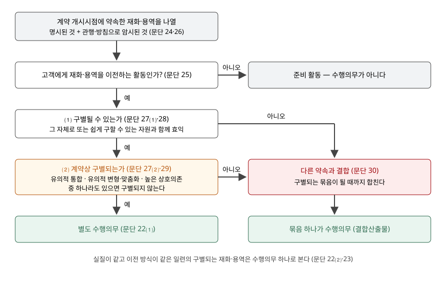

> 예제의 `사아기계`·`마바기계`와 그 숫자는 계산을 보이려고 만든 가상 자료다.

## 들어가며

장비 회사의 사업보고서를 보면 비슷한 설비를 파는 두 회사가 수익 인식 정책 주석에서 서로 다른 문장을 쓰는 경우가 있다. 한 회사는 "제품 인도 시점에 수익을 인식한다"고 적고, 다른 회사는 "설치 및 시운전 완료 후 고객 검수 시점에 인식한다"고 적는다. 대부분은 이 차이를 회사마다 다른 관행 정도로 읽고 매출 숫자만 비교한다.

그런데 이 문장 하나가 매출이 어느 해에 잡히는지를 통째로 옮긴다. 아래 예제의 두 회사는 계약금액·원가·대금 일정이 모두 같은데, 1년차 매출이 한쪽은 900, 다른 쪽은 0이다. 차이는 설치가 설비를 고쳐 만드는 작업인지 아닌지 하나뿐이다.

이 글은 [수익 인식 5단계 글](../2026-10-10-revenue-recognition-five-steps/index.md)에서 한 문단으로 넘긴 2단계, 수행의무 식별을 펼친다.

## 개념

기업회계기준서 제1115호는 계약 개시시점에 약속한 재화나 용역을 검토해, 고객에게 다음 중 하나를 이전하기로 한 약속 각각을 **수행의무** 하나로 식별하게 한다(문단 22).

| 구분 | 내용 |
|---|---|
| 22⑴ | 구별되는 재화나 용역, 또는 그 묶음 |
| 22⑵ | 실질이 서로 같고 이전 방식도 같은 일련의 구별되는 재화나 용역 |

약속은 계약서에 적힌 것만이 아니다. 사업 관행이나 공개한 방침이 고객에게 정당한 기대를 주면 그것도 약속이 된다(문단 24). 반대로 계약을 이행하려고 하는 일이라도 고객에게 무엇을 이전하지 않으면 수행의무가 아니다. 기준서는 계약을 준비하는 관리 업무를 예로 든다(문단 25).

**구별된다**는 것은 두 기준을 모두 충족하는 것이다(문단 27).

| 기준 | 묻는 것 | 판단 근거 |
|---|---|---|
| ⑴ 구별될 수 있다 | 고객이 그 자체로, 또는 쉽게 구할 수 있는 다른 자원과 함께 효익을 얻을 수 있는가 | 사용·소비·폐물 가치보다 큰 금액으로 매각할 수 있으면 효익이 있다. 따로 판매한다는 사실이 증거가 된다(문단 28) |
| ⑵ 계약상 구별된다 | 이 약속을 계약 안의 다른 약속과 별도로 식별해 낼 수 있는가 | 문단 29의 세 요소 |

## 구조



> **출처**: 한국회계기준원 [기업회계기준서 제1115호 '고객과의 계약에서 생기는 수익'](https://www.samili.com/acc/Kijun/Kijunjomun.asp?code=1978-1115) 문단 22~30 (제3자 전재, 2021-04-23 개정) — 원문 발행처 [한국회계기준원](https://www.kasb.or.kr/front/board/ingAccountingList.do)

판단은 위에서 아래로 내려간다. 두 질문 중 하나라도 "아니오"면 그 약속은 혼자 수행의무가 되지 못하고 다른 약속과 합쳐진다. 합친 묶음이 구별되면 그 묶음이 수행의무 하나다. 경우에 따라서는 계약 전체가 수행의무 하나가 된다(문단 30).

## 동작 원리

### 계약상 구별되는지가 실제로 갈리는 자리다

문단 27⑴은 대부분의 재화와 용역이 쉽게 충족한다. 설비도 설치도 유지보수도 시장에서 따로 사고팔기 때문이다. 판단이 갈리는 곳은 문단 27⑵다. 기준서는 그 목적을 이렇게 정한다. 계약상 약속의 성격이 **각 재화나 용역을 개별적으로 이전하는 것**인지, 아니면 **그것들을 투입해 만든 결합 품목을 이전하는 것**인지를 가리는 것이다(문단 29).

별도로 식별해 낼 수 없음을 나타내는 요소로 문단 29는 세 가지를 든다.

| 요소 | 내용 |
|---|---|
| ⑴ 유의적 통합 | 기업이 여러 재화나 용역을 통합해 고객이 계약한 결합산출물로 만드는 유의적인 용역을 제공한다 |
| ⑵ 유의적 변형·고객 맞춤화 | 한 재화나 용역이 다른 재화나 용역을 유의적으로 변형하거나 고객 맞춤화한다 |
| ⑶ 높은 상호의존성 | 각 재화나 용역을 따로 이전해서는 약속을 이행할 수 없을 만큼 서로 유의적으로 영향을 주고받는다 |

세 요소는 "이에 한정되지 않는다"고 적혀 있어 체크리스트가 아니라 판단의 실마리다. 공통으로 묻는 것은 고객이 사려는 것이 부품들인지, 부품을 써서 만든 완성품인지다.

### 결합되면 인식 시점이 가장 늦은 약속에 맞춰진다

설치가 설비를 고객 생산라인에 맞게 고쳐 만든다면, 고객이 산 것은 "설비"가 아니라 "자기 라인에서 돌아가는 설비"다. 설비를 인도받아도 고객은 아직 계약한 것을 받지 못했다. 그래서 설비와 설치가 수행의무 하나로 묶이고, 그 묶음의 통제가 넘어가는 때에 수익을 인식한다. 인도된 설비의 원가는 그때까지 기업의 자산으로 남는다.

### 일련의 재화는 같은 것을 반복하는 약속을 하나로 다룬다

24개월 유지보수는 매달의 용역이 각각 구별된다. 그대로 두면 수행의무가 24개가 된다. 문단 22⑵는 각 단위가 기간에 걸쳐 이행되는 수행의무의 기준을 충족하고 같은 진행률 측정방법을 쓴다면 이전 방식이 같다고 보고(문단 23), 이것들을 수행의무 하나로 묶는다. 계산 결과는 매달 나누는 것과 같지만, 계약변경이나 변동대가를 배분할 때 단위를 무엇으로 볼지가 달라진다.

## 실습 예제

```python
def obligations(install_integrates):
    maintenance = ("유지보수", SSP["유지보수"], COST["유지보수"], MAINTENANCE_SCHEDULE)
    if install_integrates:
        combined_price = SSP["설비"] + SSP["설치"]
        combined_cost = COST["설비"] + COST["설치"]
        return [("설비+설치(결합)", combined_price, combined_cost, [INSTALL_DONE]), maintenance]
    return [
        ("설비", SSP["설비"], COST["설비"], [DELIVERY]),
        ("설치", SSP["설치"], COST["설치"], [INSTALL_DONE]),
        maintenance,
    ]
```

전체 소스: [`code/`](code/)

가정은 다음과 같다(금액 단위 백만원). 계약가격 1,200은 개별 판매가격 합계와 같아 할인 배분이 없다. 설비는 1년차 4분기에 인도하고, 설치는 2년차 1분기에 끝나 고객이 인수한다. 유지보수는 2년차 2분기부터 8분기 동안 고르게 이행한다. 결합 수행의무는 설치 완료·인수 시점에 통제가 넘어간다고 가정했다. 기간에 걸쳐 이전되는지(문단 35)는 별도 판단이라 이 예제에서는 다루지 않는다.

```text
[1] 수행의무 구성에 따른 연차별 수익 — 문단 22·27·29·30
  사아기계 — 설치가 표준 작업: 수행의무 3개
    연차      수익     원가   매출총이익
     1    900.00   600.00     300.00
     2    206.25   130.00      76.25
  마바기계 — 설치가 설비를 유의적으로 고객 맞춤화: 수행의무 2개
    수행의무 설비+설치(결합)    배분  1050.0  원가  700.0  인식 2년차 1분기
    연차      수익     원가   매출총이익
     1      0.00     0.00       0.00
     2   1106.25   730.00     376.25
  1년차 수익 차이 900.00 — 마바기계는 설비를 인도했어도 결합산출물이 이전되지 않았다
```

두 회사 모두 4년 합계 수익 1,200, 매출총이익 420으로 같다. 달라진 것은 시점뿐이다. 사아기계는 설비를 인도한 1년차에 매출총이익 300을 잡고, 마바기계는 그 300과 설치 이익 50을 2년차에 한꺼번에 잡는다.

```text
[2] 연말 계약부채 — 누적 청구 − 누적 수익 (문단 106)
  사아기계
     1     900.00     900.00       0.00
  마바기계
     1       0.00     900.00     900.00
```

대금 일정이 같으므로 1년차 말에 두 회사 모두 900을 받았다. 사아기계는 그만큼 수익을 인식해 계약부채가 없고, 마바기계는 받은 900 전부가 앞으로 결합산출물을 넘겨줄 의무, 즉 계약부채다. 2년차 말부터는 두 회사의 숫자가 같아진다.

```text
[3] 유지보수를 일련의 용역 하나로 볼 때 — 문단 22⑵·23
  월별 몫 6.25, 분기 몫 18.75, 8분기 합계 150.00
```

## 실무에서 주의할 점

- **같은 업종이라도 매출 시점이 다를 수 있다.** 수행의무 구분은 계약 내용에 따라 판단한다. 두 회사의 매출 성장률을 비교하기 전에 주석의 수익 인식 정책에서 설치·시운전을 별도 수행의무로 보는지부터 확인한다. 위 예제처럼 1년차만 보면 같은 사업이 매출 900과 0으로 보인다.
- **계약부채가 크게 늘면 수행의무 구성을 의심해 본다.** 결합 수행의무는 대금을 먼저 받고 수익을 늦게 잡는 구조라 계약부채가 쌓인다. 매출이 줄었는데 계약부채가 늘었다면 수주가 줄었다기보다 인식 시점이 뒤로 밀린 것일 수 있다.
- **준비 활동에 대가를 배분하지 않는다.** 계약 개시에 하는 등록·설정 업무는 고객에게 용역을 이전하지 않으므로 수행의무가 아니다(문단 25). 여기에 대가를 떼어 주면 계약 초기에 수익이 앞당겨진다. 이 대가를 별도로 받는 경우는 [환불되지 않는 선수수수료 글](../2026-11-09-nonrefundable-upfront-fee-deferral/index.md)에서 다룬다.
- **보증·라이선스·고객 선택권도 이 판단을 거친다.** 따로 살 수 있는 보증은 수행의무다([보증 글](../2026-11-09-warranty-assurance-vs-service-type/index.md)). 다른 재화와 구별되지 않는 라이선스는 결합해서 판단한다([라이선스 글](../2026-11-11-license-right-to-access-vs-use/index.md)). 문단 26이 이것들을 약속의 예로 함께 나열한다.
- **결합되면 진행률 측정 대상도 바뀐다.** 결합 수행의무가 기간에 걸쳐 이행된다면 진행률을 묶음 전체로 잰다. 이때 설비 원가를 진행률에 그대로 넣으면 수행 정도가 부풀려질 수 있는데, 이 문제는 [진행률 산출법과 미설치 자재 글](../2026-11-17-output-method-uninstalled-materials/index.md)에서 계산한다.

## 정리

- 수행의무는 구별되는 재화나 용역, 또는 실질과 이전 방식이 같은 일련의 재화나 용역을 이전하는 약속 각각이다(제1115호 문단 22·23).
- 구별되려면 고객이 효익을 얻을 수 있고(27⑴), 계약상 다른 약속과 별도로 식별되어야 한다(27⑵). 판단이 갈리는 곳은 27⑵로, 유의적 통합·변형·상호의존이 있으면 결합한다(문단 29·30).
- 가상 사례에서 설치가 설비를 고객 맞춤화하는 마바기계는 1년차 매출 0, 계약부채 900이고, 표준 설치인 사아기계는 1년차 매출 900이다. 합계는 같고 시점만 다르다.

## 참고 자료

- [한국회계기준원](https://www.kasb.or.kr/front/board/ingAccountingList.do) — K-IFRS 기준서 발행처. 아래 전재 링크는 조문을 바로 열기 위한 편의 링크다
- [기업회계기준서 제1115호 '고객과의 계약에서 생기는 수익'](https://www.samili.com/acc/Kijun/Kijunjomun.asp?code=1978-1115) (제3자 전재, 2021-04-23 개정) — 문단 22~30 수행의무 식별, 106 계약부채
- [IFRS 15 Revenue from Contracts with Customers](https://www.ifrs.org/issued-standards/list-of-standards/ifrs-15-revenue-from-contracts-with-customers/) — IFRS Foundation
- 숫자는 이 글의 [`code/output.txt`](code/output.txt) `[1]`·`[2]`·`[3]`에서 옮겼다
