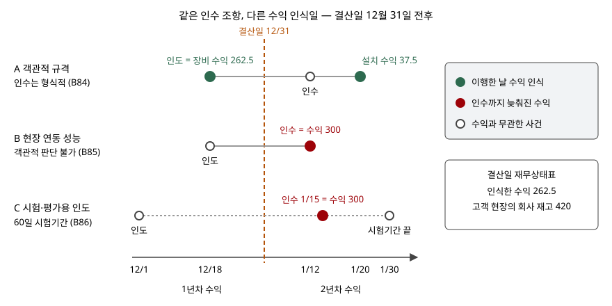

> 예제의 `사아계측`과 그 숫자는 계산을 보이려고 만든 가상 자료다.

## 들어가며

장비를 납품하는 회사의 4분기 실적 발표를 보면 "고객사 인수 지연으로 매출 일부가 다음 분기로 넘어갔다"는 설명이 종종 붙는다. 장비는 이미 고객 공장에 들어가 있는데 왜 매출이 아니냐는 질문이 따라 나오고, 보통은 회계가 보수적이라서 그렇다는 정도로 정리된다.

그런데 같은 회사, 같은 날 출하한 장비라도 어떤 것은 인수 확인서가 오기 전에 매출이 되고 어떤 것은 되지 않는다. 아래 예제의 사아계측은 12월에 장비 세 대를 인도했는데, 결산일까지 매출로 잡힌 것은 한 대의 장비 몫 262.5뿐이고 나머지 두 대 원가 420은 고객 현장에 있는 채로 회사 재고에 남는다. 세 계약 모두 인수 조항이 있다는 점은 같다.

이 글은 [위탁약정 글](../2026-11-13-consignment-arrangement-revenue-timing/index.md)에서 이름만 나온 통제 이전 지표 다섯째, 고객의 인수를 다룬다. 같은 날 쓴 [기간에 걸쳐 이행하는 세 기준 글](../2026-11-18-over-time-criteria-payment-right/index.md)에서 기간 인식이 안 되는 계약이 내려오는 자리이기도 하다.

## 개념

기간에 걸쳐 이행하지 않는 수행의무는 한 시점에 이행되고, 그 시점은 통제 이전 지표를 참고해 정한다(문단 38). 지표는 현재 지급청구권, 법적 소유권, 물리적 점유, 유의적인 위험과 보상, 고객의 인수다. 고객의 인수는 고객이 자산의 사용을 지시하고 나머지 효익의 대부분을 얻을 능력이 있음을 나타낼 수 있다(문단 38⑸).

인수 조항은 재화나 용역이 합의한 규격에 맞지 않을 때 고객이 계약을 취소하거나 회사에 개선 조치를 요구할 수 있게 하는 조항이다(B83). 기준서는 이 조항을 세 경우로 나눈다.

| 경우 | 판단 | 통제 이전 시점 | 문단 |
|---|---|---|---|
| 규격 충족을 객관적으로 판단할 수 있다 | 인수는 형식적이다 | 인수 확인과 무관하게 통제가 넘어간 때 | B84 |
| 규격 충족을 객관적으로 판단할 수 없다 | 인수 전에는 통제를 판단할 수 없다 | 고객이 인수한 때 | B85 |
| 시험·평가 목적으로 인도하고 시험기간 동안 대가를 지급하지 않기로 했다 | 시험 중에는 통제가 넘어가지 않는다 | 고객이 인수한 때와 시험기간 경과 중 이른 때 | B86 |

## 구조



> **출처**: 한국회계기준원 [기업회계기준서 제1115호 '고객과의 계약에서 생기는 수익'](https://www.samili.com/acc/Kijun/Kijunjomun.asp?code=1978-1115) 문단 38⑸·B83~B86 (제3자 전재, 2021-04-23 개정) — 원문 발행처 [한국회계기준원](https://www.kasb.or.kr/front/board/ingAccountingList.do). 날짜와 금액은 이 글의 `code/output.txt` `[2]`·`[4]`에서 옮겼다

점선이 결산일이다. A는 인도한 날 장비 수익을 인식하고 인수 확인은 수익과 무관한 사건이 된다. B와 C는 인도가 수익과 무관한 사건이고, 인수한 날 수익이 된다.

## 동작 원리

### B84 — 회사가 미리 확인할 수 있으면 인수는 형식이다

인수 조항이 크기·무게처럼 정해진 특성에 기초하면, 회사는 고객의 확인 전에 기준 충족 여부를 판단할 수 있다(B84). 이때 고객의 인수는 통제 이전 시점에 영향을 주지 않는 형식적인 것이다. 기준서는 비슷한 계약에서 회사가 쌓은 경험도 규격 충족의 증거가 될 수 있다고 본다. 예제의 A 유형 장비는 출하 전 공장 시험을 통과한 120건 가운데 인수 거절이 0건이다.

B84에는 문장이 하나 더 있다. 인수 전에 수익을 인식한다면 장비 설치처럼 아직 남은 수행의무가 있는지 보고 따로 회계처리할지 판단한다. 계약 A는 설치를 별도 수행의무로 보고, 계약가격 300을 개별 판매가격 비율로 장비 262.5와 설치 37.5로 나눴다. 설치 몫은 설치를 마친 1월에 인식한다.

### B85 — 고객 쪽에서만 판정되면 인수일까지 기다린다

규격 충족을 객관적으로 판단할 수 없으면, 고객이 인수할 때까지 고객이 통제하게 되었다고 결론 내릴 수 없다(B85). 사용을 지시하고 효익의 대부분을 얻는 능력이 고객에게 있는지 판단할 근거가 없기 때문이다. 계약 B의 장비는 고객 생산라인에 연결해 돌려 봐야 성능을 판정할 수 있다. 같은 유형 120건 가운데 9건이 현장에서 개선 요구를 받았다. 장비가 12월 18일에 고객 공장에 들어갔어도 수익은 인수일인 1월 12일이다.

### B86 — 시험·평가용 인도는 시험이 끝나야 넘어간다

시험·평가 목적으로 제품을 인도하고 고객이 시험기간 동안 대가를 지급하지 않기로 했다면, 고객이 인수하거나 시험기간이 지날 때까지 통제가 넘어가지 않는다(B86). 계약 C는 12월 1일 인도, 60일 시험기간이라 시험기간 종료일은 1월 30일이다. 고객이 1월 15일에 인수했으므로 둘 중 이른 1월 15일에 수익을 인식한다. 장비가 정밀도 규격처럼 객관적으로 판정되는 제품이어도 B86에 해당하면 B84로 앞당기지 않는다.

## 실습 예제

```python
def control_dates(c):
    if c["trial"]:
        trial_end = date.fromordinal(c["delivered"].toordinal() + c["trial_days"])
        when = min(c["accepted"], trial_end)
        return [("장비", c["price"], c["cost"], when, "B86 ...")]
    if c["objective"]:
        ...  # B84: 인도일, 설치가 남았으면 별도 수행의무로 나눈다
    return [("장비", c["price"], c["cost"], c["accepted"], "B85 ...")]
```

전체 소스: [`code/`](code/)

가정은 다음과 같다(금액 단위 백만원). 세 계약 모두 계약가격 300, 원가 210이다. 계약 A는 원가 중 20이 1월에 생기는 설치원가이고, 장비와 설치의 개별 판매가격은 280과 40이다. 설치는 하루 이틀에 끝나므로 단순하게 완료일에 인식한다. 결산일은 12월 31일이다.

```text
[2] 수행의무별 통제 이전일 — 결산일 2026-12-31
  A 객관적 규격(치수·정밀도)  계약가격 300  원가 210  인도 2026-12-18  인수 2027-01-12
    장비  수익  262.5  인식일 2026-12-18  (1년차)  근거: B84 인수는 형식적, 인도일
    설치  수익   37.5  인식일 2027-01-20  (2년차)  근거: 별도 수행의무, 설치 완료일
  B 고객 라인 연동 성능  계약가격 300  원가 210  인도 2026-12-18  인수 2027-01-12
    장비  수익  300.0  인식일 2027-01-12  (2년차)  근거: B85 객관적 판단 불가, 인수일
  C 시험·평가용 인도(60일)  계약가격 300  원가 210  인도 2026-12-01  인수 2027-01-15
    장비  수익  300.0  인식일 2027-01-15  (2년차)  근거: B86 인수일과 시험기간 종료(2027-01-30) 중 이른 날
```

```text
[3] 1년차·2년차 손익 — 세 건 합계
  1년차  수익  262.5  매출원가  190.0  이익   72.5
  2년차  수익  637.5  매출원가  440.0  이익  197.5

[4] 1년차 말 재무상태표에 남는 것
  수익을 인식한 금액(청구 조건에 따라 수취채권 또는 계약자산) 262.5
  고객 현장에 있으나 아직 회사 재고인 장비 원가 420.0
```

세 장비 모두 12월에 고객 손에 들어갔지만 1년차 수익은 계약가격 합계 900 가운데 262.5다. B와 C의 장비 원가 420은 고객 공장에 있으면서 사아계측의 재고자산으로 남는다. 물리적 점유와 통제가 어긋나는 경우는 위탁약정과 같지만, 원인이 판매 조건이 아니라 인수 조항이라는 점이 다르다.

## 실무에서 주의할 점

- **"인수 조항 있음"만으로 수익 시점을 판단하지 않는다.** 같은 조항이라도 규격을 회사가 미리 판정할 수 있으면 형식적이다(B84). 주석의 수익 인식 정책에서 인수 조건을 어떻게 다루는지 확인한다.
- **연말에 인도가 몰리는 회사는 결산일 재고자산을 같이 본다.** B85·B86 계약이 많으면 4분기 매출은 낮고 재고는 높게 나온다. 다음 분기 매출이 급증하는 모양이 반복되면 인수 조항 때문일 수 있다.
- **과거 경험은 증거가 되지만 바뀌면 다시 본다.** B84는 비슷한 계약의 경험을 규격 충족의 증거로 쓸 수 있게 한다. 신제품이나 새 고객 사양처럼 경험이 없는 출하는 같은 제품군이라도 B85로 갈 수 있다.
- **인수 전에 수익을 잡으면 남은 수행의무를 나눈다.** 설치·시운전이 남았는데 장비 대금 전액을 인도일에 인식하면 수익이 앞당겨진다(B84 마지막 문장). 나눈 몫은 [거래가격 배분](../2026-11-16-transaction-price-allocation-discount/index.md) 규칙을 따른다.
- **시험·평가용 인도는 고객의 대가 지급 확약이 기준이다.** B86은 시험기간 동안 대가를 지급하지 않기로 한 경우다. 정해진 대금을 지급하되 마음에 들지 않으면 반품할 수 있는 판매는 [반품권이 있는 판매](../2026-11-08-sales-with-right-of-return/index.md)로 본다.

## 정리

- 고객의 인수는 한 시점 수행의무의 통제 이전 지표 다섯째다(제1115호 문단 38⑸).
- 규격 충족을 회사가 객관적으로 판단할 수 있으면 인수는 형식적이고(B84), 판단할 수 없으면 인수일까지 통제가 넘어가지 않는다(B85).
- 시험·평가용 인도는 인수일과 시험기간 경과 중 이른 날에 통제가 넘어간다(B86).
- 가상 사례에서 12월에 인도한 장비 세 대 가운데 결산일까지 수익이 된 것은 262.5이고, 원가 420은 고객 현장에 있으면서 회사 재고로 남는다.

## 참고 자료

- [한국회계기준원](https://www.kasb.or.kr/front/board/ingAccountingList.do) — K-IFRS 기준서 발행처. 아래 전재 링크는 조문을 바로 열기 위한 편의 링크다
- [기업회계기준서 제1115호 '고객과의 계약에서 생기는 수익'](https://www.samili.com/acc/Kijun/Kijunjomun.asp?code=1978-1115) (제3자 전재, 2021-04-23 개정) — 문단 38, 적용지침 B83~B86
- [IFRS 15 Revenue from Contracts with Customers](https://www.ifrs.org/issued-standards/list-of-standards/ifrs-15-revenue-from-contracts-with-customers/) — IFRS Foundation
- 숫자는 이 글의 [`code/output.txt`](code/output.txt) `[1]`~`[4]`에서 옮겼다
