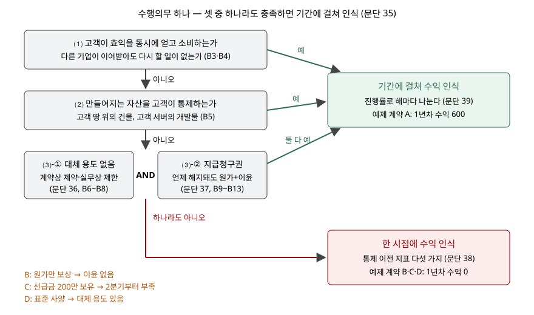

> 예제의 `마바기계`와 그 숫자는 계산을 보이려고 만든 가상 자료다.

## 들어가며

주문 제작 장비를 만드는 회사 두 곳의 사업보고서를 나란히 놓으면, 하는 일은 비슷한데 한 회사는 매 분기 매출이 고르게 잡히고 다른 회사는 장비를 출하한 분기에만 매출이 몰리는 경우가 있다. 이를 영업 방식이나 수주 시기 차이로 읽고 넘어가는 경우가 많다.

그런데 두 회사의 공사 일정이 완전히 같아도 이런 차이가 생길 수 있다. 아래 예제의 마바기계는 같은 설비를 같은 일정으로 만드는데, 계약서의 해지 보상 조항 한 줄에 따라 1년차 수익이 600이 되기도 하고 0이 되기도 한다. 그동안 원가 480은 한쪽에서는 매출원가로, 다른 쪽에서는 재고자산으로 남는다.

이 글은 [수익 인식 5단계 글](../2026-10-10-revenue-recognition-five-steps/index.md)에서 한 문단으로 지나간 5단계의 첫 판단, 즉 기간에 걸쳐 인식할지 한 시점에 인식할지를 가르는 세 기준을 다룬다.

## 개념

기업회계기준서 제1115호는 고객이 자산을 통제하게 될 때 수익을 인식한다. 수행의무마다 먼저 통제가 **기간에 걸쳐** 넘어가는지를 보고, 아니면 **한 시점**에 넘어가는 것으로 본다(문단 32·38). 기간에 걸쳐 넘어가는 경우는 다음 세 가지이고, 하나만 충족하면 된다(문단 35).

| 기준 | 내용 | 대표 사례 | 지침 |
|---|---|---|---|
| ⑴ | 고객이 기업의 수행에서 나오는 효익을 수행하는 대로 동시에 얻고 소비한다 | 청소 같은 일상적·반복적 용역 | B3·B4 |
| ⑵ | 기업이 수행하는 대로 고객이 통제하는 자산을 만들거나 그 가치를 높인다 | 고객이 통제하는 재공품 | B5 |
| ⑶ | 만든 자산이 기업에 대체 용도가 없고, 지금까지 수행한 부분에 대해 집행 가능한 지급청구권이 있다 | 주문 제작 설비, 고객 사양 선박 | 36·37, B6~B13 |

⑴과 ⑵는 고객이 이미 무언가를 받고 있는지를 본다. ⑶은 고객이 아직 아무것도 받지 못했더라도, 회사가 만드는 자산이 사실상 그 고객 것이고 회사가 그동안 한 일의 대가를 확보하고 있으면 기간에 걸쳐 인식하게 한다. 주문 제작 산업에서 판단이 갈리는 곳은 대부분 ⑶이다.

## 구조



> **출처**: 한국회계기준원 [기업회계기준서 제1115호 '고객과의 계약에서 생기는 수익'](https://www.samili.com/acc/Kijun/Kijunjomun.asp?code=1978-1115) 문단 35~38·B3~B13 (제3자 전재, 2021-04-23 개정) — 원문 발행처 [한국회계기준원](https://www.kasb.or.kr/front/board/ingAccountingList.do). 계약 A~D의 판정은 이 글의 `code/output.txt` `[2]`에서 옮겼다

⑶은 두 요건이 모두 필요하다. 그림에서 ⑶-①과 ⑶-② 사이가 AND인 이유다. 하나라도 빠지면 아래쪽 한 시점 인식으로 내려가고, 그때는 문단 38의 통제 이전 지표(지급청구권, 법적 소유권, 물리적 점유, 위험과 보상, 고객의 인수)로 시점을 정한다.

## 동작 원리

### ⑴ 다른 기업이 이어받는다고 가정한다

효익을 동시에 소비하는지 바로 보이지 않을 때는 다른 기업이 남은 수행의무를 이어받는다고 가정한다. 그 기업이 지금까지 한 일을 실질적으로 다시 할 필요가 없으면 ⑴을 충족한다. 이 가정에서는 이전을 막는 계약상 제약을 무시하고, 이어받는 기업은 원래 기업이 계속 통제하는 자산에서 효익을 얻지 못한다고 본다(B4). 두 번째 가정 때문에, 회사가 설계 도면과 재공품을 자기 쪽에 두고 있는 설비 제작은 다음 기업이 처음부터 다시 해야 하는 것으로 보게 되어 ⑴에 해당하기 어렵다. 반면 청소처럼 하루하루의 수행이 그날로 끝나는 용역은 다시 할 일이 없으므로 쉽게 해당한다(B3).

### ⑶-① 대체 용도는 계약 개시시점에 한 번 판단한다

자산을 만드는 동안 다른 용도로 돌리는 데 계약상 제약이 있거나, 완성품을 다른 용도로 돌리는 데 실무상 제한이 있으면 대체 용도가 없다(문단 36). 계약상 제약은 회사가 자산을 다른 고객에게 넘기려 할 때 고객이 그 자산에 대한 권리를 집행할 수 있어야 실질적이다. 비슷한 다른 자산으로 큰 추가원가 없이 바꿔 줄 수 있으면 실질적이지 않다(B7). 실무상 제한은 다른 용도로 돌리면 재작업 원가나 할인 판매로 경제적 손실이 유의적으로 생기는 경우다(B8). 이 판단은 계약 개시시점에 하고, 수행의무를 실질적으로 바꾸는 계약변경이 없으면 다시 하지 않는다(문단 36). 고객과의 계약이 해지될 가능성은 고려하지 않는다(B6).

### ⑶-② 지급청구권은 "언제든지"와 "원가+이윤"이 핵심이다

회사가 잘못해서가 아니라 고객 쪽 사유로 계약이 해지되더라도, 계약기간 중 **언제든지** 지금까지 수행한 부분을 보상하는 금액을 받을 권리가 있어야 한다(문단 37). 그 금액은 잃는 이익만 메우는 것이 아니라 지금까지 넘긴 것의 판매가격에 가까워야 하며, 기준서는 원가 회수액에 적정한 이윤을 더한 금액을 예로 든다(B9). 이윤은 계약 예상 이윤 중 수행 정도에 비례하는 부분이나, 비슷한 계약의 일반적인 영업 이윤 수준이면 된다(B9⑴·⑵).

지급청구권이 지금 당장 무조건적일 필요는 없고(B10), 계약서에 없더라도 법률이나 판례가 그런 권리를 주는지까지 본다(B12). 반대로 계약서의 지급 일정은 지급청구권의 증거가 되지 않을 수 있다(B13). 분기마다 대금을 받기로 했어도 해지 때 돌려줘야 한다면 권리가 없는 것이다.

## 실습 예제

```python
def payment_right_each_quarter(compensation):
    """분기마다 보상액이 요구 금액 이상인지. 문단 37 은 '계약기간에는 언제든지'를 요구한다."""
    rows = []
    for quarter, cost in enumerate(CUMULATIVE_COST, start=1):
        comp = compensation(cost)
        need = required_amount(cost)
        rows.append((quarter, cost, comp, need, comp >= need - 1e-9))
    return rows
```

전체 소스: [`code/`](code/)

가정은 다음과 같다(금액 단위 백만원). 계약가격 1,000, 추정 총원가 800, 공사 기간 2년(8분기)이다. 계약 개시 때 선급금 200을 받고 나머지 800은 인도 때 받는다. 1년차 말 누적원가는 480이다. 네 계약은 공사 일정이 같고 해지 보상 조항과 사양만 다르다. 네 계약 모두 고객이 공사 중 재공품을 통제하지 않고 다른 업체가 이어받으면 설계부터 다시 해야 하므로 ⑴·⑵는 충족하지 않는다고 둔다.

```text
[2] 문단 35⑶ 판정 — 대체 용도 없음 AND 집행 가능한 지급청구권
  계약                          대체용도없음  지급청구권  35⑶   인식
  A 맞춤 사양 + 원가·이윤 보상               예         예    충족  기간에 걸쳐
  B 맞춤 사양 + 원가만 보상                 예       아니오   미충족  인도 시점
  C 맞춤 사양 + 선급금 보유                 예       아니오   미충족  인도 시점
  D 표준 사양 + 원가·이윤 보상             아니오         예   미충족  인도 시점
```

B는 해지 때 원가를 전부 돌려받지만 이윤이 없어 B9의 "원가+적정 이윤"에 못 미친다. C는 선급금 200을 돌려주지 않아도 되므로 누적원가가 80인 1분기에는 요구 금액 100을 넘지만, 2분기부터 부족하다. 문단 37은 계약기간 내내 권리를 요구하므로 한 분기만 충족해서는 안 된다. 분기별 대조는 `output.txt` `[1]`에 전부 있다.

```text
    분기  누적원가  해지보상  요구금액  충족
      1        80     200.0     100.0  예
      2       200     200.0     250.0  아니오
```

D는 해지 보상이 A와 같지만 표준 사양이라 다른 고객에게 팔 수 있다. 대체 용도가 있으면 지급청구권이 아무리 충분해도 ⑶을 충족하지 못한다.

```text
[3] 연차별 수익과 이익
  A 맞춤 사양 + 원가·이윤 보상
    1년차  수익   600.0  매출원가   480  이익   120.0
    2년차  수익   400.0  매출원가   320  이익    80.0
  B 맞춤 사양 + 원가만 보상
    1년차  수익     0.0  매출원가     0  이익     0.0
    2년차  수익  1000.0  매출원가   800  이익   200.0
```

```text
[4] 1년차 말 재무상태표 — 같은 공사, 다른 계정
  기간에 걸쳐 (A): 계약자산 400.0, 재고자산(재공품) 0.0, 계약부채 0.0
  인도 시점 (B·C·D): 계약자산 0.0, 재고자산(재공품) 480.0, 계약부채 200.0
```

A는 1년차에 진행률 60%만큼 수익 600을 인식하고, 받은 선급금 200을 뺀 400이 계약자산이 된다. B·C·D는 1년차 손익계산서에 이 계약이 전혀 나타나지 않고, 재무상태표에 재공품 480과 선급금으로 받은 계약부채 200이 남는다. 2년 합계 이익은 모두 200이다.

## 실무에서 주의할 점

- **수익 인식 시기는 회계정책 주석과 계약 조건에서 같이 확인한다.** 같은 업종 두 회사의 분기 매출 모양이 다르면, 한쪽은 기간에 걸쳐, 다른 쪽은 인도 시점에 인식하고 있을 수 있다. 주석에 "계약 조건에 따라 기간에 걸쳐 또는 한 시점에" 같은 표현이 있으면 두 방식이 섞여 있다는 뜻이다.
- **선급금 비율은 지급청구권의 대용이 되지 못한다.** 선급금이 커도 공사 후반의 원가+이윤을 넘지 못하면 문단 37을 충족하지 못한다. 반대로 선급금이 없어도 해지 보상 조항이 충분하면 충족한다(B13).
- **같은 회사 안에서도 계약마다 판정이 갈린다.** 한 공장에서 맞춤 사양과 표준 사양을 함께 만들면 D처럼 표준 사양만 인도 시점으로 간다. 제품 구성이 바뀌면 생산량이 같아도 분기 매출이 달라 보인다.
- **인도 시점 인식 회사는 재고자산과 계약부채를 같이 본다.** 1년차 손익에 나타나지 않은 공사는 재공품과 계약부채로 재무상태표에 남는다. 재고자산 회전율이 낮아 보이는 이유가 판매 부진이 아니라 인식 방식일 수 있다.
- **법률과 판례도 판단 범위에 들어간다(B12).** 계약서에 해지 보상이 없어도 도급 관련 법률이 보상을 인정하면 지급청구권이 있을 수 있다. 같은 계약서를 쓰더라도 적용 법률이 다른 해외 계약은 판정이 다를 수 있다.

## 정리

- 통제가 기간에 걸쳐 넘어가는 기준은 세 가지이고 하나만 충족하면 된다: 효익의 동시 소비, 고객이 통제하는 자산의 생성, 대체 용도 없음과 지급청구권(제1115호 문단 35).
- ⑶의 지급청구권은 계약기간 내내 원가에 적정 이윤을 더한 수준의 보상을 받을 권리여야 한다(문단 37·B9).
- 가상 사례에서 공사 일정이 같은 네 계약 중 원가·이윤 보상이 있는 맞춤 사양 계약만 1년차 수익 600을 인식하고, 나머지 셋은 1년차 수익 0에 재공품 480을 남긴다.

## 참고 자료

- [한국회계기준원](https://www.kasb.or.kr/front/board/ingAccountingList.do) — K-IFRS 기준서 발행처. 아래 전재 링크는 조문을 바로 열기 위한 편의 링크다
- [기업회계기준서 제1115호 '고객과의 계약에서 생기는 수익'](https://www.samili.com/acc/Kijun/Kijunjomun.asp?code=1978-1115) (제3자 전재, 2021-04-23 개정) — 문단 32·35~38, 적용지침 B3~B13
- [IFRS 15 Revenue from Contracts with Customers](https://www.ifrs.org/issued-standards/list-of-standards/ifrs-15-revenue-from-contracts-with-customers/) — IFRS Foundation
- 숫자는 이 글의 [`code/output.txt`](code/output.txt) `[1]`~`[4]`에서 옮겼다
