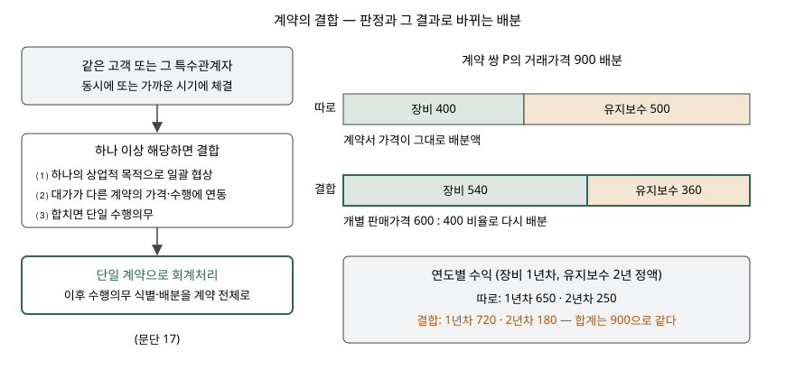

> 예제의 `타파정밀`과 그 숫자는 계산을 보이려고 만든 가상 자료다.

## 들어가며

장비 회사의 영업 담당자가 고객과 한 자리에서 장비와 2년 유지보수를 함께 협상하는 일은 흔하다. 고객 쪽 구매 부서와 설비 부서가 다르다는 이유로 계약서는 장비 한 장, 유지보수 한 장으로 나눠 쓴다. 장비 값은 깎아 주고 유지보수 요금을 정가보다 높여 전체 금액을 맞추는 식이다.

계약서마다 따로 회계처리하면 장비를 인도하는 첫해에 깎인 장비 값만 수익이 되고, 부풀린 유지보수 요금은 2년에 걸쳐 들어온다. 아래 예제의 타파정밀은 같은 묶음을 따로 처리하면 1년차 수익이 650, 하나로 처리하면 720이 된다. 2년 합계는 900으로 같지만 첫해 이익과 결산일의 계약부채가 달라진다. 이 차이를 정하는 규칙이 계약의 결합이다.

같은 날 쓴 [계약의 식별 글](../2026-11-19-contract-identification-collectibility/index.md)이 계약 하나가 성립하는지를 다뤘다면, 이 글은 성립한 계약 여럿을 하나로 볼지를 다룬다.

## 개념

기업회계기준서 제1115호는 같은 고객(또는 그 고객의 특수관계자)과 동시에 또는 가까운 시기에 체결한 둘 이상의 계약이 다음 기준 중 하나 이상을 충족하면 결합해 단일 계약으로 회계처리한다(문단 17).

| 기준 | 내용 | 무엇을 막는가 |
|---|---|---|
| ⑴ | 복수의 계약을 하나의 상업적 목적으로 일괄 협상한다 | 한 묶음 거래를 계약서만 나눠 할인을 한쪽에 몰아넣는 것 |
| ⑵ | 한 계약의 대가가 다른 계약의 가격이나 수행에 따라 달라진다 | 서로 연동된 대가를 독립된 가격처럼 다루는 것 |
| ⑶ | 복수 계약에서 약속한 재화나 용역이 문단 22~30에 따른 단일 수행의무에 해당한다 | 하나의 결과물을 계약서 단위로 쪼개 이행 시점을 앞당기는 것 |

기준을 보기 전에 전제가 둘 있다. 상대방이 같은 고객이거나 그 특수관계자여야 하고, 체결 시점이 동시이거나 가까워야 한다. 기준서는 '가까운 시기'를 날짜 수로 정하지 않는다.

결합은 [계약변경](../2026-11-14-contract-modification-three-paths/index.md)과 다르다. 계약변경은 당사자들이 승인한 계약의 범위나 가격의 변경이다(문단 18). 이미 맺은 계약을 나중에 고치는 것이 변경이고, 처음부터 한 묶음이던 계약서들을 하나로 읽는 것이 결합이다.

## 구조



> **출처**: 한국회계기준원 [기업회계기준서 제1115호 '고객과의 계약에서 생기는 수익'](https://www.samili.com/acc/Kijun/Kijunjomun.asp?code=1978-1115) 문단 17·18, 74·76·81 (제3자 전재, 2021-04-23 개정) — 원문 발행처 [한국회계기준원](https://www.kasb.or.kr/front/board/ingAccountingList.do). 배분 금액은 이 글의 `code/output.txt` `[3]`·`[4]`에서 옮겼다

왼쪽이 판정이고 오른쪽이 결과다. 결합하면 계약서 가격은 더 이상 배분액이 아니다. 거래가격 전체를 개별 판매가격 비율로 수행의무에 다시 나눈다.

## 동작 원리

### 결합은 계약 단위를 정하는 일이다

결합 판정은 수익 인식 5단계 중 첫 단계에서 끝난다. 결합한 뒤에는 그 단일 계약 안에서 수행의무를 다시 식별한다. 결합했다고 해서 수행의무가 하나가 되는 것은 아니다. 계약 쌍 P의 장비와 유지보수는 결합 뒤에도 [구별되는 수행의무](../2026-11-17-performance-obligation-distinct-goods/index.md) 두 개로 남는다. 바뀌는 것은 거래가격이 계약서 단위가 아니라 묶음 전체로 정해지고, 그 금액을 두 수행의무에 배분한다는 점이다.

### 결합하면 할인이 다시 배분된다

계약 쌍 P의 계약서 가격은 장비 400, 유지보수 500이다. 회사가 따로 팔 때의 가격인 개별 판매가격은 장비 600, 유지보수 400이다. 묶음 전체로 보면 개별 판매가격 합계 1,000을 900에 판 것이고 할인이 100이다. 결합하지 않으면 계약서마다 수행의무가 하나라서 계약서 가격이 그대로 배분액이 된다. 결합하면 거래가격 900을 개별 판매가격 비율로 배분하고(문단 74·76), 할인도 모든 수행의무에 비례해 나눈다(문단 81). 장비는 540, 유지보수는 360이 된다. 할인을 비례하지 않게 배분하는 예외 조건은 [거래가격 배분 글](../2026-11-16-transaction-price-allocation-discount/index.md)에서 다뤘다.

### 세 기준이 서로 다른 신호를 본다

⑴은 협상의 모습을 본다. 한 자리에서 한 목적으로 묶어 흥정했으면 계약서가 몇 장이든 하나다. ⑵는 대가의 연동을 본다. 유지보수 요금이 장비 가동률에 따라 깎이는 계약은 따로 협상했더라도 한 계약의 대가가 다른 계약의 수행에 달려 있다. ⑶은 결과물을 본다. 설계 계약과 제작 계약이 합쳐져야 설비 하나가 된다면 둘은 단일 수행의무이고 계약도 하나다.

## 실습 예제

```python
def combine_decision(p):
    near = p["days_apart"] <= 30  # 기준서는 '가까운 시기'를 숫자로 정하지 않는다. 예제의 가정
    hits = [CRITERIA[k] for k in ("c1", "c2", "c3") if p[k]]
    if not near:
        return False, "동시·가까운 시기가 아니다", hits
    if not hits:
        return False, "세 기준 모두 해당 없음", hits
    return True, "세 기준 중 하나 이상 충족", hits
```

전체 소스: [`code/`](code/)

가정은 다음과 같다(금액 단위 백만원). 30일 이내 체결을 '가까운 시기'로 둔 것은 판정을 코드로 보이기 위한 가정이고 기준서의 기준이 아니다. 장비는 1년차 1월에 인도하고, 유지보수는 1월부터 24개월 동안 정액으로 인식한다.

```text
[1] 계약 쌍별 결합 판정 — 문단 17
  S 고객의 종속기업과 같은 주 일괄 협상  (특수관계자, 5일 간격)
      해당: ⑴ 하나의 상업적 목적으로 일괄 협상
      → 결합한다  (세 기준 중 하나 이상 충족)
  T 8개월 뒤 별도 입찰로 추가 장비  (같은 고객, 240일 간격)
      → 따로 회계처리  (동시·가까운 시기가 아니다)
```

P·Q·R은 각각 ⑴·⑵·⑶ 하나씩으로 결합된다. S는 계약 상대가 고객 본인이 아니라 그 종속기업이지만 특수관계자라서 전제를 충족한다. T는 같은 고객이어도 8개월 뒤 별도 입찰로 맺은 계약이라 결합 대상이 아니다.

```text
[3] 수행의무별 배분액
  수행의무   따로   결합   차이
  장비        400    540   +140
  유지보수      500    360   -140

[4] 연도별 수익
  연도    따로   결합   차이
  1년차     650    720    +70
  2년차     250    180    -70
  합계      900    900     +0

[5] 1년차 말 계약부채 (두 계약서 대가 900 을 1월에 전액 받았다고 가정)
  따로  누적 인식 수익   650  받은 대가   900  계약부채   250
  결합  누적 인식 수익   720  받은 대가   900  계약부채   180
```

장비에 140이 더 배분되면서 1년차 수익은 70 늘고 2년차 수익은 70 준다. 장비 몫 증가분 140은 인도한 1년차에 전부 인식되고, 유지보수 몫 감소분 140은 2년에 70씩 나뉘어 빠지기 때문이다. 받은 대가가 같으니 1년차 말 계약부채는 250에서 180으로 줄어든다. 따로 처리한 쪽은 유지보수 요금에 숨은 장비 값 일부를 2년차까지 미뤄 둔 셈이다.

## 실무에서 주의할 점

- **계약서 개수는 판정 근거가 아니다.** 결합 기준은 협상 방식, 대가 연동, 결과물의 단일성이다. 고객 내부 결재 구조 때문에 계약서를 나눴더라도 한 번에 협상했으면 ⑴에 해당한다.
- **특수관계자와 맺은 계약도 본다.** 고객의 모회사·종속기업과 가까운 시기에 맺은 계약은 상대 법인이 달라도 결합 대상이 될 수 있다(문단 17 본문). 그룹 단위로 구매하는 고객이 많은 회사라면 계약 상대방 목록을 그룹으로 묶어 확인해야 한다.
- **'가까운 시기'에 정해진 일수는 없다.** 기준서가 숫자를 주지 않으므로 회사가 판단하고, 그 판단의 근거를 회계정책에 남겨야 한다. 예제의 30일은 가정이다.
- **결합해도 수행의무는 다시 센다.** 결합은 계약 단위를 정할 뿐이다. 묶인 계약 안에서 재화와 용역이 구별되면 수행의무는 여럿이고, 그 사이 배분이 수익 시점을 바꾼다.
- **계약서 가격과 개별 판매가격이 크게 다르면 결합 여부를 먼저 본다.** 한쪽은 정가보다 싸고 한쪽은 비싼 계약서 쌍은 ⑴의 신호다. 따로 처리하면 기간에 걸쳐 인식하는 쪽에 값이 몰려 초기 수익이 낮게, 계약부채가 높게 나온다.

## 정리

- 같은 고객이나 그 특수관계자와 동시에 또는 가까운 시기에 맺은 계약은 일괄 협상, 대가 연동, 단일 수행의무 중 하나 이상이면 하나의 계약으로 회계처리한다(제1115호 문단 17).
- 결합은 계약 단위를 정하는 판단이고, 결합한 뒤에도 수행의무는 문단 22~30으로 다시 식별한다.
- 결합하면 계약서 가격 대신 개별 판매가격 비율로 거래가격과 할인을 다시 배분한다(문단 74·76·81).
- 가상 사례에서 장비와 유지보수를 결합하자 장비 배분액이 400에서 540으로 바뀌고, 1년차 수익이 650에서 720으로, 1년차 말 계약부채가 250에서 180으로 바뀌었다.

## 참고 자료

- [한국회계기준원](https://www.kasb.or.kr/front/board/ingAccountingList.do) — K-IFRS 기준서 발행처. 아래 전재 링크는 조문을 바로 열기 위한 편의 링크다
- [기업회계기준서 제1115호 '고객과의 계약에서 생기는 수익'](https://www.samili.com/acc/Kijun/Kijunjomun.asp?code=1978-1115) (제3자 전재, 2021-04-23 개정) — 문단 17·18, 22~30, 74·76·81
- [IFRS 15 Revenue from Contracts with Customers](https://www.ifrs.org/issued-standards/list-of-standards/ifrs-15-revenue-from-contracts-with-customers/) — IFRS Foundation
- 숫자는 이 글의 [`code/output.txt`](code/output.txt) `[1]`~`[5]`에서 옮겼다
