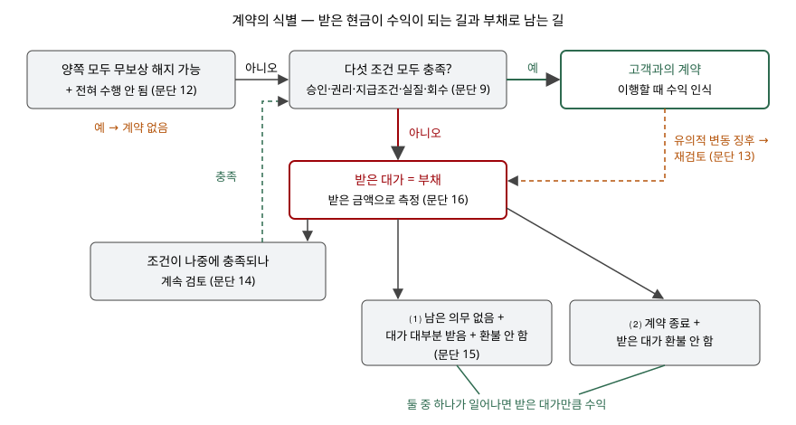

> 예제의 `자차소재`와 그 숫자는 계산을 보이려고 만든 가상 자료다.

## 들어가며

거래처의 자금 사정이 나빠졌다는 소문이 돌 때 영업 쪽에서 흔히 쓰는 방법은 선금을 받고 물건을 보내는 것이다. 돈을 먼저 받았으니 위험은 없다고 보고, 장부에도 보낸 만큼 매출이 잡혔으리라 생각한다. 재무제표를 읽는 쪽도 매출과 현금 유입이 같은 방향으로 움직이면 별다른 질문을 하지 않는다.

아래 예제의 자차소재는 네 고객과 똑같이 분기마다 250씩, 1년에 1,000어치를 공급하는 계약을 맺었다. 그런데 연말에 고객별 수익을 보면 1,000, 300, 750, 0으로 갈린다. 고객 을에게는 500어치를 보내고 300을 받았는데, 그 300조차 3분기 말까지는 수익이 아니라 부채였다. 수익 인식 5단계의 첫 단계인 '계약의 식별'에서 갈린 결과다.

수익 기준서를 다룬 앞선 글들은 모두 계약이 있다는 전제에서 출발했다. 이 글은 그 전제가 언제 성립하는지를 다룬다. 같은 날 쓴 [계약의 결합 글](../2026-11-19-contract-combination-three-criteria/index.md)은 성립한 계약 여러 개를 하나로 묶는 경우를 다룬다.

## 개념

기업회계기준서 제1115호는 다섯 조건을 모두 충족할 때만 고객과의 계약으로 회계처리한다(문단 9).

| 번호 | 조건 | 무엇을 보는가 |
|---|---|---|
| ⑴ | 승인과 확약 | 당사자들이 서면·구두·사업 관행으로 계약을 승인하고 각자 의무를 수행하기로 확약했다 |
| ⑵ | 권리 식별 | 이전할 재화나 용역에 대한 각 당사자의 권리를 식별할 수 있다 |
| ⑶ | 지급조건 식별 | 이전할 재화나 용역의 지급조건을 식별할 수 있다 |
| ⑷ | 상업적 실질 | 계약 결과로 회사 미래 현금흐름의 위험·시기·금액이 변동될 것으로 예상된다 |
| ⑸ | 회수 가능성 | 받을 권리를 갖게 될 대가의 회수 가능성이 높다 |

계약은 둘 이상의 당사자 사이에 집행 가능한 권리와 의무가 생기게 하는 합의이고, 집행 가능성은 법률 문제다(문단 10). 그래서 다섯 조건과 별도로 문단 12가 하나를 더 둔다. 아직 전혀 수행되지 않은 계약을 양쪽 당사자 모두 보상 없이 일방적으로 끝낼 수 있으면, 기준서 적용 목적상 계약이 존재하지 않는 것으로 본다. 전혀 수행되지 않았다는 것은 재화나 용역을 아직 이전하지 않았고, 대가를 받지도 않았고 받을 권리도 없다는 뜻이다.

## 구조



> **출처**: 한국회계기준원 [기업회계기준서 제1115호 '고객과의 계약에서 생기는 수익'](https://www.samili.com/acc/Kijun/Kijunjomun.asp?code=1978-1115) 문단 9~16 (제3자 전재, 2021-04-23 개정) — 원문 발행처 [한국회계기준원](https://www.kasb.or.kr/front/board/ingAccountingList.do)

오른쪽 위가 보통의 길이다. 계약이 성립하면 나머지 네 단계(수행의무 식별, 거래가격 산정, 배분, 이행)로 넘어간다. 가운데 아래가 조건을 못 채운 계약의 길이다. 받은 현금은 부채로 두고, 문단 15의 두 사건 중 하나가 일어나거나 문단 9가 나중에 충족될 때까지 그대로 둔다.

## 동작 원리

### 회수 가능성은 지급 능력과 의도만 본다

다섯 조건 가운데 판단이 가장 자주 갈리는 것이 ⑸다. 기준서는 회수 가능성을 평가할 때 지급기일에 고객이 대가를 지급할 수 있는 능력과 지급할 의도만 고려하라고 한다(문단 9⑸). 평가 대상 금액은 계약서에 적힌 가격이 아니라 회사가 받을 권리를 갖게 될 대가다. 회사가 고객에게 가격을 깎아 줄 수 있어서 대가가 변동될 수 있다면 그 금액은 표시 가격보다 적을 수 있다(문단 52 참조). 깎아 줄 것으로 예상되는 몫은 [변동대가](../2026-11-15-variable-consideration-estimate-constraint/index.md) 문제이고, 깎은 뒤의 금액을 고객이 낼 수 있느냐가 회수 가능성 문제다.

### 처음에 충족하면 징후가 있을 때만 다시 본다

계약 개시시점에 다섯 조건을 충족했으면, 사실과 상황에 유의적인 변동 징후가 없는 한 다시 검토하지 않는다(문단 13). 기준서가 드는 예가 고객의 지급 능력이 유의적으로 악화되는 경우다. 이때 재검토하는 대상은 **고객에게 이전할 나머지 재화나 용역**에 대한 대가다. 이미 이전하고 인식한 수익을 되돌리는 절차가 아니다. 이미 생긴 수취채권의 손상은 금융상품 기준서(제1109호)가 다룬다.

### 계약이 아니면 받은 돈은 부채로 남는다

조건을 충족하지 못한 계약도 버리지 않는다. 나중에 조건이 충족되는지 계속 검토한다(문단 14). 그 사이에 고객에게서 대가를 받았다면, 다음 두 사건 가운데 하나가 일어난 경우에만 받은 대가를 수익으로 인식한다(문단 15).

- ⑴ 이전할 의무가 남아 있지 않고, 약속한 대가를 모두 또는 대부분 받았으며, 그 대가는 환불되지 않는다
- ⑵ 계약이 종료되었고 받은 대가는 환불되지 않는다

두 사건이 일어나기 전에는 받은 대가를 부채로 인식하고, 그 부채는 받은 금액으로 측정한다(문단 16). 부채의 성격은 상황에 따라 재화를 이전할 의무일 수도, 환불할 의무일 수도 있다. 이 규칙이 엄격한 이유는 ⑴에 '의무가 남아 있지 않고'가 붙어 있어서다. 남은 인도분이 하나라도 있으면 이미 보낸 물건 값을 현금으로 받았어도 수익이 되지 않는다.

## 실습 예제

```python
def is_contract(c):
    if c["both_can_cancel_free"]:
        return False, "문단 12 — 전혀 수행되지 않은 계약을 양쪽 모두 무보상 해지 가능"
    missing = [...]  # 문단 9 다섯 조건 중 빠진 것
    if missing:
        return False, "문단 9 미충족: " + ", ".join(missing)
    return True, "문단 9 다섯 조건 충족"
```

전체 소스: [`code/`](code/)

가정은 다음과 같다(금액 단위 백만원). 네 고객 모두 분기마다 250씩 인도하는 1년 계약이다. 을은 계약 전부터 연체 이력이 있어 ⑸를 충족하지 못한다. 을은 1분기에 선금 300을 냈고, 회사는 1·2분기에 인도한 뒤 공급을 멈췄으며, 4분기에 계약을 종료하고 선금은 돌려주지 않기로 했다. 병은 개시 때는 문제가 없었으나 3분기 초 주거래 은행 거래가 정지되었다. 회사는 3분기분을 선금 250을 받고 보냈고, 4분기에 계약을 종료했다. 정은 기본거래약정만 맺고 발주가 없었다.

```text
[1] 계약 개시시점 판정 — 문단 9·12
  을  개시 전부터 연체 이력, 지급 능력이 낮다
      → 계약 아님  (문단 9 미충족: ⑸회수 가능성 높음)
  정  기본거래약정만 있고 발주 전에는 양쪽 모두 무보상 해지 가능
      → 계약 아님  (문단 12 — 전혀 수행되지 않은 계약을 양쪽 모두 무보상 해지 가능)
```

```text
  고객 병
    2분기  분기 말     누적 수익 500          부채 0  수취채권 250
    3분기  재검토      이후 인도분 수익 중단       문단 13 — 이미 인식한 수익은 그대로
    3분기  현금 250   부채 +250            문단 16 — 받은 금액으로 부채 측정
    3분기  인도 250   수익 0               문단 15 사건 아님 — 의무가 남아 있다
    3분기  분기 말     누적 수익 500          부채 250  수취채권 250
    4분기  계약 종료    수익 250             문단 15⑵ — 종료, 받은 대가 환불 안 함
```

```text
[3] 1년 합계 — 같은 계약 조건, 다른 수익
  고객  인도(판매가)  받은 현금  인식한 수익  기말 부채  기말 수취채권
  갑         1000       1000         1000          0              0
  을          500        300          300          0              0
  병          750        500          750          0            250
  정   발주 없음 — 문단 12 에 따라 계약이 존재하지 않는 것으로 본다
```

을은 1분기부터 3분기 말까지 수익이 0이고 부채가 300이다. 물건을 500어치 보냈고 현금도 300을 받았지만, 4분기 인도 의무가 남아 있어 문단 15⑴의 사건이 아니다. 계약이 종료된 4분기에 비로소 받은 금액 300이 수익이 된다. 인도한 판매가 500이 아니라 받은 현금 300이 기준이라는 점이 핵심이다.

병은 3분기에 같은 일이 생긴다. 3분기 인도분을 선금으로 받았는데도 수익이 0이다. 반면 2분기까지 인식한 500은 재검토 뒤에도 그대로 남는다. 기말 수취채권 250은 2분기 인도분의 미회수액이다. 이 채권의 손상은 제1109호의 영역이라 예제에서는 계산하지 않았다. 을에게 보낸 재화의 원가를 언제 비용으로 떨어내는지도 문단 15·16이 정하지 않으므로 예제는 수익 쪽만 계산한다.

## 실무에서 주의할 점

- **선금을 받았다고 수익이 되는 것은 아니다.** 회수 가능성이 낮은 고객과는 선금 거래가 흔하다. 문단 9를 못 채운 계약에서는 선금이 문단 16에 따라 부채로 남고, 인도 의무가 하나라도 남아 있으면 인도분 대금을 받아도 수익으로 바꾸지 않는다. 재무상태표의 계약부채나 선수금이 매출에 비해 커지는 고객군이 있으면 이 경우를 의심할 수 있다.
- **회수 가능성 평가는 계약서 금액이 아니라 받을 권리가 있는 대가로 한다.** 관행적으로 가격을 깎아 주는 시장이라면 깎은 뒤 금액을 기준으로 지급 능력을 본다(문단 9⑸, 52). 계약서 금액을 기준으로 '못 받을 것 같다'고 판단하면 변동대가 문제를 회수 가능성 문제로 잘못 분류하게 된다.
- **재검토는 남은 부분만이다.** 개시 뒤 고객 신용이 나빠져도 이미 인식한 수익을 거슬러 줄이지 않는다(문단 13). 이미 생긴 채권의 회수 위험은 손상차손으로 나타나므로, 손익계산서에서 매출 감소가 아니라 대손 관련 비용 줄을 봐야 한다.
- **기본거래약정은 계약이 아닐 수 있다.** 발주 전에는 양쪽이 무보상으로 끝낼 수 있는 기본약정은 문단 12에 따라 계약이 없는 것으로 본다. 개별 발주가 들어와 집행 가능한 권리와 의무가 생기는 시점에 계약을 식별한다.
- **계약이 아닌 동안에도 검토를 멈추지 않는다.** 고객의 자금 사정이 나아져 문단 9가 충족되면 그때부터 계약으로 회계처리한다(문단 14). 부채로 쌓아 둔 금액이 그 시점에 계약 회계로 넘어간다.

## 정리

- 고객과의 계약은 승인·권리·지급조건·상업적 실질·회수 가능성 다섯 조건을 모두 충족해야 성립한다(제1115호 문단 9).
- 전혀 수행되지 않은 계약을 양쪽이 무보상으로 끝낼 수 있으면 계약이 없는 것으로 본다(문단 12).
- 개시 뒤에는 유의적 변동 징후가 있을 때만 남은 부분의 회수 가능성을 재검토하고, 이미 인식한 수익은 그대로 둔다(문단 13).
- 계약이 아닌 동안 받은 대가는 받은 금액으로 부채에 두고, 남은 의무 없이 대부분을 받았거나 계약이 종료된 때에만 수익으로 바꾼다(문단 15·16).
- 가상 사례에서 같은 1,000짜리 계약이 고객에 따라 1,000, 300, 750, 0의 수익으로 갈렸다.

## 참고 자료

- [한국회계기준원](https://www.kasb.or.kr/front/board/ingAccountingList.do) — K-IFRS 기준서 발행처. 아래 전재 링크는 조문을 바로 열기 위한 편의 링크다
- [기업회계기준서 제1115호 '고객과의 계약에서 생기는 수익'](https://www.samili.com/acc/Kijun/Kijunjomun.asp?code=1978-1115) (제3자 전재, 2021-04-23 개정) — 문단 9~16, 문단 52
- [IFRS 15 Revenue from Contracts with Customers](https://www.ifrs.org/issued-standards/list-of-standards/ifrs-15-revenue-from-contracts-with-customers/) — IFRS Foundation
- 숫자는 이 글의 [`code/output.txt`](code/output.txt) `[1]`~`[3]`에서 옮겼다
