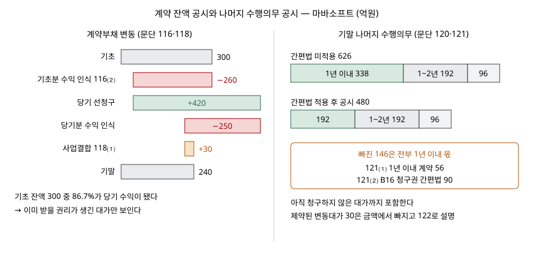

> 예제의 `마바소프트`와 그 숫자는 계산을 보이려고 만든 가상 자료다.

## 들어가며

구독형 소프트웨어 회사의 재무상태표를 보면 계약부채가 작년 300억원에서 올해 240억원으로 줄어 있다. 이 숫자 하나로 "선수금이 줄었으니 신규 계약이 줄었다"고 적는 경우가 많다. 그런데 같은 해에 선청구가 420억원 새로 생겼고, 사업결합으로 30억원이 넘어왔다. 잔액 두 개의 차이 60억원 뒤에는 플러스 450억원과 마이너스 510억원이 함께 들어 있다.

다음 해 수익을 가늠하려고 '수주잔고'를 찾는 경우도 같다. 주석에 공시된 나머지 수행의무가 480억원이라도, 1년 이내 계약과 사용량 정산 계약은 간편법으로 빠져 있을 수 있다. 아래 예제에서 빠진 금액은 146억원이고 전부 1년 이내에 수익이 될 몫이다. 이 두 표를 읽는 규칙이 제1115호 문단 116~122다.

## 개념

계약자산·계약부채·수취채권의 정의와 재무상태표 표시(문단 105~109)는 [원가기준 진행률 글](../2026-11-08-cost-to-cost-progress-estimate-change/index.md)에서 다뤘다. 이 글은 그 잔액을 주석에서 어떻게 설명하는지를 다룬다. 수익 공시의 목적은 이용자가 수익과 현금흐름의 특성·금액·시기·불확실성을 이해하게 하는 것이고(문단 110), 고객과의 계약에 관한 공시(문단 113~122) 중 같은 날 쓴 [수익의 구분 공시](../2026-11-20-revenue-disaggregation-disclosure/index.md) 다음에 오는 것이 계약 잔액과 나머지 수행의무다.

| 문단 | 무엇을 공시하는가 |
|---|---|
| 116⑴ | 수취채권·계약자산·계약부채의 기초·기말 잔액 |
| 116⑵ | 기초 계약부채 중 당기에 수익으로 인식한 금액 |
| 116⑶ | 과거에 이행한 수행의무에서 당기에 인식한 수익(예: 거래가격 변동) |
| 117 | 이행 시기와 지급 시기의 관계, 그것이 잔액에 미친 영향 |
| 118 | 계약자산·계약부채의 유의적 변동에 대한 질적·양적 설명 |
| 119 | 수행의무의 이행 시기·지급조건·특성·반품 의무·보증 유형 |
| 120 | 나머지 수행의무에 배분된 거래가격과 수익 인식 예상 시기 |
| 121 | 120을 생략할 수 있는 실무적 간편법 2가지 |
| 122 | 간편법 적용 여부와 거래가격에서 빠진 대가의 질적 설명 |

문단 118이 드는 변동의 예는 5가지다. ⑴ 사업결합, ⑵ 진행률·거래가격 추정 변경이나 계약변경에 따른 누적효과 일괄조정, ⑶ 계약자산 손상, ⑷ 대가를 받을 권리가 무조건적이 되는 일정의 변동(계약자산에서 수취채권으로 재분류), ⑸ 수행의무를 이행하는 기간의 변동(계약부채에서 수익으로 넘어감)이다.

## 구조



> **출처**: 한국회계기준원 [기업회계기준서 제1115호 '고객과의 계약에서 생기는 수익'](https://www.samili.com/acc/Kijun/Kijunjomun.asp?code=1978-1115) 문단 116·118·120~122 (제3자 전재, 2021-04-23 개정) — 원문 발행처 [한국회계기준원](https://www.kasb.or.kr/front/board/ingAccountingList.do). 금액은 이 글의 `code/output.txt` `[1]`·`[4]`·`[6]`에서 옮겼다

왼쪽은 이미 대가를 청구할 권리가 생긴 금액이 어떻게 움직였는지, 오른쪽은 계약은 됐지만 아직 이행하지 않은 금액 전체가 언제 수익이 될지를 보여 준다. 두 표는 범위가 다르다.

## 동작 원리

### 잔액의 차이만으로는 원인을 알 수 없다

계약부채 기말 잔액은 기초 잔액에 새로 생긴 선청구를 더하고 수익으로 넘어간 금액을 뺀 결과다. 신규 선청구가 늘어도 수익 인식이 더 빨리 진행되면 잔액은 줄어든다. 그래서 문단 116⑴은 잔액만, 116⑵는 기초 잔액 중 수익이 된 금액을, 118은 변동 원인을 따로 공시하게 한다. 116⑵의 금액을 기초 잔액으로 나누면 계약부채가 얼마나 빨리 수익으로 넘어가는지 알 수 있다.

### 과거에 이행한 의무에서도 수익이 생긴다

문단 116⑶은 이미 끝난 수행의무에서 당기에 생긴 수익을 따로 보이게 한다. 전기에 끝낸 프로젝트의 성과 보수가 당기에 확정되면 거래가격이 바뀌고, 그 변동분은 이미 이행한 수행의무에 배분되어 당기 수익이 된다. 이 금액은 당기 영업 활동이 아니라 과거 추정의 변경에서 나오므로 당기 실적과 구분해 읽어야 한다. 변동대가의 제약은 [변동대가 글](../2026-11-15-variable-consideration-estimate-constraint/index.md)에서 다뤘다.

### 나머지 수행의무는 아직 청구하지 않은 대가까지 담는다

계약부채는 받았거나 받을 권리가 생긴 대가 중 아직 수익이 되지 않은 금액이다. 나머지 수행의무는 보고기간 말에 이행하지 않은 수행의무에 배분된 거래가격 전체다(문단 120⑴). 3년 구독 계약에서 매달 청구한다면, 남은 24개월분은 아직 청구하지 않았으므로 계약부채에는 없지만 나머지 수행의무에는 들어간다. 수익 인식 예상 시기는 기간 범위로 나눈 양적 방법이나 질적 설명 중 하나로 공시한다(문단 120⑵).

### 간편법은 1년 이내 몫을 지운다

다음 조건 중 하나면 문단 120 공시를 생략할 수 있다(문단 121). ⑴ 최초 예상 존속 기간이 1년 이내인 계약의 일부인 수행의무, ⑵ 수행한 만큼 청구할 권리가 있어 B16에 따라 청구 금액으로 수익을 인식하는 수행의무다. 둘 다 대부분 1년 안에 수익이 되는 몫이다. 간편법을 쓰는지와 거래가격에 포함하지 않은 대가(예: 제약된 변동대가)는 질적으로 설명해야 한다(문단 122).

## 실습 예제

```python
def print_rollforward(title, opening, moves):
    balance = opening
    for label, amount in moves:
        balance += amount
        print(f"  {label:<34}{amount:>+6}")
    return balance

# 간편법 근거가 None 이 아니면 문단 121 에 따라 공시에서 뺄 수 있다.
full = buckets(REMAINING)
disclosed = buckets([r for r in REMAINING if r[6] is None])
```

전체 소스: [`code/`](code/)

가정은 다음과 같다(금액 단위 억원). 마바소프트는 구독·유지보수·구축 용역을 판다. 구독과 유지보수는 기간 초에 선청구하는 계약과 매달 청구하는 계약이 섞여 있고, 구축 용역은 진행률로 수익을 먼저 잡고 단계 완료 때 청구한다.

```text
[1] 계약부채 변동표 — 문단 116⑴·⑵, 118
  기초 잔액                                300
  기초 잔액 중 당기 수익 인식 116⑵               -260
  당기 선청구                              +420
  당기 선청구 중 당기 수익 인식                   -250
  사업결합 118⑴                            +30
  기말 잔액                                240

[2] 계약자산 변동표 — 문단 116⑴, 118
  기초 잔액                                 80
  청구 전 수익 인식                          +150
  누적효과 일괄조정 118⑵                       -12
  수취채권으로 재분류 118⑷                     -140
  손상 118⑶                               -3
  기말 잔액                                 75
```

계약부채는 60 줄었지만 신규 선청구 420과 사업결합 30이 함께 있었다. 계약자산은 5밖에 안 줄었지만, 그 안에서 진행률 추정 변경으로 12를 덜어냈고 손상 3을 인식했다.

```text
[4] 당기 수익의 출처
  기초 계약부채에서 116⑵                   260
  당기 선청구에서                         250
  청구 전 인식(계약자산)                    138
  전기 이행분 거래가격 변동 116⑶                8
  인식과 동시에 청구                       344
  고객과의 계약 수익 합계                   1000
  기초 계약부채 중 당기에 수익이 된 비율  260 / 300 = 86.7%
```

수익 출처를 다 더하면 1,000으로 손익계산서의 고객과의 계약 수익과 같다. 1,000 중 260은 연초에 이미 계약부채로 잡혀 있던 몫이고, 8은 전기에 끝낸 의무에서 나온 몫이다.

```text
[6] 간편법 적용 전후 — 문단 121
                      합계    1년이내  1~2년   2년초과
  간편법 미적용          626     338   192     96
  간편법 적용(공시)     480     192   192     96
  빠진 금액 146 — 전부 1년 이내 몫이다
  공시된 1년 이내 금액 / 당기 수익 = 192 / 1000 = 19.2%
  미적용 1년 이내 금액 / 당기 수익 = 338 / 1000 = 33.8%
  거래가격에서 빠진 제약 변동대가 30 — 문단 122 질적 설명 대상
```

간편법을 쓰면 1~2년과 2년 초과 금액은 그대로이고 1년 이내 금액만 338에서 192로 줄어든다. 공시된 숫자로 다음 해 수익 중 이미 계약된 몫을 계산하면 19.2%, 간편법 대상까지 넣으면 33.8%다.

## 실무에서 주의할 점

- **계약부채 잔액 감소를 곧바로 신규 계약 감소로 읽지 않는다.** 잔액은 신규 선청구와 수익 인식의 차이다. 116⑵와 118 설명을 보고, 사업결합처럼 영업과 무관한 변동을 따로 떼어 본다.
- **나머지 수행의무 공시 금액이 이미 계약된 수익 전체는 아니다.** 간편법을 쓰면 1년 이내 계약과 청구권 간편법 대상이 빠지고(문단 121), 제약된 변동대가도 빠진다(문단 122). 회사가 간편법을 쓰는지는 122의 질적 설명에 적혀 있으므로 금액보다 그 문장을 먼저 읽는다.
- **계약부채와 나머지 수행의무를 더하지 않는다.** 나머지 수행의무는 이행하지 않은 의무에 배분된 거래가격 전체이므로, 간편법 대상이 아닌 한 이미 받은 대가에 해당하는 계약부채 상당분을 포함한다. 둘을 더하면 같은 금액을 두 번 센다.
- **116⑶ 금액은 당기 실적과 구분한다.** 전기에 이행한 의무의 거래가격 변동은 추정이 바뀐 결과다. 이 금액이 해마다 크게 나온다면 변동대가 추정이나 제약 판단이 체계적으로 한쪽으로 치우쳐 있는지 의심할 수 있다.
- **누적효과 일괄조정과 손상은 계약자산 변동에서 따로 본다.** 진행률 추정이 바뀌면 그 효과가 한 번에 계약자산과 수익에 반영된다(문단 118⑵). 계약자산 손상(118⑶)은 제1109호에 따라 인식하고 수취채권 손상과 별도로 공시한다(문단 113⑵).

## 정리

- 계약 잔액 공시는 수취채권·계약자산·계약부채의 기초·기말 잔액, 기초 계약부채 중 당기 수익, 과거 이행분에서 생긴 당기 수익을 보인다(제1115호 문단 116).
- 잔액이 움직인 원인은 사업결합·누적효과 일괄조정·손상·재분류·이행 기간 변동 같은 항목으로 설명한다(문단 117·118).
- 나머지 수행의무 공시는 아직 청구하지 않은 대가까지 포함한 미이행 거래가격과 수익 인식 예상 시기를 보인다(문단 120).
- 1년 이내 계약과 청구권 간편법 대상은 생략할 수 있고, 그 사실을 질적으로 밝힌다(문단 121·122). 가상 사례에서 이 간편법이 1년 이내 금액을 338에서 192로 줄였다.

## 참고 자료

- [한국회계기준원](https://www.kasb.or.kr/front/board/ingAccountingList.do) — K-IFRS 기준서 발행처. 아래 전재 링크는 조문을 바로 열기 위한 편의 링크다
- [기업회계기준서 제1115호 '고객과의 계약에서 생기는 수익'](https://www.samili.com/acc/Kijun/Kijunjomun.asp?code=1978-1115) (제3자 전재, 2021-04-23 개정) — 문단 105~110, 113, 116~122, 적용지침 B16
- [IFRS 15 Revenue from Contracts with Customers](https://www.ifrs.org/issued-standards/list-of-standards/ifrs-15-revenue-from-contracts-with-customers/) — IFRS Foundation
- 숫자는 이 글의 [`code/output.txt`](code/output.txt) `[1]`~`[6]`에서 옮겼다
