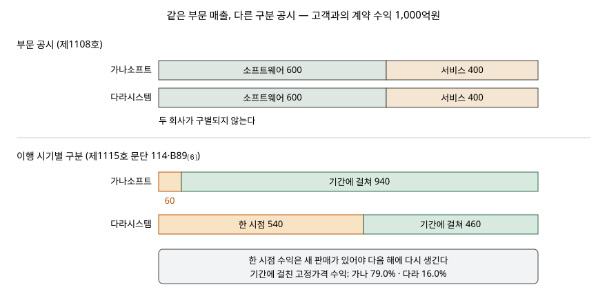

> 예제의 `가나소프트`·`다라시스템`과 그 숫자는 계산을 보이려고 만든 가상 자료다.

## 들어가며

소프트웨어 회사 두 곳의 사업보고서를 나란히 펴 놓고 비교하는 일이 있다. 손익계산서 매출이 둘 다 1,040억원이고, 부문 정보를 봐도 소프트웨어 600억원, 서비스 400억원으로 같다. 여기서 대부분은 "두 회사 매출 구조가 비슷하다"고 적고 다음 항목으로 넘어간다.

그런데 수익 주석의 구분 공시 표를 펴면 한 회사는 매출의 94%를 기간에 걸쳐 인식하고, 다른 회사는 54%를 한 시점에 인식한다. 부문 표 두 줄만으로 판단하면 이 차이를 놓친다. 같은 1,000억원이라도 다음 해에 계약이 이어지면 다시 생기는 몫이 79%인 회사와 16%인 회사는 현금흐름의 시기와 불확실성이 다르다. 이 표를 만들게 하는 규정이 수익의 구분 공시다.

## 개념

기업회계기준서 제1115호는 고객과의 계약에서 인식한 수익을, 경제적 요소가 수익과 현금흐름의 특성·금액·시기·불확실성에 어떻게 영향을 주는지 나타내는 범주로 구분해 공시하게 한다(문단 114). 공시 전체의 목적이 재무제표이용자가 수익과 현금흐름의 이 네 가지를 이해하게 하는 것이고(문단 110), 구분 공시는 그 목적을 숫자로 직접 보여 주는 항목이다.

구분 공시 앞에 문단 113이 두 가지를 먼저 요구한다.

| 문단 | 요구 | 왜 |
|---|---|---|
| 113⑴ | 고객과의 계약 수익을 다른 수익원천과 별도로 공시 | 매출 한 줄에 리스 수익·이자 수익이 섞일 수 있다 |
| 113⑵ | 수취채권·계약자산의 손상차손을 다른 계약의 손상차손과 별도로 공시 | 고객 신용위험을 따로 보이게 한다 |
| 114 | 수익을 범주별로 구분 | 시기·불확실성의 차이를 드러낸다 |
| 115 | 구분 공시와 보고부문 수익의 관계를 이해할 정보 | 두 표가 따로 놀지 않게 한다 |

범주를 무엇으로 할지는 기준서가 하나로 정하지 않는다. 구분 정도는 고객과의 계약에 관련된 사실과 상황에 달려 있고, 범주 유형을 둘 이상 써야 하는 회사도 하나로 충분한 회사도 있다(B87). 범주를 고를 때는 회사가 다른 곳에서 수익을 어떻게 보여 주는지를 고려한다. 실적 발표·연차 보고·투자자 설명 자료, 최고 영업의사결정자가 부문 성과를 평가하려고 정기적으로 검토하는 정보, 그와 비슷하게 이용자가 성과 평가나 자원 배분에 쓰는 정보다(B88).

B89가 드는 범주 예시는 7가지다.

| 번호 | 범주 | 예 |
|---|---|---|
| ⑴ | 재화·용역 유형 | 주요 제품계열 |
| ⑵ | 지리적 지역 | 국가·지역 |
| ⑶ | 시장·고객 유형 | 정부 고객과 비정부 고객 |
| ⑷ | 계약 유형 | 고정가격계약과 원가보상계약 |
| ⑸ | 계약 존속 기간 | 단기 계약과 장기 계약 |
| ⑹ | 이전 시기 | 한 시점 이전과 기간에 걸친 이전 |
| ⑺ | 판매망 | 직접 판매와 중개인 경유 판매 |

## 구조



> **출처**: 한국회계기준원 [기업회계기준서 제1115호 '고객과의 계약에서 생기는 수익'](https://www.samili.com/acc/Kijun/Kijunjomun.asp?code=1978-1115) 문단 114·115, 적용지침 B89 (제3자 전재, 2021-04-23 개정) — 원문 발행처 [한국회계기준원](https://www.kasb.or.kr/front/board/ingAccountingList.do). 금액은 이 글의 `code/output.txt` `[3]`·`[4]`·`[8]`에서 옮겼다

위 두 줄이 부문 공시, 아래 두 줄이 구분 공시다. 같은 합계를 어떤 축으로 자르느냐에 따라 두 회사가 같아 보이기도 하고 다르게 보이기도 한다.

## 동작 원리

### 이행 시기 범주가 시기와 불확실성을 드러낸다

기간에 걸쳐 이행하는 수익은 구독·유지보수처럼 계약 기간 동안 매달 인식된다. 계약이 갱신되는 한 다음 해에도 같은 계약에서 수익이 다시 생긴다. 한 시점에 이행하는 수익은 영구 라이선스처럼 인도 시점에 한 번 인식되고 끝난다. 다음 해에 같은 금액이 생기려면 새 판매가 그만큼 있어야 한다. 그래서 B89⑹의 이전 시기 범주는 문단 114가 말한 '시기'와 '불확실성'을 가장 직접 드러내는 축이다. 한 시점과 기간에 걸친 이행을 가르는 기준은 [기간에 걸친 이행 세 기준 글](../2026-11-18-over-time-criteria-payment-right/index.md)에서 다뤘다.

### 계약 유형 범주는 금액의 변동성을 드러낸다

고정가격계약은 계약할 때 금액이 정해진다. 투입시간 정산 계약은 실제로 투입한 시간과 자재만큼 대가가 정해지므로, 같은 계약이라도 해마다 금액이 달라질 수 있다. B89⑷가 고정가격계약과 원가보상계약을 범주 예로 든 것은 이 차이가 '금액'의 불확실성으로 이어지기 때문이다.

### 범주를 겹치면 하나로는 안 보이던 것이 보인다

이행 시기 하나만 봐도 두 회사가 갈리지만, 기간 이행 수익 안에도 고정가격 구독과 투입시간 정산 용역이 섞여 있다. 두 범주를 겹쳐 '기간 이행이면서 고정가격'인 몫만 뽑으면 반복 가능성이 높은 수익만 따로 셀 수 있다. B87이 범주 유형을 둘 이상 쓸 수 있다고 한 것이 이런 경우다.

### 부문 공시와 대사되어야 한다

부문 공시(제1108호)는 최고 영업의사결정자가 보는 단위로 수익을 나누고, 구분 공시는 경제적 특성으로 나눈다. 두 표가 서로 다른 합계를 보여 주면 이용자는 어느 숫자가 어디에 들어갔는지 알 수 없다. 그래서 문단 115는 둘의 관계를 이해할 수 있는 정보를 요구한다. 실무에서는 부문을 행, 구분 범주를 열로 놓은 표를 흔히 쓴다.

## 실습 예제

```python
def group_sum(rows, field):
    idx = FIELDS[field]
    out = {}
    for row in rows:
        out[row[idx]] = out.get(row[idx], 0) + row[5]
    return out

# 기간에 걸쳐 이행하는 고정가격 수익은 계약이 이어지는 한 다음 해에도 반복되는 몫이다.
recurring = sum(r[5] for r in rows if r[3] == "기간" and r[4] == "고정가격")
```

전체 소스: [`code/`](code/)

가정은 다음과 같다(금액 단위 억원). 두 회사의 고객과의 계약 수익은 각각 1,000이고, 손익계산서 매출에는 리스 수익 40이 섞여 있다. 수익 한 건마다 보고부문·유형·지역·이행 시기·계약 유형을 붙여 두고 범주별로 더한다.

```text
[2] 손익계산서 매출과 문단 113⑴ 구분
  가나소프트  매출  1040 = 고객과의 계약 수익  1000 + 리스 수익  40
  다라시스템  매출  1040 = 고객과의 계약 수익  1000 + 리스 수익  40
```

구분 공시의 출발점은 1,040이 아니라 1,000이다. 리스 수익은 제1115호가 아니라 리스 기준서의 대상이므로, 매출 한 줄을 그대로 범주로 나누면 범주 합계가 고객과의 계약 수익과 맞지 않는다.

```text
[3] 보고부문별 수익 (제1108호 부문 공시만 보면)
  소프트웨어             600 ( 60.0%)    600 ( 60.0%)
  서비스               400 ( 40.0%)    400 ( 40.0%)

[4] 이행 시기별 구분 — B89⑹
  한 시점               60 (  6.0%)    540 ( 54.0%)
  기간                940 ( 94.0%)    460 ( 46.0%)

[5] 계약 유형별 구분 — B89⑷
  고정가격              850 ( 85.0%)    700 ( 70.0%)
  투입시간 정산           150 ( 15.0%)    300 ( 30.0%)
```

부문 표에서는 두 회사가 한 자리도 다르지 않다. 이행 시기로 자르면 가나소프트는 94%가 기간 이행이고 다라시스템은 54%가 한 시점 이행이다. 다라시스템의 소프트웨어 부문 600 중 540이 영구 라이선스이고, 가나소프트의 소프트웨어 부문 600 중 540이 구독이기 때문이다. 계약 유형으로 자르면 투입시간 정산 비중이 다라시스템 쪽이 두 배다.

```text
[7] 부문 × 이행 시기 대사표 — 문단 115
  다라시스템
    부문          한 시점    기간    부문 합계
    소프트웨어           540      60        600
    서비스               0     400        400
    합계              540     460       1000

[8] 범주를 겹쳐 본 비중 — 기간 이행이면서 고정가격인 수익
  가나소프트    790 /  1000 =  79.0%
  다라시스템    160 /  1000 =  16.0%
```

대사표의 행 합은 부문 수익과, 열 합은 이행 시기별 구분 금액과 맞는다. 예제 코드는 두 합이 맞지 않으면 `assert`로 멈춘다. 대사표를 보면 두 회사의 차이가 소프트웨어 부문 안에서만 생긴다는 것까지 읽힌다. 두 범주를 겹친 [8]에서 79.0%와 16.0%로 벌어지는 것은, 다라시스템의 기간 이행 수익 460 중 300이 투입시간 정산 용역이기 때문이다.

## 실무에서 주의할 점

- **구분 공시의 합계를 손익계산서 매출과 바로 맞춰 보지 않는다.** 매출 한 줄에는 리스 수익 같은 다른 원천이 섞일 수 있고, 구분 공시는 고객과의 계약 수익만 다룬다(문단 113⑴). 두 숫자가 다르면 먼저 그 차이가 어느 원천인지 주석에서 찾는다.
- **범주는 회사마다 다르다.** 기준서가 범주를 정하지 않고 예시만 든다(B89). 한 회사는 지역과 제품으로, 다른 회사는 이행 시기와 고객 유형으로 나눌 수 있으므로, 두 회사를 같은 범주로 비교할 수 없는 경우가 많다. 이때는 회사별로 공시된 범주 안에서 연도별 변화를 보는 편이 덜 틀린다.
- **너무 잘게 나눠도, 너무 크게 묶어도 목적에 어긋난다.** 사소한 항목을 많이 늘어놓거나 특성이 다른 항목을 합쳐서 유용한 정보가 묻히지 않게 한다(문단 111). 범주가 하나뿐인 표는 B87의 판단을 거친 결과일 수도, 그냥 덜 나눈 결과일 수도 있다.
- **실적 발표 자료와 범주가 다르면 이유를 본다.** B88은 범주를 고를 때 실적 발표·투자자 설명 자료를 고려하게 한다. 회사가 발표 자료에서는 구독 매출을 따로 강조하면서 주석에서는 제품 계열로만 나눈다면 두 자료가 맞지 않는 것이다.
- **비중만 보고 결론 내리지 않는다.** 한 시점 수익 비중이 높다는 것은 다음 해 수익이 새 판매에 더 많이 달려 있다는 사실이지, 회사가 더 낫거나 못하다는 뜻이 아니다. 계약 잔액과 [나머지 수행의무 공시](../2026-11-20-contract-balance-remaining-obligation/index.md)를 함께 봐야 다음 해 수익 중 이미 계약된 몫을 셀 수 있다.

## 정리

- 고객과의 계약 수익은 다른 수익원천과 따로 공시하고(문단 113), 시기·불확실성의 차이를 나타내는 범주로 구분해 공시한다(문단 114).
- 범주는 B89의 7가지 예시에서 회사가 고르고, 실적 발표나 경영진 보고 자료와의 일관성을 고려한다(B87·B88).
- 구분 공시는 부문 공시와 대사되어야 한다(문단 115).
- 가상 사례에서 부문 매출이 같은 두 회사가 이행 시기로 나누자 기간 이행 비중 94.0%와 46.0%로, 기간 이행·고정가격 비중 79.0%와 16.0%로 갈렸다.

## 참고 자료

- [한국회계기준원](https://www.kasb.or.kr/front/board/ingAccountingList.do) — K-IFRS 기준서 발행처. 아래 전재 링크는 조문을 바로 열기 위한 편의 링크다
- [기업회계기준서 제1115호 '고객과의 계약에서 생기는 수익'](https://www.samili.com/acc/Kijun/Kijunjomun.asp?code=1978-1115) (제3자 전재, 2021-04-23 개정) — 문단 110~115, 적용지침 B87~B89
- [IFRS 15 Revenue from Contracts with Customers](https://www.ifrs.org/issued-standards/list-of-standards/ifrs-15-revenue-from-contracts-with-customers/) — IFRS Foundation
- 숫자는 이 글의 [`code/output.txt`](code/output.txt) `[2]`~`[8]`에서 옮겼다
