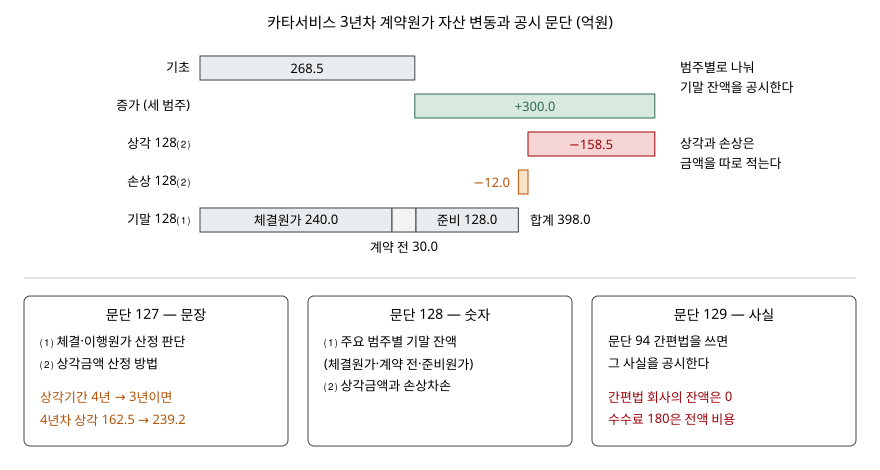

> 예제의 `카타서비스`·`타파서비스`와 그 숫자는 계산을 보이려고 만든 가상 자료다.

## 들어가며

구독형 서비스 회사 두 곳의 판매관리비를 비교하면, 한 회사는 영업 수수료 비용이 112억원이고 다른 회사는 180억원이다. 수수료 효율이 앞 회사가 낫다고 적기 쉽다. 그런데 두 회사가 그해 실제로 지급한 수수료는 둘 다 180억원이다. 앞 회사는 수수료를 자산으로 두고 4년에 걸쳐 상각하고, 뒤 회사는 지급할 때 바로 비용으로 처리했을 뿐이다.

이 차이는 손익계산서에서 보이지 않는다. 수익 주석의 계약원가 자산 공시를 봐야 보인다. 앞 회사는 범주별 잔액과 상각액을, 뒤 회사는 간편법을 썼다는 한 문장을 공시한다. 이 공시를 정한 것이 기업회계기준서 제1115호 문단 127~129다.

## 개념

고객과의 계약에서 생기는 원가 가운데 자산으로 둘 수 있는 것은 두 가지다. 계약을 체결하지 않았다면 들지 않았을 **계약체결 증분원가**(문단 91~94)와, 다른 기준서의 적용범위에 들지 않으면서 세 기준을 모두 충족하는 **계약이행원가**(문단 95)다. 세 기준은 계약이나 구체적으로 식별할 수 있는 예상 계약에 직접 관련될 것, 미래 수행의무를 이행할 자원을 창출하거나 가치를 높일 것, 회수될 것으로 예상될 것이다. 인식 조건은 [계약체결 증분원가 글](../2026-11-10-incremental-cost-of-obtaining-contract/index.md)에서, 손상 한도는 [계약원가 자산 손상 글](../2026-11-10-contract-cost-asset-impairment/index.md)에서 다뤘다.

이 글은 그 자산을 주석에서 어떻게 보여 주는지를 다룬다. 수익 공시 세 갈래 중 마지막으로, 같은 날 쓴 [유의적 판단 공시](../2026-11-21-revenue-significant-judgement-disclosure/index.md) 다음에 온다.

| 문단 | 형태 | 공시할 것 |
|---|---|---|
| 127⑴ | 문장 | 계약체결원가나 계약이행원가를 산정하면서 내린 판단 |
| 127⑵ | 문장 | 각 보고기간의 상각금액을 산정하는 데 쓴 방법 |
| 128⑴ | 숫자 | 자산의 기말 잔액을 주요 범주별로 구분한 금액(예: 계약체결원가, 계약 전 원가, 준비원가) |
| 128⑵ | 숫자 | 보고기간에 인식한 상각금액과 손상차손 |
| 129 | 사실 | 문단 63(유의적인 금융요소)이나 문단 94(계약체결 증분원가)의 실무적 간편법을 쓰기로 했다는 사실 |

기준서가 예로 드는 범주는 3가지다. **계약체결원가**는 영업 수수료처럼 계약을 따내는 데 든 증분원가, **계약 전 원가**는 아직 승인되지 않은 특정 계약을 위해 미리 들인 설계원가 같은 것(문단 95⑴의 예), **준비원가**는 계약 초기에 용역을 제공할 수 있게 시스템을 갖추는 데 든 원가다.

## 구조



> **출처**: 한국회계기준원 [기업회계기준서 제1115호 '고객과의 계약에서 생기는 수익'](https://www.samili.com/acc/Kijun/Kijunjomun.asp?code=1978-1115) 문단 94·99·100·127~129 (제3자 전재, 2021-04-23 개정) — 원문 발행처 [한국회계기준원](https://www.kasb.or.kr/front/board/ingAccountingList.do). 금액은 이 글의 `code/output.txt` `[1]`·`[3]`·`[4]`에서 옮겼다

위 막대가 문단 128이 요구하는 숫자이고, 아래 세 칸이 그 숫자를 읽는 데 필요한 문장이다. 숫자만 있으면 상각이 왜 그 크기인지 알 수 없고, 문장만 있으면 규모를 알 수 없다.

## 동작 원리

### 상각은 재화나 용역을 이전하는 방식을 따른다

문단 99는 계약원가 자산을 관련 재화나 용역을 고객에게 이전하는 방식과 일치하는 체계적 기준으로 상각하게 한다. 관련 용역에는 구체적으로 식별된 예상 계약, 즉 예상 갱신도 들어갈 수 있다. 그래서 1년 계약이라도 갱신 때 수수료를 다시 주지 않으면 상각기간이 예상 고객 유지 기간으로 길어진다. 문단 127⑵가 상각 방법을 문장으로 쓰게 하는 이유가 여기 있다. 상각기간이 3년인지 5년인지에 따라 같은 잔액에서 나오는 비용이 달라진다.

### 아직 시작하지 않은 계약의 원가는 상각하지 않는다

계약 전 원가는 관련 계약이 시작되어 용역 이전이 일어날 때부터 상각한다. 이전이 없는 동안에는 문단 99의 "이전하는 방식과 일치하는" 상각액이 0이다. 그래서 계약 전 원가가 큰 해에는 증가는 있는데 상각이 없어 잔액이 빠르게 늘어난다. 범주별로 잔액을 나누게 하는 128⑴은 이 차이를 보이게 한다.

### 상각기간 변경은 그해부터 반영한다

고객 이탈이 예상보다 빨라지는 것처럼 이전 시기에 유의적 변동이 생기면 상각 방식을 고치고, 이를 제1008호의 회계추정치 변경으로 처리한다(문단 100). 지난해 숫자는 고치지 않고, 남은 잔액을 남은 기간에 나눠 상각한다. 이 변경의 효과는 128⑵ 상각금액에 그대로 들어간다.

### 간편법을 쓰면 숫자 대신 문장 하나가 남는다

상각기간이 1년 이하면 계약체결 증분원가를 발생 시점에 비용으로 처리할 수 있다(문단 94). 이 간편법을 쓰면 자산이 생기지 않으므로 128의 숫자도 없다. 대신 문단 129가 간편법을 썼다는 사실을 공시하게 한다. 유의적인 금융요소를 1년 이하라는 이유로 조정하지 않는 간편법(문단 63, [유의적인 금융요소 글](../2026-11-14-significant-financing-component/index.md))도 같은 문단에서 공시한다.

## 실습 예제

```python
def straight_line_rollforward(costs, life, year):
    """year 해의 기초 잔액, 증가, 상각, 기말 잔액(손상 전)을 돌려준다."""
    opening = additions = amortization = 0.0
    for paid_year, cost in costs.items():
        annual = cost / life
        used_before = max(0, min(life, year - paid_year))
        if paid_year < year:
            opening += cost - annual * used_before
        elif paid_year == year:
            additions += cost
        if paid_year <= year and used_before < life:
            amortization += annual
    return opening, additions, amortization, opening + additions - amortization
```

전체 소스: [`code/`](code/)

가정은 다음과 같다(금액 단위 억원). 카타서비스는 신규 계약 때만 영업 수수료를 주고 고객이 평균 4년 머문다고 보아 수수료를 4년 정액 상각한다. 5년 계약의 준비원가는 5년 정액 상각한다. 1~3년차에 수수료 120·150·180, 준비원가 80·60·90을 자산으로 두었고, 3년차에는 4년차에 시작할 예상 계약의 설계원가 30을 계약 전 원가로 두었다. 3년차에 고객 한 곳의 남은 대가가 모자라 준비원가 12를 손상 처리했다.

```text
[1] 3년차 계약원가 자산 변동 — 문단 128⑴⑵
  범주                기초      증가      상각      손상      기말
  계약체결원가           172.5   180.0  -112.5     0.0   240.0
  계약 전 원가            0.0    30.0     0.0     0.0    30.0
  준비원가              96.0    90.0   -46.0   -12.0   128.0
  합계               268.5   300.0  -158.5   -12.0   398.0
  계약 전 원가는 관련 계약이 시작되지 않아 아직 상각하지 않는다 (문단 99)

[2] 공시만으로 거꾸로 읽는 상각 속도 — 평균 잔액 = 기초 + 증가 ÷ 2
  계약체결원가     상각  112.5 / 평균 잔액  262.5 = 42.9%
  준비원가       상각   46.0 / 평균 잔액  141.0 = 32.6%
```

계약체결원가는 상각액이 평균 잔액의 42.9%이고 준비원가는 32.6%다. 이 비율만 보면 수수료 쪽 상각이 빠르다는 것까지는 알지만, 그것이 4년 정액 때문인지 고객 이탈 때문인지는 127⑵ 문장을 읽어야 안다.

```text
[3] 4년차 계약체결원가 상각 — 상각기간 4년 → 3년 (문단 100)
  지출 연도   상각 대상 잔액  남은 기간(전)  상각(전)  남은 기간(후)  상각(후)
  1년차         30.0          1년      30.0           1년      30.0
  2년차         75.0          2년      37.5           1년      75.0
  3년차        135.0          3년      45.0           2년      67.5
  4년차        200.0          4년      50.0           3년      66.7
  합계                                       162.5                 239.2
  추정 변경으로 4년차 상각이 +76.7 늘었다 — 회계추정치의 변경, 소급하지 않는다
```

4년차에 고객 이탈이 빨라져 상각기간을 3년으로 줄이면 상각액이 162.5에서 239.2로 47% 늘어난다. 영업 수수료 지급액은 그대로인데 판매관리비가 늘어난 것처럼 보이는 해다. 이 해의 127⑵ 문장에는 상각기간이 바뀌었다는 설명이 들어간다.

```text
[4] 3년차에 영업 수수료 180을 지급한 두 회사 — 문단 94 간편법과 129 공시
  회사          3년차 수수료 비용  3년차 말 체결원가 잔액  129 공시
  카타서비스            112.5                240.0   간편법 미사용
  타파서비스            180.0                  0.0   간편법 사용 사실
  타파서비스는 계약이 1년이고 갱신 수수료를 다시 준다 — 상각기간 1년 이하
```

타파서비스는 갱신 때마다 수수료를 다시 주므로 처음 준 수수료가 관련되는 기간이 1년이고, 간편법을 쓸 수 있다. 같은 해 같은 금액을 지급했지만 비용은 112.5와 180.0, 잔액은 240.0과 0으로 갈린다. 타파서비스 주석에는 변동표가 없고 문단 129의 한 문장만 있다.

## 실무에서 주의할 점

- **판매관리비 속 수수료 비용을 비교하기 전에 129 문장을 찾는다.** 한 회사는 간편법으로 즉시 비용, 다른 회사는 자산화 후 상각이면 같은 지급액에서도 비용이 다르다. 성장기에는 자산화한 회사의 비용이 지급액보다 작게 나온다.
- **상각액이 갑자기 늘면 127⑵ 문장이 바뀌었는지 본다.** 상각기간을 줄이면 지급액 변화 없이 상각액이 늘어난다(문단 100). 가상 사례에서 47%가 늘었다. 이런 해에는 고객 유지 기간 가정이 왜 바뀌었는지가 핵심 정보다.
- **계약 전 원가가 쌓이면 회수 가능성을 같이 본다.** 계약 전 원가는 아직 승인되지 않은 예상 계약에 대한 것이라 계약이 성사되지 않으면 회수되지 않는다. 상각 없이 잔액만 늘어나는 범주라 128⑴에서 따로 보이게 한 것이다.
- **손상차손은 범주별 변동에서 따로 읽는다.** 128⑵는 상각과 손상을 나눠 공시하게 한다. 손상이 반복되면 계약 가격이 원가를 회수하지 못하는 고객군이 있다는 뜻일 수 있다. 손상 한도 계산은 [손상 글](../2026-11-10-contract-cost-asset-impairment/index.md)에서 봤다.
- **계약원가 자산과 계약자산을 혼동하지 않는다.** 계약자산은 이미 이행한 대가에 대한 권리로 수익 쪽 잔액이고(문단 105~107), 계약원가 자산은 원가를 미뤄 둔 것이다. 주석에서도 따로 공시된다.

## 정리

- 계약원가 자산을 둔 회사는 원가 산정 판단과 상각 방법을 문장으로(제1115호 문단 127), 범주별 기말 잔액과 상각·손상 금액을 숫자로(문단 128) 공시한다.
- 범주는 계약체결원가, 계약 전 원가, 준비원가 같은 것으로 나누며, 계약 전 원가는 관련 계약이 시작될 때까지 상각되지 않는다.
- 상각기간 변경은 회계추정치 변경으로 그해부터 반영되고(문단 100), 가상 사례에서 4년차 상각이 162.5에서 239.2로 늘었다.
- 문단 94 간편법을 쓰면 자산과 변동표가 없고 그 사실만 공시한다(문단 129). 수수료 비용을 비교하기 전에 이 문장부터 찾는다.

## 참고 자료

- [한국회계기준원](https://www.kasb.or.kr/front/board/ingAccountingList.do) — K-IFRS 기준서 발행처. 아래 전재 링크는 조문을 바로 열기 위한 편의 링크다
- [기업회계기준서 제1115호 '고객과의 계약에서 생기는 수익'](https://www.samili.com/acc/Kijun/Kijunjomun.asp?code=1978-1115) (제3자 전재, 2021-04-23 개정) — 문단 63, 91~100, 105~107, 127~129
- [IFRS 15 Revenue from Contracts with Customers](https://www.ifrs.org/issued-standards/list-of-standards/ifrs-15-revenue-from-contracts-with-customers/) — IFRS Foundation
- 숫자는 이 글의 [`code/output.txt`](code/output.txt) `[1]`~`[4]`에서 옮겼다
