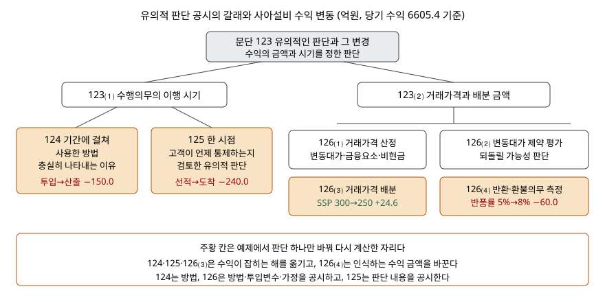

> 예제의 `사아설비`와 그 숫자는 계산을 보이려고 만든 가상 자료다.

## 들어가며

같은 업종의 두 회사 매출을 나란히 놓고 성장률을 비교하는 일이 많다. 한 회사는 매출이 8% 늘었고 다른 회사는 3% 늘었다. 그런데 두 회사가 설비 구축 계약의 진행률을 하나는 발생원가로, 다른 하나는 설치 대수로 잰다면 같은 공정 상태에서도 수익이 다르게 잡힌다. 아래 예제에서는 이 선택 하나로 한 계약의 당기 수익이 450과 300으로 갈린다.

이 차이를 매출 숫자만 보고 찾아내기는 어렵다. 회사가 어떤 방법과 가정을 썼는지는 수익 주석의 회계정책 문단에 적혀 있고, 무엇을 적어야 하는지를 정한 것이 기업회계기준서 제1115호 문단 123~126이다.

## 개념

수익 공시의 목적은 이용자가 수익과 현금흐름의 특성·금액·시기·불확실성을 이해하게 하는 것이다(제1115호 문단 110). 이를 위해 기준서는 세 가지를 공시하게 한다. 고객과의 계약(문단 113~122), 이 글이 다루는 **기준서를 적용하면서 내린 유의적인 판단과 그 판단의 변경**(문단 123~126), 그리고 계약원가 자산(문단 127~128)이다. 앞의 것은 어제 쓴 [수익의 구분 공시](../2026-11-20-revenue-disaggregation-disclosure/index.md)와 [계약 잔액 공시](../2026-11-20-contract-balance-remaining-obligation/index.md)에서, 뒤의 것은 같은 날 쓴 [계약원가 자산 공시](../2026-11-21-contract-cost-asset-disclosure/index.md)에서 다룬다.

문단 123은 수익의 **금액과 시기**를 정하는 데 유의적인 영향을 준 판단을 공시하라고 하면서, 특히 두 가지를 짚는다.

| 문단 | 판단 대상 | 공시할 것 |
|---|---|---|
| 123⑴·124 | 기간에 걸쳐 이행하는 수행의무 | 수익인식에 쓴 방법(산출법·투입법과 적용 방식), 그 방법이 이전을 충실히 나타내는 이유 |
| 123⑴·125 | 한 시점에 이행하는 수행의무 | 고객이 언제 통제하는지 검토하며 내린 유의적인 판단 |
| 123⑵·126⑴ | 거래가격 산정 | 변동대가 추정, 화폐의 시간가치 조정, 비현금 대가 측정에 쓴 방법·투입변수·가정 |
| 123⑵·126⑵ | 변동대가 제약 | 추정치가 제약되는지 평가한 방법·투입변수·가정 |
| 123⑵·126⑶ | 거래가격 배분 | 개별 판매가격 추정, 할인액·변동대가를 특정 부분에 배분한 방법 |
| 123⑵·126⑷ | 반환·환불 의무 | 반환의무, 환불의무 등 비슷한 의무의 측정 방법·가정 |

문단 126은 4가지 항목 각각에 대해 "사용한 방법, 투입변수와 가정"을 요구한다. 124는 방법과 그 이유를, 125는 판단 내용을 요구한다. 공시하는 것이 숫자가 아니라 문장이라는 점이 앞의 계약 잔액 공시와 다르다.

## 구조



> **출처**: 한국회계기준원 [기업회계기준서 제1115호 '고객과의 계약에서 생기는 수익'](https://www.samili.com/acc/Kijun/Kijunjomun.asp?code=1978-1115) 문단 123~126 (제3자 전재, 2021-04-23 개정) — 원문 발행처 [한국회계기준원](https://www.kasb.or.kr/front/board/ingAccountingList.do). 금액은 이 글의 `code/output.txt` `[5]`에서 옮겼다

나무의 왼쪽은 **언제** 수익이 되는지를, 오른쪽은 **얼마가** 수익이 되는지를 정하는 판단이다. 왼쪽 판단이 달라지면 수익이 다른 해로 옮겨 가고, 오른쪽 판단은 수익 금액과 수행의무 사이의 배분을 바꾼다.

## 동작 원리

### 기간에 걸친 이행: 방법을 정하는 것 자체가 판단이다

수행의무를 기간에 걸쳐 이행한다고 판단했다면([세 기준 글](../2026-11-18-over-time-criteria-payment-right/index.md)), 다음은 진행률을 무엇으로 잴지다. 기준서는 산출법과 투입법을 모두 허용하고, 재화나 용역의 이전을 충실히 나타내는 방법을 고르게 한다. 그래서 문단 124는 방법만이 아니라 **그 방법이 이전을 충실히 나타내는 이유**까지 쓰게 한다. 발생원가 투입법은 원가가 앞에 몰리면 진행률이 실제 공정보다 앞서 나간다. 미설치 자재 원가를 진행률에서 빼는 조정은 [산출법·미설치 자재 글](../2026-11-17-output-method-uninstalled-materials/index.md)에서, 추정 총원가가 바뀔 때의 누적 조정은 [원가기준 진행률 글](../2026-11-08-cost-to-cost-progress-estimate-change/index.md)에서 다뤘다.

### 한 시점 이행: 통제가 넘어가는 날을 고르는 판단

한 시점에 이행하는 수행의무는 고객이 자산을 통제하는 시점에 수익이 된다. 통제 이전의 지표(문단 38)는 지급청구권, 법적 소유권, 물리적 점유, 소유에 따른 위험과 보상, 고객의 인수 5가지다. 연말에 선적하고 연초에 도착하는 물량처럼 지표가 서로 다른 날을 가리키면 어느 날을 이전 시점으로 보는지가 판단이 되고, 문단 125가 그 판단을 공시하게 한다. 인수 조항이 이 판단에 미치는 영향은 [고객의 인수 조항 글](../2026-11-18-customer-acceptance-clause-timing/index.md)에서 봤다.

### 거래가격과 배분: 추정치가 곧 수익 금액이 된다

반품률, 변동대가 기댓값, 개별 판매가격은 모두 추정치다. 반품률은 [반품권 판매 글](../2026-11-08-sales-with-right-of-return/index.md)에서 본 것처럼 수익과 환불부채를 직접 나누고, 개별 판매가격 추정은 [거래가격 배분 글](../2026-11-16-transaction-price-allocation-discount/index.md)에서 본 것처럼 묶음 가격을 수행의무 사이에 나눈다. 이 추정에 무엇을 넣었는지가 문단 126의 "투입변수와 가정"이다.

### 판단의 변경도 공시 대상이다

문단 123은 판단뿐 아니라 **판단의 변경**도 공시하게 한다. 진행률 방법이나 반품률 가정을 바꾸면 그 효과가 바꾼 해의 수익에 들어간다. 전년과 같은 문장이 그대로 반복되는지, 문장이 바뀌었는지를 비교하는 것만으로도 수익이 움직인 이유 하나를 찾을 수 있다.

## 실습 예제

```python
def build_revenue(method):
    if method == "투입법(발생원가)":
        progress = BUILD_COST_TO_DATE / BUILD_TOTAL_COST
    else:
        progress = UNITS_INSTALLED / UNITS_TOTAL
    return progress, BUILD_PRICE * progress

def return_sale(return_rate):
    revenue = RETURN_SALES * (1 - return_rate)
    refund_liability = RETURN_SALES * return_rate
    return_asset = RETURN_SALES * COST_RATIO * return_rate
    cost_of_sales = RETURN_SALES * COST_RATIO - return_asset
    return revenue, refund_liability, return_asset, revenue - cost_of_sales
```

전체 소스: [`code/`](code/)

가정은 다음과 같다(금액 단위 억원). 사아설비는 설비 구축 계약 1건, 연말 수출 1건, 반품권이 있는 소매 판매, 장비와 3년 유지보수 묶음 판매를 한다. 판단이 개입하지 않는 나머지 수익은 3,000이다. 각 계산에서 **판단 하나만 바꾸고 나머지는 그대로 둔다.**

```text
[1] 진행률 방법 — 문단 124 (거래가격 1000, 추정 총원가 800)
  투입법(발생원가)      진행률  45.0%  당기 수익   450.0
  산출법(설치 대수)     진행률  30.0%  당기 수익   300.0
  발생원가 360 / 800, 설치 3 / 10대

[2] 통제 이전 시점 — 문단 125 (12월 28일 선적 240, 1월 5일 도착)
  통제 이전 선적 시점  당기 수익   240.0
  통제 이전 도착 시점  당기 수익     0.0
```

설비 계약은 자재를 먼저 사들여 원가가 45% 들어갔지만 설치는 10대 중 3대만 끝났다. 어느 쪽이 이전을 충실히 나타내는지가 문단 124의 "이유"에 해당한다. 수출 물량 240은 통제 이전 시점 판단에 따라 올해 수익이 되거나 전부 내년으로 넘어간다.

```text
[3] 반품률 가정 — 문단 126⑴⑵⑷ (판매 2000, 원가율 60%)
  반품률   수익   환불부채  반환재고 회수권  매출총이익
     5%  1900.0    100.0         60.0      760.0
     8%  1840.0    160.0         96.0      736.0

[4] 유지보수 개별 판매가격 추정 — 문단 126⑶ (묶음 1200, 장비 1000)
  추정 방법              유지보수 SSP  장비 배분  유지보수 배분  당기 수익
  관측 가능한 단독 판매가격         300      923.1        276.9    1015.4
  예상원가 + 이윤              250      960.0        240.0    1040.0
```

반품률을 3%p 올리면 수익이 60 줄고 환불부채가 60 늘어난다. 매출총이익은 24만 줄어드는데, 돌려받을 재고에 대한 회수권 36이 매출원가를 같이 줄이기 때문이다. 유지보수의 개별 판매가격을 낮게 추정하면 묶음 가격 중 더 많은 몫이 인도 시점에 수익이 되는 장비로 가서 당기 수익이 24.6 늘어난다. 3년 전체 수익 합계 1,200은 같고 해마다 나뉘는 몫만 달라진다.

```text
[5] 판단 하나만 바꿨을 때 당기 수익 — 회사가 택한 판단의 수익 6605.4
  124 진행률: 투입법 → 산출법               -150.0  (-2.27%)
  125 통제 이전: 선적 → 도착               -240.0  (-3.63%)
  126 반품률: 5% → 8%                  -60.0  (-0.91%)
  126 SSP: 관측 300 → 원가+이윤 250       +24.6  (+0.37%)
  가장 큰 변동: 125 통제 이전: 선적 → 도착
```

네 판단 중 어느 하나만 달라져도 회사 전체 수익이 0.37%에서 3.63%까지 움직인다. 들어가며에서 본 두 회사의 성장률 차이 5%p와 견주면 무시할 수 있는 크기가 아니다.

## 실무에서 주의할 점

- **회계정책 문장을 매출 성장률보다 먼저 읽는다.** 두 회사의 매출을 비교하기 전에 진행률 방법(문단 124)과 통제 이전 시점 판단(문단 125)이 같은지 확인한다. 방법이 다르면 같은 공정 상태에서도 수익이 다르게 잡히므로 성장률 차이의 일부가 방법 차이일 수 있다.
- **전년 주석과 문장을 비교한다.** 문단 123은 판단의 변경을 공시하게 한다. 반품률 가정이나 진행률 방법을 바꾼 해에는 그 효과가 그해 수익에 들어 있다. 문장이 바뀐 해의 수익 변동은 영업 성과와 추정 변경을 나눠서 본다.
- **투입법이면 원가가 앞에 몰리는 구조인지 본다.** 발생원가 투입법은 자재 선구매가 많은 계약에서 진행률을 앞당긴다. 문단 124⑵가 요구하는 "충실히 나타내는 이유"가 구체적인지, 미설치 자재를 진행률에서 빼는지가 주석에 적혀 있는지 확인한다.
- **개별 판매가격 추정은 수익의 시기를 옮긴다.** 묶음 판매에서 먼저 이행하는 수행의무에 배분이 많이 갈수록 당기 수익이 커진다. 추정 방법이 관측 가격인지, 예상원가 이윤 가산인지, 잔여접근법인지를 126⑶ 공시에서 확인한다.
- **반품률은 수익과 부채를 같이 움직인다.** 환불부채 잔액이 매출보다 빠르게 늘면 반품률 가정이 올라간 것인지, 실제 반품이 늘어난 것인지 126⑷ 설명으로 구분한다.

## 정리

- 제1115호 문단 123은 수익의 금액과 시기를 정하는 데 유의적인 판단과 그 판단의 변경을 공시하게 한다.
- 이행 시기 쪽은 기간에 걸친 이행의 방법과 이유(문단 124), 한 시점 이행의 통제 이전 판단(문단 125)을 공시한다.
- 거래가격 쪽은 산정·제약·배분·반환의무 측정 4가지에 쓴 방법·투입변수·가정을 공시한다(문단 126).
- 가상 사례에서 판단 하나만 바꿔도 당기 수익이 −3.63%~+0.37% 움직였다. 매출을 비교하기 전에 이 문장들을 먼저 맞춰 본다.

## 참고 자료

- [한국회계기준원](https://www.kasb.or.kr/front/board/ingAccountingList.do) — K-IFRS 기준서 발행처. 아래 전재 링크는 조문을 바로 열기 위한 편의 링크다
- [기업회계기준서 제1115호 '고객과의 계약에서 생기는 수익'](https://www.samili.com/acc/Kijun/Kijunjomun.asp?code=1978-1115) (제3자 전재, 2021-04-23 개정) — 문단 38, 110, 113, 123~126
- [IFRS 15 Revenue from Contracts with Customers](https://www.ifrs.org/issued-standards/list-of-standards/ifrs-15-revenue-from-contracts-with-customers/) — IFRS Foundation
- 숫자는 이 글의 [`code/output.txt`](code/output.txt) `[1]`~`[5]`에서 옮겼다
