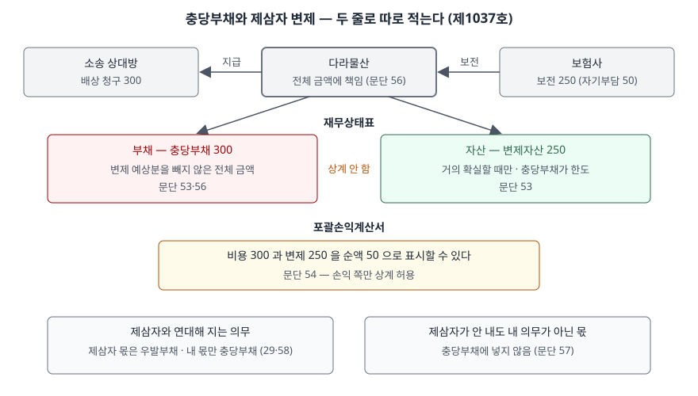

> 예제의 `다라물산`과 그 숫자는 계산을 보이려고 만든 가상 자료다. 단위는 억원이다.

## 들어가며

제조사가 제품 결함 소송에 걸렸다는 소식 뒤에는 "보험으로 대부분 보전된다"는 회사 설명이 붙는 경우가 많다. 그 말을 들으면 재무상태표에도 보험사가 내지 않는 자기부담금만 부채로 남아 있으리라고 생각하기 쉽다. 그런데 실제 재무제표를 열면 배상 예상액 전부가 충당부채로 잡혀 있고, 자산 쪽 어딘가에 보험금 받을 몫이 따로 있거나 아예 없다. 아래 예제의 다라물산은 배상액 300억원 가운데 250억원을 보험으로 돌려받을 수 있지만, 충당부채는 어느 경우에도 300억원이고, 그 때문에 부채비율이 순액으로 셀 때의 85%가 아니라 110%로 나온다.

## 개념

기업회계기준서 제1037호는 충당부채를 결제하는 데 필요한 지출의 일부나 전부를 제삼자가 대신 내 줄 것으로 예상되는 경우를 **변제**라고 부르고 따로 다룬다(문단 53~58). 보험약정이나 보증계약에 따라 제삼자가 기업이 낸 돈을 보전하거나, 기업이 낼 돈을 직접 지급하는 경우다(문단 55).

| 규정 | 내용 | 문단 |
|---|---|---|
| 별도 자산 | 기업이 의무를 이행하면 변제받을 것이 **거의 확실**할 때만 변제금액을 별도의 자산으로 인식한다 | 53 |
| 한도 | 자산으로 인식하는 금액은 관련 충당부채 금액을 넘을 수 없다 | 53 |
| 손익 표시 | 충당부채 관련 비용은 변제로 인식한 금액과 상계해 표시할 수 있다 | 54 |
| 전액 책임 | 제삼자가 못 내면 기업이 전액을 내야 하는 경우가 대부분이므로 전체 의무 금액을 충당부채로 인식한다 | 56 |
| 범위 밖 | 제삼자가 안 내도 기업이 낼 의무가 없는 금액은 충당부채에 넣지 않는다 | 57 |
| 연대 | 제삼자와 연대해 지는 의무는 제삼자가 이행할 것으로 예상되는 부분을 우발부채로 처리한다 | 29·58 |

## 구조



> **출처**: 한국회계기준원 [기업회계기준서 제1037호 '충당부채, 우발부채 및 우발자산'](https://www.samili.com/acc/Kijun/Kijunjomun.asp?code=1978-1037) 문단 29·53~58 (제3자 전재, 2021-04-23 개정) — 원문 발행처 [한국회계기준원](https://www.kasb.or.kr/front/board/ingAccountingList.do)

소송 상대방에 대한 의무와 보험사에 대한 권리는 **상대방이 다른 두 계약**이다. 그래서 재무상태표에는 두 줄로 따로 적히고, 손익계산서에서만 한 줄로 합쳐 보여 줄 수 있다.

## 동작 원리

### 부채를 줄이지 않는 이유

다라물산이 배상할 상대는 소송 상대방이고, 보험사는 다라물산이 낸 돈을 나중에 메워 줄 뿐이다. 보험사가 파산하거나 면책을 주장하면 다라물산은 300억원을 모두 내야 한다. 기준서가 전체 의무 금액을 충당부채로 인식하게 한 이유다(문단 56). 부채는 다라물산이 갚아야 할 금액을 보여 주는 숫자이고, 보험금은 다른 상대에게서 받을 권리이므로 그 금액에서 빼지 않는다.

### 자산은 더 엄격한 문턱을 넘어야 한다

충당부채는 유출 가능성이 높으면(50% 초과) 인식하지만, 변제자산은 **거의 확실**해야 인식한다(문단 53). 받을 수도 있는 돈을 미리 장부에 올리지 않는 우발자산의 원칙(문단 31·33)과 같은 쪽에 서 있다. 보험사가 면책 사유를 검토하고 있으면 보상 가능성이 높아도 자산으로 잡지 않고, 유입 가능성이 높으면 주석에 공시할 수 있을 뿐이다(문단 34).

### 손익은 합칠 수 있다

재무상태표에서는 상계하지 않지만, 포괄손익계산서에서는 충당부채 비용과 변제 금액을 상계해 순액으로 표시할 수 있다(문단 54). 그래서 손익계산서에는 50억원만 보이는데 재무상태표에는 300억원 부채와 250억원 자산이 함께 보이는 일이 생긴다.

### 나눠 지는 의무

공동수급처럼 제삼자와 연대해 의무를 지면, 전체 의무 가운데 제삼자가 이행할 것으로 예상되는 부분은 우발부채로 공시하고 내 몫 중 유출 가능성이 높은 부분만 충당부채로 잡는다(문단 29). 우발부채는 계속 평가해서 유출 가능성이 높아지면 그 기간에 충당부채로 바꾼다(문단 30).

## 실습 예제

```python
def reimbursement_asset(expected, provision, virtually_certain):
    if not virtually_certain:          # 문단 53 — 거의 확실할 때만
        return 0.0
    return min(expected, provision)    # 문단 53 — 충당부채가 한도
```

전체 소스: [`code/`](code/) · 수행 기록: [`code/output.txt`](code/output.txt)

```text
[1] 보험사 확인 여부에 따른 2026 말 처리 (문단 53·54)
  상태                            충당부채     변제자산    총액 비용    순액 비용
  보험사가 보상 확인서 발급               300.0    250.0    300.0     50.0
  보험사가 면책 사유 검토 중              300.0      0.0    300.0    300.0
  충당부채는 어느 경우에도 300 — 변제는 부채를 줄이지 않는다 (문단 56)
  손익계산서는 변제수익과 상계한 순액 표시를 허용한다 (문단 54)

[2] 돌려받을 금액이 충당부채보다 크면 — 자산은 충당부채가 한도 (문단 53)
  예상 변제  250.0 → 변제자산  250.0  (넘는 0.0 은 자산으로 잡지 않음)
  예상 변제  300.0 → 변제자산  300.0  (넘는 0.0 은 자산으로 잡지 않음)
  예상 변제  340.0 → 변제자산  300.0  (넘는 40.0 은 자산으로 잡지 않음)
```

`[1]`에서 두 경우의 충당부채는 같고 변제자산만 다르다. 보험사의 확인서 한 장이 2026년 순액 비용을 50억원과 300억원으로 가른다. `[2]`는 보험과 납품업체 구상권을 합쳐 받을 몫이 배상액보다 큰 경우를 가정했다. 넘는 40억원은 의무를 이행하는 데 드는 돈을 메우는 몫이 아니므로 자산이 되지 않는다.

```text
[3] 보험사 확인이 1년 늦어지면 — 같은 사건, 손익이 나뉘는 해 (문단 53)
  경우                    2026    2027    2028      합계
  2026 확인              -50.0     0.0     0.0   -50.0
  2027 확인             -300.0   250.0     0.0   -50.0
  2028 에 배상 300 을 내고 보험금 250 을 받으면 손익 영향은 없다 — 잔액만 정리된다
```

합계는 −50억원으로 같다. 확인이 늦어지면 2026년에 300억원 손실이 잡히고 2027년에 250억원 이익이 들어온다. 2027년의 이익은 그해 영업과 무관하다.

```text
[4] 총액 표시와 순액 표시의 부채비율 (다라물산 자본 1,000, 다른 부채 800)
  총액(기준서): 부채 1,100.0 / 자본 1,000.0 = 110%  · 변제자산 250.0 은 자산 쪽
  순액(허용 안 됨): 부채 850.0 / 자본 1,000.0 = 85%
  자본은 같다 — 자산과 부채 양쪽에서 같은 250 을 빼느냐 마느냐의 차이다

[5] 제삼자와 나눠 지는 의무 (문단 29·57·58)
  연대채무 500.0, 공동수급사 부담 예상 60% → 충당부채 200.0 / 우발부채 공시 300.0
  공동수급사 부담 예상이 20% 로 낮아지면 → 충당부채 400.0 (추가 200.0, 문단 30)
  하도급사만 지급 의무를 지고 다라물산은 지급 의무가 없는 몫 → 충당부채에 넣지 않음 (문단 57)
```

`[4]`의 순액 줄은 비교를 위해 계산한 것이고 기준서가 허용하는 표시가 아니다. 같은 회사가 표시 방식 하나로 부채비율이 25%포인트 달라진다. `[5]`는 공동수급사의 재무 상태가 나빠져 부담 예상이 줄어든 경우를 가정했다. 사건은 그대로인데 상대방 사정만으로 충당부채가 두 배가 된다.

## 실무에서 주의할 점

- **부채비율을 비교할 때 변제자산을 확인한다.** [4]처럼 보험으로 대부분 메워지는 큰 소송이 있는 회사는 부채비율이 높게 나온다. 기준서는 충당부채 유형별로 제삼자의 변제예상금액과 그에 관해 인식한 자산 금액을 공시하게 하므로(문단 85⑶), 주석에서 그 금액을 찾아 함께 본다. [안정성 비율 글](../../ratios/2026-10-01-leverage-and-current-ratio/index.md)의 부채비율을 그대로 비교하면 이 차이가 가려진다.
- **손익계산서 숫자만 보면 의무의 크기를 놓친다.** 순액 표시를 택한 회사는 비용이 50억원으로 보이지만 실제 의무는 300억원이고, 보험사 쪽 위험이 그 차이만큼 남아 있다.
- **변제 확정이 늦은 해에는 이익이 크게 튄다.** [3]의 2027년처럼 보험금 확인이 다음 해로 넘어가면 그해 이익이 영업과 무관하게 커진다. [충당부채 글](../2026-10-10-provisions-and-contingent-liabilities/index.md)에서 본 환입과 같은 방향으로 이익을 움직이므로, 충당부채 변동표와 변제자산 변동을 나란히 놓고 읽는다.
- **연대채무는 상대방의 재무 상태가 내 부채를 바꾼다.** [5]처럼 공동수급사가 어려워지면 내 충당부채가 늘어난다. 공동수급 비중이 큰 건설사는 우발부채 주석의 연대채무 금액이 충당부채로 넘어올 수 있는 금액이다.
- **변제는 충당부채 측정을 줄이는 수단이 아니다.** [구조조정 충당부채 글](../2026-11-22-restructuring-provision-direct-costs/index.md)의 예상 처분이익(문단 51·83)처럼, 기준서는 받을 돈으로 낼 돈을 줄여 잡는 것을 일관되게 막는다.

## 정리

- 제삼자가 대신 내 줄 금액은 충당부채에서 빼지 않고, 변제받을 것이 거의 확실할 때만 별도 자산으로 인식한다(문단 53·56).
- 변제자산은 충당부채를 넘을 수 없고, 손익계산서에서만 비용과 상계해 순액 표시를 할 수 있다(문단 53·54).
- 제삼자가 안 내도 내 의무가 아닌 몫은 충당부채가 아니고, 연대채무에서 제삼자 몫은 우발부채로 공시한다(문단 29·57·58).
- 가상 사례에서 다라물산은 배상액 300억원을 전액 부채로 두어 부채비율이 110%로 나오고, 보험사 확인이 늦어지면 손익이 두 해로 나뉜다.

## 참고 자료

- [한국회계기준원](https://www.kasb.or.kr/front/board/ingAccountingList.do) — K-IFRS 기준서 발행처. 아래 전재 링크는 조문을 바로 열기 위한 편의 링크다
- [기업회계기준서 제1037호 '충당부채, 우발부채 및 우발자산'](https://www.samili.com/acc/Kijun/Kijunjomun.asp?code=1978-1037) (제3자 전재, 2021-04-23 개정) — 문단 29·30 연대채무와 우발부채 재평가, 31·33·34 우발자산, 36 최선의 추정치, 51 예상되는 자산 처분, 53~58 변제, 85 공시
- [IAS 37 Provisions, Contingent Liabilities and Contingent Assets](https://www.ifrs.org/issued-standards/list-of-standards/ias-37-provisions-contingent-liabilities-and-contingent-assets/) — IFRS Foundation
- 숫자는 이 글의 [`code/output.txt`](code/output.txt) `[1]`~`[5]`에서 옮겼다
