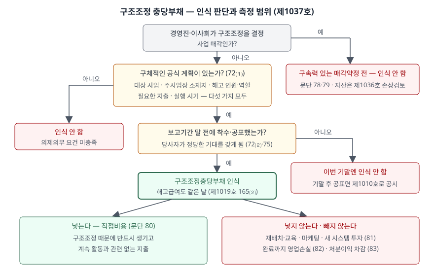

> 예제의 `가나전자`와 그 숫자는 계산을 보이려고 만든 가상 자료다. 단위는 억원이다.

## 들어가며

연말에 어느 회사가 공장 한 곳을 닫기로 했다는 기사가 나오면, 그해 실적에 폐쇄 비용이 얼마나 들어갈지부터 궁금해진다. 보도자료에는 "구조조정 비용 약 85억원" 같은 숫자가 함께 나오는 경우가 많고, 많은 사람이 그 숫자가 그해 손익계산서에 한꺼번에 잡힐 것이라고 본다. 그런데 막상 연간 실적을 열어 보면 그해 비용은 0이거나 85억원보다 훨씬 작고, 나머지는 다음 해 여러 줄에 흩어져 나온다. 아래 예제에서 가나전자는 같은 계획을 두고 기말까지 무엇을 했느냐에 따라 그해 충당부채가 0이 되기도 하고 56억원이 되기도 한다. 85억원 가운데 29억원은 어느 경우에도 충당부채에 들어가지 않는다.

## 개념

기업회계기준서 제1037호는 **구조조정**을 경영진의 계획과 통제에 따라 기업의 사업범위나 사업수행방식을 중요하게 바꾸는 일련의 절차로 정의한다(문단 10). 일부 사업의 매각·폐쇄, 사업장 이전, 경영 계층 축소, 사업구조의 근본적 변경이 그 예다(문단 70).

구조조정이라고 해서 따로 정한 인식 기준이 있는 것은 아니다. 충당부채 일반 요건(문단 14)을 모두 충족할 때만 인식하고(문단 71), 문단 72~83은 그 요건이 구조조정에 어떻게 적용되는지를 풀어 쓴 것이다. 핵심은 **의제의무**다. 법률이나 계약이 아니라 기업의 행위로 생기는 의무로, 기업이 책임을 부담하겠다고 상대방에게 표명하고 그 결과 상대방이 이행을 정당하게 기대하게 되었을 때 생긴다(문단 10). 공장을 닫으라는 법은 없으므로, 구조조정 충당부채는 거의 언제나 이 의제의무에서 나온다.

| 요건 | 내용 | 문단 |
|---|---|---|
| 구체적인 공식 계획 | 대상 사업, 주사업장 소재지, 해고 보상 대상 종업원의 근무지·역할·대략적 인원, 필요한 지출, 실행 시기를 모두 확인할 수 있다 | 72⑴ |
| 정당한 기대 | 실행에 착수했거나 주요 내용을 공표해 영향을 받을 당사자가 실행을 정당하게 기대한다 | 72⑵·73 |
| 시점 | 위 착수·공표가 보고기간 말 전에 있어야 한다 | 75 |

## 구조



> **출처**: 한국회계기준원 [기업회계기준서 제1037호 '충당부채, 우발부채 및 우발자산'](https://www.samili.com/acc/Kijun/Kijunjomun.asp?code=1978-1037) 문단 10·70~83 (제3자 전재, 2021-04-23 개정), [기업회계기준서 제1019호 '종업원급여'](https://www.samili.com/acc/Kijun/Kijunjomun.asp?code=1978-1019) 문단 165 (제3자 전재) — 원문 발행처 [한국회계기준원](https://www.kasb.or.kr/front/board/ingAccountingList.do)

위쪽 세 갈림길이 **인식 여부**를, 아래 두 상자가 **측정 범위**를 정한다. 인식 판단을 통과해도 계획서의 모든 비용이 들어가지는 않는다.

## 동작 원리

### 결의만으로는 의무가 생기지 않는다

의제의무는 경영진의 결정만으로 생기지 않는다(문단 76). 이사회가 결의했더라도 그 내용이 외부에 알려지지 않았으면 회사는 아직 결정을 거둘 수 있고, 거둘 수 있는 결정은 의무가 아니다. 그래서 보고기간 말 전에 계획의 착수나 충분히 구체적인 공표 중 하나가 없으면 기말에 의제의무가 없는 것으로 본다(문단 75). 기말 뒤에 공표했다면 중요한 경우 제1010호 보고기간후사건으로 공시한다.

공표도 아무 공표나 되는 것이 아니다. 가능한 한 빨리 착수하고, 계획이 유의적으로 바뀔 여지가 없을 만큼 빨리 끝나도록 짜여 있어야 한다(문단 74). 착수가 크게 늦어지거나 비합리적으로 오래 걸릴 계획이면 정당한 기대가 생겼다고 보지 않는다.

### 매각은 약정이 기준이다

사업 매각은 결정을 공표해도 구속력 있는 매각약정을 맺기 전까지는 의무가 없다(문단 78·79). 원매자가 나타나지 않으면 다른 방안을 찾을 수 있기 때문이다. 대신 그 사업의 자산은 제1036호에 따라 손상 여부를 검토한다.

### 해고급여는 같은 날을 쓴다

해고급여는 제1019호가 다루지만 인식 시점을 제1037호와 맞춰 두었다. 해고급여 제안을 더는 철회할 수 없을 때와 해고급여를 포함한 구조조정 원가를 제1037호로 인식할 때 중 이른 날에 부채와 비용을 잡는다(제1019호 문단 165). 회사가 해고를 결정하는 경우 철회할 수 없는 시점은 인원·직무·근무 장소·완성 예상일과 받을 급여를 산정할 수 있을 만큼 상세한 해고계획을 대상 종업원에게 전달한 때다(문단 167).

### 직접비용만 넣는다

충당부채에 넣는 지출은 구조조정 때문에 반드시 생기고, 기업의 계속적인 활동과 관련 없는 직접비용뿐이다(문단 80). 계속 근무할 종업원의 재배치·교육, 마케팅, 새 제도·물류체제 투자는 미래 영업과 관련되므로 넣지 않는다(문단 81). 구조조정을 마칠 때까지 예상되는 영업손실도 넣지 않는다(문단 82). 반대로 설비를 팔아 이익이 예상되더라도 그만큼 충당부채를 줄이지 않는다(문단 83·51). 처분이익은 실제로 처분할 때 그 자산의 기준서에 따라 인식한다(문단 52).

## 실습 예제

```python
def judge(s):
    if s.is_sale:
        return "인식" if s.binding_sale_date <= REPORTING_DATE else "인식 안 함"
    if not s.detailed_plan:                        # 72⑴
        return "인식 안 함"
    if s.started_or_announced <= REPORTING_DATE:   # 72⑵·75
        return "인식"
    return "인식 안 함"
```

위는 판정 함수를 줄여 보인 것이다. 전체 소스: [`code/`](code/) · 수행 기록: [`code/output.txt`](code/output.txt)

```text
[1] 계획서의 비용 가운데 충당부채에 들어가는 것 (문단 80~83)
  항목                           금액  포함    근거
  해고급여(기업 요청 해고 추가분)         42.0  O     80 직접비용 / 1019호 165⑵
  원재료 장기공급계약 해지 위약금           8.0  O     80 직접비용
  설비 철거·폐기물 처리                6.0  O     80 직접비용
  계속 근무 직원 재배치·교육             5.0  X     81⑴ 미래 영업 관련
  다른 공장 제품 마케팅                3.0  X     81⑵ 미래 영업 관련
  새 물류 시스템 구축                12.0  X     81⑶ 미래 영업 관련
  폐쇄일까지 예상 영업손실               9.0  X     82 예상 영업손실
  설비 매각 예상 이익 4.0 — 차감하지 않음 (51·83)
  계획서 비용 합계 85.0 / 구조조정충당부채 56.0 / 빠진 금액 29.0
```

보도자료의 85억원과 충당부채 56억원의 차이 29억원은 전부 문단 81·82가 막은 항목이다. 해고급여는 기업 요청으로 해고할 때 더 주는 부분만 해고급여이고, 원래 받을 퇴직급여는 퇴직급여로 남는다(제1019호 문단 160). 예제의 42억원은 그 추가분이라고 가정했다.

```text
[2] 같은 계획, 보고기간 말(2026-12-31)까지 일어난 일만 다른 네 경우 (문단 72~79)
  경우                                    판정        2026 비용  근거
  A 12-10 이사회 결의만, 공표는 01-15            인식 안 함        0.0  75 기말 후 공표 — 1010호에 따라 공시
  B 12-10 결의, 12-20 노조·직원에 세부 계획 통보     인식           56.0  72⑵ 공표로 정당한 기대 형성
  C 12-20 공표했으나 인원·지출이 계획서에 없음          인식 안 함        0.0  72⑴ 구체적 공식 계획 요건 미충족
  D 12-20 사업 매각 공표, 매각약정은 03-02         인식 안 함        0.0  78·79 매각약정 전 — 자산은 1036호 손상검토
  A·C·D 는 계획 비용이 그대로여도 2026 년 부채가 0 이다
```

A와 B는 결의 날짜가 같고 공표 날짜만 열이틀 사이로 기말을 넘는지가 다르다. 그 차이로 2026년 비용이 0과 56억원으로 갈린다. C는 기말 전에 공표했지만 계획서에 인원과 지출이 없어 정당한 기대가 생길 만큼 구체적이지 않다.

```text
[3] 경우 B 의 두 해 — 충당부채 변동과 손익 (문단 59·61·81·82·52)
  2026 말 설정 56.0 → 2027 사용 54.0 (해고급여 실제 40.0) → 환입 2.0 → 2027 말 잔액 0.0
  연도         구조조정 비용      환입      제외 항목 비용      처분이익      손익 영향 합계
  2026         -56.0     0.0           0.0       0.0         -56.0
  2027           0.0     2.0         -17.0       4.0         -11.0
  새 물류 시스템 12.0 은 2027 년 자산으로 잡고 이후 상각한다고 가정
  2026 년에는 직접비용만, 나머지는 생기는 해에 따로 들어온다
```

2027년에는 충당부채를 원래 목적에만 쓰고(문단 61), 해고급여가 2억원 적게 나간 만큼 환입한다(문단 59). 충당부채에서 빠진 재배치·마케팅·영업손실 17억원은 생기는 대로 비용이 되고, 처분이익 4억원은 실제로 팔 때 들어온다. 그래서 2027년에도 구조조정과 관련된 손익이 −11억원 남는다. 새 물류 시스템이 자산 요건을 충족한다는 것은 예제의 가정이다.

## 실무에서 주의할 점

- **보도자료의 구조조정 비용과 충당부채를 같은 숫자로 읽지 않는다.** 경영진이 말하는 비용에는 재배치·마케팅·영업손실이 섞이는 경우가 많다. 충당부채 변동표(제1037호 문단 84)의 설정액과 비교하면 어디까지가 직접비용인지 드러난다.
- **기말 직후 공표된 구조조정은 다음 해 실적에 들어간다.** 경우 A처럼 결의가 기말 전이어도 공표가 기말 뒤면 그해 부채는 0이다. 재무제표 주석의 보고기간후사건을 함께 본다.
- **구조조정 다음 해의 이익에도 구조조정 손익이 섞인다.** 환입과 처분이익은 이익을 키우고 제외 항목은 줄인다. [3]의 2027년 −11억원은 영업 성과와 따로 떼어 읽어야 한다. 환입이 큰 해의 이익률 해석은 [충당부채 글](../2026-10-10-provisions-and-contingent-liabilities/index.md)에서 다룬 추정 변경과 같은 문제다.
- **매각과 폐쇄가 섞인 계획은 부분별로 판단한다.** 매각 부분은 약정 전까지 의무가 없지만, 같은 구조조정의 다른 부분은 그 전에 의제의무가 생길 수 있다(문단 79).
- **예상 영업손실 가운데 손실부담계약은 예외다.** 문단 82는 손실부담계약과 관련된 예상 영업손실은 충당부채로 인식한다고 덧붙인다. 폐쇄할 공장에 묶인 공급계약이 있다면 [손실부담계약 글](../2026-11-08-onerous-contract-provision/index.md)의 판정을 따로 거친다.

## 정리

- 구조조정 충당부채는 일반 인식 요건을 그대로 따르고, 의무는 대부분 의제의무에서 나온다(문단 10·71).
- 다섯 항목이 담긴 공식 계획과, 보고기간 말 전의 착수·공표가 모두 있어야 인식한다. 결의만으로는 부족하고, 매각은 구속력 있는 약정이 기준이다(문단 72·75·78).
- 넣는 것은 구조조정 때문에 반드시 생기고 계속 활동과 무관한 직접비용뿐이며, 예상 처분이익으로 줄이지도 않는다(문단 80~83).
- 해고급여는 같은 시점에 맞춰 인식한다(제1019호 문단 165). 가상 사례에서 계획서 비용 85억원 가운데 56억원만 충당부채가 되고, 나머지는 다음 해 손익에 흩어진다.

충당부채 금액에서 덜어내지 않는 또 하나의 항목인 보험금 같은 제삼자 변제는 [충당부채의 변제 글](../2026-11-22-provision-reimbursement-separate-asset/index.md)에서 이어 다룬다.

## 참고 자료

- [한국회계기준원](https://www.kasb.or.kr/front/board/ingAccountingList.do) — K-IFRS 기준서 발행처. 아래 전재 링크는 조문을 바로 열기 위한 편의 링크다
- [기업회계기준서 제1037호 '충당부채, 우발부채 및 우발자산'](https://www.samili.com/acc/Kijun/Kijunjomun.asp?code=1978-1037) (제3자 전재, 2021-04-23 개정) — 문단 10 정의, 14 인식기준, 51·52 예상되는 자산 처분, 59 변동, 61 사용, 70~83 구조조정, 84 공시
- [기업회계기준서 제1019호 '종업원급여'](https://www.samili.com/acc/Kijun/Kijunjomun.asp?code=1978-1019) (제3자 전재) — 문단 159·160 해고급여, 165~167 인식
- [IAS 37 Provisions, Contingent Liabilities and Contingent Assets](https://www.ifrs.org/issued-standards/list-of-standards/ias-37-provisions-contingent-liabilities-and-contingent-assets/) — IFRS Foundation
- 숫자는 이 글의 [`code/output.txt`](code/output.txt) `[1]`·`[2]`·`[3]`에서 옮겼다
