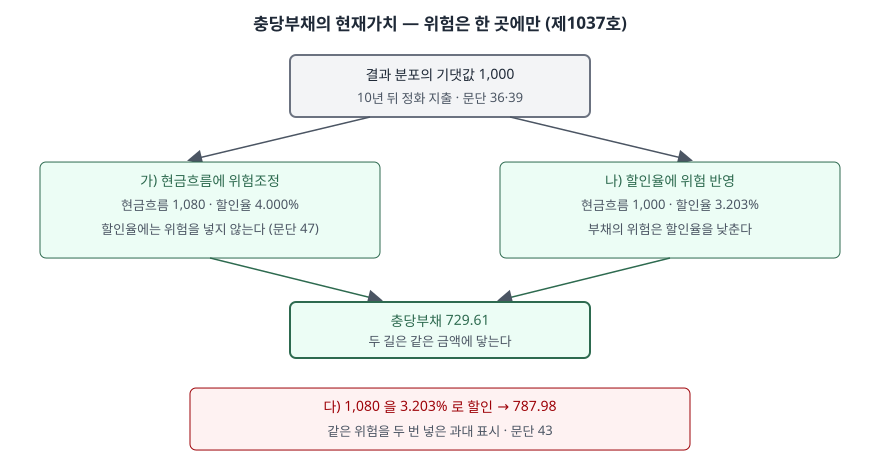

> 예제의 `마바화학`과 그 숫자는 계산을 보이려고 만든 가상 자료다. 단위는 억원이다. 결과 분포, 위험조정 80, 할인율 4%는 계산 원리를 보이기 위한 가정이다.

## 들어가며

공장을 가진 회사의 주석을 읽다 보면 복구충당부채나 정화충당부채 옆에 "할인율 ○%"라는 가정이 적혀 있다. 대개는 그 숫자를 건너뛰고 충당부채 잔액만 본다. 그런데 10년 뒤에 낼 1,000억원짜리 의무는 할인율 4%를 쓰면 약 730억원, 2%를 쓰면 약 886억원으로 장부에 오른다. 추정한 지출은 하나도 바뀌지 않았는데 할인율 2%포인트가 부채를 156억원 움직인다. 게다가 위험을 어디에 넣느냐에 따라 같은 회사가 같은 의무를 59억원 더 크게 적을 수도 있다.

## 개념

기업회계기준서 제1037호는 충당부채를 의무 이행에 필요한 지출의 최선의 추정치로 측정하게 하고(문단 36), 그 추정치를 정할 때 지켜야 할 것을 몇 가지 덧붙인다. 이 글은 그 가운데 위험과 불확실성(문단 42~44), 현재가치(문단 45~47), 그리고 할인한 충당부채가 해마다 어떻게 움직이는지(문단 59·60·84⑸)를 다룬다.

| 규정 | 내용 | 문단 |
|---|---|---|
| 위험 고려 | 최선의 추정치를 구할 때 불가피한 위험과 불확실성을 고려한다 | 42 |
| 위험조정 | 위험은 결과의 변동성이며 위험조정으로 부채 측정금액이 커질 수 있다. 위험과 불확실성을 이중 조정해 과대 표시하지 않는다 | 43 |
| 현재가치 | 화폐의 시간가치 영향이 중요하면 예상 지출의 현재가치로 평가한다 | 45·46 |
| 할인율 | 부채의 특유한 위험과 시간가치에 대한 현행 시장 평가를 반영한 세전 이율. 현금흐름 추정에 넣은 위험은 할인율에 넣지 않는다 | 47 |
| 재검토 | 보고기간 말마다 잔액을 검토해 현재의 최선의 추정치로 조정한다 | 59 |
| 할인 상각 | 기간 경과에 따른 증가액은 차입원가로 인식한다 | 60 |
| 공시 | 기간 경과에 따른 증가액과 할인율 변동 영향을 유형별로 공시한다 | 84⑸ |

## 구조



> **출처**: 한국회계기준원 [기업회계기준서 제1037호 '충당부채, 우발부채 및 우발자산'](https://www.samili.com/acc/Kijun/Kijunjomun.asp?code=1978-1037) 문단 36·39·42~47 (제3자 전재, 2021-04-23 개정) — 원문 발행처 [한국회계기준원](https://www.kasb.or.kr/front/board/ingAccountingList.do)

출발점은 결과 분포의 기댓값이다. 위험은 왼쪽 길처럼 현금흐름을 키워 넣거나, 오른쪽 길처럼 할인율을 낮춰 넣는다. 어느 길로 가도 도착하는 금액은 같아야 하고, 두 길을 한꺼번에 밟으면 아래 빨간 칸이 된다.

## 동작 원리

### 위험은 왜 부채를 키우는가

기댓값 1,000은 800·1,000·1,200이 나올 수 있는 의무의 평균이다. 평균이 같아도 결과가 넓게 흩어진 의무는 좁게 모인 의무보다 떠안기 부담스럽다. 누군가에게 이 의무를 넘기려면 평균에 더해 변동성을 떠안는 대가를 얹어 줘야 한다. 문단 43이 "위험조정으로 부채의 측정금액이 증가할 수 있다"고 적은 이유다. 예제는 그 대가를 80으로 가정했다.

### 부채의 위험은 할인율을 낮춘다

같은 위험을 할인율로 넣으려면 할인율을 **올리는 것이 아니라 내려야** 한다. 할인율이 낮을수록 현재가치가 커지기 때문이다. 자산을 평가할 때 위험이 크면 할인율을 올려 가치를 깎는 것과 방향이 반대다. 예제에서 현금흐름 쪽에 넣은 80과 같은 효과를 내는 할인율은 4%가 아니라 3.203%다.

### 한 번만 넣는다

문단 47의 마지막 문장은 현금흐름을 추정할 때 고려한 위험을 할인율에 다시 넣지 말라고 한다. 문단 43도 위험과 불확실성을 이중 조정하지 말라고 적는다. 위험을 반영한 현금흐름 1,080을 위험을 반영한 할인율 3.203%로 할인하면 같은 80을 두 번 얹은 셈이 된다.

### 할인율은 해마다 다시 본다

할인율은 **현행** 시장 평가를 반영한 이율이고(문단 47), 충당부채는 보고기간 말마다 현재의 최선의 추정치로 조정한다(문단 59). 그래서 지출 추정이 그대로여도 시장금리가 바뀌면 장부금액이 바뀐다. 이 변동은 시간이 흘러 생기는 증가(문단 60의 차입원가)와 성격이 달라서, 기준서는 둘을 나눠 공시하게 한다(문단 84⑸).

## 실습 예제

```python
def present_value(amount, rate, years):
    return amount / (1.0 + rate) ** years

def implied_rate(target_pv, amount, years):
    # amount 를 years 동안 할인해 target_pv 가 되는 이율
    return (amount / target_pv) ** (1.0 / years) - 1.0
```

전체 소스: [`code/`](code/) · 수행 기록: [`code/output.txt`](code/output.txt)

```text
[1] 같은 1,000 을 언제 내느냐 — 시간가치 (문단 45·46, 할인율 4%)
     지급 시점       현재가치      할인 효과
       0년 뒤    1000.00       0.00
       1년 뒤     961.54      38.46
       3년 뒤     889.00     111.00
       5년 뒤     821.93     178.07
      10년 뒤     675.56     324.44
```

1년 뒤에 낼 의무는 할인해도 38.46밖에 줄지 않는다. 문단 45가 시간가치의 영향이 **중요한 경우에** 할인하라고 한 것은 이 차이 때문이다. 판매보증처럼 1~2년 안에 나가는 충당부채는 할인하지 않는 경우가 많고, 정화·복구처럼 10년 넘게 남은 의무는 할인 효과가 원금의 3분의 1에 이른다.

```text
[2] 위험을 어디에 넣느냐 (문단 42·43·47)
  결과 분포 기댓값 1000.0 · 위험조정 80.0
  방법                                    현금흐름      할인율      충당부채
  위험 반영 없음                          1000.0   4.000%    675.56
  가) 현금흐름에 위험조정                     1080.0   4.000%    729.61
  나) 할인율에 위험 반영                     1000.0   3.203%    729.61
  다) 둘 다 반영 — 이중 조정                 1080.0   3.203%    787.98
```

가)와 나)는 같은 729.61이다. 기준서가 어느 쪽을 쓰라고 정하지 않은 것은 두 길이 같은 곳에 닿기 때문이다. 다)는 가)보다 58.37 크다. 이 차이는 의무가 커져서 생긴 것이 아니라 계산 실수로 생긴 것이다.

```text
[3] 할인율만 바꿔 본 충당부채 (위험조정 현금흐름 1,080, 10년 뒤)
  할인율   2% → 충당부채   885.98  (4% 대비  +156.37)
  할인율   3% → 충당부채   803.62  (4% 대비   +74.01)
  할인율   4% → 충당부채   729.61  (4% 대비    +0.00)
  할인율   6% → 충당부채   603.07  (4% 대비  -126.54)
  할인율   8% → 충당부채   500.25  (4% 대비  -229.36)
```

할인율이 오를수록 부채가 줄어든다. 회사가 자기 회사채 수익률처럼 자신의 신용위험이 섞인 이율을 쓰면, 신용이 나쁜 회사일수록 높은 이율을 쓰게 되고 같은 의무가 더 작게 잡힌다. 문단 47이 할인율에 반영할 위험을 **부채의 특유한 위험**으로 한정한 것은 측정 대상이 그 의무이기 때문이다.

```text
[4] 충당부채 변동표 — 기간 경과와 할인율 변동을 나눠 적는다 (문단 59·60·84⑸)
    연도        기초     기간 경과      할인율 변동        기말     기말 할인율
  2026    729.61     29.18       68.94    827.73       3.0%
  2027    827.73     24.83        0.00    852.56       3.0%
  2028    852.56     25.58        0.00    878.14       3.0%
```

2026년 말 할인율을 4%에서 3%로 바꿨다. 그해 증가 98.12 가운데 29.18만 시간이 흘러 생긴 몫이고, 68.94는 금리가 바뀌어 생긴 몫이다. 정화 비용 추정은 한 번도 바뀌지 않았다.

## 실무에서 주의할 점

- **할인율 가정을 잔액과 같이 읽는다.** [3]처럼 장기 의무는 할인율 1%포인트에 부채가 10% 안팎 움직인다. 두 회사의 복구충당부채를 비교할 때 할인율이 다르면 잔액 차이의 일부는 의무의 크기가 아니라 가정의 차이다.
- **금리가 내린 해에는 부채가 저절로 늘어난다.** [4]의 2026년처럼 의무가 그대로여도 충당부채가 크게 뛴다. 충당부채 변동표(문단 84)에서 기간 경과분과 할인율 변동분을 갈라 보면 의무가 커진 것인지 가정이 바뀐 것인지 가려진다.
- **기간 경과분은 영업비용이 아니라 차입원가다.** 문단 60은 할인 상각을 차입원가로 인식하게 한다. 그래서 장기 충당부채가 큰 회사는 차입금이 적어도 이자 성격의 비용이 꾸준히 나온다. [안정성 비율 글](../../ratios/2026-10-01-leverage-and-current-ratio/index.md)의 이자보상배율을 볼 때 분모에 무엇이 들어갔는지 확인한다.
- **위험을 두 번 넣었는지는 주석으로 판단하기 어렵다.** 회사는 보통 할인율만 공시하고 현금흐름에 얼마의 위험조정을 넣었는지는 밝히지 않는다. 할인율이 같은 업종의 무위험 이율보다 눈에 띄게 낮으면 위험을 할인율로 넣은 것인지 주석의 측정 방법 설명을 찾아본다.
- **할인율 변경과 추정 변경을 구분한다.** [충당부채 기초 글](../2026-10-10-provisions-and-contingent-liabilities/index.md)의 환입은 유출 가능성이나 지출 추정이 바뀐 결과이고, 이 글의 [4]는 지출 추정 없이 이율만 바뀐 결과다. 둘 다 충당부채 금액을 바꾸지만 원인이 다르다.

## 정리

- 시간가치가 중요한 충당부채는 예상 지출의 현재가치로 측정하고, 할인율은 부채의 특유한 위험과 시간가치를 반영한 세전 현행 이율이다(문단 45~47).
- 위험은 현금흐름에 얹거나 할인율을 낮추는 방식 중 한 곳에만 넣는다. 가상 사례에서 두 방법은 모두 729.61이고, 둘 다 넣으면 787.98로 과대 표시된다(문단 43·47).
- 할인율이 오를수록 부채가 줄어들므로, 장기 의무에서는 할인율 가정이 잔액을 크게 움직인다.
- 할인한 충당부채의 증가는 기간 경과분(차입원가)과 할인율 변동분으로 나눠 공시한다(문단 60·84⑸).

## 참고 자료

- [한국회계기준원](https://www.kasb.or.kr/front/board/ingAccountingList.do) — K-IFRS 기준서 발행처. 아래 전재 링크는 조문을 바로 열기 위한 편의 링크다
- [기업회계기준서 제1037호 '충당부채, 우발부채 및 우발자산'](https://www.samili.com/acc/Kijun/Kijunjomun.asp?code=1978-1037) (제3자 전재, 2021-04-23 개정) — 문단 36·39 최선의 추정치, 42~44 위험과 불확실성, 45~47 현재가치, 59 변동, 60 할인 상각, 84 변동 공시
- [IAS 37 Provisions, Contingent Liabilities and Contingent Assets](https://www.ifrs.org/issued-standards/list-of-standards/ias-37-provisions-contingent-liabilities-and-contingent-assets/) — IFRS Foundation
- 숫자는 이 글의 [`code/output.txt`](code/output.txt) `[1]`~`[4]`에서 옮겼다
