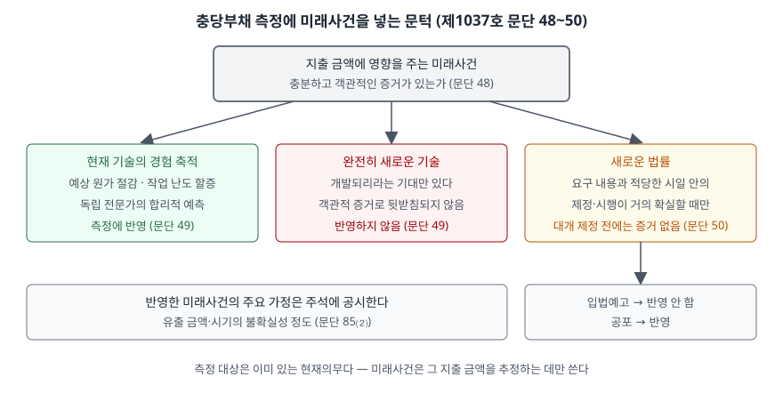

> 예제의 `자차화학`과 그 숫자는 계산을 보이려고 만든 가상 자료다. 단위는 억원, 정화 물량 단위는 천 m³다. 단가, 하락률, 할증률, 할인율 4%, 법률 내용은 계산 원리를 보이기 위한 가정이다.

## 들어가며

화학 공장을 가진 회사가 몇 년 뒤 부지를 정화해야 한다면, 그 비용을 지금 기술과 지금 단가로 계산하는 것이 가장 단순하다. 그런데 정화 업계는 해마다 작업 경험이 쌓여 단가가 내려가고, 연구소에서는 비용을 절반으로 줄인다는 신기술이 발표되며, 국회에서는 정화 기준을 강화하는 법안이 논의된다. 이 셋을 모두 넣으면 같은 의무가 356억원으로도, 963억원으로도 잡힌다. 어느 것을 지금 넣고 어느 것을 기다려야 하는지가 정해져 있지 않으면 회사마다 원하는 쪽을 골라 쓰게 된다.

## 개념

기업회계기준서 제1037호는 현재의무를 이행하는 데 필요한 지출에 영향을 줄 미래사건이 일어난다는 **충분하고 객관적인 증거**가 있을 때만 그 사건을 고려해 충당부채를 추정하게 한다(문단 48). 이어서 기술과 법률이라는 두 가지 대표 사례에 대해 그 증거가 무엇인지 적는다.

| 미래사건 | 반영하는 경우 | 반영하지 않는 경우 | 문단 |
|---|---|---|---|
| 기술 변화 | 현재 기술에 경험이 쌓여 예상되는 원가 절감, 과거보다 넓고 복잡한 작업에 현재 기술을 쓸 때 예상되는 원가 | 충분하고 객관적인 증거가 없는 완전히 새로운 기술 개발 | 49 |
| 새로운 법률 | 요구 내용과 적당한 시일 안의 제정·시행이 거의 확실하다는 증거가 있을 때 | 일반적으로 법률이 제정되기 전 | 50 |
| 공시 | 유출 금액·시기의 불확실성 정도, 필요하면 미래사건에 관한 주요 가정 | — | 85⑵ |

기술에 관한 판단은 정화 시점에 쓸 수 있는 기술에 대한 모든 증거를 고려한 **자격 있는 독립 전문가의 합리적인 예측**을 반영한다(문단 49).

## 구조



> **출처**: 한국회계기준원 [기업회계기준서 제1037호 '충당부채, 우발부채 및 우발자산'](https://www.samili.com/acc/Kijun/Kijunjomun.asp?code=1978-1037) 문단 48~50·85 (제3자 전재, 2021-04-23 개정) — 원문 발행처 [한국회계기준원](https://www.kasb.or.kr/front/board/ingAccountingList.do)

세 갈래 모두 출발점의 질문은 같다. 그 사건이 일어난다는 증거가 충분하고 객관적인가. 갈래마다 다른 것은 그 증거가 무엇으로 채워지느냐다.

## 동작 원리

### 미래사건은 의무를 만들지 않는다

문단 48~50은 측정에 관한 규정이다. 정화 의무가 이미 있다는 것은 인식 단계에서 판단이 끝났고, 여기서는 그 의무를 이행하는 데 **얼마가 들지**를 추정할 때 미래의 변화를 어디까지 넣을지를 다룬다. 그래서 같은 법률이라도 이미 있는 정화 의무의 범위를 넓히는 것이면 이 문단으로 측정에 들어간다.

### 경험이 쌓이는 것은 증거가 있다

같은 공법으로 작업을 반복하면 장비 운용과 시료 분석이 손에 익어 단가가 내려간다. 이것은 지금까지 쌓인 작업 기록으로 추세를 확인할 수 있는 변화다. 반대 방향도 같다. 지금까지 다룬 것보다 깊은 오염층을 같은 공법으로 처리하면 단가가 오르리라는 것도 예측할 수 있다. 문단 49는 두 방향을 모두 반영하게 한다. 절감만 골라 넣고 할증은 빼면 측정이 한쪽으로 기운다.

### 신기술은 기대일 뿐이다

실험실 단계 기술이 단가를 절반으로 줄인다는 발표는 그 기술이 8년 뒤 상용화된다는 증거가 아니다. 문단 49는 충분하고 객관적인 증거로 뒷받침되지 않으면 완전히 새로운 기술 개발을 예상하지 말라고 한다. 지출을 줄이는 쪽의 미래사건은 증거가 약할 때 부채를 과소 표시하게 만드므로, 문단 43이 말한 불확실한 상황에서의 주의와 같은 방향의 규정이다.

### 법률은 대개 공포 뒤에 들어온다

법안이 발의되거나 입법예고된 단계에서는 내용이 국회에서 바뀔 수 있고 통과 자체가 불확실하다. 문단 50은 새 법률이 요구할 내용과 적당한 시일 안에 제정·시행될 것이 거의 확실하다는 증거를 요구하고, 일반적으로 법률이 제정되기 전까지는 그런 증거가 없다고 적는다. 시행일이 몇 년 뒤라도 제정되었으면 그 영향을 넣는다.

## 실습 예제

```python
def unit_cost(years_ahead, learning=True, complexity=True):
    cost = UNIT_COST_TODAY
    if learning:                       # 문단 49 — 경험 축적에 따른 절감
        cost *= (1.0 - LEARNING_DROP) ** years_ahead
    if complexity:                     # 문단 49 — 더 복잡한 작업의 할증
        cost *= 1.0 + COMPLEXITY_UPLIFT
    return cost
```

전체 소스: [`code/`](code/) · 수행 기록: [`code/output.txt`](code/output.txt)

```text
[1] 기술에 관한 가정별 2026 말 충당부채 (정화 물량 500, 8년 뒤, 할인율 4%) — 문단 48·49
  가정                           단가     지출 추정      현재가치  문단 49
  현재 단가 그대로                2.000   1000.00    730.69  —
  경험 축적에 따른 절감             1.772    886.11    647.48  반영
  절감 + 깊은 오염층 할증           1.949    974.73    712.22  반영
  실험실 단계 신기술 기대            0.975    487.36    356.11  반영 안 함
```

자차화학이 장부에 올리는 금액은 셋째 줄의 712.22다. 절감만 넣은 둘째 줄은 647.48로 64.74 작고, 신기술까지 넣은 넷째 줄은 356.11로 절반이 된다. 넷째 줄은 계산할 수는 있어도 측정에 쓸 수 없는 숫자다.

```text
[2] 정화 기준을 강화하는 법률 — 언제 측정에 들어가나 (문단 50)
    연말  법률 상태                   물량     지출 추정      충당부채
  2026  입법예고만 됐다             500    974.73    712.22
  2027  국회 통과·공포, 2029 시행     650   1267.14    962.93
  2027 증가 250.70 = 기간 경과 28.49 + 법률 반영 222.21
```

2026년 말에는 법안 내용을 알아도 현행 기준 물량 500으로만 잰다. 2027년에 법률이 공포되자 시행은 2029년인데도 물량 650이 측정에 들어가고, 충당부채가 그해 250.70 늘어난다. 그 가운데 28.49는 [할인율 글](../2026-11-23-provision-discount-rate-risk-once/index.md)에서 본 기간 경과분이고 222.21이 법률 반영분이다. 단가 가정은 2026년 판단을 그대로 두어 법률의 효과만 보이게 했다.

```text
[3] 주요 가정 공시 — 연간 단가 하락률만 바꿔 본 2026 말 충당부채 (문단 85⑵)
  연 0.0% 하락 → 충당부채   803.76
  연 1.0% 하락 → 충당부채   741.66
  연 1.5% 하락 → 충당부채   712.22
  연 2.0% 하락 → 충당부채   683.81
  연 3.0% 하락 → 충당부채   629.94
```

이 표는 할증 10%를 넣은 상태에서 하락률만 바꿨다. 그래서 0% 줄이 [1]의 첫 줄과 다르다. 하락률을 1.5%에서 3%로 올려 잡으면 충당부채가 82.28 줄어든다. 전문가 예측 하나가 이만큼 부채를 움직이므로, 문단 85⑵는 필요한 경우 미래사건에 관한 주요 가정을 공시하게 한다.

## 실무에서 주의할 점

- **원가 절감 가정은 근거와 함께 읽는다.** [3]처럼 하락률 가정이 충당부채를 크게 움직인다. 주석에 단가 하락을 가정했다는 설명이 있으면 그 근거가 과거 작업 실적인지, 아직 검증되지 않은 기술인지를 본다. 문단 49가 반영을 허용하는 것은 앞쪽이다.
- **절감만 있고 할증이 없으면 한쪽만 넣었는지 의심한다.** 문단 49는 경험에 따른 절감과 더 복잡한 작업의 원가를 함께 예로 든다. [1]에서 절감만 넣으면 부채가 64.74 작게 잡힌다.
- **법률 공포는 부채가 한 번에 뛰는 시점이다.** [2]의 2027년처럼 의무 이행은 몇 년 뒤인데도 공포된 해에 충당부채가 크게 늘어난다. 같은 규제를 받는 회사라면 같은 해에 이 비용을 인식하게 된다. 그해 이익 감소가 영업 때문인지 규제 반영 때문인지는 충당부채 변동표(문단 84)의 추가 설정액에서 가른다.
- **입법예고 단계의 법안은 측정에 넣지 않지만 공시는 살핀다.** 문단 50 때문에 장부에는 아직 없지만, 불확실성 정도에 관한 공시(문단 85⑵)에 규제 강화 가능성이 언급되어 있을 수 있다. 다음 해 충당부채가 늘어날 단서다.
- **미래사건 판단과 할인율 판단을 섞지 않는다.** 기술 변화는 현금흐름 추정에 들어가는 가정이고, [할인율 글](../2026-11-23-provision-discount-rate-risk-once/index.md)에서 본 할인율은 그 현금흐름을 현재로 가져오는 이율이다. 두 가정이 같은 해에 함께 바뀌면 변동표에서 각각의 영향을 따로 찾는다.

## 정리

- 충당부채를 잴 때 미래사건은 충분하고 객관적인 증거가 있을 때만 반영한다(문단 48).
- 현재 기술의 경험 축적에 따른 절감과 더 복잡한 작업의 할증은 반영하고, 근거 없는 완전히 새로운 기술은 반영하지 않는다(문단 49).
- 새로운 법률은 제정·시행이 거의 확실할 때 반영하며, 대개 제정 전에는 그 증거가 없다(문단 50).
- 가상 사례에서 자차화학의 충당부채는 712.22이고, 정화 기준을 강화한 법률이 공포된 해에 222.21이 더해졌다. 측정에 쓴 주요 가정은 필요하면 공시한다(문단 85⑵).

## 참고 자료

- [한국회계기준원](https://www.kasb.or.kr/front/board/ingAccountingList.do) — K-IFRS 기준서 발행처. 아래 전재 링크는 조문을 바로 열기 위한 편의 링크다
- [기업회계기준서 제1037호 '충당부채, 우발부채 및 우발자산'](https://www.samili.com/acc/Kijun/Kijunjomun.asp?code=1978-1037) (제3자 전재, 2021-04-23 개정) — 문단 43 불확실한 상황의 주의, 48 미래사건, 49 기술 변화, 50 새로운 법률, 84 변동 공시, 85 불확실성 공시
- [IAS 37 Provisions, Contingent Liabilities and Contingent Assets](https://www.ifrs.org/issued-standards/list-of-standards/ias-37-provisions-contingent-liabilities-and-contingent-assets/) — IFRS Foundation
- 숫자는 이 글의 [`code/output.txt`](code/output.txt) `[1]`~`[3]`에서 옮겼다
