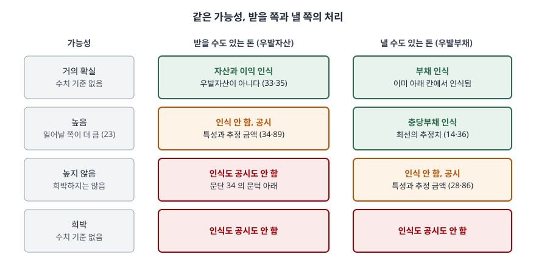

> 예제의 `가나전자`·`다라물산`과 그 숫자는 계산을 보이려고 만든 가상 자료다. 단위는 억원이다. 승소 확률과 판결 결과는 계산 원리를 보이기 위한 가정이며, 두 회사가 같은 확률 판단을 한다고 두어 차이가 기준서의 문턱에서만 나오게 했다.

## 들어가며

특허를 침해당한 회사가 300억원 손해배상 소송을 내고 1심에서 이겼다면, 경영진은 그 돈을 이번 해 실적에 넣고 싶어 한다. 상대방은 같은 판결을 받고 이미 300억원을 비용으로 잡았으니 균형이 맞아 보인다. 그런데 회계기준은 원고에게 아직 아무것도 장부에 올리지 말라고 한다. 같은 판결문 한 장이 한쪽에는 부채를 만들고 다른 쪽에는 주석 몇 줄만 남기는 이유를 알면, 소송 중인 회사의 주석에서 무엇을 읽어야 하는지가 정해진다.

## 개념

기업회계기준서 제1037호는 우발자산을 과거사건으로 생겼지만 기업이 전적으로 통제할 수 없는 불확실한 미래 사건이 일어나야만 존재가 확인되는 **잠재적 자산**으로 정의한다(문단 10). 기업이 제기했으나 결과가 불확실한 소송이 기준서가 드는 예다(문단 32).

| 규정 | 내용 | 문단 |
|---|---|---|
| 인식 | 우발자산은 재무제표에 인식하지 않는다 | 31 |
| 이유 | 전혀 실현되지 않을 수도 있는 수익을 인식하게 될 수 있다 | 33 |
| 경계 | 수익의 실현이 거의 확실하면 우발자산이 아니므로 자산으로 인식한다 | 33 |
| 공시 | 유입 가능성이 높으면 특성을 간결하게 설명하고, 실무적으로 가능하면 추정 금액을 공시한다 | 34·89 |
| 재평가 | 계속 평가해 유입이 거의 확실해진 기간에 자산과 이익을 인식한다 | 35 |
| 주의 | 수익이 생길 가능성이 있다는 오해를 주지 않도록 공시한다 | 90 |

'가능성이 높다'는 일어날 가능성이 일어나지 않을 가능성보다 높다는 뜻이다(문단 23). '거의 확실'과 '희박'에는 기준서가 수치를 주지 않는다.

## 구조



> **출처**: 한국회계기준원 [기업회계기준서 제1037호 '충당부채, 우발부채 및 우발자산'](https://www.samili.com/acc/Kijun/Kijunjomun.asp?code=1978-1037) 문단 10·14·23·27·28·31~35·86·89·90 (제3자 전재, 2021-04-23 개정) — 원문 발행처 [한국회계기준원](https://www.kasb.or.kr/front/board/ingAccountingList.do)

두 열을 나란히 놓으면 문턱이 한 칸씩 어긋나 있다. 부채는 '높음'에서 장부에 오르고 '희박하지 않음'부터 공시되는데, 자산은 '거의 확실'에서야 장부에 오르고 '높음'부터 공시된다.

## 동작 원리

### 같은 확률을 다르게 읽는 이유

문단 33이 드는 이유는 하나다. 우발자산을 인식하면 끝내 실현되지 않을 수도 있는 수익을 인식하게 된다. 부채를 늦게 잡으면 재무제표가 회사를 실제보다 좋게 보이게 하고, 자산을 일찍 잡아도 같은 방향으로 틀린다. 그래서 기준서는 두 방향의 오류 가운데 회사를 좋게 보이게 하는 쪽에 더 높은 문턱을 둔다.

### 판결이 확정되면 우발자산이 아니다

문단 33의 뒷문장은 우발자산을 인식하라는 규정이 아니다. 수익의 실현이 거의 확실해지면 그 자산은 **더 이상 우발자산이 아니라고** 정의를 빠져나가게 한다. 그러니 원고가 장부에 올리는 것은 우발자산이 아니라 미수금 같은 보통의 자산이다. 문단 35는 그 시점을 상황 변화가 일어난 기간으로 정한다. 과거로 돌아가 고치지 않고, 확정된 해에 한 번에 이익으로 들어온다.

### 공시 금액도 측정 규정을 따른다

문단 89가 공시하게 하는 추정 금액은 충당부채와 같은 측정 규정(문단 36~52)으로 잰 금액이다. 하나의 의무라면 가능성이 가장 높은 결과가 출발점이 되고, 다른 가능한 결과도 고려한다(문단 40). 다만 문단 90 때문에 원고의 주석은 대개 단정하지 않는 문장으로 쓰인다.

## 실습 예제

```python
def plaintiff_view(outcomes, settled):
    p = win_probability(outcomes)
    if settled:                          # 문단 33·35 — 실현이 거의 확실하면 우발자산이 아니다
        return "자산 인식", most_likely(outcomes), "—"
    if p > 0.5:                          # 문단 34·89 — 유입 가능성이 높으면 공시
        return "인식 안 함", 0.0, f"우발자산 공시 {amount_if_paid(outcomes):.0f}"
    return "인식 안 함", 0.0, "공시 안 함"
```

전체 소스: [`code/`](code/) · 수행 기록: [`code/output.txt`](code/output.txt)

```text
[1] 같은 소송, 두 회사의 연말 장부 (청구 300) — 문단 23·28·33~35·86·89
  2025 말  소 제기, 1심 진행 중  (원고 승소 가능성 35%, 기댓값 105)
    가나전자(원고)  재무상태표 인식 안 함      0   주석 공시 안 함
    다라물산(피고)  재무상태표 인식 안 함      0   주석 우발부채 공시 300
  2026 말  1심 300 인용, 피고 항소  (원고 승소 가능성 70%, 기댓값 210)
    가나전자(원고)  재무상태표 인식 안 함      0   주석 우발자산 공시 300
    다라물산(피고)  재무상태표 충당부채      300   주석 —
  2027 말  항소심 240 으로 감액, 상고 기각 확정  (원고 승소 가능성 100%, 기댓값 240)
    가나전자(원고)  재무상태표 자산 인식     240   주석 —
    다라물산(피고)  재무상태표 확정 채무     240   주석 —
```

2025년 말에는 다라물산만 주석에 소송을 적는다. 패소 가능성이 높지 않아도 희박하지 않으면 공시하기 때문이다(문단 86). 가나전자는 승소 가능성이 35%라 공시 문턱인 '높음'에 못 미친다. 2026년 1심 뒤 같은 70%를 두고 다라물산은 충당부채 300을 올리고 가나전자는 주석에 300을 적는다. 다라물산은 패소 하나뿐인 다른 결과를 고려하고도 최빈값 300을 최선의 추정치로 잡았다고 가정했다(문단 40). 2027년 확정 판결이 나서야 가나전자 장부에 240이 오른다. 다라물산 쪽은 금액과 지급 시기가 정해져 충당부채가 아닌 확정 채무가 된다.

```text
[2] 원고 승소 가능성별 처리 — 같은 확률이 양쪽에서 다르게 읽힌다
  ('희박' 기준 5% 미만은 이 예제의 가정. 기준서에는 수치가 없다)
  승소 가능성    원고(가나전자)              피고(다라물산)
        3%    공시 안 함            공시 안 함
       30%    공시 안 함            우발부채 공시 300
       50%    공시 안 함            우발부채 공시 300
       51%    우발자산 공시 300       충당부채 300
       90%    우발자산 공시 300       충당부채 300
       99%    우발자산 공시 300       충당부채 300
  판결 확정     자산 인식 300         확정 채무 300
```

50%와 51% 사이에서 양쪽이 동시에 한 칸씩 올라간다. 하지만 99%가 되어도 원고는 공시에 머문다. 가능성이 아무리 높아도 '거의 확실'은 확률 구간이 아니라 판결 확정 같은 사실로 채워지는 문턱이기 때문이다.

```text
[3] 연도별 당기손익 영향 — 합계는 같고 시기가 다르다
    연도      가나전자      다라물산
  2025        +0        +0
  2026        +0      -300
  2027      +240       +60
   합계      +240      -240
```

결국 오가는 돈은 240이고 두 회사의 손익 합계도 ±240으로 같다. 다른 것은 시기다. 다라물산은 2026년에 300을 비용으로 잡았다가 2027년에 60을 환입하고, 가나전자는 2027년에 240을 한 번에 이익으로 올린다.

## 실무에서 주의할 점

- **원고의 주석 금액은 이익이 아니다.** [1]의 2026년 가나전자처럼 우발자산 공시 300이 있어도 손익계산서에는 아무것도 없다. 문단 90이 오해를 주지 않게 공시하라고 하는 것도 이 금액이 실현을 약속하지 않기 때문이다. 다음 해 이익을 예상할 때 이 금액을 그대로 더하지 않는다.
- **판결이 확정된 해에 일회성 이익이 몰린다.** [3]의 2027년 가나전자 이익 240은 그해 영업과 무관하다. 손익계산서에서 이 금액이 영업외수익으로 표시되는지, 주석에서 그 성격을 설명하는지를 보고 다음 해와 비교할 때 걸러 낸다.
- **상대방의 충당부채가 원고의 자산보다 먼저 보인다.** 같은 분쟁의 상대방이 공시 대상이라면 그쪽 장부에 이미 충당부채가 있을 수 있다. [1]의 2026년처럼 한쪽이 300을 잡았다고 다른 쪽도 300을 받을 수 있는 상태라는 뜻은 아니다. 두 회사의 문턱이 다르다.
- **변제 받을 돈도 같은 문턱을 쓴다.** 충당부채를 보험사가 대신 내 주는 경우에도 변제가 거의 확실할 때만 별도 자산으로 인식한다. [변제 글](../2026-11-22-provision-reimbursement-separate-asset/index.md)에서 본 문단 53의 문턱이 이 글의 문단 33과 같은 이유에서 나온다.
- **우발자산은 계속 평가한다.** 문단 35는 해마다 상황을 다시 보게 한다. 2025년에 공시하지 않았던 소송이 다음 해 주석에 처음 나타나면 그 사이에 유입 가능성이 '높음'으로 올라갔다는 신호다.

## 정리

- 우발자산은 재무제표에 인식하지 않는다. 실현되지 않을 수도 있는 수익을 인식하지 않으려는 것이다(문단 31·33).
- 수익의 실현이 거의 확실해지면 우발자산이 아니므로, 그런 상황 변화가 일어난 기간에 자산과 이익을 인식한다(문단 33·35).
- 유입 가능성이 높으면 특성과 추정 금액을 공시하되 수익이 생길 것처럼 읽히지 않게 쓴다(문단 34·89·90).
- 가상 사례에서 피고는 2026년에 충당부채 300을 잡았고 원고는 2027년 판결 확정 뒤에야 240을 이익으로 올렸다. 손익 합계는 같고 시기가 한 해 어긋난다.

## 참고 자료

- [한국회계기준원](https://www.kasb.or.kr/front/board/ingAccountingList.do) — K-IFRS 기준서 발행처. 아래 전재 링크는 조문을 바로 열기 위한 편의 링크다
- [기업회계기준서 제1037호 '충당부채, 우발부채 및 우발자산'](https://www.samili.com/acc/Kijun/Kijunjomun.asp?code=1978-1037) (제3자 전재, 2021-04-23 개정) — 문단 10 정의, 14 인식 요건, 23 가능성이 높음, 27·28 우발부채, 31~35 우발자산, 36·40 최선의 추정치, 53 변제, 86 우발부채 공시, 89·90 우발자산 공시
- [IAS 37 Provisions, Contingent Liabilities and Contingent Assets](https://www.ifrs.org/issued-standards/list-of-standards/ias-37-provisions-contingent-liabilities-and-contingent-assets/) — IFRS Foundation
- [충당부채와 우발부채 — 아직 나가지 않은 돈을 부채로 잡는 기준](../2026-10-10-provisions-and-contingent-liabilities/index.md) — 이 블로그의 앞선 글
- [우발부채 공시 — 유출 가능성 세 구간과 해마다 다시 하는 평가](../2026-11-24-contingent-liability-disclosure-bands/index.md) — 같은 문턱을 낼 돈 쪽에서 본 글
- 숫자는 이 글의 [`code/output.txt`](code/output.txt) `[1]`~`[3]`에서 옮겼다
