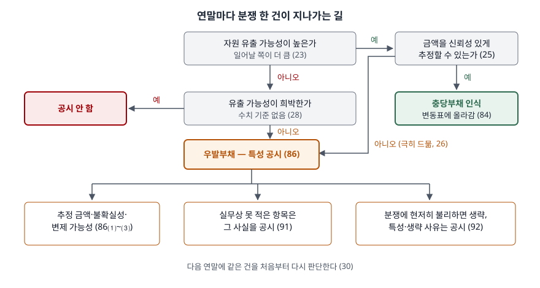

> 예제의 `마바건설`과 그 숫자는 계산을 보이려고 만든 가상 자료다. 단위는 억원이다. 분쟁별 유출 가능성과 금액, 그리고 '희박'을 5% 미만으로 둔 것은 계산 원리를 보이기 위한 가정이다. 기준서에는 '희박'의 수치 기준이 없다.

## 들어가며

건설사의 사업보고서를 처음 펴면 주석 뒤쪽에 소송과 중재가 몇 쪽씩 이어진다. 대부분은 재무상태표에 숫자가 없어서 그냥 넘기게 되는데, 이듬해 보고서를 보면 그중 한두 건이 충당부채로 올라와 그해 이익을 깎아 놓았다. 작년 주석을 한 줄씩 읽었다면 미리 알 수 있었던 일이다. 주석의 소송 목록이 어떤 규칙으로 적히고, 어떤 순간에 장부로 넘어오는지를 알면 그 목록을 다음 해 비용 후보로 읽을 수 있다.

## 개념

기업회계기준서 제1037호는 우발부채를 두 가지로 정의한다(문단 10). 하나는 불확실한 미래 사건이 일어나야 존재가 확인되는 **잠재적 의무**이고, 다른 하나는 **현재의무지만 인식 요건을 못 채운 의무**다. 후자는 유출 가능성이 높지 않거나 금액을 신뢰성 있게 측정할 수 없는 경우다.

| 규정 | 내용 | 문단 |
|---|---|---|
| 인식 | 우발부채는 재무제표에 인식하지 않는다 | 27 |
| 공시 문턱 | 유출 가능성이 희박하지 않으면 공시한다 | 28·86 |
| 공시 항목 | 분류별 특성, 실무적으로 가능하면 재무적 영향의 추정 금액·불확실성 정도·변제 가능성 | 86 |
| 재평가 | 계속 평가해 유출 가능성이 높아진 기간에 충당부채로 인식한다 | 30 |
| 추정 불가 | 극히 드물게 금액을 신뢰성 있게 추정할 수 없으면 우발부채로 공시한다 | 25·26 |
| 공시 못 한 항목 | 실무적인 이유로 공시하지 않은 사항이 있으면 그 사실을 공시한다 | 91 |
| 공시 생략 | 상대방과의 분쟁에 현저히 불리할 것으로 예상되면 생략할 수 있으나, 분쟁의 전반적 특성과 생략 사실·사유는 공시한다 | 92 |

'가능성이 높다'는 일어날 가능성이 일어나지 않을 가능성보다 높다는 뜻이다(문단 23). 그래서 유출 가능성은 희박, 높지 않음, 높음의 세 구간으로 나뉜다.

## 구조



> **출처**: 한국회계기준원 [기업회계기준서 제1037호 '충당부채, 우발부채 및 우발자산'](https://www.samili.com/acc/Kijun/Kijunjomun.asp?code=1978-1037) 문단 10·14·23·25~30·84·86·91·92 (제3자 전재, 2021-04-23 개정) — 원문 발행처 [한국회계기준원](https://www.kasb.or.kr/front/board/ingAccountingList.do)

이 경로는 한 번 지나면 끝나지 않는다. 문단 30이 우발부채를 계속 평가하게 하므로 같은 분쟁이 해마다 맨 위 질문에서 다시 출발한다.

## 동작 원리

### 넘어오는 해에 비용이 한 번에 잡힌다

문단 30은 과거에 우발부채로 처리했더라도 유출 가능성이 높아지면 **그 변화가 생긴 기간의** 재무제표에 충당부채로 인식하게 한다. 지난 해를 고치지 않는다. 그래서 몇 해 동안 주석에만 있던 분쟁이 판결이나 감정 결과가 나온 해에 금액 전체가 비용으로 들어온다.

### 추정 불가는 예외로 좁혀 둔다

기준서는 극히 드문 경우를 제외하면 가능한 결과의 범위를 판단할 수 있으므로 충분히 신뢰성 있는 금액을 추정할 수 있다고 본다(문단 25). 유출 가능성이 높은데도 금액을 못 잰다는 이유로 우발부채에 머무는 것은 이 예외에 해당할 때뿐이다(문단 26). 이때도 금액을 적지 못한 사실은 주석에 남는다(문단 91).

### 생략할 수 있는 것과 없는 것

문단 92가 허용하는 것은 금액과 같은 세부 정보의 생략이다. 분쟁이 있다는 것, 그 전반적인 특성, 생략했다는 사실과 사유는 공시해야 한다. 그러니 주석에서 금액 없이 "공시가 분쟁에 불리해 생략한다"는 문장을 만나면 분쟁 자체가 사라진 것이 아니다.

## 실습 예제

```python
def classify(prob, amount, prejudicial, closed):
    if closed:
        return "종결", 0.0
    if prob > 0.5 and amount is not None:            # 문단 14·23
        return "충당부채", amount
    if prob < REMOTE_BELOW:                          # 문단 28·86 — 희박하면 공시도 안 함
        return "공시 안 함", 0.0
    if prejudicial:                                  # 문단 92
        return "우발부채 — 금액 생략, 특성·사유만 공시", 0.0
    if amount is None:                               # 문단 26·91
        return "우발부채 — 추정 불가 사실 공시", 0.0
    return "우발부채", amount                        # 문단 86⑴
```

전체 소스: [`code/`](code/) · 수행 기록: [`code/output.txt`](code/output.txt)

```text
[1] 연말마다 다시 하는 평가 — 건별 분류 (문단 23·26·28·30·86·91·92)
  2025 말
    A 하도급 대금 분쟁    유출 가능성   3%       —  공시 안 함
    B 환경 과징금       유출 가능성  40%      80  우발부채
    C 제품 결함 집단소송   유출 가능성  60%       —  우발부채 — 추정 불가 사실 공시
    D 공사 지연 중재     유출 가능성  20%     200  우발부채
    → 재무상태표 충당부채 0 / 주석 우발부채 금액 280
  2026 말
    A 하도급 대금 분쟁    유출 가능성  30%     120  우발부채
    B 환경 과징금       유출 가능성  70%      80  충당부채
    C 제품 결함 집단소송   유출 가능성  60%     150  충당부채
    D 공사 지연 중재     유출 가능성  35%       —  우발부채 — 금액 생략, 특성·사유만 공시
    → 재무상태표 충당부채 230 / 주석 우발부채 금액 120
  2027 말
    A 하도급 대금 분쟁    유출 가능성  60%     120  충당부채
    B 환경 과징금       유출 가능성 100%       —  종결
    C 제품 결함 집단소송   유출 가능성  60%     150  충당부채
    D 공사 지연 중재     유출 가능성   0%       —  종결
    → 재무상태표 충당부채 270 / 주석 우발부채 금액 0
```

A는 3년 동안 세 구간을 차례로 지난다. 2025년에는 희박해서 주석에도 없고, 2026년에 주석에 처음 나타나며, 2027년에 충당부채가 된다. C는 2025년에 유출 가능성이 이미 60%였지만 피해 규모를 잴 수 없어 우발부채에 머물렀다. D는 2026년에 중재 상대방에게 회사의 예상 배상액을 알려 주는 셈이 되어 금액을 생략했다고 두었다. 주석의 우발부채 금액 합계가 280, 120, 0으로 줄어드는 동안 충당부채는 0, 230, 270으로 늘었다.

```text
[2] 충당부채 변동표 (문단 84) — 우발부채가 넘어온 금액은 '추가'에 들어간다
    연도      기초      추가      사용      환입      기말  당기손익
  2025       0       0       0       0       0      +0
  2026       0     230       0       0     230    -230
  2027     230     120      80       0     270    -120
```

변동표에는 우발부채에서 넘어왔다는 칸이 따로 없다. 2026년의 230은 B와 C, 2027년의 120은 A이며 모두 '추가'에 들어간다. 2027년 B의 80은 과징금을 내며 충당부채를 줄인 것이라 손익에 다시 잡히지 않는다.

```text
[3] 작년 주석이 올해 장부로 넘어온 경로
  2025 주석 B(80) → 2026 충당부채 80   [우발부채]
  2025 주석 C(금액 없음) → 2026 충당부채 150   [우발부채 — 추정 불가 사실 공시]
  2026 주석 A(120) → 2027 충당부채 120   [우발부채]
```

2026년과 2027년에 새로 잡힌 비용 350은 모두 전년 주석에 있던 건에서 나왔다. 그 가운데 150은 전년 주석에 금액이 없던 C다.

## 실무에서 주의할 점

- **주석 금액이 없다고 작은 분쟁이 아니다.** [3]의 C처럼 추정 불가로 금액이 빠진 건이 이듬해 가장 큰 충당부채가 될 수 있다. 금액 대신 적힌 불확실성 설명(문단 86⑵)을 읽는다.
- **주석 금액 합계가 줄어든 것을 좋은 신호로 읽지 않는다.** [1]에서 2027년 주석 금액은 0이 되었지만 그 이유는 A가 충당부채로 넘어갔고 B와 D가 종결됐기 때문이다. 변동표의 추가 금액과 함께 본다.
- **처음 나타난 분쟁을 표시해 둔다.** 문단 30 때문에 분쟁은 희박 → 주석 → 충당부채 순으로 올라올 수 있다. [1]의 A처럼 올해 처음 주석에 나타난 건은 다음 해 장부에 올라올 후보다.
- **생략 문장도 정보다.** 문단 92로 금액을 생략했다면 회사는 그 공시가 분쟁에 현저히 불리하다고 판단한 것이다. 금액이 작아서 생략하는 문단이 아니다.
- **'희박'의 선은 회사가 긋는다.** 기준서에 수치가 없으므로 같은 분쟁을 두고 한 회사는 공시하고 다른 회사는 공시하지 않을 수 있다. 이 글의 5%도 예제를 위한 가정이다. 같은 업종 회사들의 주석 길이가 크게 다르면 이 판단이 갈렸을 수 있다.

## 정리

- 우발부채는 장부에 올리지 않고, 유출 가능성이 희박하지 않으면 특성과 실무적으로 가능한 추정 금액을 공시한다(문단 27·28·86).
- 연말마다 다시 평가해 유출 가능성이 높아진 기간에 충당부채로 옮기며, 그 해에 비용이 한 번에 잡힌다(문단 30).
- 금액을 추정할 수 없는 경우는 극히 드문 예외이고 그 사실을 공시한다. 분쟁에 현저히 불리하면 세부를 생략하되 특성과 생략 사유는 공시한다(문단 25·26·91·92).
- 가상 사례에서 마바건설이 2026~2027년에 새로 잡은 충당부채 350은 모두 전년 주석에 있던 분쟁에서 나왔고, 그중 150은 금액 없이 공시된 건이었다.

## 참고 자료

- [한국회계기준원](https://www.kasb.or.kr/front/board/ingAccountingList.do) — K-IFRS 기준서 발행처. 아래 전재 링크는 조문을 바로 열기 위한 편의 링크다
- [기업회계기준서 제1037호 '충당부채, 우발부채 및 우발자산'](https://www.samili.com/acc/Kijun/Kijunjomun.asp?code=1978-1037) (제3자 전재, 2021-04-23 개정) — 문단 10 정의, 14 인식 요건, 23 가능성이 높음, 25·26 신뢰성 있는 추정, 27~30 우발부채, 61 사용, 84 변동 공시, 86 우발부채 공시, 91 공시 못 한 사실, 92 공시 생략
- [IAS 37 Provisions, Contingent Liabilities and Contingent Assets](https://www.ifrs.org/issued-standards/list-of-standards/ias-37-provisions-contingent-liabilities-and-contingent-assets/) — IFRS Foundation
- [우발자산 — 실현이 거의 확실해질 때까지 장부에 올리지 않는 받을 돈](../2026-11-24-contingent-asset-virtually-certain/index.md) — 같은 문턱을 받을 돈 쪽에서 본 글
- [충당부채와 우발부채 — 아직 나가지 않은 돈을 부채로 잡는 기준](../2026-10-10-provisions-and-contingent-liabilities/index.md) — 이 블로그의 앞선 글
- 숫자는 이 글의 [`code/output.txt`](code/output.txt) `[1]`~`[3]`에서 옮겼다
