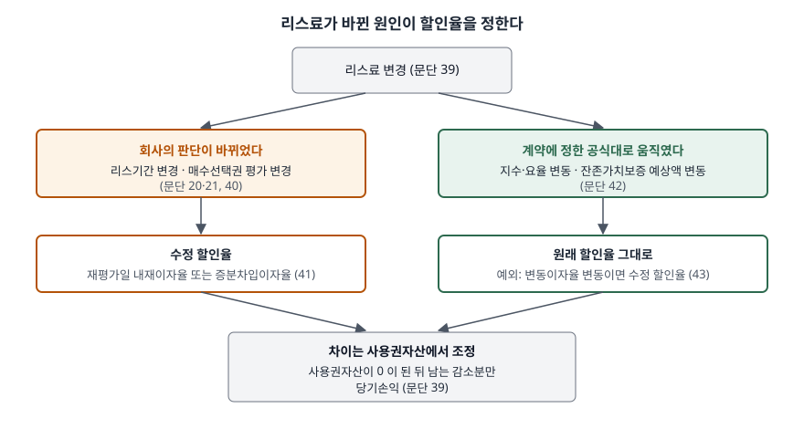

> 예제의 `가나유통`과 그 숫자는 계산을 보이려고 만든 가상 자료다. 법인세, 초기 직접원가, 복구원가, 리스 인센티브는 없다고 두었다.

## 들어가며

매장을 여러 곳 빌려 쓰는 회사의 리스 주석을 해마다 펴 보면, 새 계약을 맺지 않았는데도 사용권자산 증감표에 '재측정' 줄이 꽤 큰 금액으로 찍혀 있는 해가 있다. 이 줄을 보고 흔히 신규 출점이 늘었다고 읽거나, 금액이 작으면 건너뛴다. 그런데 같은 리스료 인상이라도 그 원인이 임대료의 물가 연동인지 계약 연장인지에 따라 리스부채에 얹히는 금액이 다르고, 남은 기간에 이자비용으로 잡힐 몫도 달라진다. 예제에서는 같은 매장 하나의 재측정 금액이 원인 판단 하나로 16.34와 137.69로 갈린다. 재측정 줄을 읽으려면 기준서가 언제 할인율을 바꾸게 하는지부터 알아야 한다.

## 개념

### 재측정은 새 리스가 아니다

리스부채는 리스개시일에 남은 리스료를 할인한 현재가치로 처음 잰다. 개시일 뒤에는 이자로 늘고 지급으로 줄어든다. 이 흐름은 [리스 회계 기본 글](../2026-10-10-lease-liability-right-of-use/index.md)에서 계산했다. 계약 기간 중간에 앞으로 낼 리스료가 바뀌면, 리스이용자는 바뀐 리스료를 반영해 리스부채를 다시 재고 그 차이만큼 사용권자산을 조정한다(문단 39). 새 자산을 산 것이 아니라 같은 리스에서 기대하는 지급액이 바뀐 것이므로, 차이를 손익으로 보내지 않고 자산 쪽 원가를 고친다. 사용권자산을 0까지 줄이고도 부채 감소분이 남을 때만 남는 몫을 당기손익으로 인식한다(문단 39). 이 글은 원래 계약에 이미 적힌 선택권·지수 조항이 작동한 경우만 다룬다. 당사자가 계약서를 새로 고친 경우는 리스 변경이라 처리가 다르고, [리스 변경 글](../2026-11-25-lease-modification-separate-or-scope-decrease/index.md)에서 계산했다.

### 할인율을 바꾸는 두 경우

기준서는 재측정의 원인을 둘로 나눈다. 첫째, 리스기간이 바뀌거나 매수선택권을 행사할지에 대한 평가가 바뀐 경우다(문단 40). 이때는 수정 할인율로 할인한다. 수정 할인율은 남은 리스기간의 내재이자율을 쉽게 산정할 수 있으면 그것이고, 아니면 재평가일 현재 리스이용자의 증분차입이자율이다(문단 41).

리스기간 판단이 언제 바뀌는지도 기준서가 정한다. 리스이용자가 통제할 수 있는 범위에 있는 유의적인 사건이나 상황 변화가 있고, 그것이 연장선택권·종료선택권을 행사할지에 영향을 줄 때 다시 평가한다(문단 20). 실제로 선택권을 행사했거나 행사하지 않아 해지불능기간 자체가 바뀌면 리스기간을 바꾼다(문단 21). 적용지침은 그런 사건의 예로 리스 개시 때 예상하지 못한 대규모 리스개량을 든다(문단 B41).

### 원래 할인율을 유지하는 두 경우

둘째, 잔존가치보증에 따라 낼 것으로 예상하는 금액이 바뀌거나, 리스료를 정하는 지수·요율이 바뀌어 앞으로의 리스료가 바뀐 경우다(문단 42). 이때는 원래 할인율을 그대로 쓴다(문단 43). 지수 변동은 현금흐름이 실제로 바뀔 때, 즉 리스료 조정이 효력을 갖는 때에만 반영하고, 바뀐 계약상 지급액을 기준으로 남은 기간 리스료를 다시 정한다(문단 42). 예외가 하나 있다. 리스료가 변동이자율에 연동돼 있어 그 이자율이 바뀐 것이면 그 변동을 반영한 수정 할인율을 쓴다(문단 43).

## 구조



> **출처**: [K-IFRS 제1116호 리스 — 문단 20·21 리스기간 재평가, 39 재측정의 상대 계정, 40·41 수정 할인율, 42·43 원래 할인율과 변동이자율 예외, B41 유의적인 사건의 예](https://accountingwiki.co.kr/standards/1116) (제3자 전재, 발행처 한국회계기준원)

두 갈래를 가르는 축은 **무엇이 리스료를 바꿨는가**다. 왼쪽은 회사가 계약을 얼마나 오래 쓸지, 기초자산을 살지에 대한 판단을 고친 경우다. 판단을 고친 날 기준으로 남은 계약 전체를 다시 평가하는 셈이므로 그날의 금리를 쓴다. 오른쪽은 계약서에 이미 적힌 공식(물가지수 연동, 보증 정산)에 따라 금액이 움직인 경우다. 계약의 범위와 기간은 그대로이므로 개시일에 정한 할인율을 유지한다. 기준서는 이 구분의 이유를 본문에 따로 적지 않으며, 위 해석은 문단 40과 42가 나열한 원인의 성격에서 읽은 것이다.

## 동작 원리

### 조정액은 모두 사용권자산으로 간다

재측정 시점에는 손익계산서에 아무것도 찍히지 않는다. 리스부채가 16.34 늘면 사용권자산도 16.34 늘고, 그 뒤 남은 기간에 걸쳐 감가상각과 이자로 비용이 된다. 그래서 재측정의 효과는 그해 이익이 아니라 **남은 기간의 감가상각비와 이자비용**에서 드러난다. 사용권자산 장부금액이 커지면 남은 기간 정액 상각액이 커지고, 리스부채가 커지면 이자비용이 커진다.

### 할인율은 총비용이 아니라 비용의 이름을 바꾼다

같은 리스료 인상을 어느 할인율로 할인하든, 남은 기간에 비용으로 나갈 총액은 같다. 할인율이 높으면 부채가 작게 잡혀 사용권자산 조정액도 작아지고 감가상각이 줄지만, 그만큼 이자비용이 늘기 때문이다. 다만 감가상각비는 영업비용이고 이자비용은 금융비용이라, 할인율을 잘못 고르면 영업이익과 EBITDA, 그리고 재무상태표의 부채 금액이 달라진다. 금리가 오른 해에 기간 연장을 재측정하면 수정 할인율이 높아 리스부채가 덜 늘고, 그 대신 남은 기간 이자비용이 커진다.

## 실습 예제

가나유통은 매장을 5년 빌려 매년 말 100을 내고, 개시일 증분차입이자율은 5%다. 2년차 말 지급 직후, 재평가일의 증분차입이자율은 7%로 올라 있다. 이 날 두 사건 중 하나가 일어났다고 놓고 각각 재측정한다. 전체 소스: [`code/`](code/) · 수행 기록: [`code/output.txt`](code/output.txt)

- **사건 A** — 계약서의 물가지수 연동 조항에 따라 3년차부터 리스료가 106으로 오른다
- **사건 B** — 대규모 인테리어 공사를 마쳐 2년 연장선택권 행사가 상당히 확실해졌다. 연장 기간 리스료도 100이다

```text
[3] 2년차 말 재평가 직전 장부
  리스부채 272.32 · 사용권자산 259.77 (연 감가상각 86.59)

[4] 재측정 결과 — 같은 사건을 두 할인율로
  사건 · 할인율                         문단      새 부채      조정액      사용권자산     연 상각
  A 지수 변동, 원래 할인율              42⑵·43    288.66   +16.34     276.11    92.04
  A 지수 변동, 수정 할인율(잘못)               -    278.18    +5.85     265.62    88.54
  B 기간 연장, 수정 할인율              40⑴·41    410.02  +137.69     397.46    79.49
  B 기간 연장, 원래 할인율(잘못)               -    432.95  +160.62     420.39    84.08
  조정액은 전액 사용권자산에 더한다 (문단 39) — 재측정 시점 손익 영향 0
```

사건 A는 원래 할인율 5%로 남은 3년의 106을 할인해 288.66이 되고, 직전 부채 272.32와의 차이 16.34를 사용권자산에 더한다. 같은 사건을 재평가일 금리 7%로 할인하면 조정액이 5.85에 그쳐 부채가 10.48 작게 잡힌다. 사건 B는 남은 기간이 3년에서 5년으로 늘었으므로 수정 할인율 7%로 다섯 번의 100을 할인한 410.02가 새 부채다. 이것을 원래 5%로 할인하면 부채가 22.93 크게 잡힌다. 두 경우 모두 '잘못' 줄은 문단 40·42가 정한 할인율을 서로 바꿔 넣은 결과다.

```text
[5] 재측정 뒤 남은 기간의 비용 — 총액은 같고 이름이 갈린다
  사건 · 할인율                       첫해 이자     이자 합계     상각 합계     비용 합계     현금 합계
  A 지수 변동, 원래 할인율                14.43     29.34    276.11    305.44    318.00
  A 지수 변동, 수정 할인율(잘못)            19.47     39.82    265.62    305.44    318.00
  B 기간 연장, 수정 할인율                28.70     89.98    397.46    487.44    500.00
  B 기간 연장, 원래 할인율(잘못)            21.65     67.05    420.39    487.44    500.00
```

같은 사건 안에서는 비용 합계가 할인율과 상관없이 같다. 사건 B에서 5%를 쓰면 감가상각이 22.93 많고 이자가 같은 금액만큼 적다. 비용 합계가 현금 합계보다 작은 것은 개시 후 2년 동안 이미 비용으로 잡힌 몫(이자가 앞쪽에 몰린 효과)이 있어서다.

```text
[7] 사건 B 를 재평가일 할인율별로 — 금리가 오른 해의 재측정은 부채를 덜 늘린다
     할인율      새 부채      조정액     남은 기간 이자
      3%    457.97  +185.65        42.03
      5%    432.95  +160.62        67.05
      7%    410.02  +137.69        89.98
      9%    388.97  +116.64       111.03
```

같은 2년 연장이라도 재평가일 금리가 3%인 해와 9%인 해의 조정액 차이가 69를 넘는다. 리스 주석의 재측정 금액을 해마다 비교할 때 그해 금리 수준을 같이 봐야 하는 이유다.

```text
[8] 부채가 줄어드는 재측정 — 사용권자산이 0 아래로 가지 않는다 (문단 39)
  사용권자산 20.00, 재측정으로 부채 35.00 감소
  사용권자산 조정 -20.00 → 0.00, 남는 15.00 은 당기손익(이익)
```

## 실무에서 주의할 점

- **재측정 줄을 신규 리스와 섞어 읽지 않는다.** 사용권자산 증감표에서 신규 계약과 재측정은 원인이 다르다. 재측정이 크면 기존 매장의 계약 연장이나 지수 연동 인상이 많았다는 뜻이고, 출점이 늘었다는 뜻이 아니다.
- **같은 금액의 리스료 변화라도 원인을 먼저 본다.** 연장 판단이 바뀐 것인지 지수 조정인지에 따라 할인율이 달라지고, 부채 금액과 영업이익·금융비용의 배분이 달라진다. 주석에 재측정 사유가 적혀 있지 않으면 금액만으로 원인을 추정하지 않는다.
- **물가 상승을 미리 반영하지 않는다.** 지수 연동 리스료는 조정이 실제로 효력을 갖는 때에 반영한다(문단 42). 향후 물가가 오를 것으로 예상된다는 이유로 미래 리스료를 올려 잡지 않으므로, 물가가 오르는 시기에는 리스부채가 실제 지급 예정액보다 낮게 표시될 수 있다.
- **리스기간 재평가는 회사가 통제하는 사건이 계기다.** 시장 임대료가 올라 연장이 유리해진 것만으로는 문단 20의 재평가 계기가 되지 않는다. 리스개량 같은 회사 쪽 사건이 있어야 한다(문단 20·B41). 같은 업종의 두 회사가 같은 해에 재측정 금액이 크게 다르면 이 판단 시점 차이일 수 있다.
- **사용권자산이 0이 되는 재측정은 이익으로 나온다.** 많이 상각된 리스에서 기간을 줄이는 재측정이 있으면 남는 감소분이 당기손익으로 들어간다(문단 39). 영업 실적과 무관한 일회성 이익이므로 따로 떼어 본다.

## 정리

- 리스료가 바뀌면 리스부채를 다시 재고 차이를 사용권자산에서 조정한다. 사용권자산이 0이 된 뒤 남는 감소분만 당기손익이다.
- 리스기간이나 매수선택권 판단이 바뀌면 재평가일의 수정 할인율, 지수·요율이나 잔존가치보증 예상액이 바뀌면 원래 할인율을 쓴다. 변동이자율 변동은 예외로 수정 할인율이다.
- 할인율 선택은 남은 기간 비용 총액을 바꾸지 않고, 감가상각비와 이자비용의 배분과 부채 금액을 바꾼다.
- 재측정 금액은 원인과 그해 금리 수준을 같이 보고 읽는다.

## 참고 자료

- [한국회계기준원 — 시행 중인 K-IFRS 기준서 목록](https://www.kasb.or.kr/front/board/ingAccountingList.do) — 기업회계기준서 제1116호 리스 원문 발행처. 아래 전재 사이트는 문단을 바로 열기 위한 편의 링크다
- [IFRS Foundation — IFRS 16 Leases](https://www.ifrs.org/issued-standards/list-of-standards/ifrs-16-leases/) — 국제회계기준 원문 발행처
- [K-IFRS 제1116호 리스 — 문단 20·21 리스기간 재평가, 39~43 리스부채 재평가, 41 수정 할인율](https://accountingwiki.co.kr/standards/1116) (제3자 전재)
- [K-IFRS 제1116호 리스 적용지침 — 문단 B37~B41 리스기간 판단과 유의적인 사건의 예](https://accountingwiki.co.kr/standards/1116/b) (제3자 전재)
