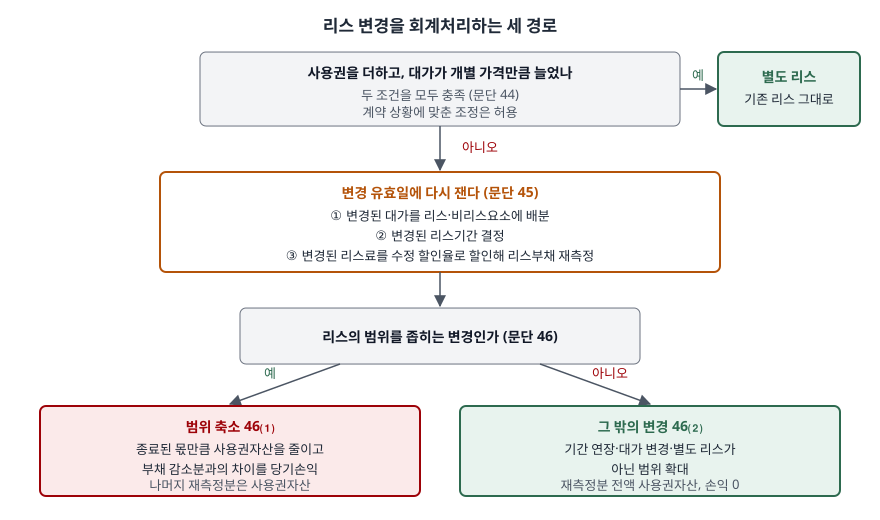

> 예제의 `다라물산`과 그 숫자는 계산을 보이려고 만든 가상 자료다. 법인세, 초기 직접원가, 복구원가, 비리스요소는 없다고 두었고, 변경은 연초에 효력이 생긴다고 단순화했다.

## 들어가며

사무실을 몇 년 쓰다 보면 인원이 늘어 한 층을 더 빌리거나, 재택근무가 자리 잡아 한 층을 반납하는 일이 생긴다. 리스 주석을 읽다 보면 그런 해에 '리스 변경이익'이라는 줄이 영업외수익에 찍혀 있기도 하다. 면적을 줄였는데 왜 이익이 나는지 설명하지 못한 채, 대개는 일회성 항목이라며 넘긴다. 그런데 같은 '한 층 추가'도 가격 조건에 따라 새 리스가 되기도 하고 기존 리스 전체를 다시 재는 계기가 되기도 해서, 예제에서는 재무상태표에 붙는 리스부채가 432.95와 326.49로 갈린다. 계약서를 고친 해의 숫자를 읽으려면 기준서가 변경을 어느 경로로 보내는지부터 알아야 한다.

## 개념

### 리스 변경과 재측정은 다르다

[리스부채 재측정 글](../2026-11-25-lease-liability-remeasurement-discount-rate/index.md)에서 다룬 재측정은 **원래 계약에 이미 적힌** 연장선택권이나 지수 연동 조항이 작동한 경우다. 리스 변경은 원래 계약조건에 없던 범위나 대가의 변경, 즉 당사자가 계약서를 새로 고친 경우다(부록 A 용어 정의). 기존 계약에 연장선택권이 있어 그것을 행사한 것은 재측정이고, 선택권이 없던 계약에 3년을 새로 붙이기로 합의한 것은 리스 변경이다.

### 첫 번째 질문 — 별도 리스인가

리스 변경은 두 조건을 모두 충족하면 별도 리스로 회계처리한다(문단 44). 하나는 하나 이상의 기초자산 사용권을 추가해 리스의 범위가 넓어지는 것이고, 다른 하나는 넓어진 범위의 개별 가격에 그 계약 상황을 반영한 적절한 조정을 더한 금액만큼 리스대가가 늘어나는 것이다. 사무실 한 층을 시장 임대료대로 더 빌리면 두 조건을 충족한다. 이때 기존 리스는 손대지 않고, 추가된 층은 그 날을 개시일로 하는 새 리스가 된다.

### 별도 리스가 아니면 다시 잰다

별도 리스가 아닌 변경은 변경 유효일에 세 가지를 한다(문단 45). 변경된 계약의 대가를 배분하고, 변경된 리스기간을 정하고, 변경된 리스료를 수정 할인율로 할인해 리스부채를 다시 잰다. 수정 할인율은 남은 리스기간의 내재이자율을 쉽게 산정할 수 있으면 그것, 아니면 변경 유효일의 증분차입이자율이다(문단 45). 리스 변경은 계약을 새로 고친 것이므로 어떤 경우든 그날의 할인율을 쓴다는 점이 지수 변동 재측정과 다르다.

### 두 번째 질문 — 범위를 좁혔는가

재측정 차이를 어디로 보낼지는 변경의 방향이 정한다(문단 46). 리스의 범위를 좁히는 변경이면 리스의 일부나 전부가 종료된 것을 반영해 사용권자산 장부금액을 줄이고, 그에 따른 차손익을 당기손익으로 인식한다. 그 밖의 모든 변경(기간 연장, 대가만 바뀐 경우, 별도 리스 조건을 못 갖춘 범위 확대)은 재측정 차이를 사용권자산에서 조정하고 손익은 생기지 않는다.

## 구조



> **출처**: [K-IFRS 제1116호 리스 — 문단 44 별도 리스, 45 변경 유효일의 재측정, 46 범위 축소와 그 밖의 변경, 부록 A 리스변경 정의](https://accountingwiki.co.kr/standards/1116) (제3자 전재, 발행처 한국회계기준원) · [K-IFRS 제1116호 적용사례 — 사례 15~19 리스변경](https://accountingwiki.co.kr/standards/1116/ig) (제3자 전재)

손익이 생기는 자리는 왼쪽 아래 하나뿐이다. 계약의 일부가 끝났으니 그 몫의 자산과 부채를 함께 없애는 것이고, 두 장부금액이 다르기 때문에 차이가 손익이 된다. 나머지 경로는 같은 리스가 이어지거나 새 리스가 생기는 것이라 손익이 끼어들 자리가 없다.

## 동작 원리

### 범위 축소는 두 단계로 계산한다

기준서 본문은 사용권자산을 '종료를 반영해' 줄이라고만 한다. 줄이는 방법은 적용사례 17이 보여 준다. 사무실 면적을 절반으로 줄인 그 사례는 먼저 사용권자산과 리스부채를 각각 줄어든 면적 비율만큼 줄이고, 두 감소액의 차이를 당기손익으로 인식한다. 다음으로 남은 리스료를 수정 할인율로 할인해 리스부채를 다시 재고, 비율로 줄이고 남은 부채와의 차이는 사용권자산에서 조정한다. 첫 단계는 '끝난 몫'의 정리이고, 둘째 단계는 '남은 몫'의 가격과 금리 변화 반영이다. 두 단계를 섞어 한 번에 계산하면 손익과 자산 조정의 경계가 흐려진다.

### 범위 축소는 대개 이익으로 나온다

리스부채는 원리금 균등 상환처럼 줄어 초기에 이자 비중이 크고 원금이 천천히 줄어든다. 반면 사용권자산은 정액으로 상각된다. 그래서 계약 중간에는 대개 리스부채 장부금액이 사용권자산보다 크고, 같은 비율로 둘을 줄이면 부채가 더 많이 줄어 이익이 된다. 개시일 할인율이 높을수록 부채가 늦게 줄어 이 차이가 커진다. 리스 변경이익은 면적을 줄여 돈을 번 것이 아니라 상각 방식의 차이가 정리되는 순간 드러난 것이다.

## 실습 예제

다라물산은 사무실 두 층을 10년 빌려 층당 매년 말 100을 내고, 개시일 증분차입이자율은 6%다. 5년을 지나 6년차 초에 계약을 고치고, 그날의 증분차입이자율은 5%다. 한 층의 시장 임대료는 그때도 연 100이다. 전체 소스: [`code/`](code/) · 수행 기록: [`code/output.txt`](code/output.txt)

```text
[1] 리스개시일 리스부채 = 사용권자산 원가 = 1472.02
[2] 6년차 초 변경 직전 장부 (5년 지급·상각 뒤)
  리스부채 842.47 · 사용권자산 736.01
```

```text
[3] 경로 1 — 한 층 추가, 층당 연 100 (개별 가격) → 별도 리스 (문단 44)
  변경                            리스부채     사용권자산      당기손익  처리
  기존 리스                       842.47    736.01     +0.00  그대로 둔다
  새 리스(3층)                    432.95    432.95     +0.00  새 개시일, 할인율 5%

[4] 경로 2 — 한 층 추가, 층당 연 70 (개별 가격 아님) → 별도 리스 아님 (문단 45·46⑵)
  변경                            리스부채     사용권자산      당기손익  처리
  변경 뒤                       1168.96   1062.49     +0.00  부채 재측정 +326.49 → 사용권자산 조정
```

경로 1은 기존 두 층의 장부를 6% 그대로 두고, 셋째 층만 5%로 새로 올린다. 경로 2는 셋째 층을 시장가보다 싸게 받았으므로 별도 리스가 아니고, 세 층 전체 270 × 5년을 5%로 다시 할인한다. 기존 두 층도 6%에서 5%로 다시 할인되면서 부채가 그만큼 더 커지고, 그 효과가 셋째 층 몫과 섞여 사용권자산 하나로 들어간다. 경로 2의 부채 증가가 경로 1보다 작은 것은 셋째 층 리스료가 작아서이고, 두 층의 할인율이 바뀐 효과는 반대 방향으로 부채를 키운다.

```text
[5] 경로 3 — 한 층 반납, 남은 한 층 연 110 → 범위 축소 (문단 46⑴)
  ① 줄어든 면적 비율 50% 만큼 줄인다
     사용권자산 -368.00 · 리스부채 -421.24 → 차이 +53.23 당기손익
  ② 남은 리스료 110 × 5년을 수정 할인율 5% 로 재측정 476.24
     남은 부채 421.24 와의 차이 +55.01 → 사용권자산 조정
  변경                            리스부채     사용권자산      당기손익  처리
  변경 뒤                        476.24    423.01    +53.23  비율 감소분만 손익, 재측정분은 자산

[6] 경로 4 — 두 층 그대로 기간만 3년 연장 → 그 밖의 변경 (문단 45·46⑵)
  변경                            리스부채     사용권자산      당기손익  처리
  변경 뒤                       1292.64   1186.18     +0.00  부채 재측정 +450.17 → 사용권자산 조정
```

경로 3에서 다라물산은 한 층을 반납했고, 남은 한 층의 리스료는 100에서 110으로 올랐다. 이익 53.23은 반납한 층의 부채와 자산 장부금액 차이이고, 리스료 인상과 금리 하락 효과 55.01은 손익을 거치지 않고 남은 층의 사용권자산에 붙는다. 경로 4는 계약서에 없던 3년을 새로 붙였으므로 리스 변경이고, 두 층 200 × 8년을 5%로 할인한 금액과의 차이가 전부 사용권자산으로 간다.

```text
[7] 범위 축소 손익의 크기 — 개시일 할인율별 (같은 계약, 5년 경과)
     개시일 할인율      리스부채     사용권자산    50% 축소 손익
          2%    942.69    898.26       +22.22
          4%    890.36    811.09       +39.64
          6%    842.47    736.01       +53.23
          8%    798.54    671.01       +63.77
```

같은 계약을 같은 시점에 절반 줄여도 개시일 할인율에 따라 이익이 22.22에서 63.77까지 벌어진다. 리스 변경이익의 크기는 반납 조건이 아니라 개시일 금리와 경과 기간이 정한다.

## 실무에서 주의할 점

- **리스 변경이익을 영업 성과로 읽지 않는다.** 범위 축소 이익은 사용권자산 정액 상각과 리스부채 유효이자 상각의 차이가 한꺼번에 정리된 것이다. 개시 후 지금까지 이자가 앞쪽에 몰려 지급액보다 비용을 더 잡아 둔 몫(리스부채와 사용권자산의 차이)이, 종료된 비율만큼 되돌아오는 것이다.
- **'한 층 추가'의 가격 조건을 확인한다.** 시장가대로면 별도 리스라 기존 리스 숫자가 그대로지만, 할인을 받았으면 기존 리스 전체가 새 할인율로 다시 잡힌다. 주석에 신규 리스로 잡혔는지 변경으로 잡혔는지에 따라 사용권자산 증감표의 줄이 달라진다.
- **연장의 출처를 구분한다.** 기존 계약의 연장선택권을 행사했으면 문단 40의 재측정이고, 선택권 없이 새로 합의했으면 문단 45의 리스 변경이다. 결과로 쓰는 할인율은 둘 다 재평가일·변경 유효일 금리라 같아 보이지만, 근거 문단과 주석 표시 위치가 다를 수 있다.
- **비율의 기준을 확인한다.** 적용사례 17은 면적 비율로 줄였다. 기초자산이 여러 개이고 가격이 서로 다르면 단순 면적 비율이 종료된 몫을 잘 나타내지 못할 수 있고, 회사가 고른 기준에 따라 손익이 달라진다. 기준서 본문은 비율 산정 방법을 정하지 않는다.
- **리스 전체 종료도 같은 줄로 나온다.** 범위 축소에는 일부 종료뿐 아니라 전부 종료도 들어간다(문단 46). 계약을 조기에 해지한 해의 리스 관련 손익은 해지 위약금과 장부금액 정리 이익이 섞여 있을 수 있으므로 주석에서 나눠 본다.

## 정리

- 리스 변경은 원래 계약에 없던 범위·대가의 변경이고, 계약에 이미 있던 선택권·지수 조항이 작동하는 재측정과 다르다.
- 사용권을 더하고 대가가 개별 가격만큼 늘면 별도 리스다. 기존 리스는 그대로 둔다.
- 별도 리스가 아니면 변경 유효일의 수정 할인율로 리스부채를 다시 잰다. 범위를 좁혔으면 종료된 몫의 자산·부채를 비율로 줄이고 차이를 손익으로, 그 밖의 변경은 차이 전액을 사용권자산에서 조정한다.
- 범위 축소 손익은 대개 이익이고, 그 크기는 개시일 할인율과 경과 기간이 정한다.

## 참고 자료

- [한국회계기준원 — 시행 중인 K-IFRS 기준서 목록](https://www.kasb.or.kr/front/board/ingAccountingList.do) — 기업회계기준서 제1116호 리스 원문 발행처. 아래 전재 사이트는 문단을 바로 열기 위한 편의 링크다
- [IFRS Foundation — IFRS 16 Leases](https://www.ifrs.org/issued-standards/list-of-standards/ifrs-16-leases/) — 국제회계기준 원문 발행처
- [K-IFRS 제1116호 리스 — 문단 44~46 리스변경, 부록 A 용어 정의](https://accountingwiki.co.kr/standards/1116) (제3자 전재)
- [K-IFRS 제1116호 리스 적용사례 — 문단 IE7 사례 15~19 리스변경, 사례 17 범위를 좁히는 변경](https://accountingwiki.co.kr/standards/1116/ig) (제3자 전재)
