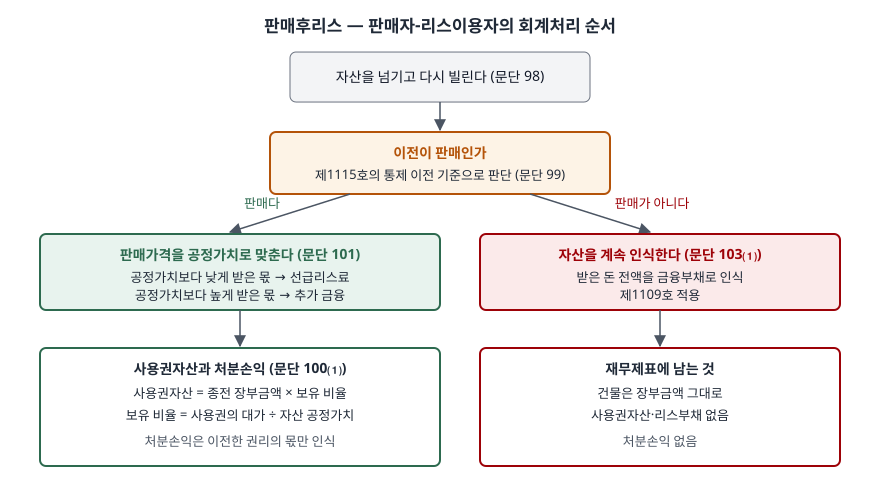

> 예제의 `가나물산`과 그 숫자는 계산을 보이려고 만든 가상 자료다. 법인세, 거래원가, 초기 직접원가는 없다고 두었다.

## 들어가며

사옥이나 물류센터를 팔고 그 자리에서 계속 영업하는 회사의 공시를 읽다 보면, 매각 대금은 1,000인데 손익계산서의 유형자산처분이익은 그 차익보다 훨씬 작게 찍혀 있는 경우가 있다. 이때 흔히 매각가에서 장부금액을 뺀 금액을 그해 이익으로 계산해 놓고, 공시된 숫자가 왜 다른지 찾느라 주석을 처음부터 다시 읽는다. 판매후리스에서는 그 뺄셈이 맞지 않는다. 예제의 건물은 장부금액 600, 매각가 1,000이라 차익이 400이지만 판매일에 이익으로 잡히는 금액은 214.68이고, 나머지 185.32는 손익계산서에 이익이라는 이름으로는 나타나지 않는다. 그 몫이 어디로 가는지는 사용권자산을 얼마로 재는지를 보면 알 수 있다.

## 개념

### 판매후리스는 두 계약을 하나로 본다

판매후리스는 기업이 자산을 다른 기업에 넘기고 그 자산을 다시 빌리는 거래다. 기준서는 넘기는 쪽을 판매자-리스이용자, 받는 쪽을 구매자-리스제공자라 부르고, 두 당사자 모두 자산 이전 계약과 리스를 묶어 회계처리하게 한다(문단 98). 따로 보면 판매 한 건과 리스 한 건이지만, 판매자는 자산을 넘긴 뒤에도 리스기간 동안 그 자산을 계속 쓴다. 자산이 주는 효익 가운데 리스기간에 해당하는 몫은 처음부터 넘어가지 않은 것이다.

### 먼저 판매인지 판단한다

첫 단계는 자산 이전이 판매인지다. 이 판단은 리스 기준서가 아니라 수익 기준서(제1115호)의 수행의무 이행 시점 요구사항, 곧 구매자가 자산을 통제하게 됐는지로 정한다(문단 99). 판매자가 자산을 되살 권리나 의무를 갖고 있으면 구매자가 통제하지 못하는 것이므로 판매가 아니다. 이 기준은 [재매입 선도·콜옵션 글](../2026-11-12-repurchase-forward-call-option/index.md)에서 다뤘다.

### 판매이면 넘긴 권리의 손익만 인식한다

판매에 해당하면 판매자-리스이용자는 사용권자산을 리스부채 금액으로 재지 않는다. 자산의 종전 장부금액 가운데 **계속 보유하는 사용권에 관련되는 부분**으로 잰다. 그 결과 구매자에게 넘긴 권리에 관련되는 차손익만 인식하게 된다(문단 100⑴). 일반 리스에서 사용권자산이 리스부채에서 출발하는 것과 다른 점이다. 리스부채 재는 법은 [리스 회계 기본 글](../2026-10-10-lease-liability-right-of-use/index.md)에 있다.

### 판매가 아니면 차입이다

판매가 아니면 판매자는 넘긴 자산을 계속 인식하고, 받은 돈과 같은 금액을 금융부채로 인식한다. 구매자는 자산을 인식하지 않고 같은 금액의 금융자산을 인식한다. 둘 다 금융상품 기준서(제1109호)를 적용한다(문단 103). 형식은 매매지만 재무제표에는 건물을 담보로 돈을 빌린 것과 같은 모양으로 남는다.

## 구조



> **출처**: [K-IFRS 제1116호 리스 — 문단 98 적용 대상, 99 판매 여부 판단, 100 판매인 경우, 101·102 공정가치 조정, 103 판매가 아닌 경우](https://accountingwiki.co.kr/standards/1116) (제3자 전재, 발행처 한국회계기준원)

판단은 두 번 갈린다. 첫 갈림은 판매 여부이고, 여기서 처분이익이 생길 수 있는지가 정해진다. 판매 쪽으로 가면 두 번째로 판매가격이 자산의 공정가치와 같은지를 본다. 다르면 그 차이를 판매대금이 아닌 다른 것으로 바꿔 읽은 다음에 사용권자산과 처분손익을 계산한다.

## 동작 원리

### 보유 비율이 장부금액과 차익을 함께 나눈다

판매자가 계속 보유하는 몫은 자산 전체의 공정가치 가운데 사용권의 대가가 차지하는 비율로 잰다. 기준서 본문은 이 비율의 산식을 따로 정하지 않고, 적용사례 24가 리스료의 현재가치를 자산의 공정가치로 나누는 방식으로 계산해 보인다. 예제에서 리스료의 현재가치가 463.30이고 건물의 공정가치가 1,000이면 보유 비율은 46.33%다. 이 비율을 종전 장부금액 600에 곱한 277.98이 사용권자산이고, 차익 400 가운데 나머지 53.67%에 해당하는 214.68만 처분이익이다.

### 인식하지 않은 몫은 감가상각비가 줄어드는 형태로 나타난다

차익 가운데 185.32는 없어진 것이 아니다. 사용권자산이 리스부채 463.30보다 그만큼 작게 잡혔으므로, 리스기간 10년 동안 감가상각비가 매년 18.53씩 적게 나간다. 판매일에 한꺼번에 잡히지 않은 이익이 자산을 쓰는 기간에 걸쳐 비용 감소로 나뉘어 들어오는 구조다. 그래서 판매후리스를 한 회사는 판매일 이후 몇 해 동안, 같은 조건으로 건물을 그냥 빌린 회사보다 감가상각비가 작다.

### 판매가격이 공정가치와 다르면 차이를 바꿔 읽는다

판매자와 구매자는 판매가격과 리스료를 함께 정하므로, 판매가격을 올리고 리스료도 올리는 식으로 금액을 옮길 수 있다. 기준서는 판매대가가 자산의 공정가치와 다르거나 리스료가 시장요율이 아니면 판매금액을 공정가치로 맞추게 한다(문단 101). 시장조건보다 낮게 받은 몫은 리스료를 미리 낸 것으로 보고, 높게 받은 몫은 구매자가 판매자에게 빌려준 추가 금융으로 본다. 조정액은 판매대가와 공정가치의 차이, 또는 계약상 리스료와 시장 리스료의 현재가치 차이 가운데 더 쉽게 산정할 수 있는 쪽으로 잰다(문단 102).

### 변동리스료만 있어도 리스부채를 인식한다

리스료가 전부 매출 연동 같은 변동리스료이면 일반 리스에서는 리스부채에 들어갈 금액이 없다. 판매후리스에서 그대로 두면 보유한 사용권에 대한 차익까지 전부 이익으로 잡히게 된다. 2024년 1월 1일 이후 시작하는 회계연도부터 적용되는 문단 102A는, 판매자-리스이용자가 개시일 뒤 리스부채를 잴 때 계속 보유하는 사용권에 관련된 차손익을 인식하지 않는 방식으로 '리스료'를 정하게 한다. 이 글의 예제는 고정리스료만 다룬다.

## 실습 예제

가나물산은 장부금액 600, 공정가치 1,000인 건물을 팔고 10년 다시 빌린다. 리스료는 매년 말에 내고 내재이자율은 5%다. 전체 소스: [`code/`](code/) · 수행 기록: [`code/output.txt`](code/output.txt)

```text
[1] 사례 A — 계속 보유하는 사용권의 비율
  리스료 현재가치   463.30  (= 60 × 연금현가계수 7.7217)
  보유 비율         46.33%  (= 463.30 ÷ 1000)
  사용권자산        277.98  (= 장부금액 600 × 보유 비율)
  처분이익 총액     400.00  (= 1000 - 600)
  인식하는 이익     214.68  (이전한 권리 53.67%)
  인식하지 않는 몫  185.32
```

판매일 분개는 현금 1,000과 사용권자산 277.98이 차변에, 건물 600·리스부채 463.30·처분이익 214.68이 대변에 놓인다.

```text
[3] 세 사례 비교 — 판매가격이 달라도 처분이익은 거의 같다
  사례        판매가    연 리스료    리스료 PV    추가 금융    선급리스료      리스부채     사용권자산     인식 이익
  A      1000.00      60.00     463.30       0.00        0.00      463.30       277.98      214.68
  B      1100.00      73.00     563.69     100.00        0.00      463.69       278.21      214.53
  C       900.00      47.00     362.92       0.00      100.00      362.92       277.75      214.83
  조정이 없다면 B 의 처분이익 총액은 500.00 (= 1100 - 600) 로 보인다
```

사례 B는 공정가치보다 100을 더 받고 리스료를 73으로 올린 거래다. 더 받은 100은 판매대금이 아니라 추가 금융이므로 금융부채로 따로 잡고, 리스료 현재가치 563.69에서 100을 뺀 463.69만 리스부채다. 사례 C는 100을 덜 받고 리스료를 47로 낮춘 거래다. 덜 받은 100은 리스료를 미리 낸 것이므로 사용권의 대가에 더해져 보유 비율이 46.29%가 된다. 세 사례의 처분이익은 214.53에서 214.83 사이에 모인다. 남은 차이는 리스료를 정수로 맞추면서 생긴 것이다. 판매가격을 어떻게 정하든 판매일 이익이 달라지지 않게 하는 것이 문단 101의 조정이 하는 일이다.

```text
[5] 리스기간별 — 오래 빌릴수록 판매일의 이익이 줄어든다
    리스기간    리스료 PV    보유 비율     사용권자산     인식 이익       미인식
       3년      163.39     16.34%        98.04      334.64      65.36
       5년      259.77     25.98%       155.86      296.09     103.91
      10년      463.30     46.33%       277.98      214.68     185.32
      15년      622.78     62.28%       373.67      150.89     249.11
      20년      747.73     74.77%       448.64      100.91     299.09
```

같은 건물을 같은 값에 팔아도 다시 빌리는 기간이 3년이면 334.64, 20년이면 100.91이 판매일 이익이다. 오래 빌릴수록 넘긴 권리가 작기 때문이다.

```text
[6] 이전이 판매가 아닌 경우 (문단 103) — 사례 A 와 같은 현금 1000

                    판매 (사례 A)      판매 아님
  건물                     0.00       600.00
  사용권자산                277.98         0.00
  리스부채                 463.30         0.00
  금융부채                   0.00      1000.00
  판매일 이익               214.68         0.00
```

들어온 현금은 같은 1,000인데 판매가 아니면 부채가 1,000으로 잡히고 이익은 없다.

## 실무에서 주의할 점

- **매각가에서 장부금액을 뺀 금액을 그해 이익으로 읽지 않는다.** 판매후리스의 처분이익은 넘긴 권리의 몫뿐이다. 공시된 처분이익이 단순 차익보다 작으면 오류가 아니라 문단 100⑴의 결과다. 리스이용자는 판매후리스에서 생긴 차손익을 주석에 따로 공시한다(문단 53⑼). 그 주석 표를 읽는 법은 [리스이용자 주석 글](../../disclosure/2026-11-26-lessee-lease-disclosure-total-cash-outflow/index.md)에 있다.
- **리스기간을 같이 본다.** 같은 매각 대금이라도 재리스 기간이 길면 판매일 이익이 작고 그 뒤 감가상각비가 작다. 기간이 짧으면 반대다. 처분이익의 크기만으로 두 회사의 매각 조건을 비교할 수 없다.
- **공정가치를 넘는 대금은 차입으로 남는다.** 사례 B처럼 100을 더 받으면 그만큼 금융부채가 생긴다. 현금흐름표에서 유형자산 처분으로 들어온 돈이 크더라도 그 일부는 재무활동 성격의 차입이다.
- **판매가 아닌 거래는 부채비율이 다르게 나온다.** 되살 권리가 붙은 매각은 받은 돈 전액이 금융부채다. 사례 A의 리스부채 463.30과 비교하면 부채가 두 배를 넘는다. 매각으로 차입금을 갚았다는 설명이 있더라도 재매입 조건이 있는지 주석에서 확인한다.
- **처분이익은 일회성이고 감가상각 감소는 여러 해에 걸친다.** 판매일 이익 214.68은 그해에만 나타나지만, 연 18.53의 감가상각 차이는 리스기간 내내 영업이익에 들어간다. 기간별 실적을 비교할 때 두 효과를 따로 본다.

## 정리

- 판매후리스는 자산 이전과 리스를 묶어 처리하고, 이전이 판매인지는 제1115호의 통제 이전 기준으로 판단한다.
- 판매이면 사용권자산을 종전 장부금액에 보유 비율을 곱해 재고, 넘긴 권리에 해당하는 차익만 인식한다. 인식하지 않은 몫은 리스기간의 감가상각비 감소로 나타난다.
- 판매가격이 공정가치보다 낮으면 차이를 선급리스료로, 높으면 추가 금융으로 본다.
- 판매가 아니면 자산을 그대로 두고 받은 돈을 금융부채로 인식한다. 처분이익은 없다.

## 참고 자료

- [한국회계기준원 — 시행 중인 K-IFRS 기준서 목록](https://www.kasb.or.kr/front/board/ingAccountingList.do) — 기업회계기준서 제1116호 리스 원문 발행처. 아래 전재 사이트는 문단을 바로 열기 위한 편의 링크다
- [IFRS Foundation — IFRS 16 Leases](https://www.ifrs.org/issued-standards/list-of-standards/ifrs-16-leases/) — 국제회계기준 원문 발행처
- [K-IFRS 제1116호 리스 — 문단 98~103 판매후리스거래, 102A 판매후리스에서 생기는 리스부채, C1D 시행일](https://accountingwiki.co.kr/standards/1116) (제3자 전재)
- [K-IFRS 제1116호 리스 적용사례 — 사례 24 판매후리스](https://accountingwiki.co.kr/standards/1116/ig) (제3자 전재)
