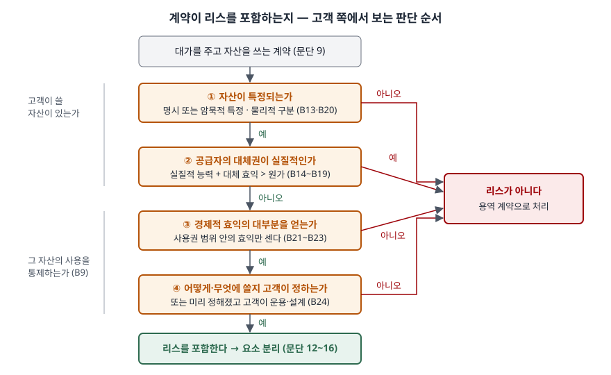

> 예제의 `가나유통`·`다라운송`과 그 숫자는 계산을 보이려고 만든 가상 자료다. 대체 효익과 원가, 개별 가격도 예제를 위해 정한 값이다. 리스개설직접원가와 리스 인센티브는 없다고 두었다.

## 들어가며

물류를 외주로 돌린 회사 두 곳의 재무제표를 나란히 놓고 보면, 운송비 규모는 비슷한데 한 회사에는 사용권자산과 리스부채가 수백억 원 잡혀 있고 다른 회사에는 아무것도 없는 경우가 있다. 이때 흔히 한쪽이 차를 빌렸고 한쪽은 운송을 샀다고 짐작하고 넘어가는데, 계약서 제목이 둘 다 '운송 용역 계약'이라면 그 짐작은 근거가 없다. 리스인지 아닌지는 계약의 이름이 아니라 조건 몇 개로 갈린다. 예제의 계약은 연 120을 5년간 내는 같은 계약인데, 조건에 따라 개시일 리스부채가 0이 되기도 하고 388.83이나 505.48이 되기도 한다.

## 개념

### 리스는 식별되는 자산의 사용 통제권을 넘기는 계약이다

제1116호는 계약 약정시점에 그 계약이 리스이거나 리스를 포함하는지를 판단하게 한다. 대가와 교환해 **식별되는 자산의 사용 통제권**을 일정 기간 이전하면 리스다(문단 9). 판단은 계약 조건이 바뀔 때만 다시 한다(문단 11). 리스로 판단되면 고객은 사용권자산과 리스부채를 재무상태표에 올리고, 아니면 대가를 지급할 때마다 비용으로 처리한다. 리스부채를 재는 법은 [리스 회계 기본 글](../2026-10-10-lease-liability-right-of-use/index.md)에 있다.

### 통제는 두 권리를 함께 가질 때만 있다

고객이 자산의 사용을 통제하려면 사용기간 내내 두 권리를 모두 가져야 한다. 자산을 써서 생기는 경제적 효익의 대부분을 얻을 권리, 그리고 자산의 사용을 지시할 권리다(B9). 효익만 얻고 지시는 공급자가 하면 리스가 아니다. 기준서는 '대부분'에 숫자 기준을 두지 않는다. 비율로 선을 긋는 글을 보면 그 선이 어디서 왔는지 확인해야 한다.

### 리스가 들어 있으면 나머지 요소와 나눈다

계약에 리스와 정비 같은 용역이 함께 들어 있으면, 리스요소는 리스로 처리하고 비리스요소는 분리한다(문단 12). 고객은 대가를 각 요소의 상대적 개별 가격으로 배분한다(문단 13). 다만 기초자산 유형별로 분리하지 않고 전체를 하나의 리스로 처리하는 간편법을 고를 수 있다(문단 15).

## 구조



> **출처**: [K-IFRS 제1116호 리스 적용지침 — B9 통제의 두 조건, B13~B20 식별되는 자산과 실질적 대체권, B21~B23 경제적 효익, B24~B30 사용 지시권, B31 판단 순서도](https://accountingwiki.co.kr/standards/1116/b) (제3자 전재, 발행처 한국회계기준원)

앞의 두 단계는 고객이 쓸 자산이 따로 있는지를 묻고, 뒤의 두 단계는 그 자산의 사용을 고객이 통제하는지를 묻는다. 어느 단계에서든 '아니오'로 빠지면 계약 전체가 용역이 된다.

## 동작 원리

### 자산이 특정돼도 공급자가 바꿀 수 있으면 식별되는 자산이 아니다

공급자가 사용기간 내내 자산을 대체할 **실질적 권리**를 가지면 고객은 식별되는 자산의 사용권이 없다. 실질적이려면 두 조건이 모두 맞아야 한다. 공급자가 대체할 실질적 능력이 있고, 대체로 경제적 효익을 얻을 것, 곧 대체에서 오는 효익이 원가를 넘을 것으로 예상돼야 한다(B14). 특정일 이후에만 바꿀 수 있으면 사용기간 내내의 능력이 아니므로 실질적이지 않다(B15). 판단은 약정시점의 사실로 하고 일어날 것 같지 않은 미래 사건은 넣지 않는다(B16). 자산이 고객 부지에 있으면 대체 원가가 대개 크다(B17). 고장 수리나 정비를 위해 바꾸는 권리는 고객의 사용권을 막지 않는다(B18). 고객이 쉽게 판단할 수 없으면 실질적이지 않다고 본다(B19).

마지막 조항이 고객 쪽 판단의 기본값을 정한다. 공급자의 사정을 알 수 없으면 대체권이 없는 것처럼 보고 리스로 처리하게 된다.

### 자산의 일부는 물리적으로 구분될 때 식별된다

건물의 한 층처럼 물리적으로 구분되는 부분은 식별되는 자산이다. 광케이블 용량처럼 구분되지 않는 일부는 그것이 용량의 대부분이어서 고객이 효익의 대부분을 얻을 때만 식별되는 자산이 된다(B20).

### 사용 지시권은 '어떻게, 무엇에'를 정하는 권리다

고객이 사용기간 내내 자산을 어떻게, 무엇을 위해 쓸지 지시할 수 있으면 사용 지시권이 있다(B24⑴). 무엇을 실어 나를지, 언제 어디로 갈지 같은 결정이 그것이다(B26). 이런 결정이 계약에 미리 정해져 있으면, 고객이 자산을 운용할 권리를 가지거나 자산을 설계했을 때 지시권이 있다고 본다(B24⑵). 공급자가 자기 인력과 자산을 보호하려고 넣은 조건은 사용 범위를 정할 뿐 지시권을 막지 않는다(B30).

## 실습 예제

가나유통이 다라운송과 5년 계약을 맺고 매년 말 120을 낸다. 120에는 화물차 사용과 정비·기사 용역이 함께 들어 있다. 증분차입이자율은 6%다. 전체 소스: [`code/`](code/) · 수행 기록: [`code/output.txt`](code/output.txt)

```text
  B 다라운송이 차고지의 같은 차종으로 언제든 교체
    - 자산이 특정됨 (B13)
    - 대체 효익 8 > 원가 2 → 실질적 대체권 (B14)
    => 리스가 아니다 (용역)
  C 교체는 3년 차부터만 가능
    - 자산이 특정됨 (B13)
    - 대체권이 특정일 이후에만 생김 → 실질적이지 않음 (B15)
    - 경제적 효익의 대부분을 얻음 (B21)
    - 운행 노선·시간을 고객이 정함 → 사용 지시권 있음 (B24⑴)
    => 리스를 포함한다
  D 차량번호 명시, 노선·시간은 다라운송이 정함
    - 자산이 특정됨 (B13)
    - 공급자 대체권 없음
    - 경제적 효익의 대부분을 얻음 (B21)
    - 운행 노선·시간을 공급자가 정함 → 사용 지시권 없음 (B24)
    => 리스가 아니다 (용역)
```

차량번호를 명시하고 노선을 가나유통이 정하는 사례 A는 리스다. B와 C는 대체 효익과 원가가 같은데, 교체가 3년 차부터만 가능하다는 조건 하나로 결론이 갈린다. D는 차량이 특정돼도 노선을 공급자가 정하므로 용역이다.

```text
[2] 리스요소와 비리스요소에 대가 배분 (문단 13)
  리스요소   120 × 100/130 = 92.31
  비리스요소 120 × 30/130 = 27.69
  연금현가계수 (5년, 6%) 4.2124

[3] 개시일 재무상태표와 첫해 손익
  처리                          리스부채     사용권자산     감가상각       이자     용역비용     비용 합계
  용역 (B·D)                      0.00        0.00       0.00     0.00     120.00     120.00
  리스, 요소 분리 (A·C)             388.83      388.83      77.77    23.33      27.69     128.79
  리스, 간편법 (문단 15)             505.48      505.48     101.10    30.33       0.00     131.43
  EBITDA 를 줄이는 비용은 용역비용 칸뿐이다: 용역 120.00 / 요소 분리 27.69 / 간편법 0.00
```

간편법을 쓰면 정비·기사 용역 몫 27.69까지 리스료에 들어가 리스부채가 116.65 커진다. 같은 계약이 처리 방식에 따라 EBITDA를 120, 27.69, 0만큼 줄인다.

```text
[4] 5년 합계 비용은 같다 — 시점만 다르다
  용역              120.00  120.00  120.00  120.00  120.00   합계 600.00
  리스, 요소 분리       128.79  124.65  120.26  115.61  110.68   합계 600.00
  리스, 간편법         131.43  126.05  120.34  114.30  107.89   합계 600.00
```

5년 합계는 셋 다 600이다. 리스로 처리하면 이자비용이 앞쪽에 몰려 초기 비용이 크고 뒤로 갈수록 작다.

## 실무에서 주의할 점

- **계약서 제목으로 판단하지 않는다.** '운송 용역 계약'에도 리스가 들어 있을 수 있다. 차량이 특정되는지, 노선을 누가 정하는지를 본다. 두 회사의 운송비를 비교할 때 한쪽만 사용권자산이 있으면 계약 조건이 다른 것이지 운송을 덜 쓰는 것이 아니다.
- **대체권 조항은 시기 제한을 같이 읽는다.** 사례 C처럼 특정일 이후에만 바꿀 수 있으면 실질적 대체권이 아니다(B15). 정비를 위한 교체 조항도 대체권이 아니다(B18). 고객이 판단할 정보가 없으면 실질적이지 않은 것으로 본다(B19).
- **간편법은 부채를 키운다.** 문단 15를 고르면 용역 대가까지 리스부채에 들어간다. 예제에서는 리스부채가 388.83에서 505.48로 30% 커진다. 부채비율이나 EBITDA를 비교할 때 어느 쪽을 골랐는지 회계정책 주석에서 확인한다.
- **EBITDA는 처리 방식에 따라 크게 달라진다.** 리스로 처리한 비용은 감가상각과 이자로 나뉘어 EBITDA 밖으로 나간다. 같은 사업 구조라도 리스 식별 결과에 따라 EBITDA가 달라지므로, 리스를 많이 쓰는 회사의 EBITDA는 리스부채와 함께 읽는다.
- **'대부분'에는 숫자 기준이 없다.** 제1116호는 효익의 '대부분'이나 용량의 '대부분'을 비율로 정하지 않는다. 특정 비율을 기준선으로 제시한 자료는 그 출처가 이 기준서가 아님을 염두에 둔다.

## 정리

- 리스는 식별되는 자산의 사용 통제권을 대가와 교환해 이전하는 계약이고, 통제는 효익의 대부분과 사용 지시권을 함께 가질 때만 있다.
- 자산이 특정돼도 공급자가 사용기간 내내 바꿀 실질적 권리가 있으면 리스가 아니다. 특정일 이후의 대체권, 정비를 위한 대체권은 실질적이지 않다.
- 리스가 들어 있으면 대가를 상대적 개별 가격으로 나누고, 간편법을 쓰면 용역 몫까지 리스부채에 들어간다.
- 처리 방식이 달라도 총비용은 같고, 재무상태표의 부채와 EBITDA, 비용의 시점이 달라진다.

## 참고 자료

- [한국회계기준원 — 시행 중인 K-IFRS 기준서 목록](https://www.kasb.or.kr/front/board/ingAccountingList.do) — 기업회계기준서 제1116호 리스 원문 발행처. 아래 전재 사이트는 문단을 바로 열기 위한 편의 링크다
- [IFRS Foundation — IFRS 16 Leases](https://www.ifrs.org/issued-standards/list-of-standards/ifrs-16-leases/) — 국제회계기준 원문 발행처
- [K-IFRS 제1116호 리스 — 문단 9~11 리스의 식별, 12~17 계약의 구성요소 분리](https://accountingwiki.co.kr/standards/1116) (제3자 전재)
- [K-IFRS 제1116호 리스 적용지침 — B9~B31 리스의 식별, B32~B33 구성요소 분리](https://accountingwiki.co.kr/standards/1116/b) (제3자 전재)
