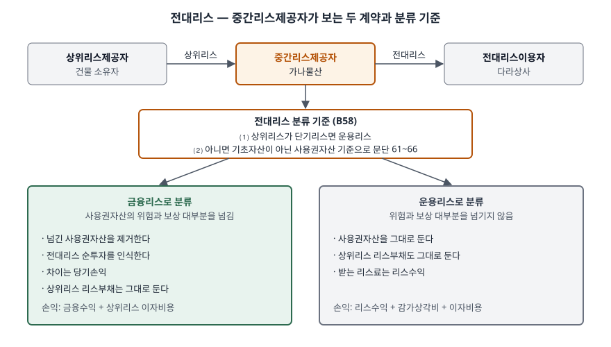

> 예제의 `가나물산`·`다라상사`와 그 숫자는 계산을 보이려고 만든 가상 자료다. 리스개설직접원가, 법인세, 리스 인센티브는 없다고 두었다.

## 들어가며

사업을 줄이면서 쓰지 않게 된 사무실 층을 다른 회사에 다시 빌려주는 일은 흔하다. 이런 회사의 주석을 읽다 보면 사용권자산은 줄었는데 리스부채는 그대로이고, 대신 '리스채권'이나 '전대리스 순투자'라는 자산이 새로 생긴 경우가 있다. 이때 흔히 건물을 기준으로 생각해서, 40년 가는 건물을 몇 년 빌려준 것이니 운용리스일 것이라고 짐작한다. 예제의 전대 기간 8년은 건물 내용연수의 20%에 불과하지만, 기준서가 보라는 대상으로 재면 100%가 된다. 이 차이로 재무상태표에 남는 자산의 이름과 손익의 모양이 달라진다.

## 개념

### 전대리스는 리스를 유지한 채 다시 빌려주는 거래다

전대리스는 리스이용자가 빌린 기초자산을 제3자에게 다시 리스하는 거래다. 처음 리스제공자와 맺은 리스(상위리스)는 그대로 유효하다(부록 A). 다시 빌려주는 회사는 상위리스에서는 리스이용자, 전대리스에서는 리스제공자가 되며, 기준서는 이 회사를 **중간리스제공자**라 부른다. 두 계약은 각각 따로 회계처리한다.

### 분류는 사용권자산을 기준으로 한다

리스제공자는 리스를 금융리스와 운용리스로 나눈다. 기초자산의 소유에 따른 위험과 보상의 대부분을 넘기면 금융리스다(문단 61·62). 이 판단 지표는 [리스제공자의 금융리스·운용리스 글](../2026-11-05-lessor-finance-vs-operating-lease/index.md)에서 다뤘다. 전대리스에서는 그 '기초자산'을 건물이 아니라 **상위리스에서 생긴 사용권자산**으로 바꿔 읽는다(B58⑵). 중간리스제공자가 가진 것은 건물이 아니라 남은 기간의 사용권이기 때문이다. 상위리스가 단기리스 면제(문단 6)를 적용해 사용권자산을 인식하지 않은 경우에는 전대리스를 운용리스로 분류한다(B58⑴).

### 할인율은 상위리스 것을 빌려 쓸 수 있다

금융리스로 분류하면 전대리스 순투자를 재야 한다. 전대리스의 내재이자율을 쉽게 산정할 수 없으면 상위리스에 쓴 할인율을 쓸 수 있다(문단 68). 이 경우 전대리스의 리스개설직접원가가 있으면 그만큼 조정한다.

## 구조



> **출처**: [K-IFRS 제1116호 리스 적용지침 — B58 전대리스의 분류](https://accountingwiki.co.kr/standards/1116/b) · [K-IFRS 제1116호 리스 적용사례 — 사례 20·21 전대리스](https://accountingwiki.co.kr/standards/1116/ig) (제3자 전재, 발행처 한국회계기준원)

아래 두 상자의 차이는 사용권자산이 재무상태표에 남는지다. 두 경우 모두 상위리스 리스부채는 그대로 남는다. 전대했다고 해서 건물 소유자에게 갚을 의무가 사라지지 않기 때문이다.

## 동작 원리

### 금융리스면 사용권자산이 순투자로 바뀐다

전대리스가 금융리스이면 중간리스제공자는 전대리스이용자에게 넘긴 사용권자산을 제거하고 전대리스 순투자를 인식한다. 둘의 차이는 당기손익이다. 상위리스 리스부채는 재무상태표에 그대로 두고, 전대 기간 동안 전대리스의 금융수익과 상위리스의 이자비용을 함께 인식한다(적용사례 20). 사용권자산이 사라졌으므로 감가상각비는 더 이상 없다.

### 운용리스면 두 계약이 따로 굴러간다

전대리스가 운용리스이면 중간리스제공자는 사용권자산과 리스부채를 그대로 둔다. 사용권자산 감가상각비와 리스부채 이자비용을 계속 인식하고, 전대리스로 받는 리스료는 리스수익으로 인식한다(적용사례 21). 상위리스 쪽 회계처리는 전대가 없을 때와 같다.

### 전대할 자산은 소액자산 면제를 받지 못한다

상위리스의 기초자산이 소액이라도 리스이용자가 그 자산을 전대하거나 전대할 것으로 예상하면 소액자산 리스로 보지 않는다(B7). 빌려서 다시 빌려줄 목적이면 처음부터 사용권자산과 리스부채를 인식해야 한다.

## 실습 예제

가나물산은 사무실 한 층을 10년, 연 100(매년 말 지급), 할인율 5%로 빌렸다. 2년이 지나 그 층을 다라상사에 연 110으로 다시 빌려준다. 전대리스의 내재이자율은 쉽게 산정할 수 없어 5%를 쓴다(문단 68). 전체 소스: [`code/`](code/) · 수행 기록: [`code/output.txt`](code/output.txt)

```text
[1] 전대 시작 시점 (2년 차 말) 상위리스
  최초 사용권자산·리스부채 772.17
  리스부채   646.32  (남은 8년 리스료의 현재가치)
  사용권자산 617.74  (= 772.17 × 8/10)

[2] 분류 지표 — 리스기간이 경제적 내용연수의 상당 부분인가 (문단 63⑶)
   전대 기간      기초자산 기준       사용권자산 기준
       8년          20.0%           100.0%
       3년           7.5%            37.5%
  (기초자산 내용연수 40년, 사용권자산의 남은 기간 8년)
```

남은 8년을 전부 전대하면 건물 기준으로는 20%지만 사용권자산 기준으로는 100%다. 사용권자산의 위험과 보상이 전부 다라상사로 넘어가므로 금융리스다. 3년만 전대하는 경우는 37.5%이고, 이 예제에서는 다른 지표도 금융리스를 가리키지 않는다고 두어 운용리스로 분류했다. 문단 63의 지표는 예시이며 결정적이지 않다(문단 65).

```text
[3] 사례 1 — 남은 8년 전부를 전대 (금융리스)
  전대리스 순투자 710.95  (= 110 × 6.4632)
  제거하는 사용권자산 617.74
  전대 개시일 손익   +93.21
  상위리스 리스부채 646.32 는 그대로 남는다
```

```text
[5] 전대 첫해 (3년 차) 손익
  항목                  사례 1 금융    사례 2 운용
  리스수익                     0.00       110.00
  전대 금융수익                 35.55         0.00
  감가상각비                    0.00       -77.22
  상위리스 이자비용              -32.32       -32.32
  합계                       3.23         0.47
  (사례 1 은 전대 개시일에 이익 93.21 를 따로 인식했다)
```

사례 1은 전대 개시일에 93.21을 한꺼번에 인식하고, 그 뒤 해마다 금융수익과 이자비용의 차이만 남는다. 사례 2는 개시일 손익이 없고 리스수익 110에서 감가상각비와 이자비용을 뺀 0.47이 남는다. 같은 층을 같은 값에 빌려줘도 손익계산서의 줄 이름과 이익이 잡히는 시점이 다르다.

```text
[6] 전대 직후 재무상태표 — 자산과 부채가 함께 남는다
  항목                  사례 1 금융    사례 2 운용
  사용권자산                    0.00       617.74
  전대리스 순투자               710.95         0.00
  리스부채                   646.32       646.32
```

두 사례 모두 리스부채 646.32가 남는다. 전대리스 순투자는 다라상사에게서 받을 돈이고, 리스부채는 건물 소유자에게 줄 돈이다.

## 실무에서 주의할 점

- **건물 내용연수로 분류를 짐작하지 않는다.** 기준이 되는 것은 사용권자산의 남은 기간이다. 남은 기간 대부분을 전대하면 건물 기준으로 짧아 보여도 금융리스가 될 수 있다.
- **리스부채는 전대해도 줄지 않는다.** 금융리스 전대로 사용권자산이 순투자로 바뀌어도 상위리스 부채는 그대로다. 부채비율을 볼 때 전대리스 순투자를 부채에서 빼서 읽지 않는다. 받을 돈과 줄 돈은 상대방이 다르고, 다라상사가 리스료를 내지 못해도 건물 소유자에게 줄 의무는 남는다.
- **개시일 손익은 할인율에 달려 있다.** 순투자를 상위리스 할인율로 재면(문단 68) 전대 리스료가 상위리스 리스료보다 큰 만큼 개시일 이익이 생긴다. 전대 리스료가 낮으면 손실이 된다. 공실을 메우려고 낮은 값에 전대한 경우 이 손실이 한꺼번에 나타난다.
- **운용리스 전대는 리스수익이 총액으로 잡힌다.** 사례 2는 리스수익 110과 감가상각비·이자비용이 따로 표시된다. 매출 규모를 비교할 때 전대 수익이 섞여 있는지 확인한다. 리스이용자는 사용권자산의 전대리스에서 생긴 수익을 주석에 공시한다(문단 53⑹). 그 주석 표를 읽는 법은 [리스이용자 주석 글](../../disclosure/2026-11-26-lessee-lease-disclosure-total-cash-outflow/index.md)에 있다.
- **전대를 예정한 자산은 면제가 막힌다.** 소액자산이라도 전대 목적이면 리스로 인식한다(B7). 단기리스 면제를 적용한 상위리스라면 전대는 기간과 관계없이 운용리스다(B58⑴).

## 정리

- 전대리스는 상위리스를 유지한 채 기초자산을 다시 빌려주는 거래이고, 중간리스제공자는 두 계약을 따로 처리한다.
- 전대리스는 기초자산이 아니라 상위리스에서 생긴 사용권자산을 기준으로 분류한다. 상위리스가 단기리스 면제를 받았으면 운용리스다.
- 금융리스면 사용권자산을 제거하고 전대리스 순투자를 인식하며 차이를 당기손익으로 인식한다. 운용리스면 사용권자산을 두고 리스수익을 인식한다.
- 어느 쪽이든 상위리스 리스부채는 그대로 남는다.

## 참고 자료

- [한국회계기준원 — 시행 중인 K-IFRS 기준서 목록](https://www.kasb.or.kr/front/board/ingAccountingList.do) — 기업회계기준서 제1116호 리스 원문 발행처. 아래 전재 사이트는 문단을 바로 열기 위한 편의 링크다
- [IFRS Foundation — IFRS 16 Leases](https://www.ifrs.org/issued-standards/list-of-standards/ifrs-16-leases/) — 국제회계기준 원문 발행처
- [K-IFRS 제1116호 리스 — 부록 A 용어 정의, 문단 61~66 리스의 분류, 68 전대리스 할인율, 53⑹ 전대리스 수익 공시](https://accountingwiki.co.kr/standards/1116) (제3자 전재)
- [K-IFRS 제1116호 리스 적용지침 — B7 소액자산, B58 전대리스의 분류](https://accountingwiki.co.kr/standards/1116/b) (제3자 전재)
- [K-IFRS 제1116호 리스 적용사례 — 사례 20·21 전대리스](https://accountingwiki.co.kr/standards/1116/ig) (제3자 전재)
