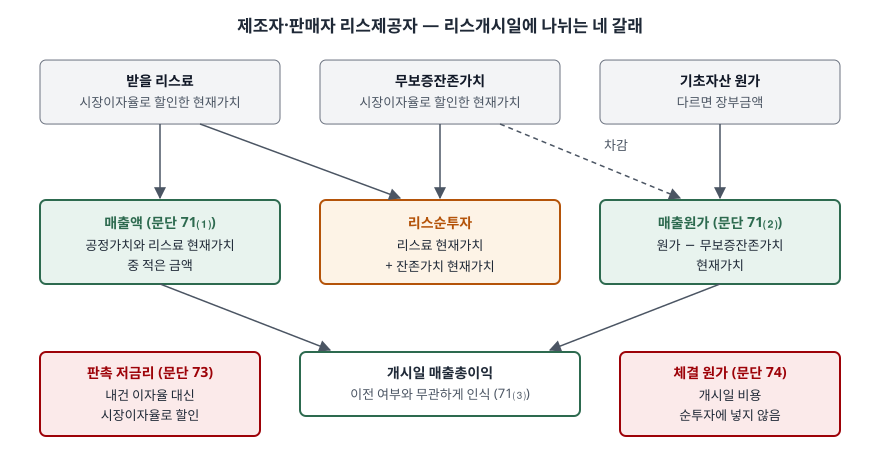

## 들어가며

자동차나 건설기계 광고에서 "36개월 무이자", "연 1.9% 리스" 같은 문구를 자주 본다. 고객은 같은 기계를 일시불로 살 수도 있고 리스로 쓸 수도 있으며, 만든 회사는 어느 쪽이든 기계를 내보낸다. 그런데 리스를 고른 고객의 계약에서 만든 회사는 언제 매출을 올리고 이익을 얼마로 잡는가.

계약서의 리스료를 계약서에 적힌 이자율로 할인해 매출을 잡으면 일시불 판매와 똑같은 이익이 첫날 나온다. 문제는 그 이자율이 판촉용이라는 데 있다. 이 글의 가상 회사로 계산하면 연 2%로 할인한 쪽의 첫날 이익은 30.00억원, 시장이자율 10%로 할인한 쪽은 9.35억원이다. 첫날에만 20.65억원이 갈린다.

[앞 글](../2026-11-05-lessor-finance-vs-operating-lease/index.md)은 리스제공자가 금융리스와 운용리스를 어떻게 나누는지 다뤘다. 이 글은 그중 금융리스를 **만든 회사나 파는 회사가 직접** 내줄 때 붙는 규칙을 다룬다.

## 개념

기업회계기준서 제1116호는 제조자나 판매자인 리스제공자가 금융리스를 맺으면 리스개시일에 세 가지를 인식하게 한다(문단 71).

| 항목 | 금액 |
|---|---|
| 수익(매출액) | 기초자산의 공정가치와, 제공자에게 귀속되는 리스료를 **시장이자율로 할인한 현재가치** 중 적은 금액 |
| 매출원가 | 기초자산의 원가(원가와 장부금액이 다르면 장부금액)에서 **무보증잔존가치의 현재가치**를 뺀 금액 |
| 매출손익 | 일반 판매에 적용하는 회계정책(제1115호)에 따라 인식. 기초자산을 이전하는지와 관계없이 개시일에 인식 |

이 규칙이 왜 있는지는 문단 72가 설명한다. 제조자나 판매자는 고객에게 구매와 리스 중 고르게 하는 일이 흔하고, 금융리스로 내주면 정상 판매가격으로 팔 때와 같은 손익이 생긴다. 금융리스는 위험과 보상의 대부분이 넘어간 거래이므로, 경제적으로는 **외상 판매에 할부 금융을 얹은 것**과 같다는 판단이다. 그래서 개시일의 판매 이익과 그 뒤 기간의 이자 수익을 나눠 인식한다.

일반 리스제공자(금융회사 등)는 개시일에 매출이익이 없다. 설비를 공정가치로 사서 같은 금액의 순투자로 바꾸기 때문이다. 제조자·판매자는 장부에 원가로 있던 자산을 공정가치 수준의 순투자로 바꾸므로 그 차이가 이익이 된다.

## 구조



> **출처**: [K-IFRS 제1116호 리스 — 문단 71~74 제조자 또는 판매자인 리스제공자](https://accountingwiki.co.kr/standards/1116) (제3자 전재, 발행처 한국회계기준원)

무보증잔존가치는 매출과 매출원가 어느 쪽에도 들어가지 않는다. 리스기간이 끝나면 기계가 돌아오므로 그 몫은 팔린 것이 아니다. 그래서 매출액은 리스료 몫만 담고, 매출원가에서도 잔존가치 현재가치를 빼며, 그 금액은 리스순투자 안에 남는다. 리스순투자는 리스료 현재가치와 무보증잔존가치 현재가치의 합이다.

## 동작 원리

### 할인율 하나가 매출과 금융수익을 나눈다

같은 리스료 흐름을 높은 이자율로 할인하면 현재가치가 작아진다. 매출이 줄고 개시일 이익이 줄어든다. 대신 순투자가 작게 잡히고, 이후 그 순투자에 높은 이자율을 곱하므로 기간마다 금융수익이 커진다. 반대로 낮은 이자율로 할인하면 개시일 이익이 커지고 금융수익이 작아진다. 계약 전체에서 받는 현금은 정해져 있으므로 **이익 총액은 같고, 개시일과 그 뒤 기간 사이의 배분만 바뀐다.**

### 판촉 저금리가 개시일 이익을 부풀리는 경로

문단 73은 고객을 끌려고 의도적으로 낮은 이자율을 제시하는 경우를 따로 짚는다. 이때 계약서 이자율을 쓰면 개시일에 과도한 이익이 인식되므로, 매출이익을 **시장이자율을 적용했을 때의 금액으로 제한**한다.

판촉 금리가 실제로 하는 일은 가격 할인이다. 정가 100억원짜리 기계를 연 2%로 리스해 주면 고객이 내는 리스료는 시장 조건보다 작다. 그 리스료를 시장이자율로 할인하면 고객이 실제로 치르는 값이 100억원보다 낮다는 것이 드러난다. 계약서의 2%로 할인하면 그 할인이 매출에서 빠지지 않고, 이후 5년의 금융수익이 낮아지는 형태로 뒤로 미뤄진다.

### 체결 원가는 순투자에 넣지 않는다

일반 리스제공자는 리스개설직접원가를 순투자에 포함해 리스기간에 걸쳐 수익을 줄인다. 제조자·판매자가 금융리스 체결과 관련해 쓴 원가는 개시일에 비용으로 인식한다(문단 74). 이 원가는 리스개설직접원가의 정의에서 빠지므로 순투자에 들어가지 않는다. 개시일에 매출이익을 인식하는 이상, 그 판매를 얻는 데 든 원가도 같은 날 비용으로 대응시키는 구조다.

## 실습 예제

가상 회사 **사하기계**는 원가 70억원인 기계를 정상 판매가격 100억원에 판다. 같은 기계를 5년 금융리스로 내주는데, 리스료는 매년 말에 받고 5년 뒤 기계를 돌려받는다. 돌려받을 때의 무보증잔존가치는 10억원, 시장이자율은 10%로 둔다.

```python
def day_one(payment: float, rate: float) -> dict[str, float]:
    pv_payments = pv_annuity(payment, rate, YEARS)
    pv_residual = pv_single(RESIDUAL, rate, YEARS)
    revenue = min(FAIR_VALUE, pv_payments)  # 문단 71⑴: 둘 중 적은 금액
    cost_of_sales = COST - pv_residual      # 문단 71⑵: 잔존가치 현재가치는 원가에서 뺀다
    ...
```

전체 소스: [`code/`](code/)

### 시장이자율로 리스료를 정한 경우

```text
[0] 일반 판매로 팔았을 때 (문단 72의 비교 대상)
    매출 100.00 - 원가 70.00 = 매출총이익 30.00

[1] 시장이자율 10%로 리스료를 정한 경우
  시장이자율로 할인
    연 리스료                    24.74
    할인에 쓴 이자율               10%
    리스료 현재가치              93.79
    무보증잔존가치 현재가치       6.21
    매출액 = min(100, 현재가치)  93.79
    매출원가 = 70 - 잔존 현재가치 63.79
    매출총이익                   30.00
    리스순투자                  100.00
```

매출액이 100억원이 아니라 93.79억원이다. 5년 뒤 돌아올 기계의 현재가치 6.21억원은 팔린 것이 아니어서 매출에서 빠지고, 같은 금액이 매출원가에서도 빠진다. 매출총이익은 30.00억원으로 일반 판매와 같다. 문단 72가 말하는 "정상 판매가격으로 팔 때와 같은 손익"이 숫자로 맞는다. 순투자 100.00억원은 공정가치와 같다.

### 판촉 이자율 2%로 리스료를 정한 경우

사하기계가 "연 2% 리스"를 내걸고 2% 기준으로 리스료를 정하면 연 리스료가 19.29억원으로 내려간다. 이 리스료를 어떤 이자율로 할인하느냐가 갈린다.

```text
  (가) 내건 2%로 할인 — 문단 73이 막는 처리
    연 리스료                    19.29
    리스료 현재가치              90.94
    무보증잔존가치 현재가치       9.06
    매출총이익                   30.00
    리스순투자                  100.00

  (나) 시장이자율 10%로 할인 — 문단 73의 처리
    연 리스료                    19.29
    리스료 현재가치              73.14
    무보증잔존가치 현재가치       6.21
    매출총이익                    9.35
    리스순투자                   79.35

    개시일 이익 차이 (가)-(나) = 20.65
```

(가)는 리스료를 깎아 줬는데도 개시일 이익이 일반 판매와 같은 30.00억원이다. 할인을 매출에서 빼지 않았기 때문이다. (나)는 리스료 현재가치가 73.14억원으로, 고객이 실제로 치르는 값이 정가보다 26.86억원 낮다는 것이 매출에 드러난다. 개시일 이익은 9.35억원이다(출력의 할인율 줄은 지면상 생략했다).

### 연도별로 펼치면

```text
[3] 판촉 리스의 연도별 이익 — 개시일 매출총이익 + 금융수익 (단위: 억원)
    시점     (가) 2% 처리    (나) 10% 처리
  ----------------------------------
   개시일         30.00          9.35
     1년          2.00          7.93
     2년          1.65          6.80
     3년          1.30          5.55
     4년          0.94          4.18
     5년          0.57          2.66
  ----------------------------------
    합계         36.47         36.47
  5년 말 순투자 잔액: (가) 0.00 / (나) 0.00
  현금 검산: 리스료 합계 96.47 + 잔존가치 10.00 - 원가 70.00 = 36.47
```

두 처리의 합계는 36.47억원으로 같고, 받는 현금에서 원가를 뺀 값과 일치한다. (가)는 이익의 82%(30.00/36.47)를 첫날 잡고 5년 동안 연 2억원 안팎을 얹는다. (나)는 첫날 9.35억원을 잡고 매년 7.93억원에서 2.66억원까지의 금융수익을 인식한다. 문단 73은 총액이 아니라 **첫날로 끌어오는 몫**을 제한하는 규칙이다.

### 체결 원가

```text
[4] 리스 체결 원가 (문단 74)
    성과수수료 0.50 → 개시일 비용. 순투자에 넣지 않는다
    (나) 처리의 개시일 영업 손익 = 9.35 - 0.50 = 8.85
    리스순투자는 그대로 79.35
```

영업사원 성과수수료 0.50억원은 개시일 비용이 되고 순투자 79.35억원은 바뀌지 않는다.

## 실무에서 주의할 점

- **매출 상한은 공정가치다.** 리스료가 시장 조건보다 높아 현재가치가 공정가치를 넘으면 매출은 공정가치에서 멈춘다(문단 71⑴의 "적은 금액"). 넘는 부분은 개시일 매출이 아니라 이후 금융수익으로 나온다. 이 글의 예제는 리스료가 시장 조건 이하인 경우만 계산했다.

- **판촉 금융을 많이 쓰는 회사의 매출총이익률은 "할인된 가격" 기준이다.** 문단 73대로 처리하면 저금리 판촉이 매출 감소로 나타나므로, 같은 기계를 같은 정가에 팔아도 리스 비중이 큰 해의 매출총이익률이 낮게 보인다. 대신 금융수익이 영업외나 별도 줄로 커진다. [매출총이익률](../../ratios/2026-10-14-three-margins-step-by-step/index.md)을 연도별로 비교할 때 금융수익과 묶어 봐야 판매 조건 변화를 읽을 수 있다.

- **잔존가치 추정이 개시일 이익을 바꾸지는 않지만 매출은 바꾼다.** 무보증잔존가치는 매출과 매출원가에서 같은 금액만큼 빠지므로 개시일 이익에는 영향이 없다. 그러나 매출액과 매출원가 두 줄의 크기를 함께 줄인다. 잔존가치를 크게 잡는 회사는 같은 이익을 더 작은 매출로 보고한다.

- **"시장이자율"의 근거가 공시되는지 본다.** 기준서는 시장이자율을 정하는 숫자 기준을 두지 않는다. 고객의 신용도와 리스기간에 맞는 차입금리를 쓰게 되며, 이 추정이 개시일 이익을 직접 바꾼다. 이 글의 10%는 계산을 보이려고 정한 가정이다.

- **운용리스로 분류되면 이 규칙이 적용되지 않는다.** 제조자나 판매자가 운용리스를 맺는 것은 판매가 아니므로 개시일에 매출이익을 인식하지 않는다(문단 86). 같은 회사가 계약 조건에 따라 매출이익을 앞에 잡기도 하고 전혀 잡지 않기도 하므로, 분류가 갈린 계약의 비중을 본다.

## 정리

- 제조자·판매자 리스제공자는 금융리스 개시일에 매출액·매출원가·매출손익을 인식한다(문단 71).
- 매출액은 공정가치와 시장이자율 리스료 현재가치 중 적은 금액, 매출원가는 원가에서 무보증잔존가치 현재가치를 뺀 금액이다.
- 시장 조건 리스에서 사하기계의 개시일 이익은 30.00억원으로 일반 판매와 같다(문단 72).
- 판촉 2% 리스를 2%로 할인하면 첫날 30.00억원, 시장이자율 10%로 할인하면 9.35억원이다. 5년 합계는 둘 다 36.47억원이며, 문단 73은 첫날 몫을 시장이자율 기준으로 제한한다.
- 체결 원가는 개시일 비용이고 순투자에 들어가지 않는다(문단 74).

## 참고 자료

- [한국회계기준원 — 시행 중인 K-IFRS 기준서 목록](https://www.kasb.or.kr/front/board/ingAccountingList.do) — 기업회계기준서 제1116호 리스 원문 발행처. 아래 전재 사이트는 문단을 바로 열기 위한 편의 링크다
- [IFRS Foundation — IFRS 16 Leases](https://www.ifrs.org/issued-standards/list-of-standards/ifrs-16-leases/) — 국제회계기준 원문 발행처
- [K-IFRS 제1116호 리스 — 문단 71~74 제조자 또는 판매자인 리스제공자, 문단 86 운용리스](https://accountingwiki.co.kr/standards/1116) (제3자 전재)
- 숫자는 이 글의 [`code/output.txt`](code/output.txt) `[0]`~`[4]`에서 옮겼다
