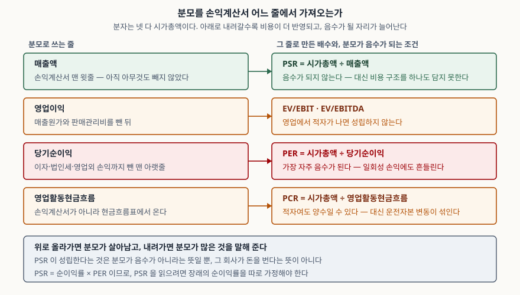

> 예제의 회사 `가나전자`·`다라바이오`·`마바커머스`·`사아장터`와 모든 숫자는 계산 원리를 보이려고 만든 가상 값이다. 실제 기업과 관계가 없다.

## 들어가며

증권사 앱이나 포털에서 종목 정보를 열면 PER이 가장 먼저 눈에 들어온다. 그런데 적자를 낸 회사를 열어 보면 그 자리가 비어 있거나 `N/A`로 찍힌다. 시가총액은 멀쩡히 조 단위로 붙어 있는데 배수만 공란이니, 처음에는 데이터가 덜 들어온 줄 알게 된다. 비어 있는 것이 맞다. PER의 분모가 음수라서 계산해도 뜻이 없는 값이 나오기 때문이다. 그러면 시장은 그 회사에 어떻게 값을 매기고 있는가. 분모를 손익계산서 위쪽으로 올려 잡는 것이 PSR과 PCR이고, 올리는 만큼 **분모가 살아남는 대신 담는 정보가 줄어든다.**

## 개념

세 배수의 분자는 모두 시가총액이다. 다른 것은 분모뿐이다.

```text
PER = 시가총액 ÷ 당기순이익
PSR = 시가총액 ÷ 매출액
PCR = 시가총액 ÷ 영업활동현금흐름
```

PER이 적자에서 무너지는 이유는 간단하다. 분모가 음수가 되면 배수도 음수가 되는데, 음수 배수는 대소 비교가 성립하지 않는다. 적자 폭이 줄어들수록 배수의 절댓값이 커지는 쪽으로 움직이기 때문이다. 그래서 적자 회사의 PER은 아예 쓰지 않는다.

PSR이 대안이 되는 근거는 분모의 성질이다. CFA Institute의 시장 기반 가치평가 자료는 매출이 다른 항목보다 왜곡되거나 조작될 여지가 적고 이익보다 안정적이며 **결코 음수가 되지 않는다**고 적는다. 같은 자료가 PCR의 근거로는 현금흐름이 이익보다 조작될 여지가 적고 PER보다 안정적인 경우가 많다는 점을 든다.

다만 같은 자료가 단점도 같이 적는다. PSR은 사업 간 원가 구조 차이를 반영하지 못하고, 돈을 잃고 있는 회사의 상황을 드러내지 못하며, 수익 인식 관행으로 여전히 조정될 수 있다. 분모를 위로 올린 대가가 그것이다.

## 구조



> **출처**: [K-IFRS 제1007호 현금흐름표 — 문단 6 영업활동의 정의, 문단 20 간접법](https://accountingwiki.co.kr/standards/1007) (제3자 전재) · [CFA Institute, Market-Based Valuation: Price and Enterprise Value Multiples (2026 Curriculum, Level II)](https://www.cfainstitute.org/insights/professional-learning/refresher-readings/2026/market-based-valuation-price-enterprise-value-multiples)

왼쪽이 손익계산서를 위에서 아래로 내려오며 만나는 줄이고, 오른쪽이 그 줄을 분모로 만든 배수다. 맨 아래 영업활동현금흐름만 손익계산서가 아니라 현금흐름표에서 온다. 영업활동은 "기업의 주요 수익창출활동, 그리고 투자활동이나 재무활동이 아닌 기타의 활동"이다(제1007호 문단 6).

## 동작 원리

### PSR은 마진을 가정 안에 숨긴 PER이다

PSR을 분해하면 정체가 드러난다.

```text
PSR = 시가총액 ÷ 매출액
    = (시가총액 ÷ 순이익) × (순이익 ÷ 매출액)
    = PER × 순이익률
```

PSR은 PER에 순이익률을 곱한 값이다. 뒤집으면 **내재 PER = PSR ÷ 순이익률**이고, PSR을 해석하려면 분모에 넣을 순이익률을 따로 가정해야 한다. 적자 회사의 PSR을 보고 "싸다"고 말하는 문장은, 실은 그 회사가 장래에 어느 정도 마진을 낸다는 가정을 말하지 않은 채 깔고 있는 것이다. 가정을 적지 않으면 비교가 되지 않는다. 마진 3%로 도는 유통업과 마진 30%를 내는 소프트웨어의 PSR을 나란히 놓는 것은 열 배 차이를 미리 집어넣고 시작하는 셈이다.

### 분모의 매출액이 같은 뜻인지부터 확인한다

PSR이 가장 크게 어긋나는 자리는 수익 인식 방식이다. 수익 기준서(K-IFRS 제1115호)는 다른 당사자가 재화나 용역 제공에 관여할 때 기업이 **본인**인지 **대리인**인지를 먼저 판단하게 한다(문단 B34). 고객에게 이전되기 전에 기업이 그것을 통제하면 본인이다(문단 B35). 본인은 "대가의 총액"을 수익으로 인식하고(문단 B35B), 대리인은 "주선 대가로 받을 보수나 수수료"를 수익으로 인식하며 이 금액은 다른 당사자에게 지급한 금액을 뺀 순액일 수 있다(문단 B36).

판단 지표로는 약속 이행의 주된 책임, 이전 전후의 재고위험, 가격 결정 재량을 든다(문단 B37). 같은 규모의 거래를 중개하더라도 재고를 직접 떠안고 파는 쪽은 거래액 전체가 매출액이 되고, 주선만 하는 쪽은 수수료만 매출액이 된다. PSR의 분모가 통째로 다른 축척이 되는 것이다.

### PCR은 적자에서도 살아남을 수 있다 — 다만 항상은 아니다

간접법으로 작성한 영업활동현금흐름은 당기순손익에서 출발해 비현금항목과 영업 관련 채권·채무의 변동을 조정한다(제1007호 문단 20). 감가상각비처럼 현금이 나가지 않은 비용이 크면 **손익계산서가 적자여도 현금은 남는다.** 설비나 무형자산 상각 부담이 큰 회사에서 이 간격이 벌어진다.

그런데 같은 조정 항목에 운전자본 변동이 들어 있다. 매출이 빠르게 느는 회사는 매출채권과 재고가 같이 늘어 영업현금흐름이 눌린다. PCR의 분모가 사업의 수익성이 아니라 **성장 속도에 반응한다**는 뜻이고, 그래서 같은 회사라도 성장 국면에서 PCR이 높게 나온다. 현금전환주기가 운전자본과 같은 정보라는 점은 [현금전환주기 글](../../ratios/2026-10-13-cash-conversion-cycle-negative/index.md)에서 다뤘다.

분류 선택도 섞인다. 기준서는 이자지급을 영업활동으로 분류할 수도, 재무활동으로 분류할 수도 있게 한다(문단 33). 차입이 많은 회사가 이자를 재무활동으로 보내면 영업현금흐름이 그만큼 커진다.

## 실습 예제

가상 회사 네 곳을 세웠다. 적자 회사 둘은 영업현금흐름의 부호가 갈리도록, 중개 회사 둘은 거래 규모가 같은데 수익 인식만 다르도록 설계한 값이다. 금액 단위는 억원이다.

전체 소스: [`code/`](code/) · 수행 기록: [`code/output.txt`](code/output.txt)

```text
[1] 네 회사의 세 배수 (단위: 억원)
                   매출액     순이익    영업CF      시가총액        PER       PSR        PCR
  가나전자            5000     300     450      4500      15.00배     0.90배      10.00배
  다라바이오            800    -200    -120      6000        성립안함     7.50배        성립안함
  마바커머스           3000    -100     250      3000        성립안함     1.00배      12.00배
  사아장터             300      30      50      3000     100.00배    10.00배      60.00배

[2] 같은 거래량을 다루는 두 회사의 PSR — 제1115호 문단 B35B·B36 (단위: 억원)
              구분            중개 거래액     인식      매출액      시가총액       PSR
  마바커머스       본인              3000     총액     3000      3000     1.00배
  사아장터        대리인             3000     순액      300      3000    10.00배
```

`[1]`에서 적자 회사 둘의 결과가 갈린다. 다라바이오는 순이익도 영업현금흐름도 음수라 PER과 PCR이 모두 성립하지 않고 PSR 7.50배만 남는다. 마바커머스는 순이익이 −100억인데 영업현금흐름이 +250억이라 PCR 12.00배가 나온다. **적자라고 해서 PSR과 PCR이 자동으로 자리를 대신해 주지 않는다.** 어느 배수가 남는지는 적자의 성격에 달려 있고, 둘 다 깨지는 회사도 있다.

`[2]`가 PSR 분모의 축척 문제다. 두 회사 모두 3,000억 규모의 거래를 중개하고 시가총액도 3,000억으로 같다. 마바커머스는 재고를 떠안고 팔아 거래액 전체가 매출액이 되고, 사아장터는 수수료 10%만 매출액이 된다. PSR이 1.00배와 10.00배로 열 배 갈린다. 두 숫자를 같은 표에 올려 "사아장터가 열 배 비싸다"고 읽으면, 읽은 것은 밸류에이션이 아니라 기준서 문단 B35B와 B36의 차이다.

```text
[3] PSR 을 PER 로 되돌리려면 — PSR = 순이익률 x PER
    따라서 내재 PER = PSR ÷ 가정 순이익률
                   PSR       마진 5%      마진 10%      마진 15%      마진 20%      마진 30%      마진 50%
  다라바이오          7.50배      150.0배       75.0배       50.0배       37.5배       25.0배       15.0배
  마바커머스          1.00배       20.0배       10.0배        6.7배        5.0배        3.3배        2.0배
  가나전자           0.90배       18.0배        9.0배        6.0배        4.5배        3.0배        1.8배
```

`[3]`은 PSR 하나를 마진 가정별 PER로 펼친 표다. 다라바이오의 PSR 7.50배는 장래 순이익률이 10%가 되면 PER 75.0배에 해당하고, 30%가 되면 25.0배, 50%가 되어야 15.0배가 된다. 가나전자가 지금 내고 있는 PER이 15.00배이므로, 다라바이오가 그 수준으로 읽히려면 순이익률 50%가 전제로 깔려 있어야 한다는 뜻이다. 반대로 가나전자의 PSR 0.90배는 마진 6%에서 PER 15.0배가 된다. 숫자를 확인하면 0.90 ÷ 0.06 = 15.0으로 `[1]`의 실제 PER과 맞는다. **PSR 비교는 마진 가정 비교다.**

```text
[4] PCR 의 분모는 운전자본에 흔들린다 — 제1007호 문단 20 간접법 (단위: 억원)
  마바커머스: 당기순손익 -100 + 감가상각비 350 − 운전자본 증가 = 영업활동현금흐름
         운전자본 증감      영업CF        PCR        비고
            -100       350       8.57배  회수
               0       250      12.00배  그대로
            +100       150      20.00배  성장으로 묶임
            +200        50      60.00배  성장으로 묶임

[5] 이자지급을 어디로 분류하느냐 — 제1007호 문단 33 (단위: 억원)
  가나전자의 이자지급 80억 — 기준서는 두 분류를 모두 허용한다
  분류                           영업CF       PCR
  영업활동으로 분류                     450    10.00배
  재무활동으로 분류                     530     8.49배
```

`[4]`에서 당기순손익 −100억과 감가상각비 350억은 고정이고 운전자본 증감만 움직였는데 PCR이 8.57배에서 60.00배까지 7.0배 벌어진다. 영업이 잘되어 매출채권과 재고가 늘면 분모가 작아지고 배수는 올라간다. 성장하는 회사의 PCR이 높게 나오는 것은 **분모의 정의가 그렇게 생겼기 때문**이지 시장이 그만큼 비싸게 보고 있기 때문만은 아니다.

`[5]`는 선택의 문제다. 같은 회사, 같은 해, 같은 이자 80억인데 분류를 어디로 두느냐에 따라 PCR이 10.00배와 8.49배로 갈린다. 기준서가 둘 다 허용하므로 어느 쪽도 잘못이 아니다. 두 회사의 PCR을 비교하려면 현금흐름표를 펴서 이자지급이 어느 구간에 들어 있는지 맞춰야 한다.

## 실무에서 주의할 점

- **적자 회사를 보면 먼저 적자의 성격을 가른다.** `[1]`의 다라바이오와 마바커머스가 그 갈림이다. 현금이 나가지 않은 비용 때문에 적자인 회사는 PCR이 살아 있고, 영업에서 현금이 실제로 빠지는 회사는 PCR도 같이 깨진다. 후자에는 배수로 값을 매길 분모 자체가 없으므로, 배수를 억지로 만들기보다 현금이 언제까지 버티는지를 보는 편이 맞다.
- **PSR을 쓸 때는 가정한 순이익률을 같이 적는다.** `[3]`처럼 마진별 내재 PER을 펼쳐 두면 그 PSR이 무엇을 전제하는지가 눈에 보인다. 가정을 적지 않은 PSR 비교는 어느 마진을 깔고 있는지 서로 모르는 채로 숫자만 맞대는 일이 된다. 업종이 다르면 PSR은 애초에 같은 축에 놓이지 않는다.
- **PSR의 분모가 총액인지 순액인지 확인한다.** 중개·플랫폼·여행·광고대행처럼 다른 당사자가 끼는 사업에서는 본인과 대리인 판단에 따라 매출액 축척이 바뀐다(문단 B35B·B36). 기업이 대리인으로 활동하면 그 사실을 강조해 공시하게 되어 있으므로(문단 119(3)), 주석에서 확인할 수 있다. 거래액(GMV)과 매출액을 같이 공시하는 회사라면 둘의 비율로 가늠한다.
- **PCR은 같은 분모 정의로만 비교한다.** `[5]`의 이자 분류뿐 아니라, 영업활동현금흐름 대신 잉여현금흐름(FCF)이나 순이익에 상각비만 더한 값을 쓰는 자료도 많다. CFA Institute 자료도 상각비를 더한 현금흐름이나 EBITDA는 비현금 수익과 운전자본 변동을 반영하지 않아 엄밀한 현금 측정치가 아니라고 적는다. 출처가 다른 PCR을 섞지 않는다.
- **성장 국면의 PCR을 수익성 지표로 읽지 않는다.** `[4]`의 7.0배가 전부 운전자본에서 나왔다. 성장과 함께 PCR이 오르는 회사는 현금흐름표의 운전자본 증감 줄을 같이 봐야 분모가 왜 눌렸는지 알 수 있다.
- **배수 하나로 결론 짓지 않는다.** 사아장터는 PER 100.00배, PSR 10.00배, PCR 60.00배로 셋 다 다른 회사들보다 높지만, 그것은 순액 인식 때문에 분모가 작아서다. 세 배수가 전부 높다는 사실은 분모 셋이 같은 이유로 작다는 사실의 다른 표현일 수 있다.

## 정리

- 세 배수의 분자는 모두 시가총액이다. 분모를 손익계산서 위로 올릴수록 음수가 될 가능성은 줄고 담는 정보도 줄어든다.
- PSR = 순이익률 × PER이다. PSR을 읽으려면 장래 순이익률을 가정해야 하고, 가정을 적지 않은 PSR 비교는 비교가 아니다.
- 적자라고 PSR·PCR이 자동으로 자리를 메우지 않는다. 예제의 다라바이오는 영업현금흐름도 음수라 PSR만 남았다.
- 본인은 총액을, 대리인은 순액을 수익으로 인식한다(제1115호 문단 B35B·B36). 같은 3,000억을 중개하는 두 회사의 PSR이 1.00배와 10.00배로 갈렸다.
- PCR의 분모에는 운전자본 변동과 이자 분류 선택이 섞인다. 예제에서 운전자본만으로 8.57배에서 60.00배까지, 이자 분류만으로 10.00배와 8.49배로 움직였다.

## 참고 자료

- [한국회계기준원 — 시행 중인 K-IFRS 기준서 목록](https://www.kasb.or.kr/front/board/ingAccountingList.do) — 기준서 원문(PDF·HWP) 발행처. 아래 전재 사이트는 문단을 바로 열기 위한 편의 링크다
- [K-IFRS 제1007호 현금흐름표 — 문단 6 영업활동의 정의, 문단 18~20 직접법과 간접법, 문단 31~34 이자와 배당금](https://accountingwiki.co.kr/standards/1007) (제3자 전재)
- [K-IFRS 제1115호 고객과의 계약에서 생기는 수익 — 적용지침 문단 B34~B38 본인과 대리인, 문단 119(3) 대리인 공시](https://accountingwiki.co.kr/standards/1115/b) (제3자 전재) — 본인·대리인 판단 문단은 2016년 12월 개정되어 2018년 1월 1일 이후 최초로 시작되는 회계연도부터 적용된다(문단 C1B)
- [CFA Institute, Market-Based Valuation: Price and Enterprise Value Multiples (2026 Curriculum, Level II)](https://www.cfainstitute.org/insights/professional-learning/refresher-readings/2026/market-based-valuation-price-enterprise-value-multiples) — P/S와 P/CF의 근거와 단점, 분모로 쓰는 현금흐름 정의의 한계
- [CFA Institute, Equity Valuation: Concepts and Basic Tools (2026 Curriculum, Level I)](https://www.cfainstitute.org/insights/professional-learning/refresher-readings/2026/equity-valuation-concepts-basic-tools) — 가격 배수의 분류와 상대가치 평가의 전제
