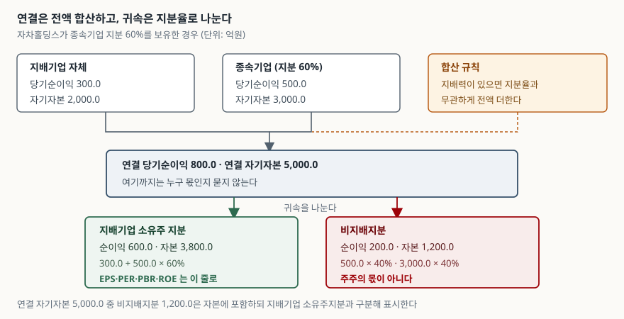
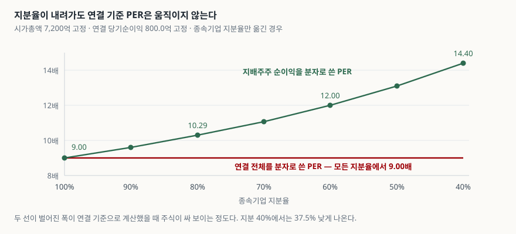

> 예제의 `자차홀딩스` 그룹과 그 숫자는 계산 원리를 보이려고 만든 가상 값이다. 실제 기업과 관계가 없다. 주가·발행주식수·지분율은 모두 설명용 가정값이고, 지분 추가 취득의 대가도 가정한 금액이다.

## 들어가며

연결 손익계산서를 처음 열어 보면 당기순이익 아래에 줄이 두 개 더 붙어 있다. "지배기업의 소유주에게 귀속되는 당기순이익"과 "비지배지분에 귀속되는 당기순이익"이다. 위쪽의 큰 숫자가 회사 전체의 성적 같아 보이니 그것으로 주당순이익을 나눠 보게 된다. 주가를 그 값으로 나눴더니 PER 9배가 나온다. 그런데 증권사 자료에는 같은 날 기준으로 12배라고 적혀 있다. 숫자를 잘못 본 것도, 기준일이 다른 것도 아니다. 분자가 다르다. 지주회사나 종속기업을 여럿 거느린 회사에서는 이 차이가 30%를 넘기기도 한다.

## 개념

연결재무제표는 지배기업과 종속기업을 **한 회사처럼** 묶는다. 묶는 기준은 지분율이 아니라 지배력이다. 지배력이 있으면 지분을 51%만 가졌든 100%를 가졌든 종속기업의 자산·부채·수익·비용을 **전액** 합산한다.

그러면 내 것이 아닌 몫이 섞인다. 그것을 따로 떼어 표시한 것이 비지배지분이다. 기업회계기준서 제1110호 연결재무제표는 비지배지분을 연결재무상태표에서 자본에 포함하되 지배기업의 소유주지분과는 구분해 별도로 표시하도록 하고(문단 22), 당기순손익과 기타포괄손익의 각 구성요소를 지배기업의 소유주와 비지배지분에 귀속시키도록 한다(문단 B94). 기업회계기준서 제1001호 재무제표 표시도 당기순손익과 당기포괄손익을 각각 비지배지분 귀속분과 지배기업 소유주 귀속분으로 나눠 표시하게 한다(문단 81B).

| 줄 | 무엇이 들어 있나 | 주주의 몫인가 |
|---|---|---|
| 연결 당기순이익 | 지배기업 + 종속기업 전액 | 아니다 |
| 비지배지분 귀속 | 종속기업 중 남이 가진 지분 몫 | 아니다 |
| 지배기업 소유주 귀속 | 위 둘의 차 | **그렇다** |

주당이익을 계산하는 기준도 여기에 맞춰져 있다. 기업회계기준서 제1033호 주당이익은 기본주당이익의 분자를 **지배기업의 보통주에 귀속되는** 특정 회계기간의 당기순손익으로 정하고(문단 10), 그 금액에서 자본으로 분류된 우선주에 대한 세후 우선주 배당금과 우선주 상환 시 발생한 차액 등을 조정하도록 한다(문단 12).

## 구조



> **출처**: [기업회계기준서 제1110호 연결재무제표 — 문단 22 비지배지분의 구분 표시, 문단 B94 당기순손익과 기타포괄손익의 귀속](https://accountingwiki.co.kr/standards/1110) (제3자 전재) · [기업회계기준서 제1001호 재무제표 표시 — 문단 81B 당기순손익·당기포괄손익의 배분 항목 표시](https://accountingwiki.co.kr/standards/1001) (제3자 전재). 수치는 이 글의 [`code/output.txt`](code/output.txt) `[1]`에서 옮겼다.

가운데 칸에서 한 번 멈춰 볼 만하다. 연결 당기순이익 800.0억은 **누구 몫인지 묻지 않은 숫자**다. 지분 60%라는 사실이 이 단계까지는 전혀 반영되지 않는다. 지분율이 들어오는 곳은 그 아래 귀속을 나누는 단계뿐이다. 그래서 종속기업의 지분을 40%로 낮춰도 연결 당기순이익은 800.0억 그대로다.

## 동작 원리

### 같은 주가에 배수가 갈린다

자차홀딩스의 시가총액이 7,200억이라고 하자. 어느 분자를 쓰느냐로 네 개 지표가 한꺼번에 달라진다.

```text
[2] 시가총액 7,200 억 · 발행주식 10 억주 · 주가 720
  분자·분모로 무엇을 쓰는가            EPS      PER      BPS      PBR      ROE
  연결 전체 (틀린 계산)             80.00     9.00   500.00     1.44   16.00%
  지배주주지분 (기준서대로)         60.00    12.00   380.00     1.89   15.79%
  PER 격차  9.00 → 12.00  (+33.3%)
  PBR 격차  1.44 → 1.89  (+31.6%)
```

PER이 9.00배에서 12.00배로, PBR이 1.44배에서 1.89배로 올라간다. 연결 전체를 분자로 쓰면 내 것이 아닌 이익 200.0억과 내 것이 아닌 자본 1,200.0억까지 세게 되므로 **주식이 싸 보인다.**

시가총액은 지배기업 주식의 값이다. 분모가 지배기업 주주의 것이니 분자도 지배기업 주주의 것이어야 한다. 한쪽만 전체로 두면 격이 맞지 않는다. 제1033호가 분자를 지배기업 보통주 귀속분으로 못박은(문단 10) 이유가 이 대응이다.

ROE는 16.00%와 15.79%로 차이가 작다. 분자와 분모가 같은 방향으로 함께 줄어들기 때문이다. 비지배지분을 빼먹었을 때 ROE만 보고 있으면 이상을 알아채기 어렵다는 뜻이기도 하다.

### 연결 기준 PER은 지분율에 반응하지 않는다



> **출처**: [기업회계기준서 제1033호 주당이익 — 문단 10 기본주당이익의 분자와 분모, 문단 12 우선주 배당금 등의 조정](https://accountingwiki.co.kr/standards/1033) (제3자 전재) · [기업회계기준서 제1110호 연결재무제표 — 문단 B94 당기순손익의 귀속](https://accountingwiki.co.kr/standards/1110) (제3자 전재). 수치는 이 글의 [`code/output.txt`](code/output.txt) `[3]`에서 옮겼다.

빨간 선이 수평이다. 지분을 100%에서 40%까지 내려도 분자로 쓴 연결 당기순이익이 800.0억에서 한 번도 움직이지 않기 때문이다. 반면 초록 선은 9.00배에서 14.40배까지 올라간다.

이 그림이 말하는 것은 **연결 기준 PER이 틀린 값이라는 사실이 아니라, 틀린 방향이 일정하다는 사실**이다. 종속기업 비중이 큰 회사일수록 더 싸 보인다. 지배구조가 복잡한 회사를 비교할 때 이 지표를 그대로 쓰면, 순위가 사업 성과가 아니라 지분 구조로 정해진다.

### 지분을 더 사면 연결 순이익은 그대로다

지배력을 이미 가진 종속기업의 지분을 더 사는 것은 사업을 더 사는 것이 아니라 **남은 주주 몫을 사는 것**이다. 기업회계기준서 제1110호는 이 거래를 지배력을 상실하지 않는 소유지분 변동으로 보아 자본거래, 즉 소유주로서 자격을 행사하는 소유주와의 거래로 회계처리하게 한다(문단 23). 구체적으로는 비지배지분과 지배지분의 장부금액을 상대적 지분 변동에 맞춰 조정하고, 비지배지분 조정금액과 지급하거나 수취한 대가의 공정가치 차이를 **자본에 직접 인식해** 지배기업 소유주에게 귀속시킨다(문단 B96).

```text
[4] 종속기업 지분을 60% → 80% 로 추가 취득하면 (단위: 억원)
  항목                              취득 전     취득 후        변동
  연결 당기순이익                  800.0     800.0       0.0
  비지배지분 귀속 순이익           200.0     100.0    -100.0
  지배주주 귀속 순이익             600.0     700.0     100.0
  지배주주 EPS                     60.00     70.00     10.00
  비지배지분 장부금액            1,200.0     600.0    -600.0
  취득 대가 780.0 - 비지배지분 조정액 600.0 = 180.0
```

연결 당기순이익 줄의 변동이 0.0이다. 그런데 지배주주 EPS는 60.00에서 70.00으로 16.7% 오른다. 지분을 더 산 효과가 연결 기준 지표에는 전혀 나타나지 않고 지배주주 기준 지표에만 나타난다. 그 결과 연결 기준 PER로 보면 이 거래는 아무 일도 아닌 것이 된다.

취득 대가 780.0억과 비지배지분 조정액 600.0억의 차이인 180.0억은 영업권으로도 손익으로도 잡히지 않고 자본에서 바로 차감된다. 돈은 나갔는데 손익계산서 어디에도 안 보이는 금액이다. 자본변동표를 함께 읽어야 하는 이유가 이런 데 있다.

### 비지배지분이 음수가 될 수 있다

종속기업이 크게 적자를 내면 비지배지분이 가진 몫보다 큰 손실이 배분될 수 있다. 제1110호는 **비지배지분이 부(-)의 잔액이 되더라도** 총포괄손익을 지배기업의 소유주와 비지배지분에 귀속시키도록 한다(문단 B94).

```text
[5] 종속기업이 -900 억 적자이고 그 자기자본이 200.0 억뿐이라면
  연결 당기순이익                 -600.0
  비지배지분 귀속                 -360.0
  지배주주 귀속                   -240.0
  비지배지분 장부금액               80.0  (기초 80.0 억에서 손실 360.0 억을 맞는다)
  손실 배분 후 비지배지분         -280.0  ← 부(-)의 잔액
```

배분을 80.0억에서 멈추면 남은 280.0억이 지배주주 쪽으로 넘어간다. 지배주주 손실이 −240.0억이 아니라 −520.0억이 되는 것이다. 기준서가 멈추지 말라고 한 것은 이 전가를 막기 위해서다. 자본 항목에 음수가 찍히는 것이 어색해 보여도, 그쪽이 사실에 가깝다.

### 희석 여부와 섞지 않는다

분자를 지배주주 기준으로 맞추는 것과 분모에 잠재적 보통주를 반영하는 것은 다른 조정이다. 전자는 **누구의 이익인가**를 맞추고, 후자는 **몇 주로 나눌 것인가**를 맞춘다. 전환사채나 신주인수권이 있는 회사에서는 둘을 모두 해야 한다. 분모 쪽 조정은 [희석주당이익 — 전환사채가 EPS를 깎는 방식](../2026-10-08-diluted-eps-convertible-bonds/index.md)에서 다뤘다.

## 실습 예제

자차홀딩스의 지배기업 순이익 300억, 종속기업 순이익 500억, 지분율 60%, 자기자본 2,000억과 3,000억, 발행주식 10억주, 주가 720은 전부 가정이다. 주가의 단위에는 뜻이 없고 배수를 계산하기 위한 값이다. 내부거래 제거나 영업권 상각은 논점을 흐리므로 넣지 않았다.

전체 소스: [`code/`](code/) · 수행 기록: [`code/output.txt`](code/output.txt)

```text
[1] 자차홀딩스 — 종속기업 지분 60% (단위: 억원)
  항목                        지배기업    종속기업      연결 합계
  당기순이익                  300.0       500.0       800.0
  자기자본                  2,000.0     3,000.0     5,000.0
  연결 당기순이익의 귀속
    지배기업 소유주 지분      600.0   (75.0%)
    비지배지분                200.0   (25.0%)
  연결 자기자본의 귀속
    지배기업 소유주 지분    3,800.0   (76.0%)
    비지배지분              1,200.0   (24.0%)

[3] 종속기업 지분율을 옮기면 (연결 순이익 800.0 억·연결 자본 5,000.0 억 고정)
   지분율  비지배 순이익  지배주주 순이익   지배주주 EPS   지배주주 PER   연결기준 PER   연결기준이 낮게 보이는 폭
    100%       0.0          800.0          80.00           9.00           9.00         +0.0%
     90%      50.0          750.0          75.00           9.60           9.00         -6.2%
     80%     100.0          700.0          70.00          10.29           9.00        -12.5%
     70%     150.0          650.0          65.00          11.08           9.00        -18.8%
     60%     200.0          600.0          60.00          12.00           9.00        -25.0%
     50%     250.0          550.0          55.00          13.09           9.00        -31.2%
     40%     300.0          500.0          50.00          14.40           9.00        -37.5%
```

`[1]`에서 순이익 귀속 비율(75.0% / 25.0%)과 자본 귀속 비율(76.0% / 24.0%)이 다르다는 점을 짚어 둘 만하다. 종속기업이 지배기업보다 자본 대비 이익을 많이 내고 있어서 생기는 차이다. 그래서 PER의 격차(+33.3%)와 PBR의 격차(+31.6%)도 같지 않다. 두 배수를 함께 봐야 하는 이유다.

`[3]`의 마지막 열이 0.0%에서 −37.5%까지 일정하게 벌어진다. 지분율이 10%p 내려갈 때마다 연결 기준 PER이 6%p 안팎씩 더 낮게 보인다. 지분 100%인 첫 줄에서만 두 값이 같은데, 비지배지분이 아예 없는 경우다.

## 실무에서 주의할 점

- **시가총액과 짝을 맞춘다.** 분모가 지배기업 주식의 값이면 분자도 지배기업 주주의 몫이어야 한다. 제1033호 문단 10이 분자를 지배기업 보통주 귀속분으로 정한 것이 이 대응이다. 어느 한쪽만 전체로 두면 PER·PBR이 함께 낮게 나온다.
- **PBR도 같이 고친다.** 분자를 고치면서 분모를 연결 자기자본 그대로 두는 실수가 흔하다. 자기자본에서도 비지배지분을 빼야 한다. 예제에서 5,000.0억이 아니라 3,800.0억이다.
- **ROE로는 잘 드러나지 않는다.** 분자와 분모가 같이 줄어들어 예제에서 16.00%와 15.79%로 0.21%p밖에 차이나지 않았다. ROE만 검산하고 넘어가면 PER·PBR의 오류를 놓친다.
- **지분 추가 취득은 손익에 안 나타난다.** 제1110호 문단 23과 B96에 따라 자본거래로 처리되므로 연결 당기순이익이 움직이지 않는다. 지배주주 EPS만 올라간다. 연결 기준 지표만 보면 이 거래가 보이지 않으므로 자본변동표를 함께 읽는다.
- **비지배지분 비중이 큰 회사들을 한 줄에 놓고 비교하지 않는다.** 연결 기준 배수는 지분 구조에 따라 체계적으로 낮게 나오므로, 종속기업 지분율이 다른 회사들을 같은 기준으로 줄 세우면 순위가 사업 성과가 아니라 지배구조를 반영하게 된다.
- **부(-)의 비지배지분을 보정하지 않는다.** 음수가 어색해 손실 배분을 멈추면 그만큼이 지배주주 손실에서 빠져 실적이 좋게 보인다. 제1110호 문단 B94는 잔액이 음수가 되더라도 배분하도록 한다.
- **종속기업이 발행한 누적적우선주를 확인한다.** 제1110호는 비지배지분이 그 우선주를 소유한 경우 배당결의 여부와 관계없이 배당금을 조정한 뒤 당기순손익에 대한 지분을 산정하도록 한다(문단 B95). 배당 결의가 없었다고 넘기면 지배주주 몫이 부풀려진다.

## 정리

- 연결은 지배력을 기준으로 종속기업을 전액 합산한다. 지분율은 합산 단계가 아니라 귀속을 나누는 단계에서 들어온다.
- 주당이익의 분자는 지배기업 보통주에 귀속되는 당기순손익이다(제1033호 문단 10). 연결 당기순이익을 그대로 쓰면 내 것이 아닌 몫까지 세게 된다.
- 예제에서 같은 주가에 PER이 9.00배와 12.00배, PBR이 1.44배와 1.89배로 갈렸다. 연결 기준이 항상 싸게 보인다.
- 지분율을 100%에서 40%까지 내려도 연결 기준 PER은 9.00배에서 움직이지 않는다. 틀린 방향이 일정하므로 회사끼리 비교할 때 순위가 지분 구조로 정해진다.
- 지분을 추가 취득하면 자본거래로 처리되어 연결 당기순이익은 그대로인 채 지배주주 EPS만 오른다(제1110호 문단 23·B96).
- 종속기업 손실로 비지배지분이 음수가 되더라도 배분을 멈추지 않는다(문단 B94). 멈추면 지배주주 실적이 실제보다 좋게 보인다.

## 참고 자료

- [한국회계기준원 — 시행 중인 K-IFRS 기준서 목록](https://www.kasb.or.kr/front/board/ingAccountingList.do) — 기업회계기준서 제1110호 연결재무제표, 제1033호 주당이익, 제1001호 재무제표 표시 원문 발행처
- [기업회계기준서 제1110호 연결재무제표 — 문단 22·23, 적용지침 B94·B95·B96](https://accountingwiki.co.kr/standards/1110) (제3자 전재)
- [기업회계기준서 제1033호 주당이익 — 문단 10·12·13](https://accountingwiki.co.kr/standards/1033) (제3자 전재)
- [기업회계기준서 제1001호 재무제표 표시 — 문단 81B·106(1)](https://accountingwiki.co.kr/standards/1001) (제3자 전재)
- [IFRS Foundation — IFRS 10 Consolidated Financial Statements](https://www.ifrs.org/issued-standards/list-of-standards/ifrs-10-consolidated-financial-statements/) — 비지배지분 귀속 규정 원문
- [IFRS Foundation — IAS 33 Earnings per Share](https://www.ifrs.org/issued-standards/list-of-standards/ias-33-earnings-per-share/) — 기본주당이익 분자 규정 원문
- [금융감독원 회계포털](https://acct.fss.or.kr/) — 연결재무제표 작성과 공시 관련 실무 안내
