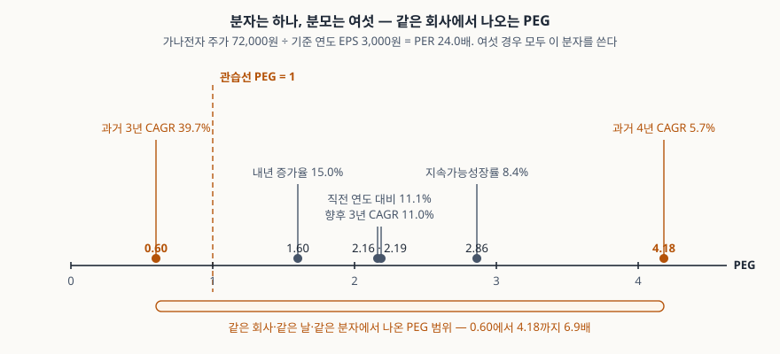

> 예제의 회사 `가나전자`와 그 숫자는 계산 원리를 보이려고 만든 가상 값이다. 실제 기업과 관계가 없다. EPS 이력·추정치·주가·배당성향·베타는 모두 설명용 가정값이다.

## 들어가며

종목 토론방이나 스크리너 화면에서 "PEG 0.6, 저평가"라는 문구를 볼 때가 있다. PER만 보면 24배라 비싸 보이는데 성장률로 한 번 나누니 1 아래로 내려왔다는 뜻이다. 그런데 그 0.6을 만든 성장률이 어디서 온 숫자인지는 대개 적혀 있지 않다. 같은 회사의 같은 날짜 PER 24배를 두고, 과거 3년 연평균 성장률을 넣으면 0.60이 나오고 과거 4년을 넣으면 4.18이 나온다. 분자는 한 글자도 바뀌지 않았는데 결과는 6.9배 차이다. 숫자 하나만 받아 들면 둘 중 어느 쪽을 받았는지 알 수가 없다.

## 개념

PEG는 PER을 기대 EPS 성장률로 나눈 값이다. PER이 높아도 이익이 빠르게 늘고 있다면 비싼 것이 아니라는 생각을 숫자 하나로 만든 것이다. 분자인 PER의 분모는 주당이익(EPS)이고, 그 정의와 계산 순서는 기업회계기준서 제1033호 주당이익에 있다. 반면 PEG의 분모인 성장률은 **회계기준에 정의가 없다.** 어느 기간의, 어느 이익의, 실적인지 추정인지를 쓰는 사람이 고른다. 값이 갈리는 자리가 여기다.

| 구성 | 출처 | 고를 여지 |
|---|---|---|
| 주가 | 시장 | 없다 (종가 기준) |
| EPS | 기업회계기준서 제1033호 — 기본·희석 EPS 산정 방법 | 기본이냐 희석이냐, 실적이냐 추정이냐 |
| 기대 성장률 | 정의한 기준이 없다 | 기간·기준 연도·실적/추정·산출 방식 전부 |

PEG를 널리 쓰이게 만든 것은 Peter Lynch의 *One Up on Wall Street*(1989)이고, 적정한 회사라면 PER이 성장률과 같아야 한다는 서술에서 PEG 1이라는 기준선이 나왔다. 다만 이 지표를 처음 고안한 사람이 누구인지는 자료마다 갈리고, 1이라는 선 자체가 어떤 회계기준이나 표준에서 나온 값은 아니다.

## 구조



> **출처**: [Aswath Damodaran, *Earnings Multiples* 강의자료 — PEG 정의와 기간 일치 요건, 2단계 모형 유도, 위험·성장률에 따른 명제](https://pages.stern.nyu.edu/~adamodar/pdfiles/eqnotes/earnmult.pdf) (2차 자료, NYU Stern 강의자료) · [PEG ratio — Lynch의 1989년 서술과 기준선 1의 유래](https://en.wikipedia.org/wiki/PEG_ratio) (2차 자료). PEG 값은 이 글의 [`code/output.txt`](code/output.txt) `[2]`에서 옮겼다.

축 위의 점 여섯은 전부 같은 분자에서 나왔다. 왼쪽으로 갈수록 싸 보이고 오른쪽으로 갈수록 비싸 보인다. 점선이 관습선 1이다. 어느 성장률을 집느냐에 따라 같은 회사가 이 선의 왼쪽에도 오른쪽에도 선다.

## 동작 원리

### 분모를 고르는 자리가 넷이다

성장률 하나를 정하려면 네 가지를 정해야 한다. **기간**(3년인지 5년인지), **기준 연도**(어느 해를 출발점으로 둘지), **실적인지 추정인지**, **산출 방식**(연평균 성장률인지 직전 연도 대비인지, 아니면 ROE와 유보율로 만든 지속가능성장률인지). 넷을 조합하면 후보가 수십 개가 되고, 그중 어느 하나가 더 옳다고 정해 주는 규칙은 없다.

가나전자의 EPS는 2022년에 한 번 크게 꺾였다가 회복했다. 그래서 출발점을 2022년에 두면 3년 연평균 39.7%가 나오고, 한 해 앞인 2021년에 두면 4년 연평균 5.7%가 나온다. 같은 이력에서 나온 두 숫자가 일곱 배 차이다.

### 성장률의 단위

PEG는 성장률을 **퍼센트 수치**로 쓴다. 15%를 15로 넣는다. 0.15로 넣으면 같은 회사의 PEG가 1.60 대신 160.00이 된다. 지표 가운데 분모의 단위가 소수가 아닌 것이 드물어서, 스프레드시트에서 성장률 칸이 백분율 서식으로 잡혀 있을 때 자주 어긋난다. 100배 차이라 눈에 띄지만, 여러 종목을 한꺼번에 계산할 때 일부 행만 어긋나면 지나치기 쉽다.

### 기준 연도의 일회성 손익

2022년 EPS 1,100원에 주당 900원의 일회성 손상이 들어 있었다고 하자. 그 해를 2,000원으로 보고 다시 세면 3년 연평균 성장률이 39.7%에서 14.5%로 내려가고, PEG는 0.60에서 1.66이 된다. 성장률의 분모가 된 해가 눌려 있을수록 그 뒤의 회복이 성장으로 계산된다. 적자에서 흑자로 돌아선 해를 출발점에 두면 성장률 자체가 정의되지 않는데, 이때 전년 적자를 작은 양수로 바꿔 넣는 처리가 들어가면 성장률이 임의로 커진다.

### 나눠도 성장의 영향이 사라지지 않는다

PEG의 전제는 PER을 성장률로 나누면 성장률 차이가 상쇄되어 서로 다른 성장 단계의 회사를 나란히 비교할 수 있다는 것이다. 그런데 2단계 배당할인모형으로 정당한 PER을 유도해 성장률로 나눠 보면, 결과가 성장률에 대해 단조롭지도 않고 평평하지도 않다. 요구수익률 9.5%를 가정했을 때 정당한 PEG는 성장률 5%에서 2.02, 10%에서 1.26, 15%에서 1.04, 25%에서 0.94다. 성장률이 낮은 쪽이 오히려 PEG가 높다.

위험도 그대로 남는다. 같은 성장률 10%에서 베타 0.8이면 정당한 PEG가 1.60이고 베타 1.3이면 0.94다. 위험이 큰 회사가 낮은 PEG로 거래되는 것은 싸서가 아니라 요구수익률이 높아서다. PEG가 낮은 종목을 모아 놓으면 그 업종에서 위험이 큰 쪽이 모일 수 있다는 말이 여기서 나온다.

그래서 1이라는 기준선은 고정된 값이 아니다. 베타 1.0에서는 성장률 16.9%와 38.3% 두 자리에서 정당한 PEG가 1을 지나고, 베타 1.3에서는 9.0%와 63.0%에서 지난다. 베타 0.8에서는 가정한 구간 전체에서 1 아래로 내려가지 않는다. 같은 PEG 1이라도 전제한 위험에 따라 가리키는 성장률이 다르다.

## 실습 예제

주가 72,000원, 기준 연도 EPS 3,000원, ROE 12%, 배당성향 30%는 모두 가정이다. 2단계 모형의 격자는 무위험이자율 3.5%, 시장위험프리미엄 6%, 고성장 5년, 배당성향 25%에서 70%로 이행, 안정성장률 3%를 가정했다.

전체 소스: [`code/`](code/) · 수행 기록: [`code/output.txt`](code/output.txt)

```text
[2] 같은 PER 을 성장률 후보 여섯으로 나눈 PEG
  성장률 후보                               성장률      PEG
  과거 3년 CAGR (2022→2025)             39.7%     0.60
  과거 4년 CAGR (2021→2025)              5.7%     4.18
  직전 연도 대비 (2024→2025)            11.1%     2.16
  내년 증가율 (2025→2026)               15.0%     1.60
  향후 3년 CAGR (2025→2028)             11.0%     2.19
  지속가능성장률 (ROE 12% × 유보율 70%)     8.4%     2.86
  가장 낮은 값 0.60 ~ 가장 높은 값 4.18 — 6.9배 차이

[6] 2단계 모형이 정당화하는 PEG (무위험 3.5%, 시장프리미엄 6%, 고성장 5년,
     배당성향 25%→70%, 안정성장 3%. 행 = 베타, 열 = 기대성장률)
  베타    요구수익률         5%        10%        15%        20%        25%
  0.8       8.3%       2.56       1.60       1.32       1.22       1.19
  1.0       9.5%       2.02       1.26       1.04       0.96       0.94
  1.3      11.3%       1.51       0.94       0.77       0.71       0.69

[7] 정당한 PEG 가 1 을 지나는 성장률 (1~80% 구간을 훑어서)
  베타 0.8 (r  8.3%)  구간 전체에서 1 아래로 내려가지 않는다
  베타 1.0 (r  9.5%)  g = 16.9%, 38.3%
  베타 1.3 (r 11.3%)  g = 9.0%, 63.0%
```

`[1]` EPS 이력, `[3]` 단위 혼동, `[4]` 기저효과는 [`code/output.txt`](code/output.txt)에 있다. `[5]`는 구현 검산이다. 공개 강의자료에 PEG 1.94로 적힌 예제 파라미터를 그대로 넣어 같은 값이 나오는지 확인한 줄이다.

`[6]`에서 행을 따라 오른쪽으로 가면 값이 줄다가 거의 평평해지고, 열을 따라 아래로 가면 모든 칸이 내려간다. 앞쪽이 성장률의 영향이고 뒤쪽이 위험의 영향이다. `[7]`에서 교차점이 두 개인 줄은 `[6]`의 오른쪽 끝에서 값이 다시 올라가기 시작한다는 뜻이다.

## 실무에서 주의할 점

- **PEG를 받으면 분모부터 묻는다.** 기간, 기준 연도, 실적인지 추정인지를 알기 전에는 그 값이 무엇을 재는지 정해지지 않는다. 같은 화면에 올라온 두 종목의 PEG가 서로 다른 기준으로 계산됐다면 비교 자체가 성립하지 않는다.
- **분자와 분모의 기간을 맞춘다.** 실적 PER을 과거 성장률로 나누면 둘 다 지나간 이야기이고, 선행 PER을 미래 성장률로 나누면 둘 다 추정이다. 실적 PER을 미래 성장률로 나누는 조합이 가장 흔히 섞이는데, 이때 분자의 기준 연도와 분모의 출발 연도가 어긋난다. 실적 PER과 선행 PER의 차이는 [PER — 이익 대비 주가를 재는 법](../2026-10-02-per-trailing-vs-forward/index.md)에서 다뤘다.
- **기준 연도가 눌려 있는지 본다.** 손상차손, 소송 합의금, 자산 매각 차익 같은 일회성 손익이 출발점 연도에 들어 있으면 성장률이 그만큼 과장되거나 축소된다. 손익계산서의 영업외 항목과 주석을 함께 보고, 필요하면 그 해를 조정해 다시 센다.
- **분모의 EPS가 기본인지 희석인지 확인한다.** 전환사채나 주식선택권이 있는 회사는 둘의 차이가 크다. 분자의 PER에는 희석 EPS를 쓰고 분모의 성장률은 기본 EPS로 계산하면 기준이 섞인다. 산정 순서는 [기본 EPS와 희석 EPS — 전환사채가 있을 때 주당이익](../2026-10-08-diluted-eps-convertible-bonds/index.md)에서 다뤘다.
- **위험이 다른 회사끼리 PEG로 줄 세우지 않는다.** 표에서 보듯 베타만 0.8에서 1.3으로 올려도 같은 성장률에서 정당한 PEG가 1.60에서 0.94로 내려간다. 업종이 다르거나 재무구조가 다른 회사를 같은 기준선에 놓으면, 지표가 가리키는 것이 저평가인지 높은 위험인지 구분되지 않는다.

## 정리

- PEG는 PER을 기대 EPS 성장률로 나눈 값이다. 분자의 EPS는 기준서에 정의가 있지만 분모의 성장률은 정의가 없다.
- 같은 회사의 같은 PER 24배에서 성장률 후보만 바꿨더니 PEG가 0.60에서 4.18까지 6.9배로 갈렸다.
- 성장률은 퍼센트 수치로 넣는다. 소수로 넣으면 값이 100배가 된다. 기준 연도에 일회성 손익이 있으면 PEG가 0.60에서 1.66으로 바뀐다.
- 나눠도 성장의 영향은 상쇄되지 않고 위험도 그대로 남는다. 정당한 PEG는 성장률 5%에서 2.02, 25%에서 0.94이고, 베타가 오르면 전 구간이 내려간다.
- 기준선 1은 고정된 값이 아니다. 가정한 위험에 따라 1을 지나는 성장률이 달라지고, 두 자리에서 지나기도 한다.

## 참고 자료

- [한국회계기준원 — 시행 중인 K-IFRS 기준서 목록](https://www.kasb.or.kr/front/board/ingAccountingList.do) — 기업회계기준서 제1033호 주당이익 원문 발행처
- [IFRS Foundation — IAS 33 Earnings per Share](https://www.ifrs.org/issued-standards/list-of-standards/ias-33-earnings-per-share/) — 기본·희석 주당이익 산정 원문
- [Aswath Damodaran, *Earnings Multiples*](https://pages.stern.nyu.edu/~adamodar/pdfiles/eqnotes/earnmult.pdf) — PEG 정의와 기간 일치 요건, 2단계 모형 유도식, 위험·성장 효율·성장률 수준에 관한 세 가지 명제(2차 자료, NYU Stern 강의자료)
- [PEG ratio](https://en.wikipedia.org/wiki/PEG_ratio) — Lynch의 1989년 서술과 기준선 1의 유래, 고안자 귀속이 갈린다는 점(2차 자료)
