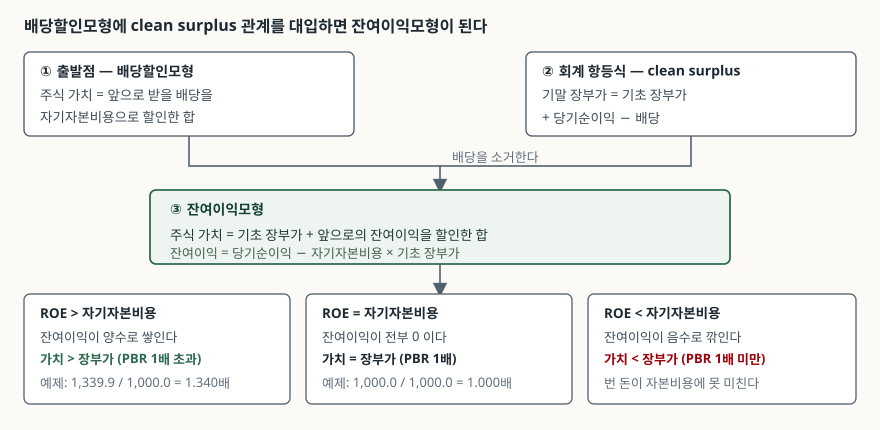
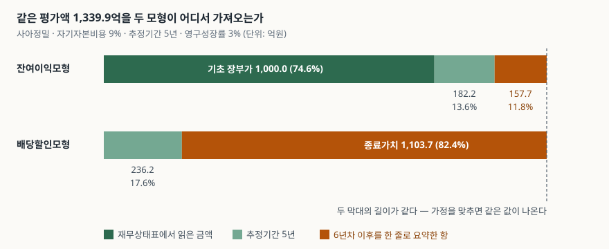

> 예제의 회사 `사아정밀`과 그 숫자는 계산 원리를 보이려고 만든 가상 값이다. 실제 기업과 관계가 없다. 자기자본비용·ROE 추정치·영구성장률·배당성향은 모두 설명용 가정값이다.

## 들어가며

평가 모형을 처음 돌려 보면 결과보다 먼저 눈에 들어오는 것이 구성비다. 5년치 매출과 마진을 셀마다 따져 넣었는데, 다 더하고 나면 기업가치의 80% 넘는 몫이 "6년차 이후"라고 적힌 칸 하나에서 나온다. 그 칸은 영구성장률 2%냐 3%냐로 정해지고, 그 2%와 3% 사이에는 근거가 거의 없다. 앞의 다섯 해를 공들여 짠 보람이 사라지는 지점이다. 같은 회사를 재무상태표의 자기자본에서 출발해 평가하면 이 비중이 11.8%로 내려간다. 평가액 자체는 한 푼도 달라지지 않는데 그렇다.

## 개념

잔여이익모형(residual income model, RIM)은 주식 가치를 **지금 장부에 적힌 자기자본**과 **앞으로 그 자본이 요구수익률을 넘겨 벌어들일 몫**의 합으로 본다.

| 기호 | 뜻 | 사아정밀의 값 |
|---|---|---|
| B₀ | 기초 자기자본 장부금액 | 1,000.0억 |
| r | 자기자본비용 | 9% |
| NIₜ | t년도 당기순이익 | ROEₜ × Bₜ₋₁ |
| RIₜ | t년도 잔여이익 = NIₜ − r × Bₜ₋₁ | 1년차 60.0억 |
| 가치 | B₀ + Σ RIₜ / (1+r)ᵗ | 1,339.9억 |

잔여이익은 당기순이익에서 **자기자본에 대한 기회비용을 한 번 더 뺀** 값이다. 손익계산서는 이자비용은 빼지만 주주 자본의 비용은 빼지 않는다. 1,000억을 들고 90억을 번 회사와 500억을 들고 90억을 번 회사가 손익계산서상으로는 같아 보인다. 잔여이익은 그 차이를 드러낸다. 앞 회사는 0원, 뒤 회사는 45억이다.

같은 식을 ROE로 다시 쓰면 `RIₜ = (ROEₜ − r) × Bₜ₋₁`가 된다. 가치를 만드는 것은 이익의 크기가 아니라 **ROE가 자기자본비용을 넘는 폭**이다.

## 구조



> **출처**: [James A. Ohlson, *Earnings, Book Values, and Dividends in Equity Valuation*, Contemporary Accounting Research 11(2), 1995, 661–687](https://onlinelibrary.wiley.com/doi/10.1111/j.1911-3846.1995.tb00461.x) — 배당할인모형과 clean surplus 관계에서 잔여이익 형태를 유도한 원 논문 · [Gerald A. Feltham · James A. Ohlson, *Valuation and Clean Surplus Accounting for Operating and Financial Activities*, Contemporary Accounting Research 11(2), 1995, 689–731](https://onlinelibrary.wiley.com/doi/10.1111/j.1911-3846.1995.tb00462.x) — 영업·재무 활동을 나눈 확장. 수치는 이 글의 [`code/output.txt`](code/output.txt) `[1]`·`[5]`에서 옮겼다.

위 세 칸이 이 모형의 전부다. 눈여겨볼 것은 가운데 칸이다. ROE가 자기자본비용과 정확히 같으면 잔여이익이 모든 해에 0이 되고, 평가액이 기초 장부가와 한 푼도 다르지 않게 된다. 주가순자산비율 1배가 무엇을 뜻하는지가 여기서 정의된다. 그 회사가 가치를 만들지도 깎지도 않는다는 뜻이다.

## 동작 원리

### 배당할인모형과 같은 모형이다

RIM은 배당할인모형(DDM)에서 유도된다. 두 모형을 잇는 것이 **clean surplus 관계**다.

```text
기말 자기자본 = 기초 자기자본 + 당기순이익 − 배당
```

자기자본이 움직이는 경로가 이익과 배당 둘뿐이라는 가정이다. 이 관계를 DDM 식에 대입하면 배당이 소거되고 장부가와 잔여이익만 남는다. Ohlson(1995)이 한 일이 이 유도이고, 그래서 두 모형은 **같은 값을 내야 한다.** 다른 값이 나오면 유도가 틀린 게 아니라 양쪽에 넣은 가정이 어긋난 것이다.

사아정밀을 두 모형으로 각각 돌리면 둘 다 1,339.9억이 나온다. 차이는 −0.0억, 부동소수점 오차뿐이다.

### 종료 단계에서는 배당성향을 고를 수 없다

두 모형의 값을 맞추려다 가장 먼저 걸리는 자리다. 추정기간 배당성향을 40%로 잡았다고 해서 종료 단계에도 40%를 쓰면 두 모형이 벌어진다.

종료 단계에서 장부가가 영구성장률 g로 자라려면, 유보한 돈이 딱 그만큼만 늘어야 한다. 그러면 `g = ROE × (1 − 배당성향)`이 성립해야 하고, 배당성향은 `1 − g / ROE`로 **정해져 버린다.** 사아정밀의 종료 ROE 10%와 영구성장률 3%에서는 70%다. 추정기간의 40%와 다르다.

40%를 그대로 쓰면 배당은 3%로 자란다고 가정하면서 장부가는 6%로 자라는 모형이 된다. 두 모형이 다른 답을 내는 것은 이 어긋남 때문이지 모형이 달라서가 아니다. DCF를 돌릴 때 재투자율과 성장률을 따로 입력하면 생기는 문제와 같은 종류다. [현금흐름할인(DCF) — 미래의 돈을 오늘 값으로](../2026-10-03-dcf-discount-rate-sensitivity/index.md)에서 다룬 할인율 민감도가 여기서는 성장률과 유보율의 짝으로 나타난다.

### 같은 값인데 구성이 다르다

두 모형이 같은 1,339.9억을 내지만, 그 금액을 어디서 가져오는지는 전혀 다르다.



> **출처**: [James A. Ohlson, *Earnings, Book Values, and Dividends in Equity Valuation*, Contemporary Accounting Research 11(2), 1995, 661–687](https://onlinelibrary.wiley.com/doi/10.1111/j.1911-3846.1995.tb00461.x) — 장부가와 잔여이익 현재가치로 가치를 분해하는 형태. 수치는 이 글의 [`code/output.txt`](code/output.txt) `[3]`에서 옮겼다.

종료가치가 차지하는 몫이 11.8%와 82.4%다. 일곱 배 차이다. 같은 숫자를 담은 두 막대의 길이가 같다는 점이 이 그림의 요지다.

### 덜 민감한 것이 아니라, 모르는 몫이 적은 것이다

여기서 흔히 빠지는 함정이 있다. 종료가치 비중이 낮으니 RIM이 가정 변화에 덜 민감할 것이라는 짐작이다. **아니다.**

```text
[4] 가정을 흔들어 본다 — 같은 변화에 두 모형이 각각 몇 % 움직이는가
  흔든 값                       RIM 평가액   변동률   DDM 평가액   변동률
  기준                              1,339.9     0.0%    1,339.9     0.0%
  영구성장률 3% → 3.5%                 1,354.2     1.1%    1,354.2     1.1%
  영구성장률 3% → 2.5%                 1,327.8    -0.9%    1,327.8    -0.9%
  종료 ROE 10% → 9.5%               1,261.1    -5.9%    1,261.1    -5.9%
  추정기간 ROE 전부 -1%p                1,289.2    -3.8%    1,289.2    -3.8%
  배당성향 40% → 20%                  1,367.1     2.0%    1,367.1     2.0%
  두 열이 모든 줄에서 같다. 가정을 맞춰 두면 같은 모형이기 때문이다.
```

두 열이 모든 줄에서 같다. 같은 모형이니 당연하다. 영구성장률을 0.5%p 올리면 RIM도 DDM도 똑같이 1.1% 오른다. "RIM이 종료가치에 덜 민감하다"는 말은 가정을 어긋나게 넣었을 때만 성립하는 착시다.

실제 차이는 다른 데 있다. **추정하지 않고 읽어 온 금액이 얼마나 되느냐**다.

```text
[4-2] 종료가치 항을 통째로 버리면 얼마가 남는가 (단위: 억원)
  RIM  기초 장부가 + 추정기간 잔여이익 = 1,182.2  → 전체의 88.2%
  DDM  추정기간 배당만              = 236.2  → 전체의 17.6%
```

6년차 이후를 한 줄로 요약한 항을 믿지 못해 버렸다고 하자. RIM 쪽에는 1,182.2억이 남고 그중 1,000억은 재무상태표에서 그대로 읽은 숫자다. DDM 쪽에는 236.2억만 남는다. 평가 결과의 신뢰 구간을 말해야 할 때 이 차이가 쓰인다. 결론이 더 정확해지는 것이 아니라, **결론 중 어디까지가 관측값이고 어디부터가 추정값인지가 보인다.**

배당성향을 40%에서 20%로 내렸을 때 두 모형이 같이 2.0% 움직인 것도 짚어 둘 만하다. 연도별 배당 금액은 절반으로 줄었는데 가치는 거의 그대로다. ROE를 고정해 둔 가정 아래서는 유보한 돈이 같은 수익률로 재투자되므로, 배당 정책이 가치를 거의 만들지 않는다. 배당의 성격은 [배당수익률과 배당성향 — 같은 배당을 두 각도에서 본다](../2026-10-03-dividend-yield-vs-payout/index.md)에서 따로 다뤘다.

### clean surplus가 깨지는 자리

한국채택국제회계기준에서는 자기자본이 이익과 배당만으로 움직이지 않는다. 기업회계기준서 제1001호 재무제표 표시는 **기타포괄손익**을 다른 기준서가 요구하거나 허용해 당기손익으로 인식하지 않은 수익과 비용 항목으로 정의하고(문단 7), 재평가잉여금의 변동, 확정급여제도의 재측정요소, 해외사업장 재무제표 환산손익, 기타포괄손익-공정가치 측정 금융자산 평가손익 등 열 가지를 열거한다. 이 항목들은 당기순이익을 거치지 않고 자본에 바로 쌓인다.

잔여이익은 당기순이익에서 계산하는데 자본비용은 전체 장부가에 매긴다. 기타포괄손익이 쌓이면 분모 쪽 장부가만 커지고 분자 쪽 이익은 그대로다. 잔여이익이 그만큼 깎인다.

```text
[6] 매년 20 억이 당기순이익을 거치지 않고 자본에 직접 쌓이면 (clean surplus 위반)
  RIM 평가액                    1,357.1
  DDM 평가액                    1,434.9
  차이                            -77.8  (RIM 이 5.4% 낮다)
  건너뛴 OCI 20 억 x 5년의 현재가치 77.8 억과 같다
```

벌어진 77.8억이 건너뛴 기타포괄손익 20억 5년치의 현재가치와 정확히 같다. 우연이 아니라 항등식이다. RIM을 쓸 때 **당기순이익이 아니라 총포괄손익을 쓰는 변형**이 있는 이유가 여기에 있다. 다만 기타포괄손익에는 재분류조정으로 나중에 당기손익에 다시 들어오는 항목이 섞여 있어, 바꿔 넣는다고 문제가 그냥 사라지지는 않는다.

### 자기자본비용과 할인율의 격

RIM에 쓰는 할인율은 자기자본비용이지 가중평균자본비용이 아니다. 잔여이익은 이자비용을 이미 뺀 당기순이익에서 출발하므로 채권자 몫이 들어 있지 않다. [WACC — 할인율은 어떻게 만들어지는가](../2026-10-15-wacc-capital-structure/index.md)에서 만든 WACC를 여기에 그대로 넣으면 주주 몫 현금흐름을 전체 자본의 비용으로 할인하게 되어 가치가 부풀려진다.

기업회계기준서 제1036호 자산손상이 요구하는 할인율과도 격이 다르다. 제1036호의 사용가치 할인율은 **세전** 기준이고(문단 55), RIM이 쓰는 자기자본비용은 세후 당기순이익에 맞춘 세후 기준이다.

## 실습 예제

사아정밀의 기초 장부가 1,000억, 자기자본비용 9%, 추정기간 5년의 ROE 15%→11%, 배당성향 40%, 종료 ROE 10%, 영구성장률 3%는 전부 가정이다. ROE를 서서히 낮춘 것은 초과수익이 경쟁으로 깎여 나가는 모양을 반영한 것이고, 그 속도 자체에 근거가 있는 것은 아니다.

전체 소스: [`code/`](code/) · 수행 기록: [`code/output.txt`](code/output.txt)

```text
[1] 사아정밀 — 잔여이익을 연도별로 만든다 (단위: 억원, r = 9.00%)
     연도   기초장부가      ROE      순이익  자본비용분    잔여이익   할인계수    현재가치
      1년    1,000.0   15.00%      150.0       90.0       60.0     0.9174       55.0
      2년    1,090.0   14.00%      152.6       98.1       54.5     0.8417       45.9
      3년    1,181.6   13.00%      153.6      106.3       47.3     0.7722       36.5
      4년    1,273.7   12.00%      152.8      114.6       38.2     0.7084       27.1
      5년    1,365.4   11.00%      150.2      122.9       27.3     0.6499       17.7
  기초 장부가                   1,000.0
  추정기간 잔여이익의 현재가치      182.2
  종료 잔여이익 14.6 / (r - g) = 242.6 → 현재가치 157.7
  RIM 평가액                    1,339.9
  장부가 대비 배수(PBR)       1.340 배

[2] 같은 가정을 배당할인모형으로 돌려 본다 (검산)
  종료 배당성향 = 1 - g/ROE = 1 - 0.03/0.1 = 70.0%  (추정기간 40% 와 다르다)
  추정기간 배당의 현재가치          236.2
  종료 배당의 현재가치            1,103.7
  DDM 평가액                    1,339.9
  RIM 평가액                    1,339.9
  차이                             -0.0  (clean surplus 가 성립하면 0 이다)

[5] ROE 를 전 기간 자기자본비용과 같은 9.00% 로 두면
  연도별 잔여이익            0.0 0.0 0.0 0.0 0.0
  종료 잔여이익              0.0
  RIM 평가액                    1,000.0
  기초 장부가                   1,000.0
  → 평가액이 장부가와 같아진다. PBR 1.000 배
```

`[1]`의 순이익 열이 150.0 → 152.6 → 153.6 → 152.8 → 150.2로 거의 움직이지 않는 동안 잔여이익 열은 60.0에서 27.3으로 반 이하가 된다. 장부가가 쌓이면서 자본비용분이 90.0에서 122.9로 커지기 때문이다. 이익이 그대로인 회사가 가치를 깎고 있는 모습이 손익계산서에는 보이지 않고 이 열에는 보인다.

`[5]`는 모형의 눈금을 맞춰 보는 용도다. ROE를 전 기간 9%로 두면 잔여이익이 전부 0이 되고 평가액이 기초 장부가와 정확히 같아진다. 이 줄이 안 맞으면 어딘가 잘못 짠 것이다.

## 실무에서 주의할 점

- **종료 단계의 배당성향·재투자율을 따로 입력하지 않는다.** `g = ROE × (1 − 배당성향)`으로 묶여 있다. 추정기간 성향을 종료 단계에 그대로 쓰면 장부가 성장률과 배당 성장률이 어긋나고, 같은 가정에서 두 모형이 다른 답을 낸다. 사아정밀에서는 종료 배당성향이 70%로 정해진다.
- **"종료가치 비중이 낮아서 안전하다"고 말하지 않는다.** 가정을 맞춰 두면 두 모형의 민감도는 소수점까지 같다. RIM이 주는 것은 낮은 민감도가 아니라 **추정값과 관측값의 경계**다. 평가 결과를 보고할 때 "이 중 1,000억은 재무상태표에서 읽었다"고 쓸 수 있는 것이 차이다.
- **자기자본비용으로 할인한다.** 잔여이익은 이자비용을 뺀 뒤의 당기순이익에서 나오므로 주주 몫이다. WACC로 할인하면 채권자 몫의 비용까지 낮게 매겨 가치가 부풀려진다.
- **clean surplus 위반분을 확인한다.** 기업회계기준서 제1001호가 정의하는 기타포괄손익(문단 7)은 당기순이익을 거치지 않고 자본에 쌓인다. 해외사업장을 많이 둔 회사나 유형자산 재평가모형을 쓰는 회사는 이 금액이 작지 않다. 예제에서 연 20억이 5년 쌓인 것만으로 77.8억, 평가액의 5.4%가 어긋났다.
- **장부가의 질을 먼저 본다.** 이 모형은 재무상태표의 자기자본을 출발점으로 삼으므로, 그 금액이 자산의 경제적 실질과 멀면 출발점부터 틀린다. 무형자산을 비용 처리하는 업종에서는 장부가가 실질보다 작게 잡히고, 모형은 그 몫을 전부 잔여이익 쪽으로 밀어낸다. 결과는 맞아도 "장부가 74.6%" 구성비는 더 이상 안전하다는 뜻이 아니다.
- **지배주주지분 기준으로 맞춘다.** 연결재무제표에서 자기자본에는 비지배지분이 섞여 있고 당기순이익에도 섞여 있다. 주식 가치를 평가하는 것이므로 B₀도 NIₜ도 지배기업 소유주 귀속분이어야 한다. 한쪽만 바꾸면 ROE가 통째로 틀어진다.

## 정리

- 잔여이익모형은 주식 가치를 기초 장부가와 앞으로의 잔여이익 현재가치의 합으로 본다. 잔여이익은 당기순이익에서 자기자본의 기회비용을 한 번 더 뺀 값이다.
- 배당할인모형에 clean surplus 관계를 대입해 유도한 것이므로, 가정을 맞춰 두면 두 모형은 같은 값을 낸다. 예제에서 둘 다 1,339.9억이었다.
- 종료 단계의 배당성향은 `1 − g / ROE`로 정해진다. 추정기간 성향을 그대로 쓰면 두 모형이 벌어지는데, 그것은 모형의 차이가 아니라 가정의 어긋남이다.
- 같은 값이어도 구성이 다르다. 종료가치 비중이 11.8%와 82.4%다. 민감도가 낮아지는 것은 아니고, 추정값과 관측값의 경계가 보이는 것이 차이다.
- ROE가 자기자본비용과 같으면 평가액이 장부가와 같아진다. 주가순자산비율 1배가 뜻하는 바가 이 지점이다.
- 기타포괄손익처럼 당기순이익을 거치지 않고 자본에 쌓이는 항목이 있으면 clean surplus가 깨지고, 깨진 몫의 현재가치만큼 모형이 어긋난다.

## 참고 자료

- [James A. Ohlson, *Earnings, Book Values, and Dividends in Equity Valuation*, Contemporary Accounting Research 11(2), 1995, 661–687](https://onlinelibrary.wiley.com/doi/10.1111/j.1911-3846.1995.tb00461.x) — 잔여이익 형태의 유도와 선형정보동학
- [Gerald A. Feltham · James A. Ohlson, *Valuation and Clean Surplus Accounting for Operating and Financial Activities*, Contemporary Accounting Research 11(2), 1995, 689–731](https://onlinelibrary.wiley.com/doi/10.1111/j.1911-3846.1995.tb00462.x) — 영업·재무 활동을 나눈 확장
- [James A. Ohlson, *Earnings, Book Values, and Dividends in Equity Valuation: An Empirical Perspective*, Contemporary Accounting Research 18(1), 2001, 107–120](https://onlinelibrary.wiley.com/doi/10.1506/7TPJ-RXQN-TQC7-FFAE) — 1995년 모형에 대한 저자 본인의 재검토
- [한국회계기준원 — 시행 중인 K-IFRS 기준서 목록](https://www.kasb.or.kr/front/board/ingAccountingList.do) — 기업회계기준서 제1001호 재무제표 표시, 제1036호 자산손상 원문 발행처
- [기업회계기준서 제1001호 재무제표 표시 — 문단 7 기타포괄손익의 정의와 구성항목](https://accountingwiki.co.kr/standards/1001) (제3자 전재)
- [기업회계기준서 제1036호 자산손상 — 문단 55 세전 할인율](https://accountingwiki.co.kr/standards/1036) (제3자 전재)
- [IFRS Foundation — IAS 1 Presentation of Financial Statements](https://www.ifrs.org/issued-standards/list-of-standards/ias-1-presentation-of-financial-statements/) — 기타포괄손익 규정 원문
