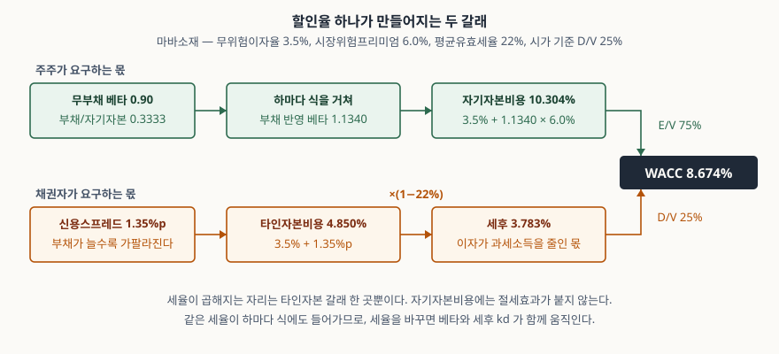
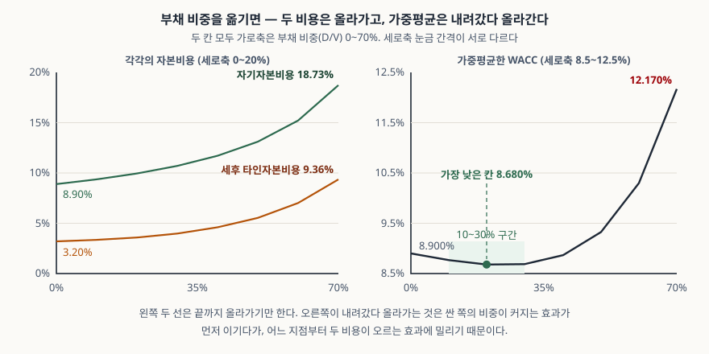

> 예제의 회사 `마바소재`와 그 숫자는 계산 원리를 보이려고 만든 가상 값이다. 실제 기업과 관계가 없다. 무위험이자율·시장위험프리미엄·베타·신용스프레드·세율은 모두 설명용 가정값이고, 부채 비중별 신용스프레드 표는 모양만 가져온 가정표다.

## 들어가며

투자 검토용 엑셀을 받으면 할인율 칸에 8.7% 같은 숫자가 하나 박혀 있고, 그 칸만 노란색으로 칠해져 있는 경우가 많다. 어디서 온 숫자인지는 옆 시트에도 주석에도 없다. 그래서 검토가 "할인율이 좀 높은 것 같다", "그럼 8%로 하자" 수준에서 끝난다. 그런데 이 한 칸은 입력 넷과 가중치 하나에서 만들어진다. 가중치를 시가 대신 장부가로 잡는 것만으로 8.674%가 7.406%가 되고, 같은 현금흐름에서 기업가치가 23.8% 커진다. 숫자를 흥정하는 대신 그 다섯 자리를 하나씩 보는 편이 빠르다.

## 개념

가중평균자본비용(WACC)은 회사에 돈을 댄 두 집단이 각각 요구하는 수익률을, 댄 돈의 비중으로 가중평균한 값이다. 주주는 배당과 주가 상승으로, 채권자는 이자로 받아 간다. 회사 전체가 만들어 내는 현금흐름은 이 둘에게 나눠지므로, 그 현금흐름을 할인할 때 쓰는 비율도 둘을 합친 값이어야 한다.

| 구성 | 산식 | 들어가는 값 |
|---|---|---|
| 자기자본비용 ke | 무위험이자율 + 베타 × 시장위험프리미엄 | 베타는 자본구조에 따라 달라진다 |
| 부채 반영 베타 | 무부채 베타 × [1 + (1 − 세율) × 부채/자기자본] | 빚이 늘면 주주 몫의 변동이 커진다 |
| 타인자본비용 kd | 무위험이자율 + 신용스프레드 | 신용등급·이자보상배율로 정해진다 |
| 세후 타인자본비용 | kd × (1 − 세율) | 이자비용이 과세소득을 줄이는 몫 |
| WACC | (E/V) × ke + (D/V) × kd × (1 − 세율) | 가중치는 **시가** 기준 |

회계기준에도 같은 이름이 나온다. 기업회계기준서 제1036호 자산손상은 사용가치를 구할 때 현행 시장의 평가를 반영하는 세전 할인율을 쓰게 하고(문단 55), 자산 고유의 할인율을 시장에서 직접 구할 수 없으면 대용치로 추정하게 한다(문단 57). 대용치를 드는 항목(문단 56)이 드는 예 가운데 하나가 검토 대상 자산과 비슷한 자산을 보유한 상장기업의 가중평균자본비용이다. 다만 이 기준서가 요구하는 것은 **세전** 할인율이고, 주식가치 평가에서 흔히 쓰는 WACC는 세후 기준이다. 이름이 같다고 그대로 옮겨 쓰면 안 되는 자리다.

## 구조



> **출처**: [기업회계기준서 제1036호 자산손상 — 문단 55 세전 할인율, 문단 56 대용치의 예로 든 가중평균자본비용, 문단 57 대용치 추정](https://accountingwiki.co.kr/standards/1036) (제3자 전재) · [William F. Sharpe, *Capital Asset Prices: A Theory of Market Equilibrium under Conditions of Risk*, Journal of Finance 19(3), 1964, 425–442](https://www.jstor.org/stable/2977928) — 자기자본비용 산식 · [Robert S. Hamada, *The Effect of the Firm's Capital Structure on the Systematic Risk of Common Stocks*, Journal of Finance 27(2), 1972, 435–452](https://econpapers.repec.org/article/blajfinan/v_3a27_3ay_3a1972_3ai_3a2_3ap_3a435-52.htm) — 부채 반영 베타. 수치는 이 글의 [`code/output.txt`](code/output.txt) `[1]`에서 옮겼다.

위 갈래가 주주 몫, 아래 갈래가 채권자 몫이다. 세율이 곱해지는 자리가 아래 갈래 한 곳뿐이라는 것이 눈에 들어와야 한다. 같은 세율이 하마다 식에도 들어가므로, 세율을 바꾸면 베타와 세후 kd가 같이 움직인다.

## 동작 원리

### 베타는 고정된 값이 아니다

자기자본비용은 자본자산가격결정모형(CAPM)으로 만든다. 무위험이자율에 베타와 시장위험프리미엄의 곱을 더한다. 여기서 쓰는 베타는 **지금 자본구조에서의 베타**다. 마바소재의 사업 자체 위험을 나타내는 무부채 베타가 0.90이고 부채/자기자본이 0.3333이면, 하마다 식을 거친 베타는 1.1340이 된다. 빚이 먼저 이자를 가져가므로 남는 몫의 변동이 커지고, 주주가 요구하는 수익률이 8.900%에서 10.304%로 오른다.

비교 기업의 베타를 그대로 가져다 쓰면 그 회사의 부채 비율이 같이 따라온다. 비교 기업 베타를 무부채 베타로 되돌린 뒤 대상 회사의 부채 비율로 다시 올리는 과정이 필요한 이유가 여기 있다.

### 절세효과는 부채 쪽에만 붙는다

이자비용은 과세소득을 줄인다. 배당은 줄이지 않는다. 그래서 타인자본비용에만 (1 − 세율)이 곱해진다. 마바소재의 kd 4.850%는 세후 3.783%가 되고, 세율을 0으로 두면 같은 자본구조의 WACC가 8.674%에서 9.238%로 0.56%p 올라간다. 이 0.56%p가 법인세 제도가 자본구조에 주는 유인이다.

세율에는 명목 최고세율이 아니라 **평균유효세율**을 쓴다. 기업회계기준서 제1012호 법인세는 평균유효세율을 법인세비용(수익)을 회계이익으로 나눈 값으로 정의하고(문단 86), 그 값과 적용세율의 수치 조정을 주석에 쓰도록 한다(문단 81(3)(나)). 세액공제나 비과세 항목이 많은 회사는 둘의 차이가 작지 않으므로, 주석의 이 조정표가 세율 칸의 근거가 된다.

### 가중치를 장부가로 잡으면

WACC의 가중치는 **시가**다. 자기자본은 시가총액, 부채는 부채의 시가다. 재무상태표를 그대로 가져와 자기자본 장부금액을 쓰면, 주가순자산비율이 1을 넘는 회사에서는 자기자본이 과소하게 잡힌다. 마바소재는 시가총액 6,000억에 자기자본 장부금액이 2,500억이라, 부채 비중이 25.0%에서 44.4%로 커진다. 싼 쪽의 비중이 커졌으니 WACC는 8.674%에서 7.406%로 1.27%p 내려간다.

할인율 1.27%p는 작아 보이지만 잔존가치를 통해 증폭된다. 같은 현금흐름을 두 할인율로 각각 할인하면 기업가치가 1,655.7억에서 2,049.7억으로 23.8% 커진다. 할인율이 기업가치를 움직이는 경로는 [현금흐름할인(DCF) — 미래의 돈을 오늘 값으로](../2026-10-03-dcf-discount-rate-sensitivity/index.md)에서 다뤘다.

### 부채를 늘리면 WACC는 계속 내려가는가

세후 타인자본비용이 자기자본비용보다 싸니 부채를 늘릴수록 WACC가 내려갈 것 같다. 실제로는 두 가지가 동시에 일어난다. 싼 쪽의 비중이 커지는 효과가 WACC를 내리고, 부채가 늘어 베타와 신용스프레드가 오르는 효과가 WACC를 올린다.



> **출처**: [Franco Modigliani · Merton H. Miller, *Corporate Income Taxes and the Cost of Capital: A Correction*, American Economic Review 53(3), 1963, 433–443](https://www.jstor.org/stable/1809167) — 법인세가 있을 때 부채의 절세효과 · [Robert S. Hamada, *The Effect of the Firm's Capital Structure on the Systematic Risk of Common Stocks*, Journal of Finance 27(2), 1972, 435–452](https://econpapers.repec.org/article/blajfinan/v_3a27_3ay_3a1972_3ai_3a2_3ap_3a435-52.htm) — 자본구조에 따른 베타 조정. 곡선의 값은 이 글의 [`code/output.txt`](code/output.txt) `[3]`에서 옮겼다. 신용스프레드는 가정표다.

왼쪽 두 선은 끝까지 올라가기만 한다. 오른쪽 WACC가 내려갔다 올라가는 것은 앞의 효과가 먼저 이기다가 어느 지점부터 뒤의 효과에 밀리기 때문이다. 가정한 표에서는 부채 비중 20%에서 8.680%로 가장 낮고, 70%에서는 12.170%까지 올라간다.

중요한 것은 **바닥이 평평하다**는 점이다. 부채 비중 10%·20%·30% 세 칸이 최저값과 0.1%p 안에 들어온다. 그 구간에서는 자본구조를 조금 바꿔 할인율을 유의미하게 낮출 수 없다. 반대로 50%를 넘어가면 기울기가 가팔라져, 같은 10%p를 더 빌릴 때마다 WACC가 1%p 가까이 오른다.

## 실습 예제

시가총액 6,000억, 부채 2,000억, 자기자본 장부금액 2,500억, 무부채 베타 0.90, 무위험이자율 3.5%, 시장위험프리미엄 6.0%, 평균유효세율 22%는 모두 가정이다. 부채 비중별 신용스프레드도 가정표이고, 그 표에서 가져온 것은 값이 아니라 **부채가 늘수록 가팔라진다**는 모양이다.

전체 소스: [`code/`](code/) · 수행 기록: [`code/output.txt`](code/output.txt)

```text
[1] 마바소재 — 기준 WACC 를 만드는 과정 (시가 기준, 단위: 억원)
  시가총액 E 6,000 · 부채 D 2,000 · 합계 V 8,000
  E/V 75.0% · D/V 25.0% · D/E 0.3333
  ① 부채 반영 베타 = 0.9 × [1 + 0.78 × 0.3333] = 1.1340
  ② ke = 3.5% + 1.1340 × 6.0% = 10.304%
  ③ kd = 3.5% + 1.350% = 4.850%  → 세후 3.783%
  ④ WACC = 0.75×10.304% + 0.25×3.783% = 8.674%

[3] 부채 비중을 옮기면 (세율 22%, 무부채 베타 0.9)
     D/V      D/E    베타        ke       kd    세후 kd      WACC
      0%   0.0000   0.900    8.900%    4.10%     3.198%    8.900%
     10%   0.1111   0.978    9.368%    4.30%     3.354%    8.767%
     20%   0.2500   1.076    9.953%    4.60%     3.588%    8.680%
     30%   0.4286   1.201   10.705%    5.10%     3.978%    8.687%
     40%   0.6667   1.368   11.708%    5.90%     4.602%    8.866%
     50%   1.0000   1.602   13.112%    7.10%     5.538%    9.325%
     60%   1.5000   1.953   15.218%    9.00%     7.020%   10.299%
     70%   2.3333   2.538   18.728%   12.00%     9.360%   12.170%
  가장 낮은 칸 D/V 20% → WACC 8.680%
  최저값과 0.1%p 안에 드는 구간: 10%, 20%, 30%

[5] 할인율 차이가 기업가치에 미치는 영향 (1년차 FCF 100억, 5년간 연 5% 성장,
     이후 영구성장 2%. 단위: 억원)
  경우                     할인율    기업가치   기준 대비
  시가 가중 WACC           8.674%     1,655.7        0.0%
  장부가 가중 WACC         7.406%     2,049.7       23.8%
  절세효과를 뺀 WACC       9.238%     1,524.9       -7.9%
  D/V 70% 로 갔을 때      12.170%     1,078.8      -34.8%
```

`[2]` 시가·장부가 가중 비교와 `[4]` 세율 비교는 [`code/output.txt`](code/output.txt)에 있다.

`[3]`에서 ke 열과 kd 열은 위에서 아래로 한 번도 꺾이지 않고 오른다. WACC 열만 8.900 → 8.680 → 12.170으로 내려갔다 올라간다. `[5]`에서 같은 현금흐름을 네 할인율로 할인했더니 기업가치가 1,078.8억에서 2,049.7억까지 나왔다. 할인율 칸 하나를 어떻게 채우느냐가 검토 결과의 거의 전부다.

## 실무에서 주의할 점

- **가중치는 시가로 잡는다.** 재무상태표의 자기자본을 그대로 쓰면 주가순자산비율이 1보다 큰 회사에서 부채 비중이 부풀려지고 WACC가 낮게 나온다. 예제에서 1.27%p 낮아졌고 기업가치는 23.8% 커졌다. 장부가로 잡아야 하는 상황이라면 그 사실을 결과에 함께 적는다.
- **세전·세후를 섞지 않는다.** 기업회계기준서 제1036호는 손상검사용 사용가치에 세전 할인율을 요구한다(문단 55). 주식가치 평가에서 쓰는 WACC는 세후다. 할인하는 현금흐름이 세전인지 세후인지와 짝을 맞추지 않으면 세금을 두 번 빼거나 한 번도 빼지 않게 된다.
- **비교 기업 베타를 그대로 쓰지 않는다.** 가져온 베타에는 그 회사의 부채 비율이 들어 있다. 무부채 베타로 되돌린 뒤 대상 회사의 부채 비율로 다시 올린다. 이 과정을 건너뛰면 사업 위험과 재무 위험이 섞인다.
- **최저점을 목표로 삼지 않는다.** 표에서 WACC가 가장 낮은 칸은 신용스프레드 가정표가 정한 자리다. 스프레드 가정을 완만하게 바꾸면 최저점이 오른쪽으로 옮겨 가고, 가파르게 바꾸면 왼쪽으로 온다. 바닥이 평평하다는 사실이 그 자리를 정확히 맞히는 일을 더 무의미하게 만든다.
- **회사 하나의 WACC를 모든 사업부에 쓰지 않는다.** 제1036호가 대용치로 드는 것은 검토 대상 자산과 **비슷한 자산을 보유한** 기업의 가중평균자본비용이다(문단 56). 위험이 다른 사업부에 전사 WACC를 일괄 적용하면 위험이 낮은 쪽은 저평가되고 높은 쪽은 과대평가된다.

## 정리

- WACC는 주주가 요구하는 수익률과 채권자가 요구하는 수익률을 시가 비중으로 가중평균한 값이다. 입력은 넷, 가중치는 하나다.
- 자기자본비용은 CAPM으로 만들고, 그 베타는 자본구조에 따라 움직인다. 무부채 베타 0.90이 부채/자기자본 0.3333에서 1.1340이 됐다.
- 세율은 타인자본 쪽에만 곱해진다. 절세효과를 빼면 같은 자본구조의 WACC가 0.56%p 오른다. 세율은 평균유효세율을 쓴다.
- 가중치를 장부가로 잡으면 WACC가 1.27%p 내려가고 같은 현금흐름의 기업가치가 23.8% 커진다.
- 부채를 늘려도 WACC는 계속 내려가지 않는다. 예제에서는 부채 비중 20% 부근에서 최저이고, 그 바닥은 10~30%에 걸쳐 평평하다.

## 참고 자료

- [한국회계기준원 — 시행 중인 K-IFRS 기준서 목록](https://www.kasb.or.kr/front/board/ingAccountingList.do) — 기업회계기준서 제1036호 자산손상, 제1012호 법인세 원문 발행처
- [기업회계기준서 제1036호 자산손상 — 문단 55·56·57](https://accountingwiki.co.kr/standards/1036) (제3자 전재)
- [기업회계기준서 제1012호 법인세 — 문단 81(3)(나)·86](https://accountingwiki.co.kr/standards/1012) (제3자 전재)
- [IFRS Foundation — IAS 36 Impairment of Assets](https://www.ifrs.org/issued-standards/list-of-standards/ias-36-impairment-of-assets/) — 할인율 추정 지침 원문
- [William F. Sharpe, *Capital Asset Prices: A Theory of Market Equilibrium under Conditions of Risk*, Journal of Finance 19(3), 1964, 425–442](https://www.jstor.org/stable/2977928) — CAPM 원 논문
- [Franco Modigliani · Merton H. Miller, *Corporate Income Taxes and the Cost of Capital: A Correction*, American Economic Review 53(3), 1963, 433–443](https://www.jstor.org/stable/1809167) — 법인세가 있을 때의 자본비용
- [Robert S. Hamada, *The Effect of the Firm's Capital Structure on the Systematic Risk of Common Stocks*, Journal of Finance 27(2), 1972, 435–452](https://econpapers.repec.org/article/blajfinan/v_3a27_3ay_3a1972_3ai_3a2_3ap_3a435-52.htm) — 부채 반영 베타 산식
